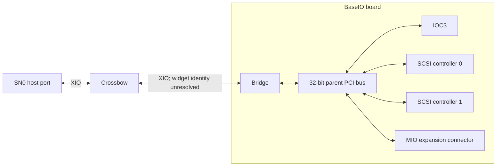
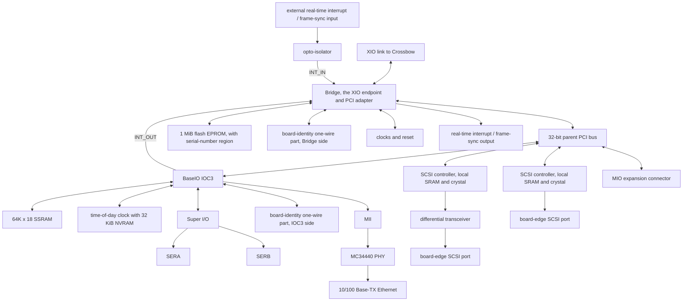
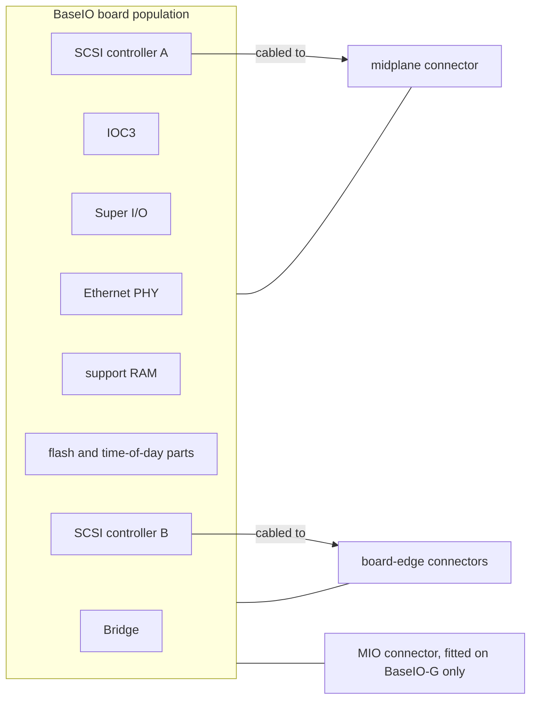
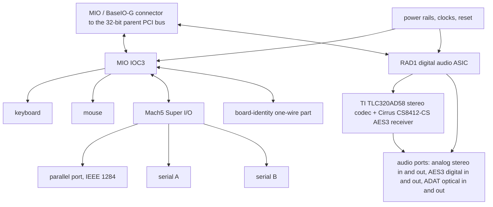

# BaseIO board reference

References rendered as citation identities name material outside this document
set. Those targets are not included or cleared for redistribution. Review and
runtime statements retain their recorded dates and scope.

BaseIO is the standard XIO I/O board for the Origin 2000 and Onyx2. It is a
board assembly, not an ASIC: a Bridge connects the board to Crossbow, and a
32-bit PCI bus connects Bridge to one IOC3 and two SCSI controllers. The board
also carries the support parts and external connections described here.[^theory]

This scope boundary matters. The Origin 200 has an integrated IP29 System
Board, not an Origin 2000 BaseIO card. Shared Bridge and IOC3 behavior can be
described once in their component references, but this board's population,
wiring, identities, and interrupt paths must not be transferred to the Origin
200.

## System position and board composition

The diagram is an original redrawing of the relationships published in SGI's
logical-location and board block diagrams. It records connectivity, not physical
placement, address assignment, or a PCI enumeration order.[^theory]



Crossbow sees Bridge as the board's XIO endpoint. IOC3 and both SCSI
controllers are PCI children of Bridge, not independent crosstalk widgets.
Figure 2-24 calls Bridge a PCI adapter and shows the two SCSI controllers,
IOC3, serial function, and optional MIO connection behind it. Figure 2-25 makes
the 32-bit parent PCI bus explicit.[^theory]

The standard board provides one 10/100 Base-TX Ethernet link, two independent
460-Kbaud serial ports, one external single-ended wide SCSI port, one internal
Fast-20 SCSI port, a real-time interrupt input and frame-sync output, flash,
non-volatile RAM, and a time-of-day clock.[^theory] The source does
not identify either SCSI controller's ASIC or assign a controller to a PCI
device number, so this reference keeps them neutral as controller 0 and
controller 1.

## IOC3 and Super I/O are separate parts

IOC3 is the PCI endpoint. Super I/O is a separate board component connected to
IOC3, and the SERA and SERB signals leave the Super I/O component. The compact
logical diagram labels this pair as IOC3 and Serial. The detailed board diagram
shows the physical division: IOC3 owns the PCI-facing function while Super I/O
drives the two serial connections.[^theory]

That distinction prevents two common modelling errors. Super I/O is not a
fourth PCI endpoint, and the serial connectors do not attach directly to the
IOC3 package. The [IOC3 component reference](ioc3.md) owns the register and DMA
contracts. BaseIO owns the fact that this external Super I/O part is present and
wired to SERA and SERB.

## Board-local support and identity paths

Figure 2-25 places these parts around the main devices:[^theory]

| Owner or path | Board population and connection |
|---|---|
| IOC3 | 64K by 18 SSRAM, a time-of-day clock with 32 KiB NVRAM, Super I/O, a board-identity NIC labelled NIC, and MII to an MC34440 PHY, then 10/100 Base-TX Ethernet |
| Bridge | a separate NIC labelled NIC, a 1 MiB flash EPROM with a serial-number region, clocks, and reset |
| Parent PCI bus | two SCSI controllers, each with local SRAM and a crystal, one differential-transceiver path, and an MIO expansion connector |
| Board edge | Ethernet, SERA, SERB, SCSI0, SCSI1, real-time interrupt input and output, and frame sync |

The two NIC blocks are distinct identity paths. One is attached to Bridge and
one to IOC3. The figure does not identify their device families, stored data,
or wire protocol, so those details cannot be inferred from this board drawing.
The flash serial-number region is a third, separately drawn identity-bearing
part of the Bridge side. It must not be collapsed into either NIC.

The support memories are also separate. The 64K by 18 SSRAM and the
time-of-day/32 KiB NVRAM attach to IOC3. The 1 MiB flash EPROM attaches on the
Bridge side. Their placement is a BaseIO wiring fact, not a general rule for
every board that contains Bridge or IOC3.

## Board block diagram, redrawn from Figure 2-25

The diagram below is an original redrawing of the connectivity in SGI's BaseIO
board block diagram. It records which part connects to which bus or signal, not
placement, address assignment, or PCI enumeration order.[^theory]



The two one-wire identity parts sit on different buses: one on IOC3, one on
Bridge. The flash serial-number region is a third, separately drawn
identity-bearing part. One SCSI controller reaches its board-edge port through a
differential transceiver; the other reaches its port directly. The figure does
not number the PCI devices or name the SCSI controller parts, so this drawing
does not either.[^theory]

## Board physical arrangement, redrawn from Figure 2-26

Figure 2-26 is SGI's physical layout of the board. The redrawing below keeps only
its connectivity and connector-destination facts, which part cables to which
connector and which connectors the BaseIO-G variant adds. It does not reproduce
where parts sit on the board.[^theory]



Figure 2-26 shows one SCSI controller cabled to the midplane connector and the
other cabled to a board-edge connector, and it draws the MIO connector on the
BaseIO-G variant. The figure does not name the SCSI parts, so the labels here
stay generic.[^theory] The physical board carries the parts this figure names:
the IOC3 is marked LSI L2A0366 / SGI 099-0126-003 rev C, the time-of-day part is
an ST M48T35Y Timekeeper NVRAM, and the 1 MiB flash is an AMD AM29LV800B.[^photos]

## Interrupt and real-time paths

BaseIO adds board-specific paths around the generic Bridge and IOC3 interrupt
controllers:[^theory]

- IOC3's `INT_OUT` reaches Bridge directly.
- The external frame-sync/real-time interrupt input reaches Bridge's `INT_IN`
  through an opto-isolator.
- Bridge drives the separate real-time interrupt output at the board edge.

The IOC3's real-time output source is also a local interrupt source. A one-pulse
strobe posts IOC3 SuperIO status bit 27 on the outgoing rising edge, independently
of the external input. An on-board IOC3 presents its SuperIO sources on PCI
interrupt pin D. The reviewed evidence does not identify the numbered Bridge
input to which standard BaseIO wires that pin. Once the signal reaches Bridge,
Bridge delivers it to the Hub and CPU selected by its programmed interrupt
destination. The outgoing signal still follows the board path to the real-time
output connector.

The external return is a distinct source. The BaseIO opto-isolator makes the
incoming pulse visible on its falling edge, one 23.4-microsecond pulse width after
the local rising-edge event when a cable loops output to input. Internal-only
operation therefore enables the IOC3 output-pulse source and disables the
external-input source.

IRIX creates an `ei` child below the IOC3's PCI vertex when real-time support is
enabled. Standard BaseIO enumerates IOC3 at PCI device 2, so the complete device
path is `/hw/module/<module>/slot/io1/baseio/pci/2/ei`. `olrti -vertex` takes the
parent path ending in `/pci/2` and appends `/ei`. The interface adjacent to the
system console also has the stable alias `/hw/external_int/1`.

The [IOC3 component reference](ioc3.md) owns the register, acknowledgement,
reset, migration, and pulse-timing contract. The [Bridge component
reference](bridge.md) owns Bridge interrupt aggregation and crosstalk delivery.

## BaseIO-G and MediaIO boundary

Standard BaseIO exposes an MIO expansion connection. A MediaIO daughterboard is
fitted only to the modified BaseIO-G board. MediaIO adds a second IOC3, a Mach5
Super I/O, a RAD audio ASIC, parallel and additional serial ports, keyboard and
mouse connections, and audio interfaces.[^theory] Those devices are not part
of standard BaseIO and must not appear in its inventory merely because Figure
2-24 shows the optional MIO position.

The diagram below is an original redrawing of the connectivity in SGI's MIO board
block diagram. As before it records connections, not placement or numbering.[^theory]



Figure 2-27 draws the MIO IOC3 fronting the Mach5 Super I/O, the same way the
BaseIO IOC3 fronts its own Super I/O. The keyboard and mouse leave the IOC3; the
parallel port and the two serial ports leave the Mach5. The RAD ASIC sits on the
PCI bus and carries the audio ports, and SGI's text attributes the majority of
the audio functions to the RAD.[^theory] Our own [IOC3 reference](ioc3.md)
records the matching board identity: the MIO IOC3 answers `0xc301`, carrying two
serial ports and PS/2 with no Ethernet or clock of its own.

The base board itself, distinct from the MediaIO daughtercard, carries its own
SGI assembly number: a real owner's `hinv` output for a populated io6g system
reports base board `030-0734-002` revision N.[^hinv] A community SGI
parts-catalogue also documents `030-0734-001` as an io6g BaseIO base-board
revision,[^pca] so `-002` is a second directly observed revision, not a
correction of an error.

The same owner's `hinv -v` gives the PCI placement of every function on the
board's Bridge, in two separate listings from the same machine.[^hinv] Its
`PCI Adapter ID` lines report vendor and device in decimal: the two SCSI
controllers (vendor 4215, device 4128, which is `0x1077:0x1020`, the QLogic
ISP10x0 family) at PCI slots 0 and 1; IOC3s (vendor 4265, device 3, which is
`0x10a9:0x0003`) at slots 2 and 6; and the RAD1 audio ASIC (vendor 4265, device
5, which is `0x10a9:0x0005`) at **slot 7**. The second listing covers only this
board's Bridge, and it shows nothing else. So on a real BaseIO-G, RAD1 sits at
Bridge PCI device 7. This is established, from a first-hand owner inventory. An
earlier model placed RAD1 at device 5 as an unsourced choice; device 5 is wrong.
The same listing shows no PCI function at slot 4. Whether the board IOC3's
second enumeration at device 4 in the model corresponds to anything IRIX would
list as an adapter is not settled by this listing, and belongs to the
[IOC3 reference](ioc3.md).

The physical MediaIO board is SGI assembly 030-0880-003, observed at rev F on one
photographed unit and rev E on a second, independently photographed unit.[^photos]
It carries two large square ASICs beside each other: one is the MIO IOC3 (marked
LSI L2A0366 / 099-0126-003), and the second is an LSI/SGI part whose top marking
reads RAD1 REV B / SGI 1996 / made in Korea on the first photographed unit, and,
at higher resolution on the second, LSI L2A0470 RAD1 REV B / SGI 099-0142-002 /
made in Korea — the same chip, with the LSI and SGI part numbers legible only on
the second unit's photographs. That RAD1 is the physical realisation of the "RAD
audio ASIC" SGI's text names, so the digital half of the audio path is now
confirmed present, not merely documented. A **prior revision of this document
misidentified the board's analog codec as a Cirrus Logic CS4297 AC'97 part**; a
second, higher-resolution photograph of the audio chip cluster reads no CS4297
anywhere, and instead shows a Cirrus Logic CS8412-CS AES3/S-PDIF digital receiver,
a Texas Instruments TLC320AD58 stereo analog codec, and at least one Cirrus Logic
CS3310-KS digital-controlled volume/attenuator, each with a directly legible top
marking.[^photos] The CS4297 identification is retracted; RAD1's digital output
does not feed an AC-97 codec on this board. What remains open is the exact
division of the AES3 and ADAT digital paths among RAD1, the CS8412 and the
TLC320AD58, and whether the board carries a matched pair of Analog Devices
SSM2142 balanced line drivers as claimed by one source but not located in either
photographed set; the photographs available do not resolve either question. The
photographs carry no legible Mach5 marking, so they neither confirm nor deny that
part; the Mach5 rests on Figure 2-27 alone.

## How IRIX enables each IOC3's functions

A single IOC3 always contains Ethernet, two UARTs, a keyboard/mouse controller, a
parallel-port context, and a one-wire master. Which of those a given IOC3 brings
up is not fixed in the chip; IRIX 6.5.30 decides it per IOC3.

### What a live boot establishes

A boot of IRIX 6.5.30m on the modeled Origin 2000 with the reviewed io6g preset
settles the outcome directly.[^liveboot] The preset builds the board IOC3 at PCI
device 2 (also enumerating at device 4, its own MediaIO-style dual connection)
and a second IOC3 at PCI device 6, identity `0xc301`, backed by the MediaIO
daughtercard's own Bridge one-wire board-part record (`030-0880-003`). IRIX
enumerated both and brought up a keyboard, a mouse, and two serial ports on
each: `hinv` shows four serial ports (tty1-tty4) and a parallel port (plp2),
and the hardware graph carries `pckb`/`pcms` character-device nodes under both
`.../io1/______________/pci/4` (board IOC3) and `.../pci/6` (MediaIO IOC3), each
with its own `tty/1` and `tty/2`. Device 6 carries no `ef` (Ethernet) node and no
Ethernet-attach message appears anywhere in the transcript; `ef0` at PCI device 2
remains the machine's only Ethernet interface. The machine reached a multiuser
login.

That `plp2` numbering is a guest disk-state artifact, not a hardware
numbering fact: the golden disk's `/etc/ioconfig.conf` carries a stale
parallel entry from a prior Origin 200 install, at a hardware-graph path
that no longer exists on this board, and that stale entry holds parallel
unit 1, pushing the one live MIO parallel port to unit 2. A fresh disk
with no prior `ioconfig` history numbers the single parallel port `plp1`.
The mechanism is recorded in the
parallel-port numbering research (citation: `docs/research/irix-ioc3-parallel-plp-numbering.md`),
and a later boot on the model observed it directly.[^plpboot] Deleting only the
stale line still gave `plp2`, because the first boot had already recorded the live
port as unit 2 and IRIX keeps a unit it has recorded. With every parallel line
deleted, the port came back as `plp1`. The owner's inventory also shows `plp1` on
a real io6g,[^hinv] but that machine carries MENET cards as well, so it is not a
clean comparison. The owner's second listing, taken with the MENET and Fibre
Channel boards removed, still shows `plp1`,[^hinv] so the extra boards are not
the likely difference. That machine's earlier `ioconfig` history is unknown,
which keeps the comparison imperfect.

Two things are therefore settled by observation, not inference: IRIX applies its
per-IOC3 subdevice enablement to a second IOC3 at PCI device 6 -- it is not
hardcoded to device 2 -- and on that device-6 IOC3 it brings up the keyboard, the
mouse, and both MIO serial ports, while correctly leaving Ethernet off. Only
which back-panel connector maps to which chip stays unresolved.

### The enable mechanism, read from disassembly

Disassembly of the IRIX kernel reads the per-IOC3 decision as an eight-byte
"subdevice-enable" word attached to the IOC3's PCI slot: each function attaches
only when its bit is set, and an absent word defaults to all-ones so every
function comes up.[^disasm] The bits the attach path reads are:

| Bit | Function it enables |
|---|---|
| 0 | Ethernet |
| 3 | PS/2 keyboard and mouse together, one bit for both |
| 4 | serial A |
| 5 | serial B |
| 7 | real-time / external interrupt |

No attach routine tests bits 1, 2, or 6 on its own. The check for whether the
IOC3 needs its interrupt tests the word against `0xfa`, which is bits 1 and 3
through 7, so bits 0 and 2 are outside it. A slot with no word counts as needing
the interrupt. Bit 6 is set only in the MediaIO value and is an
unconfirmed parallel-port candidate. The disassembly reads the
word as selected by board identity from the Bridge one-wire part: `0xbf` for
standard BaseIO at device 2 (`0xb7` without the keyboard/mouse option), and `0x7a`
for the MediaIO IOC3 at device 6 when the one-wire identity carries the 030-0880
part number. A live boot on the io6g model measured both values and the bit
assignment:[^enableword] IRIX writes `0xbf` for device 2 and `0x7a` for device 6,
and its attach routines test bit 0 for Ethernet, bit 3 for keyboard and mouse,
bits 4 and 5 for the serial ports and bit 7 for the real-time interrupt. That
measures what IRIX does on our model. The word is kernel memory, not a register,
and its value follows from the one-wire records the model supplies, so nothing
here is a measurement of the silicon.

### An earlier, unreviewed population contradicted the prediction; the MediaIO board-part record resolves it

The `0x7a` reading predicts Ethernet stays off on device 6 (bit 0 clear). An
earlier, unreviewed model of this board gave the device-6 IOC3 the `0xc301`
identity (serials and keyboard/mouse, no Ethernet or clock) without a Bridge
one-wire board-part record of its own. Without that record, IRIX's one-wire
dispatch fell back to a default population that turned Ethernet on for a chip
that was never wired to one: IRIX still ran the Ethernet and one-wire-MAC attach
against PCI device 6, which failed at IOC3 reset ("No presence pulse from NIC",
"ef-1: IOC3 reset timed out") and produced no second Ethernet interface, but the
failure was IRIX's own attach attempt reaching the device, not a suppression by
an enable word.

The reviewed io6g preset (`hw/mips/sgi/baseio.c`) fixes this by giving the
MediaIO daughtercard its own Bridge one-wire board-part record
(`030-0880-003`), distinct from the primary board's, so a one-wire search can
tell the two apart. With that record present, the `0x7a` prediction is borne
out: the archived io6g boot[^liveboot] shows no Ethernet-attach attempt and no
IOC3-reset failure message anywhere against device 6, and no `ef` device node
under its hardware-graph entry. The enable-word measurement[^enableword] shows
the mechanism on the model: the MediaIO record selects `0x7a`, and the Ethernet
attach reads bit 0 as clear for device 6 and returns. What decides whether
device 6 gets an Ethernet attach attempt is therefore the one-wire board-part
record's presence, acting through the enable word. That real 030-0880 hardware
takes the same route is inferred, not measured: the owner's real `hinv` lists
the same `030-0880-003` record, and the routine that handles that record writes
`0x7a` without any further test. The inference also assumes that a real board
does not take the IOC3 attach routine's own override, which writes `0x91` when
the IOC3's hardware-graph name contains a particular string. That string was not
resolved, and the override did not fire on the model.
This enable word is a separate layer from the
IOC3 board-identity type code the [IOC3 reference](ioc3.md) records (`0xc301`
for the MIO IOC3; the BaseIO IOC3's own word is not observed and is carried as
the `0xffff` placeholder, with `0xc302` the plain-BaseIO driver-dispatch
value).

## Board-identity records on the Bridge one-wire bus

A real BaseIO-G reports two board-identity records at its Bridge's location. The
owner's `hinv -vm`[^hinv] prints:

```text
Location: /hw/module/1/slot/io1/baseio
   MIO Board: barcode JKV745     part 030-0880-003 rev  G
   BASEIO Board: barcode HSE188     part 030-0734-002 rev  N
```

That listing is the acceptance target for this section, apart from the barcodes.
Our model already carries one DS2505-class record per board on the Bridge line,
but in a text layout that IRIX misreads. IRIX 6.5.30 on the io6g preset prints
`Location: /hw/module/1/slot/io1/______________` and, for each board,
`.............. Board: barcode ?Part?     part 030-0734-002?  rev ....`.[^namingboot]
[The Bridge datasheet](bridge.md#the-page-is-a-fixed-offset-binary-record-and-the-fieldvalue-string-is-formatted-from-it)
explains why and gives the record layout with its evidence. This section applies
that layout to the two BaseIO-G records and to the plain BaseIO's one.

Both records are read at the Bridge's location, which is observed in the
owner's listing. That the MediaIO record is a second part on the Bridge's own
wire is inferred from IRIX's behavior on our model. Figure 2-27 draws the
MediaIO's identity part beside the MIO IOC3,[^theory] and no held source shows
its wiring.

### What each record holds

| Bytes | Field | BaseIO record | MediaIO record | Grade |
|---|---|---|---|---|
| 0 | format | `0x01` | `0x01` | as graded in the Bridge datasheet: inferred for Bridge records from the I/O-controller and Hub records |
| 1-10 | barcode | `OBASEIO001` | `OMIO000001` | **placeholders.** The real unit's `HSE188` and `JKV745` are per-unit values and are not copied |
| 11-29 | part, first part | ten spaces, `030-0734-` | ten spaces, `030-0880-` | real part numbers from the owner's listing; the layout is established |
| 30-31 | check value | `c7 85` | `fe 4d` | computed |
| 32-37 | part, dash number | three spaces, `002` | three spaces, `003` | as above; the three spaces are inferred |
| 38-41 | revision | `N`, three spaces | `G`, three spaces | the owner's product revisions, which are board revisions rather than per-unit values; left alignment is a choice (see open questions) |
| 42-47 | group, capability, variety | `0xff` ×6 | `0xff` ×6 | inferred for Bridge records, as graded in the Bridge datasheet |
| 48-61 | name | `BASEIO`, eight spaces | `MIO`, eleven spaces | names from the owner's listing; space padding inferred, left alignment a choice |
| 62-63 | check value | `33 bb` | `c9 3b` | computed |

The exact images, page 0 then page 1 of each record:

```text
BaseIO
01 4f 42 41 53 45 49 4f 30 30 31 20 20 20 20 20 20 20 20 20 20 30 33 30 2d 30 37 33 34 2d c7 85
20 20 20 30 30 32 4e 20 20 20 ff ff ff ff ff ff 42 41 53 45 49 4f 20 20 20 20 20 20 20 20 33 bb

MediaIO
01 4f 4d 49 4f 30 30 30 30 30 31 20 20 20 20 20 20 20 20 20 20 30 33 30 2d 30 38 38 30 2d fe 4d
20 20 20 30 30 33 47 20 20 20 ff ff ff ff ff ff 4d 49 4f 20 20 20 20 20 20 20 20 20 20 20 c9 3b
```

Each check value is the ones' complement of CRC-16 (reflected polynomial
`0xa001`, initial value 0) over the page's first thirty bytes, stored low byte
first. The routine reproduces the reviewed Hub design's published page (`f9 27`),
and each full page leaves the residue `0xb001` that Linux checks. Linux assembles
`030-0734-002` and `030-0880-003` from these pages, and both match its BaseIO-G
prefixes. Both pages also pass OpenBSD's record checks, although OpenBSD reads
such records only on the I/O controller's bus and never on the Bridge's. The DS2505 transfer framing
the model already sends around each page is separate from these stored values.
Memory beyond byte 63 stays at `0xff`.

### The plain BaseIO's record

A plain BaseIO carries one record, for the base board alone. An owner's
Origin 2000 `hinv -m`, posted to comp.sys.sgi.hardware, prints:[^io6hinv]

```text
          BASEIO Board: barcode GTM039     part 030-1124-002 rev  J
```

| Bytes | Field | Value | Grade |
|---|---|---|---|
| 0 | format | `0x01` | as for the BaseIO-G records |
| 1-10 | barcode | `OBASEIO002` | **placeholder.** The owner's `GTM039` is a per-unit value and is not copied |
| 11-29 | part, first part | ten spaces, `030-1124-` | the owner's listing; Linux's table also maps `030-1124-` to its plain-BaseIO setup |
| 30-31 | check value | `ef 3e` | computed |
| 32-37 | part, dash number | three spaces, `002` | as above |
| 38-41 | revision | `J`, three spaces | the owner's listing, a board revision rather than a per-unit value; left alignment as for BaseIO-G |
| 42-47 | group, capability, variety | `0xff` ×6 | as for the BaseIO-G records |
| 48-61 | name | `BASEIO`, eight spaces | the owner's listing |
| 62-63 | check value | `41 6e` | computed |

```text
BaseIO (plain)
01 4f 42 41 53 45 49 4f 30 30 32 20 20 20 20 20 20 20 20 20 20 30 33 30 2d 31 31 32 34 2d ef 3e
20 20 20 30 30 32 4a 20 20 20 ff ff ff ff ff ff 42 41 53 45 49 4f 20 20 20 20 20 20 20 20 41 6e
```

The check values are computed as for the BaseIO-G records, and each page
leaves the residue `0xb001`. The same routine reproduces the BaseIO-G images
above byte for byte. The placeholder barcode differs from BaseIO-G's
`OBASEIO001`, so the two presets' records can be told apart.

**Model state.** QEMU `sgi-origami` stores the fixed-offset record above for
the plain BaseIO (jamesb/qemu#813). The live check below ran that pull request's
branch before it landed, at a revision whose record change is the same patch.

The name matters beyond the inventory line. In the IRIX 6.5.30 IP27 kernel,
the NVRAM write routines look the Timekeeper up by a hardware-graph path
containing the slot name,
`module/<M>/slot/io1/baseio/pci/2/ioc3`, with `.../slot/io1/MotherBoard/...`
as the fallback, and skips a module whose lookup fails.[^nvramdisasm] The
`nvram` command writes through it, and so does the clock-write routine's
leap-cycle marker update at NVRAM offset `0x3883`. Reads use a base address
saved at boot and do not depend on the lookup. With the text-layout record,
IRIX named the plain BaseIO's slot `______________`, and on the model both
writes were skipped:

- `nvram volume 55` printed 55 afterwards, reported success and wrote nothing
  to the Timekeeper; after a reset the Command Monitor still showed the old
  value (run `irix-20260924T174504-2ff999`, 2026-09-24);
- `date 0101120030` rewrote the clock cells but not the marker, so the next
  boot warned that the clock had gained two days and read the date one day
  early (run `irix-20260924T182704-b663e3`, 2026-09-24).

BaseIO-G, with its fixed-offset record and slot name `baseio`, kept an
`nvram` setting across a reset (run `irix-20260924T174522-980dcc`), and its
clock write included the marker (run `irix-20260924T181131-e50685`). With the pending record, the plain BaseIO
lists `/hw/module/1/slot/io1/baseio` and an `nvram volume` setting survives a
reset (boot log `irix.boot.2026-09-25T00:50:01-07:00`, archived in the
boot-log pull request that waits on the QEMU change). That a real plain BaseIO names its slot
`baseio`, and so reaches its Timekeeper, is inferred from the name rule under
"What IRIX prints from them" below. No real machine was measured.

### What IRIX prints from them

- **The board line.** `hinv -mv` prints the name right-aligned in sixteen
  columns, then `Board: barcode`, the barcode left-aligned in ten, `part`, the
  part and `rev` with the revision. The field-to-column mapping is established
  by comparing our model's output with the owner's listing. The column widths
  are inferred from about ten real lines and the model's own Hub-side records.
  With the fixed-offset records, IRIX 6.5.30 on the model prints both lines,
  with the name padded to sixteen columns, under
  `Location: /hw/module/1/slot/io1/baseio`:[^boardlines]

  ```text
            BASEIO Board: barcode OBASEIO001 part 030-0734-002 rev  N
               MIO Board: barcode OMIO000001 part 030-0880-003 rev  G
  ```

  The model lists BASEIO first. Every listing in the owner's thread lists MIO
  first.[^hinv] This is model evidence about IRIX's output, not a hardware
  measurement; open question 2 below records what it leaves open.

- **The slot name.** Inferred: the hardware-graph name under the slot is the
  board record's name in lower case. Real Bridge-based boards show `menet` for
  MENET, `mscsi` for MSCSI, `fibre_channel` for FIBRE_CHANNEL and
  `xbox_dualxtown` for XBOX_DUALXTOWN, and the owner's BaseIO-G shows `baseio`
  for BASEIO.[^hinv][^o200hinv] Our model's fourteen-byte empty name produced
  fourteen underscores even though IRIX recognised the board as a BaseIO, so the
  name comes from the record rather than from the board type. The graphics
  board `mgras` (record name MOT10), the Origin 200's `MotherBoard` and the
  node and router slots (`node`, `router`) do not follow the rule. They reach the inventory by other paths and do not bear on
  this one.

### Open questions and how each is settled

1. **Which record names the slot.** The owner's listing prints the MediaIO
   record first, yet the slot is `baseio`. So the name comes either from the
   record whose part number identified the board, or from some rule other than
   "first record read". To settle it, boot with both records and run
   `ls /hw/module/1/slot/io1`. Then swap the two names in a scratch build: if
   the slot follows the BaseIO part number, the name comes from the identified
   record. If both boots fail to give `baseio`, the smallest disassembly
   question is: in IRIX 6.5.30's attach path for a Bridge-based board, which
   record's name becomes the slot name when the string holds two records, and
   is it lower-cased there? On the model, with both records, the slot is
   `baseio`, matching the owner's listing,[^boardlines] but the model lists
   BASEIO first, so these boots do not separate the two readings.
2. **Listing order.** Inferred: records are listed in the order the one-wire
   search finds them. The standard Dallas search takes the zero branch first at
   the lowest differing bit of the two ROM numbers. The MediaIO part's ROM number
   should therefore have a zero at the lowest bit where the two differ. Settled
   by `hinv -mv` showing MIO before BASEIO. The model does not: its `hinv -mv`
   lists BASEIO before MIO, the reverse of the owner's listing.[^boardlines] So
   either the model's ROM numbers do not reproduce the real ordering, or the
   order comes from something other than the search. The question stays open.
3. **Revision alignment and padding.** Only the Hub design places the revision
   at bytes 38-41, and no held source shows how a one-letter revision sits in
   four bytes. Left alignment with space padding is the proposal. Settled by
   `hinv -mvvv` showing `Revision:N;` with no spaces, and `hinv -mv` showing
   `rev  N` as in the owner's listing. The model shows both: `hinv -mvvv` prints
   `Revision:N;` and `Revision:G;` with no spaces, and `hinv -mv` prints
   `rev  N` and `rev  G`.[^boardlines] That confirms the proposal produces the
   owner's output, not that it is the real byte layout. A raw page dump from any
   real SGI board would settle it outright. We hold none.
4. **Regression.** After the change, IRIX must still type the MediaIO IOC3 as
   before: no Ethernet attach against PCI device 6, and `pckb` and `pcms` under
   both IOC3s. Linux must still reach its BaseIO-G setup.

## External ports and the chip that drives each

This table names, for every external port and function of the combined BaseIO-G
and MediaIO assembly, the chip that provides it and the evidence for it. A single
IOC3 already contains Ethernet, two UARTs, a PS/2 keyboard and mouse controller, a
parallel-port context, and a one-wire master, so which IOC3 carries a given
function is a wiring fact, not a capability question. Where the sources do not fix
which of the two connectors of a kind maps to which chip, the row says so.

| Port or function | Board | Chip that drives it | Evidence | Status |
|---|---|---|---|---|
| 10/100 Base-TX Ethernet, RJ45 | BaseIO | BaseIO IOC3 Ethernet, through an MII link to an MC34440 PHY | Fig 2-25;[^theory] BaseIO IOC3 at device 2, subsystem word not observed (`0xffff` placeholder; `0xc302` is the plain-BaseIO driver-dispatch value), [IOC3 reference](ioc3.md); board photo, IOC3 marked LSI L2A0366[^photos] | physical-confirmed |
| Serial port, one of the two BaseIO ports | BaseIO | BaseIO IOC3 UART, out through the BaseIO Super I/O as SERA | Fig 2-25[^theory] | which back-panel connector carries it is documentary-unresolved |
| Serial port, the other BaseIO port | BaseIO | BaseIO IOC3 UART, out through the BaseIO Super I/O as SERB | Fig 2-25[^theory] | back-panel assignment documentary-unresolved |
| Serial port, one of the two MIO ports | MIO | MIO IOC3 UART, out through the MIO Mach5 Super I/O as serial A | Fig 2-27;[^theory] IOC3 identity `0xc301`, [IOC3 reference](ioc3.md); IRIX brings it up on the device-6 IOC3[^liveboot] | IRIX 6.5.30 enables it (tty3/tty4 in a live boot); which back-panel connector carries it is documentary-unresolved |
| Serial port, the other MIO port | MIO | MIO IOC3 UART, out through the MIO Mach5 Super I/O as serial B | Fig 2-27;[^theory] IOC3 identity `0xc301`; IRIX brings it up on the device-6 IOC3[^liveboot] | IRIX 6.5.30 enables it (tty3/tty4 in a live boot); back-panel assignment documentary-unresolved |
| PS/2 keyboard, two six-pin mini-DIN connectors | BaseIO-G panel | one on the MIO IOC3 (device 6); the model puts the other on the board IOC3 (device 2/4) | two keyboard connectors, primary on the right (Figure 4-11, printed page 62);[^onyx2guide] the MediaIO adds one keyboard port and standard BaseIO lists none;[^theory] `0xc301` (MIO IOC3), [IOC3 reference](ioc3.md); IRIX brings up a `pckb` node under both IOC3s in the model;[^liveboot] board photo shows two keyboard connectors[^photos] | two connectors: established. One on the MIO IOC3: established. Both connectors working as separate IRIX inputs on real hardware: established for at least one assembly. An owner of a three-pipe rack Onyx2 ran three keyboards as separate X server inputs from two assemblies, so at least one assembly ran both its pairs; its two assemblies gave hardware-graph nodes `/hw/input` through `/hw/input3`. The same owner's attempt to use all four pairs failed, with keyboards and mice crossing between ports.[^usenetkbd] The second on the board IOC3: inferred. Each IOC3 has one keyboard controller, the MediaIO adds only one keyboard port, and 007-3439-002's no-PS/2 list describes standard BaseIO, not BaseIO-G. The IRIX 6.5.30 kernel[^disasm] and Linux both enable keyboard and mouse on the device-2 IOC3 of a `030-0734` board; OpenBSD does not, but it treats BaseIO-G as standard BaseIO.[^ps2drivers] The primary connector on the board IOC3: inferred from panel placement only. The primary pair sits in the base board's half of the panel, beside tty_1 (Console), tty_2, Ethernet and external SCSI. The other pair sits in the MediaIO half, beside tty_3, tty_4 and the audio jacks.[^photos] No source traces a connector to a chip. `ls -l /hw/input*` on a real io6g with one keyboard in the primary port would settle it |
| PS/2 mouse, two six-pin mini-DIN connectors | BaseIO-G panel | one on the MIO IOC3 (device 6); the model puts the other on the board IOC3 (device 2/4) | two mouse connectors, primary on the right (Figure 4-11, printed page 62);[^onyx2guide] the MediaIO adds one mouse port and standard BaseIO lists none;[^theory] IRIX brings up a `pcms` node under both IOC3s in the model;[^liveboot] board photo shows two mouse connectors[^photos] | as for the keyboard: two connectors and one on the MIO IOC3 established; both working as separate inputs established for at least one assembly; the second on the board IOC3 inferred; the primary connector on the board IOC3 inferred from panel placement only |
| Parallel port, 36-pin IEEE 1284-C connector | MIO | MIO IOC3 parallel context, out through the MIO Mach5 Super I/O | Fig 2-27;[^theory] 36-pin IEEE 1284-C connector on the IO6G panel;[^onyx2guide] IOC3 parallel register block, [IOC3 reference](ioc3.md); board photo shows a 36-pin half-pitch connector above the SCSI connector[^photos] | brought out on the panel: established. The connector is IEEE 1284-C, not DB25 |
| Audio: analog stereo in | MIO | RAD1 digital audio ASIC feeding a TI TLC320AD58 stereo codec | Fig 2-27 and text;[^theory] board photo shows RAD1 and TLC320AD58[^photos] | RAD1 and codec both physical-confirmed; internal AES3/ADAT routing between them unresolved |
| Audio: analog stereo out | MIO | TI TLC320AD58 stereo codec, driven by RAD1; a Cirrus CS3310-KS digital volume control and, unconfirmed, a pair of AD SSM2142 balanced line drivers are populated in the same audio section, exact signal-chain order not traced | Fig 2-27 and text;[^theory] board photo[^photos] | RAD1, TLC320AD58 and at least one CS3310-KS physical-confirmed; SSM2142 not located in either photographed set, relayed claim only |
| Audio: AES3 digital in, 75-ohm BNC | MIO | RAD1 digital audio ASIC, fed by a Cirrus CS8412-CS AES3/S-PDIF receiver | Fig 2-27 and text;[^theory] BNC connector type and "Digital" panel label;[^onyx2guide] board photo[^photos] | RAD1 and CS8412-CS both physical-confirmed; RAD1-versus-CS8412 functional split unresolved |
| Audio: AES3 digital out, 75-ohm BNC | MIO | RAD1 digital audio ASIC | Fig 2-27 and text;[^theory] BNC connector type and "Digital" panel label;[^onyx2guide] board photo[^photos] | RAD1 physical-confirmed; split unresolved |
| Audio: ADAT optical in | MIO | RAD1 digital audio ASIC | Fig 2-27 and text;[^theory] board photo[^photos] | RAD1 physical-confirmed; ADAT-versus-support-logic split unresolved |
| Audio: ADAT optical out | MIO | RAD1 digital audio ASIC | Fig 2-27 and text;[^theory] board photo[^photos] | RAD1 physical-confirmed; split unresolved |
| External wide single-ended SCSI, 68-pin | BaseIO | one of the two BaseIO SCSI controllers, its path through a differential transceiver | Fig 2-25 and 2-26;[^theory] 68-pin connector on the panel[^photos] | controller part and PCI device number unresolved |
| Internal Fast-20 SCSI | BaseIO | the other BaseIO SCSI controller | Fig 2-25 and 2-26[^theory] | controller part and PCI device number unresolved |
| Real-time interrupt input, 3.5 mm tip-ring-sleeve jack | BaseIO | reaches Bridge `INT_IN` through an opto-isolator | Fig 2-25;[^theory] "Interrupt in" jack in the IO6G panel table;[^onyx2guide] [IOC3 reference](ioc3.md) interrupt paths | connector type on the IO6G panel: established. Not a BNC. Not modeled (jamesb/origami#2015) |
| Real-time interrupt / frame-sync output, 3.5 mm tip-ring-sleeve jack | BaseIO | driven at the board edge by Bridge; the IOC3 output pulse is a local source | Fig 2-25; the base board's output is "for frame sync";[^theory] "Interrupt out" jack in the IO6G panel table;[^onyx2guide] [IOC3 reference](ioc3.md) | connector type on the IO6G panel: established. The panel table lists no separate frame-sync connector, so frame sync leaving through this jack is inferred. Not modeled (jamesb/origami#2015) |
| Video sync, two loop-through 75-ohm BNC inputs | BaseIO-G panel | the 030-1101-001 genlock daughtercard, where fitted; read as a video-reference clock source for RAD1 in the RAD1 reference (citation: `docs/datasheets/mediaio-rad1-audio.md#video-clock--genlock`) | listed as standard IO6G connectors, "Video sync in/loopthrough";[^onyx2guide] "Video Sync" panel label and the daughtercard's silkscreen in the photographs[^photos] | connectors: established. That they reach RAD1 through the genlock card: inferred. The owner's `hinv -v` shows no PCI function for the card, only slots 0, 1, 2, 6 and 7, though it does not say whether that unit had one fitted.[^hinv] A video reference is host configuration on RAD1; the sync-present status bit is not modeled (jamesb/origami#2017) |
| One-wire / board-identity PROM | BaseIO and Bridge | one one-wire part on the BaseIO IOC3; on Bridge's line a DS2505-class record for the base board and, on BaseIO-G, a second for the MediaIO | Fig 2-25 draws two;[^theory] [IOC3 reference](ioc3.md); owner's `hinv -vm`[^hinv] | Bridge records: layout and proposed contents in "Board-identity records on the Bridge one-wire bus" above; which record names the slot and the revision alignment are open. IOC3 part's family and payload not settled here |

Both SCSI controllers report single-ended. The owner's `hinv` prints
`QL1040B (rev. 2), single ended` for controllers 0 and 1,[^hinv] the model's IRIX
boot prints the same,[^plpboot] and the Onyx2 guide calls the panel connector
"the BaseIO single-ended SCSI connector".[^onyx2guide] Figure 2-25 still draws a
differential transceiver on one controller's path.[^theory] Figure 2-25 is SGI's
drawing of standard BaseIO, while the `hinv` lines and the guide's text come from
BaseIO-G, so a difference between the two products or their revisions is one
candidate explanation. The disagreement is unresolved, and no guest-visible
effect of it has been found.

The panel's LEDs have no guest-visible contract. The Onyx2 guide describes two on
the RJ-45 jack, transmit and any-packet, and a row of four above it: SCSI activity
on the single-ended connector, 100 Mb/s activity, full duplex and link.[^onyx2guide]
No held source gives any of them a register, so the model has none.

The IO6G panel carries four BNC connectors, and none of them is a
real-time interrupt path. Two are the AES3 digital audio input and output
and two are the video-sync loop-through inputs.[^onyx2guide] The real-time
interrupt input and output are the two 3.5 mm jacks. They belong to the base
board (assembly 030-0734, Bridge-driven; see
the RTI loopback contract (citation: `docs/notebooks/baseio-rti-loopback-contract.md`)),
while the BNCs reach RAD1 and its support chips on the MediaIO side. The
manual's table covers only the IO6G panel. This reference holds no
connector-level listing for the standard BaseIO panel.

## Facts this reference leaves open

The public diagrams establish the board composition and signal paths. They do
not establish:

- the numeric Crossbow widget identity used by BaseIO in every enclosure.
- the SCSI controller ASIC revisions. (Their PCI placement, slots 0 and 1,
  and their PCI identity, `0x1077:0x1020`, come from an owner's `hinv -v`;
  see "BaseIO-G and MediaIO boundary" above. That inventory is from a
  BaseIO-G system; standard BaseIO is inferred to match.)
- the part family and payload of the IOC3's identity device. (The Bridge line's
  records are DS2505-class with a fixed-offset layout; see "Board-identity
  records on the Bridge one-wire bus" above. The revision's alignment within its
  four bytes and which record names the slot remain open there.)
- the numeric Bridge input for the external real-time signal, which blocks
  modeling the external jacks (jamesb/origami#2015). (The IOC3
  SuperIO Bridge inputs are established: the board IOC3 rides input 4 and
  the MediaIO IOC3 input 6, confirmed by 6.5.30 disassembly and a live
  IRIX 6.5.30 io6g boot.)
- whether a particular multi-enclosure system fits one BaseIO per enclosure or
  shares a single BaseIO across the system.

The last item is configuration-dependent by design. SGI states that a deskside
enclosure can hold at most one BaseIO, while a multi-enclosure system can have
one for the whole system or one in each deskside enclosure.[^theory]

## The flash part

The 1 MiB flash EPROM on the Bridge side holds the BASEIO PROM, the image the
IP27 PROM copies into memory at "Loading BASEIO prom"; what the loader does at
the port is in [the Bridge datasheet](bridge.md#external-flash-port). What the
board fits is settled only as far as the evidence reaches:

- **Established.** The Bridge port is sixteen bits wide and takes a
  sector-erasable 256K x16 or 512K x16 part (the Bridge specification); the board
  diagram draws 1 MB, so the part is 512K x16. The IP27 PROM accepts three
  identities for a sixteen-bit part here: AMD `0x01`/`0x22da`, ST `0x20`/`0xd7`
  and Fujitsu `0x04`/`0x22da`.
- **Approximated.** The model fits the first, which Linux's JEDEC flash probe
  table names AM29LV800BT: 1 MiB, top boot, fifteen 64 KiB sectors then 32 KiB,
  two 8 KiB and 16 KiB, AMD's command set with unlock addresses `0x555` and
  `0x2aa`. Which of the three SGI soldered on a given board is not established;
  the loader accepts all three the same way, though each returns its own
  identity bytes to an autoselect read; whether they also differ in sector
  layout was not checked. A part fitted without an
  image reads as zeros, not the `0xff` a blank chip shows; the harness always
  supplies the shipped image, padded with `0xff` to the part.
- **Unknown.** The strap behind the Bridge's `FLASH_SELECT` pin, and whether the
  second chip select is a socket as the specification suggests; the model reads
  the strap as zero and leaves the second select unpopulated.

The image is the `io6prom.img` the install media carry beside the node PROM
(the PROM inventory (citation: `docs/library/prom-inventory.md`)); the harness copies it into
each launch as `-drive if=none,id=sgi-baseio-flash0`. A multi-module system with
a BaseIO in each enclosure would take one drive per card, `sgi-baseio-flash<N>`;
the harness supplies the first only.

## Emulator boundary

QEMU's `origin2000` machine builds this board from the shared Bridge and IOC3
models (`hw/mips/sgi/baseio.c`). Plain BaseIO is the default. BaseIO-G, with
the MediaIO IOC3 and RAD1, is selected at launch with
`-M origin2000,baseio-preset=io6g`, or `tools/origami run irix --machine
origin2000 --baseio io6g`, on either stock topology: the rack module
(`origin2000-rack`) and the deskside (`topology=origin2000-deskside`, with
`nodes=1` for the one-node deskside) both declare plain BaseIO. Each Onyx2 topology declares a BaseIO-G in IO1, and QEMU builds that
record as io6g whatever `baseio-preset` says. The
board's widget and
PCI assignments are its own, not the Origin 200's.

This page records hardware facts and their grades. Current
capability (citation: `docs/NOW.md`) says what the model does and what a live IRIX guest has
shown. The external real-time interrupt jacks are not modeled: they wait on
the numbered Bridge input and a guest that uses them (jamesb/origami#2015). The
genlock daughtercard is modeled only as a video reference that host
configuration presents to RAD1, without its sync-present bit
(jamesb/origami#2017). The panel LEDs have no guest-visible register to model (see
[External ports and the chip that drives each](#external-ports-and-the-chip-that-drives-each)).

The Origin 2000 machine reference (citation: `docs/machines/origin2000.md`) places BaseIO in
the system's XIO graph. This page supplies the board detail deliberately omitted
from that machine-wide view.

## References

[^theory]: Silicon Graphics, *Origin and Onyx2 Theory of Operations Manual*,
    document 007-3439-002, revision 002. BaseIO functions appear on printed
    page 67/PDF page 81. Figure 2-24 is on printed page 68/PDF page 82, and
    Figure 2-25 is on printed page 69/PDF page 83. Figure 2-26, the board's
    physical layout, is on printed page 70/PDF page 84. The MediaIO description
    and Figure 2-27 are on printed pages 71-72/PDF pages 85-86. Held PDF SHA-256:
    `f6f30191b662aeef6c9888f109c4997d58ac9c4a77acd24263937c6392113309`.

[^photos]: Physical board photographs, library
    `docs/library/cache/photos/baseio6g/ebay-277424701723-01.jpg` through `-07.jpg`
    (eBay listing 277424701723), corroborating 007-3439-002. A second photo set of
    the same assembly, `docs/library/cache/photos/baseio6g/ordi-spare-2631-11053.jpg`
    through `-11058.jpg` (ordi-spare listing 2631, assembly 013-1631-003), corroborates
    the three-board stack from other angles but at lower resolution. The eBay images top
    out at 1600 px wide; requesting a larger size returns the same bytes, so 1600 px is
    the best available read of the chip markings. The MediaIO board silkscreen reads
    assembly 030-0880-003 rev F on this unit; the IOC3 is marked LSI L2A0366 / SGI
    099-0126-003 rev C; the time-of-day part is an ST M48T35Y Timekeeper NVRAM; the
    flash is an AMD AM29LV800B; the MediaIO carries a second large LSI/SGI ASIC beside
    its IOC3 whose top marking reads RAD1 REV B / SGI 1996 / made in Korea on close
    inspection of image `-01.jpg`. The back panel (image `-02.jpg`) presents one
    RJ45 Ethernet, four serial connectors, four PS/2 connectors (two keyboard, two
    mouse), audio jacks, four BNC connectors (the upper pair labelled "Video Sync"),
    two optical connectors, a 36-pin half-pitch parallel connector above the 68-pin
    external SCSI connector, and two 3.5 mm jacks beside the Ethernet LEDs. There is
    no DB25; the parallel port uses the IEEE 1284-C connector the Onyx2 owner's
    guide lists.[^onyx2guide] An earlier revision of this note counted two BNC
    connectors and no parallel connector; image `-02.jpg` shows four and one.

    A third photo set, `docs/library/cache/photos/baseio6g/ebay-286153077499-01.jpg`
    through `-11.jpg` (eBay listing 286153077499), photographs a different physical
    unit of the same assembly stacked with its 030-1101-001 genlock daughtercard and,
    beneath both, a separate 030-0734-002 Rev.K base board (its own, separate IOC3,
    same LSI L2A0366 part number, visible in images `-09.jpg` through `-11.jpg`).
    This unit's MediaIO silkscreen reads assembly 030-0880-003 rev E (images
    `-01.jpg` and `-06.jpg`, cross-checked) — a different revision letter from the
    277424701723 unit above; both are directly observed and recorded as two
    confirmed revisions, not a discrepancy. Its RAD1 marking (images `-01.jpg`,
    `-04.jpg`, `-05.jpg`) reads LSI L2A0470 RAD1 REV B / SGI 099-0142-002 / NND 9705
    / CHO1964 / Korea, in full agreement with the 277424701723 unit's marking and
    with its physical placement beside MediaIO's own IOC3, not the base board. Its
    IOC3 marking (image `-05.jpg`) reads LSI L2A0366 IOC3 REV C SGI 1996
    099-0126-003 NND 9713 CHO2201 Korea, an exact match to the value already
    recorded above from the 277424701723 unit. The audio chip cluster (image
    `-06.jpg`) shows, legibly: a Cirrus Logic CS8412-CS AES3/S-PDIF digital
    receiver (lot/date code reading GYAG5G9704; the final two package-suffix
    characters carry minor residual reading uncertainty at this photo resolution),
    a Texas Instruments TLC320AD58 stereo audio codec, and at least one Cirrus
    Logic CS3310-KS digital-controlled volume/attenuator (marked "3310-KS
    VFC9706"; a claim of three total instances populated on the board was not
    independently confirmed — only the one instance in `-06.jpg` was read). **No
    Cirrus CS4297 marking, or any AC-97 codec marking, is legible anywhere in this
    photo set**; the CS4297 identification carried in an earlier revision of this
    document was a misidentification, not a cross-revision substitution, and is
    retracted. A claim of two Analog Devices SSM2142 balanced line drivers was not
    located in any of the eleven images in this set and is recorded as
    unconfirmed. Two HV51-100 crystal oscillators (11.2896 MHz and 12.288 MHz,
    image `-03.jpg`/`-09.jpg`) are visible near the audio section, standard
    master-clock rates for 48 kHz-family digital audio.

    **Back-panel BNC count on this genlock-equipped unit: photo-confirmed.**
    A claim originally relayed from another agent's research, that this
    unit's back panel carries four BNC connectors in two pairs, has now been
    directly read by this author from image `-02.jpg` of the 286153077499
    set: four BNC connectors, top pair labeled "Video Sync," bottom pair
    both labeled "Digital" (AES3/S-PDIF digital audio over 75-ohm BNC, an
    ordinary MediaIO audio path, not genlock). The 277424701723 unit's panel
    shows the same four, and the Onyx2 owner's guide lists the video-sync pair
    as a standard IO6G connector,[^onyx2guide] so the BNC count does not show
    whether a genlock daughtercard is fitted. The real-time interrupt jacks are
    3.5 mm, not BNC (see "External ports and the chip that drives each"
    above). Image `-03.jpg`
    of the same set additionally shows the genlock daughtercard's own
    silkscreen, reading "030-1101-001" directly — confirming the
    daughtercard's photographed physical identity, not only its back-panel
    connector count. See "Video-clock / genlock" in
    `mediaio-rad1-audio.md` (citation: `docs/datasheets/mediaio-rad1-audio.md`) for the corresponding
    chip-marking reads (EL4583CS, MM74HC4053) on the same `-03.jpg` board.

    **Naming note.** "RAD1" and "genlock" each name more than one thing in
    this project's sources. The RAD1 marking on this board is SGI's own
    digital audio ASIC (assembly 099-0142-002), documented in
    `mediaio-rad1-audio.md` (citation: `docs/datasheets/mediaio-rad1-audio.md`); it is unrelated to the
    PsiTech `rad1pci` Permedia2 graphics card documented in
    `psitech-rad1.md` (citation: `docs/datasheets/psitech-rad1.md`), which carries its own, different
    "RAD1" board marking. Likewise, the 030-1101 daughtercard's audio-clock
    genlock, controlled through this RAD1 audio ASIC's own register space
    (see "Video-clock / genlock" in `mediaio-rad1-audio.md`), is unrelated to
    KONA/InfiniteReality display genlock (`kona_genlock.o` in the project's
    Library index), a graphics-subsystem frame-sync mechanism on a different
    board family entirely.

[^onyx2guide]: Silicon Graphics, *Onyx2 Deskside Workstation Owner's Guide*,
    document 007-3454-005, Library root `techpubs`. The IO6G connector list is on
    printed page 7; Figure 2-10, the IO6G panel, on printed page 26; Table 2-1,
    "BaseIO Panel Connectors", on printed page 27; the two keyboard and mouse
    pairs, primary pair on the right, on printed page 61; Figure 4-8, the IO6G
    panel with its LEDs, on printed page 55, and the Ethernet and SCSI LED
    descriptions on printed page 56; and Figure 4-15, the
    loop-through and digital audio connectors, on printed page 71. PDF page numbers
    are the printed page plus 18. The guide covers the Onyx2 deskside's IO6G panel,
    so its connector facts apply to BaseIO-G, not to standard BaseIO.

[^usenetkbd]: Public Usenet posts, read through the Library's `comp.sys.sgi.hardware`
    and `comp.sys.sgi.graphics` archives. Hendrik-Jan van Veen,
    `<35AB0320.794B@kyb.tuebingen.mpg.de>`, comp.sys.sgi.graphics, 1998-07-14,
    an owner report: a two-rack, three-pipe Onyx2 runs three keyboards as
    `/dev/input`, `/dev/input1` and `/dev/input2` from "two times two
    keyboard/mouse connectors on two IO6 BaseIO's", and `/hw/input3` exists.
    Trying to use the fourth pair as well, he reports it working only when a
    keyboard was connected at power-up, a mouse on one port working with
    another port's keyboard, and often only one or two of four pairs
    working. His rack Onyx2 "IO6" boards are inferred to be the same IO6G
    assembly, since the standard BaseIO panel has no keyboard ports. Configuration advice, not
    owner reports: Ben Cheatham of SGI, `<35B3BC60.BDFCF112@sgi.com>`,
    1998-07-20, replies that the fourth pair needs its missing device node;
    Ralf Beyer, `<FEG3s1.FK8@arl.mil>`, and Alexis Cousein of SGI,
    `<36BEC9EF.EB1DEA1A@brussels.sgi.com>`, comp.sys.sgi.hardware, 1999, give
    two-keyboard `Xservers` entries for an Onyx2's second port. None names
    which chip drives which connector.

[^ps2drivers]: Linux mainline `db2ddb871435`,
    `arch/mips/pci/pci-xtalk-bridge.c` (`bridge_setup_ip27_baseio6g`, selected
    by Bridge board part `030-0734-` or `030-0880-`, gives PCI device 2 the
    BaseIO6G identity and device 6 the MIO identity) and `drivers/mfd/ioc3.c`
    (`ip27_baseio6g_setup` and `ip27_mio_setup` both call `ioc3_kbd_setup`).
    OpenBSD `2df91d80c104` (`sgi-is-alive-at-7.9`), `sys/arch/sgi/pci/ioc.c`:
    on an Origin 2000 Bridge it attaches the keyboard controller only on
    device 6, and chooses by PCI device number without reading the board part,
    so a BaseIO-G's base IOC3 gets the standard BaseIO set. Driver behavior is
    software expectation, not a hardware statement.

[^hinv]: A real owner's `hinv` output for a populated io6g Origin 2000, public
    forum thread, Library root `origami-docs`, exact path
    `library/cache/graphics/mgras-ip27/nekonomicon-thread-17194-page1.html`
    (<https://nekonomicon.irixnet.org/forum/3/17194/1.html>). Reports the base
    board as `030-0734-002` revision N, and its `hinv -v` `PCI Adapter ID`
    lines give each Bridge PCI function's slot. Its `hinv -vm` gives the board
    lines quoted under "Board-identity records on the Bridge one-wire bus",
    and the MENET and FIBRE_CHANNEL boards at `io4/menet` and
    `io5/fibre_channel`. A first-hand owner inventory, not a factory record.

[^io6hinv]: A real owner's Origin 2000 `hinv -m`, comp.sys.sgi.hardware,
    "WARNING: downrev router board in module 1 slot r1", Tyson, 4 December
    2001, message `<9uhh6o$j75@dispatch.concentric.net>`, held in the
    project's Usenet mirror (`comp.sys.sgi.hardware.mbox`). Its board lines
    include `BASEIO ... part 030-1124-002 rev J` and `MSCSI ... part
    030-1243-001 rev G`, and its inventory puts the Ethernet at `module 1,
    slot io1, pci 2`. A first-hand owner inventory, not a factory record.

[^nvramdisasm]: Disassembly of the IRIX 6.5.30 IP27 kernel
    (`assets/boot/6.5.30/unix.IP27`; the installed kernel's instructions
    match at these addresses). The lookup is in `ioc_base`, called for
    every module by `set_nvram_offset`, `set_nvreg` (`0xc00000000004af74`)
    and `update_checksum` (`0xc00000000004b098`); a failed lookup returns 0
    and the module is skipped. `get_nvreg` (`0xc00000000004af50`) reads
    through a saved base. The clock-write routine `wtodc`
    (`0xc000000000048e20`) calls `set_nvreg(0x3883, state)` at
    `0xc000000000048f98` before writing the clock cells. The runs cited
    above confirmed the skip with guest breakpoints after `ioc_base` returns
    and at `set_nvreg_base`, and with the Timekeeper's NVRAM write trace.
    Disassembly and model runs show what the software does, not what real
    hardware contains.

[^namingboot]: IRIX 6.5.30 on the model's io6g preset,
    irix.boot.2026-09-23T23:52:10-07:00 (citation: `docs/boot-logs/irix.boot.2026-09-23T23:52:10-07:00.terminal.txt`),
    `hinv -mv` and `ls -lR /hw/module/1/slot/io1`. It shows what IRIX prints
    from the model's text-layout records. It is not evidence about real
    hardware.

[^o200hinv]: A real Origin 200 `hinv -vm` on the SGI preservation wiki's
    Origin 200 page, Library root `origami-docs`, exact path
    `library/cache/wiki/preterhuman-sgi-origin-200.html`. It shows
    `io7/xbox_dualxtown` (XBOX_DUALXTOWN), `io2/mscsi` and `io4/mscsi` (MSCSI)
    and `io3/menet` (MENET).

[^pca]: Community SGI parts-catalogue compilation, Library root `origami-docs`,
    exact path `library/cache/reference/sgi-pca-numbers.html`
    (<https://happy-yapph.github.io/sgi-pca-numbers/>). Lists `030-0734-001` as
    the io6g BaseIO base board and `030-0880-003` as the MediaIO daughter
    board, corroborating the BaseIO/BaseIO-G split. A community-maintained
    list, not a vendor document.

[^disasm]: Disassembly of the IRIX 6.5.30 kernel `unix.install`, SHA-256
    `99040083dd5e6073d2b4a951ac72be130a1dd3dc624d9c9e6477f9b181c96c3f`, along the
    board-identity dispatch and IOC3 attach paths. Disassembly of a shipped binary is
    an independent reading, not vendor source. It establishes the per-IOC3
    subdevice-enable word, its bit assignment, the all-ones default, and the two board
    masks (`0xbf`/`0xb7` for standard BaseIO at PCI device 2, `0x7a` for the MediaIO
    IOC3 at PCI device 6, selected when the Bridge one-wire identity carries the
    030-0880 part number). A live boot later measured these values and the bit
    assignment on the model.[^enableword] The `0x7a`
    reading's prediction that device-6 Ethernet stays off is borne out by the
    reviewed io6g archive[^liveboot]: with the MediaIO daughtercard's own
    Bridge one-wire board-part record present, no Ethernet-attach attempt
    appears against device 6. It reflects what this IRIX release does on
    this model, and is software expectation, not an independent statement of the
    silicon's own reset behavior.

[^enableword]: Live measurement on the io6g model, 2026-09-26: IRIX 6.5.30
    (`unix.install`, SHA-256
    `99040083dd5e6073d2b4a951ac72be130a1dd3dc624d9c9e6477f9b181c96c3f`) on
    `-M origin2000,topology=origin2000-one-node`, QEMU `sgi-origami` commit
    `a31a08af57`. Debugger breakpoints on the enable-word writer and its readers
    printed `0xbf` for the IOC3 whose hardware-graph name ends `baseio/pci/2`
    and `0x7a` for the one ending `baseio/pci/6`, each read coming from the
    allocation the writer filled for that slot. Method and transcript:
    the measurement notebook (citation: `docs/notebooks/ioc3-baseio-enable-word-measurement.md`);
    console: `docs/boot-logs/irix.boot.2026-09-26T00:09:52-07:00`. It measures
    this IRIX release's behavior on this model, not the silicon.

[^liveboot]: Boot of IRIX 6.5.30m on the modeled Origin 2000 with the reviewed
    io6g preset (board IOC3 at PCI device 2/4, MediaIO IOC3 at PCI device 6,
    identity `0xc301`, backed by its own Bridge one-wire board-part record),
    captured as `docs/boot-logs/irix.boot.2026-09-20T21:42:03-07:00`, QEMU
    commit `335ead22cb` ("add the io6g BaseIO-G board variant"). A black-box
    functional result: it establishes which functions IRIX brings up on a
    device-6 IOC3, not the enable-word write that drives the decision.

[^plpboot]: IRIX 6.5.30 on the one-node Origin 2000, from when that topology
    fitted a BaseIO-G, with the diagnostics disk (`root-diags.qcow2`),
    irix.boot.2026-09-26T00:22:42-07:00 (citation: `docs/boot-logs/irix.boot.2026-09-26T00:22:42-07:00.terminal.txt`).
    It shows the `/etc/ioconfig.conf` edits, the `hinv` parallel-port line
    after each reboot, and both SCSI controllers' `hinv` lines. It shows what
    IRIX does on the model, not what real hardware contains.

[^boardlines]: IRIX 6.5.30 on the model's io6g preset with the fixed-offset
    Bridge records.
    irix.boot.2026-09-24T07:34:34-07:00 (citation: `docs/boot-logs/irix.boot.2026-09-24T07:34:34-07:00.terminal.txt`),
    on the QEMU branch that added the records before it landed, shows the slot
    `baseio`, both `hinv -mv` board lines and the `hinv -mvvv` record text.
    irix.boot.2026-09-24T08:45:57-07:00 (citation: `docs/boot-logs/irix.boot.2026-09-24T08:45:57-07:00.terminal.txt`),
    on `sgi-origami` `4686d60de8`, shows the same slot and board lines. Both
    ran the four-node module with `--baseio io6g`. They show what IRIX prints
    from the model's records, not what a real board holds.
