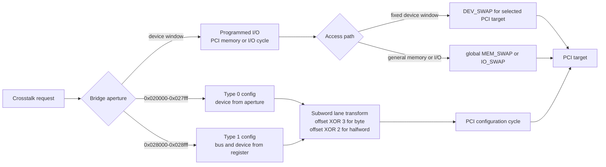
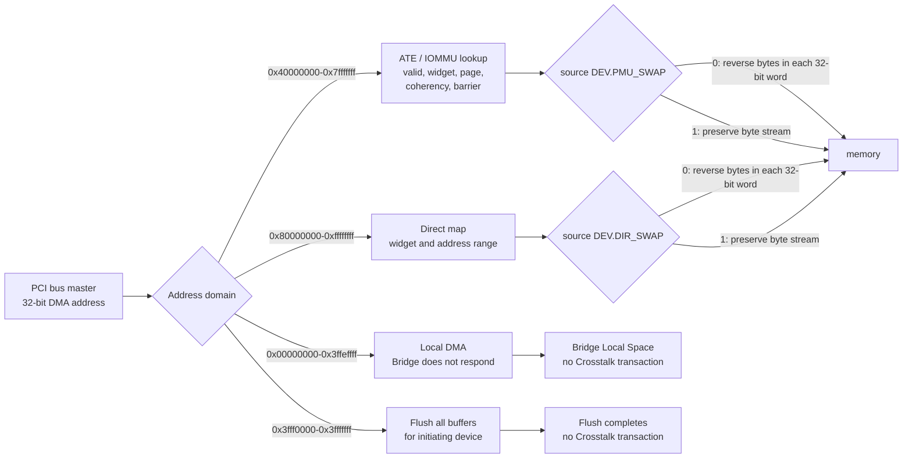
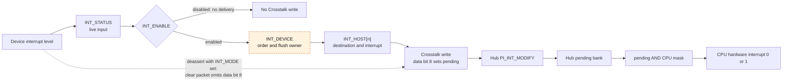
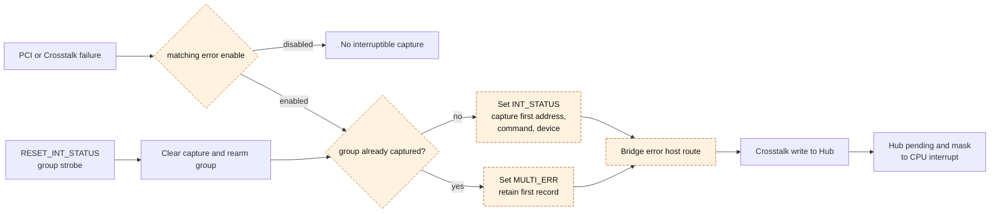

# Datasheet: Bridge, the XIO-to-PCI bridge

References rendered as citation identities name material outside this document
set. Those targets are not included or cleared for redistribution. Review and
runtime statements retain their recorded dates and scope.

**Status:** reviewed (coordinator with codex, 2026-08-09) — **ready for the
OpenBSD 7.9 path**, a scoped clearance rather than the whole chip.
The DMA-destination-failure and inbound-link-reset additions have
independent source clearance (citation: `docs/reviews/crossbow-dma-reset-independent-review-20260907.md`)
for the bounded behavior stated here.
**Fork file(s):** `hw/pci-host/sgi-bridge.c`

**Sources used:** SGI's *Bridge ASIC Specification*, revision 4.0 for silicon
revision D, dated 26 April 1998, held in the project document library as
`docs/library/cache/asic/sgi-bridge-asic-spec-rev4.0.pdf`. That file is a
178-page scan with no text layer, so it yields nothing to a text search as
shipped; the text this datasheet was written from is the
optical-character-recognition output beside it, at
`docs/library/cache/asic/sgi-bridge-asic-spec-rev4.0.ocr.txt`, with a
searchable-PDF companion at `sgi-bridge-asic-spec-rev4.0.ocr.pdf`. Those files
live in a directory the repository ignores, so no third-party document is
committed. Also used: Linux
`arch/mips/include/asm/pci/bridge.h` and `arch/mips/pci/pci-xtalk-bridge.c`, and
Linux 2.4's `arch/mips/sgi-ip27/ip27-pci.c`, which mainline later deleted and
which is read from the historical MIPS tree without checking anything out, as in
`git -C refs/linux-mips show 8ef7d46c94:arch/mips/sgi-ip27/ip27-pci.c`
(public, GPL). Also OpenBSD `sys/arch/sgi/xbow/xbridgereg.h`,
`sys/arch/sgi/xbow/widget.h`, `sys/arch/sgi/xbow/xbow.h` and
`sys/arch/sgi/xbow/xbridge.c` from the `the-machine-hall/openbsd-sgi` tree
(public, ISC); OpenBSD retired its SGI port, so those files sit on no checked-out
branch and are read with
`git -C refs/openbsd-sgi show 2df91d80c1:sys/arch/sgi/xbow/xbridgereg.h`.
Also two SGI patents in the project document library, both naming the Bridge
specification's own author: US 5,915,104, *High bandwidth PCI to packet switched
router bridge*, and US 6,604,161, *Translation of PCI level interrupts into
packet based messages*. Both carry real text layers and need no character
recognition. The Hub side of the interrupt path is specified in
[the Hub processor interface datasheet](hub-processor-interface.md) and the
address arithmetic in [the SN0 address map datasheet](address-map.md). We only
read reference sources and never copy their code or file structure
(source-use policy, decision D-0002).

One narrow compatibility behavior comes from bounded execution and disassembly
of a held Origin 200 processor PROM. It is restated only as an interface
requirement: one zero write to a reserved Bridge data-half address must complete
on the Origin 200 product path. No private identifier, source structure,
executable byte, or wider reserved-space behavior enters this page.

**Which facts came from where.** Register offsets, field positions and the
address maps are dual-sourced: the ASIC specification and the Linux and OpenBSD
headers agree on every one checked, and the places they appear to disagree are
explained by the access convention described below rather than by a real
conflict. A later pass read the specification's register tables as page images
instead of through character recognition and cross-checked each field against the
reference headers; its output sits beside the scan as
`sgi-bridge-asic-spec-rev4.0.registers.md`, committed under
`docs/library/transcriptions/`, and it
confirms every address and bit position on this page. **Reset values are
single-sourced from the ASIC specification** and are marked in the register map.
No public header carries a reset value at all, so none of them can ever be
cross-checked — treat the reset column as one reading of a scanned page and the
offset and bit-position columns as dual-sourced. In addition to the single
compatibility write described in the reserved-address section, bounded IRIX
6.5.7 source establishes how software preserves and restores Bridge programming
across an inbound link reset. The matching IRIX 6.5.5 kernel file is
byte-identical. Exact paths and hashes are recorded in
provenance (citation: `docs/provenance.md`). The other behavioural sequences come from the
two Linux drivers and OpenBSD's. The level-interrupt handshake is traced from
OpenBSD 7.9 rather than taken from the interrupt patent, which describes a
different mechanism that this guest does not use.

## What to implement from this page

**Read this before writing code.** This document is settled and dual-sourced, and an
implementer can build straight from it. **Two facts on this page were open questions for
part of 2026-08-10 and are not any more — both are ratified or observed, and both are safe
to implement as stated.** They are named here because a reader who has seen an older
revision, or who reads only the register map and not the prose around it, may still be
carrying the open version.

**Build all of it, including these two.** The register face and its offsets, the access
convention, the device windows, the address-translation path for transfers a device
initiates, the interrupt status and enable registers, the level-following interrupt handshake
with its re-arm sequence, the board-identity one-wire, and the interrupt pin. These are
dual-sourced between SGI's ASIC specification and the guests' own drivers, and the interrupt
handshake is traced from a guest we boot. **The single most important of them is that the
interrupt status register follows the device's level and never latches** — a model that
latches passes a simple test, boots, and then hangs.

**The interrupt pin is `3` for the I/O controller's second interrupt.** James ratified it,
confirmed on both guests independently: Linux selects it from the board part number a real
machine reports from the Bridge's own identity chip, and OpenBSD reaches the same pin from
the first empty PCI device number on the real bus. **`4` was this page's own prescription
until 2026-08-10** and every remaining statement of it elsewhere in the tree is superseded.

**The Bridge's board-identity one-wire must answer, with real contents.** A real Origin 200
reports part `030-1244-001`, name `IP29`, plus a serial and revision, read by firmware from
this register — **carry those contents**, which reproduces the machine rather than exceeding
it. The model's IP29 image on QEMU `sgi-origami` carries the fixed-offset record
(jamesb/qemu#813); see
[the record layout](#the-record-layout-and-every-constraint-on-building-it).
**Do not carry the same part on the controller's one-wire** — that bus is a different
chip with a different, and still narrower, answer; see the section on it below.

**Both were marked as open on this page for part of 2026-08-10, on the grounds that nothing
had been observed for either.** That was true when each sentence was written and stopped
being true the same day, once a real board's part number and the ratification landed. **If
any passage below this point still reads as though either is open, that passage is stale and
this section is the correction, not the surrounding prose.**

## Role

The Bridge is the machine's only path from the crossbar to ordinary peripherals.
On one side it is a crosstalk widget like any other, with a 16 MB widget address
space and the common widget register block at the bottom of it. On the other side
it is a PCI host bridge with eight device slots, a configuration-space window per
slot, a programmable memory or I/O window per slot, an eight-pin interrupt
controller and a two-mode address translator for transfers a device initiates.

On an Origin 200 the Bridge is widget 8, and it carries everything the machine
has: the IOC3 multi-function chip that provides the console serial ports, and the
QLogic ISP1020 SCSI host adapter that owns the disk. Nothing reaches a guest
operating system past its first console banner without going through this device.
It is also where the interrupt chain becomes real. A device asserts a level on one
of eight pins; the Bridge turns that level into a write across the crossbar into
the Hub's interrupt-modify register; the Hub turns that into a processor
interrupt. The Hub end of that path is already specified, so this document
specifies the Bridge end and the exact contents of the write.

**The one thing to take from this document before anything else: the interrupt
status register must follow the device's level and must never latch and clear on
service.** That requirement is the hardware's and holds for every guest. **OpenBSD
specifically re-arms in software** — it re-reads that status register and writes the Hub's
interrupt-modify register itself, without touching the Bridge — so a model that clears a bit
when the interrupt is serviced tells this guest a device has gone quiet when it has not, and
a device with a second pending condition is never serviced again. The full sequence, the
register contents and the qtest that catches a latching model are specified later in this
document; it leads here because an implementer who reads only the register map will build
the latching version, which is what the interrupt patent describes and what this machine
does not do.

The chip also supports a GIO bus instead of PCI, selected by a strap pin, an
external static RAM for a larger translation table, and external flash. This
machine is a PCI Bridge with the internal translation table, so the first two are
not used here.

**The flash interface is populated on the Origin 2000, and modelled.** The public
Bridge specification shows the processor boot address `0x001f_c00000` translated
by the memory controller to the Bridge external-flash window at `0x00c0_0000`,
and describes the port: the SSRAM port's sixteen data lines carrying a
sector-erasable 256K x16 or 512K x16 part, two chip selects of 2 MB each, a strap
(`FLASH_SELECT`, read back as status bit 6) choosing which answers at the base,
reads of any crosstalk size, writes of sixteen bits only, and no write completed
while control bit 31 is clear. SGI's own board block diagram for the Origin 2000
and Onyx2 base-I/O card — *Origin and Onyx2 Theory of Operations Manual*,
document 007-3439-002, revision 002, Figure 2-25, printed page 69, PDF page
83 — shows a 1 MB flash EPROM wired to the Bridge, along with a one-wire
identity chip; the part the model fits is in
[the BaseIO datasheet](baseio.md#the-flash-part). That
flash holds the BASEIO PROM the IP27 PROM loads at "Loading BASEIO prom";
[the port contract](#external-flash-port) records what the loader does with it.
That board is an XIO card and the Origin 200 carries its base I/O on the IP29
System Board, so the Origin 200's physical flash population, selection signals,
and board wiring remain unresolved and its onboard Bridge fits no part. The
public evidence does not place the flash on the Hub memory-directory unit.

## Register map

### Access convention, which must be got right first

Every Bridge register is 32 bits or narrower. Every one sits on an eight-byte
boundary, occupying data bits 31:0 of that eight-byte slot, and the specification
states that they may be accessed only by a crosstalk double-word packet with four
data enables — that is, by a 32-bit load or store. Any other packet type raises an
address error.

This single fact explains an apparent conflict between our two public sources and
must be carried into the model. OpenBSD names Bridge register offsets on the
eight-byte boundary and folds the extra four bytes in at access time, so its
interrupt status register is at `0x100`. Linux names the same register at `0x104`,
the address of its low half in a big-endian machine. They are the same register.
This datasheet uses the eight-byte-aligned offset throughout, and the model must
serve a 32-bit access at offset plus four while rejecting a 64-bit access to the
same slot, rather than quietly serving both.

### Widget address space

The Bridge occupies 16 MB of crosstalk address space. On this machine that space
appears at the node's crosstalk I/O base plus widget 8 shifted left 24 bits.

| Offset in widget space | Size | Contents |
|---|---|---|
| `0x00_0000` | 64 KB | Local registers. Only the first `0x300` bytes are defined. |
| `0x01_0000` | 1 KB | Internal address translation table, 128 entries of eight bytes, written as 64-bit quantities. |
| `0x01_1000` | 1 KB | Read-only 32-bit view of the *lower* half of each of the same 128 entries, running to `0x01_13ff`. |
| `0x02_0000` | 32 KB | PCI type 0 configuration space, eight devices of 4 KB, each holding eight functions of 256 bytes. |
| `0x02_8000` | 4 KB | PCI type 1 configuration space, for devices behind a PCI-to-PCI bridge. |
| `0x03_0000` | 8 bytes | PCI interrupt-acknowledge cycle. |
| `0x08_0000` | 512 KB | External static RAM, holding the extended translation table when fitted. |
| `0x10_0000` | 1 MB | Reserved. |
| `0x20_0000` | 2 MB | Device 0 window. |
| `0x40_0000` | 2 MB | Device 1 window. |
| `0x60_0000` | 1 MB each | Device 2 through device 7 windows, consecutively, ending at `0xbf_ffff`. |
| `0xc0_0000` | 4 MB | External flash: two 2 MB chip selects, the part a board fits answering at the base. |

The two 2 MB windows followed by six 1 MB windows is the detail every driver
gets wrong once. Linux encodes it as a conditional in a macro and OpenBSD as an
arithmetic expression; both produce the same table, and the specification's own
widget address map confirms it region by region.

### Common widget registers

Every crosstalk widget begins with this block, so the crossbar can identify and
configure anything plugged into it without knowing what it is.

| Offset | Name | Width | Reset | Access | Behavior as guest drivers use it |
|---|---|---|---|---|---|
| `0x00_0000` | Identification | 32 | fixed | readable | Bits 31:28 silicon revision, 27:12 part number, 11:1 manufacturer, bit 0 always reads one. The Bridge reports part `0xc002` and manufacturer `0x036`. The later XBridge reports part `0xd002` and manufacturer `0x024`. |
| `0x00_0008` | Status | 32 | mixed | readable | Bits 31:24 link receive retry count and 23:16 link transmit retry count, both reset zero. Bit 6 selects which flash chip answers at `0xc0_0000` and bit 5 reads one for PCI and zero for GIO; both are driven by strap pins and are undefined at reset. This model reads bit 6 as zero: chip select 0 answers at the base. Bits 4:0 count outstanding read requests, reset zero. |
| `0x00_0010` | Error address, upper | 32 | — | readable | Upper 16 bits of the address of the first logged error, plus which device was master. |
| `0x00_0018` | Error address, lower | 32 | — | readable | Lower 32 bits of the same address. |
| `0x00_0020` | Control | 32 | mixed — see below | readable and writable | Bit 31 enables flash writes, resetting clear, and a write to the flash window while it is clear is not completed; bits 30, 29 and 28 enable the 50, 40 and 33 MHz clock outputs, **all three resetting set**; bits 27:24 drive the four PCI reset pins, **all four resetting set**; bit 23 swaps bytes for I/O-space accesses outside a device window and bit 22 does the same for memory space, both resetting clear; bit 21 selects a 16 KB translation page instead of 4 KB, resetting clear; bit 20 forces bad static-RAM parity and bit 19 enables static-RAM parity, both resetting clear; bits 18:17 declare the external static RAM size, resetting to zero; bit 16 forces a bad link packet, resetting clear; bits 15:12 set the crossbar credit, **resetting to 3**; bits 11 and 10 clear the two link retry counters and always read zero; bit 9 sets system endianness, **resetting to big**; bits 8:4 cap outstanding transactions, **resetting to `0x1f`**; bits 3:0 are this widget's own number, **resetting to `0xf`**. |
| `0x00_0028` | Request timeout | 32 | `0xf_ffff` | readable and writable | How long the widget waits for a crosstalk response. Bits 19:0 are the reload value; the counter ticks every 960 ns. |
| `0x00_0030` | Interrupt destination, upper | 32 | — | readable and writable | Bits 31:24 an interrupt vector, 19:16 the target widget, 15:0 the upper 16 bits of the destination address. |
| `0x00_0038` | Interrupt destination, lower | 32 | — | readable and writable | The lower 32 bits of the destination address. |
| `0x00_0040` | Error command word | 32 | — | readable | The crosstalk command word of the packet that failed. |
| `0x00_0048` | Link configuration | 32 | mixed | readable and writable | Bits 25:16 the maximum micropacket retry, resetting to `0x3ff`; bits 15:10 the null-packet timeout, resetting to `0x06`; bits 9:0 the maximum burst, resetting to `0x010`. |
| `0x00_0050` | Target flush | 32 | — | readable | Reading it returns nothing useful; the read itself is the operation. It completes only after every earlier programmed access to this widget has completed, so drivers read it to make a configuration change take effect before they rely on it. |

### Bridge-specific registers

| Offset | Name | Width | Reset | Access | Behavior as guest drivers use it |
|---|---|---|---|---|---|
| `0x00_0058` | Auxiliary error command word | 32 | — | readable | Command word of a second, overlapping error. |
| `0x00_0060` | Response buffer error address, upper | 32 | — | readable | Includes which device and which read response buffer failed. |
| `0x00_0068` | Response buffer error address, lower | 32 | — | readable | The rest of that address. |
| `0x00_0070` | Test pin control | 32 | — | readable and writable | Manufacturing test only. |
| `0x00_0080` | Direct map | 32 | see behavior | readable and writable | Bits 23:20 the widget every direct-window transfer targets, reset zero. Bit 18 selects how the remote map field is formed in 64-bit addressing, reset zero. Bit 17 adds a 512 MB offset, and **resets set**. Bits 16:0 supply crosstalk address bits 47:31, reset zero. |
| `0x00_0090` | Static RAM parity error | 32 | — | readable | Records a parity failure in the external translation table, with the requesting device and the failing byte. |
| `0x00_00a0` | Arbitration | 32 | mixed | readable and writable | Bits 17:16 the tick period the request-wait circuit counts in, resetting to 2. Bits 15:8 per-device request-wait enables, one per bus request pin, resetting to zero. Bit 6 freezes every grant. Bits 5:3 and 2:0 let *the Bridge itself* request the bus on the high and low priority rings, resetting to `0b001` and `0b000`. Which ring a device arbitrates on is not here — it is the real-time bit in that device's own register. |
| `0x00_00b0` | Number in a can | 32 | **`0x0000_0000`**, with bit 0 undefined | readable and writable | The one-wire serial line to the board identity part. Bit 0 is the level sampled from the bus, **reset undefined**; bit 1 is the specification's *sample data valid*, **resetting clear**, which a driver polls to know a bit slot has completed; bits 9:2 are the sampling offset and bits 19:10 the bus-master pulse duration, both resetting to zero, and a write to them starts one bit slot. Mainline Linux cannot attach the Bridge unless a read of this line **succeeds**; whether it then *recognises* the part number only decides the per-board fixups. |

**The sample-data-valid bit resets clear, and that is harmless.** The Bridge's **own
specification** gives it — its number-in-a-can register table, on a page rendered as an image
and read by eye rather than through character recognition. **This register's bit positions are
dual-sourced** — Linux's one-wire master driver matches the same layout independently, bit for
bit — **but the reset value is not, and cannot be.** No public header carries a power-on
value for any register in this chip, so this one rests on a single reading of the scanned
page, exactly as every other reset value on this page does. The specification also supplies
the field's real name, which this page had been calling *slot finished* in our own words.

**An earlier version of this page said the specification did not give this reset, which is
why it carried a dash.** It does give it, in the Bridge's own register table. The dash was
never a gap in the source; **it was a gap in what we had read of the source** — and the whole
hazard below grew in the space that mistake created.

**This page carried a hazard saying the opposite for part of 2026-08-10, and the reasoning
behind it was wrong twice over.** The hazard argued that a zero reset would make a driver
"see a slot permanently in progress on its first read", presenting as the identity part being
absent — the state that makes a current Linux abandon the Bridge. It was built on the
Crossbow's equivalent register, which really does reset that bit **set**.

**Name that source when repeating it, because it is not the one a reader will reach for.**
The Crossbow value comes from **SGI's machine-readable register table**, its Crossbow file,
read directly — **not** from our transcription of the scanned Crossbow specification, which
does not carry it. Anyone reconciling the two chips against the ASIC scans alone will find
nothing on the Crossbow side and conclude the claim was invented. **It was not; it is in a
different SGI artifact.**

**The reasoning fails because no driver reads the register before writing it.** Every path in
the one-wire master writes first — the reset sequence and both bit-slot cases each store a
timing pair, which starts a slot — and only then polls the done bit. **The reset value is
never observed**, so it cannot produce the failure the hazard described.

**And the contradiction was visible without any of that.** If a zero reset broke the probe,
real hardware would not boot, and it does. **An argument whose conclusion is that the real
machine cannot work is refuted by the machine working**, and that check needed no source at
all — it was available the moment the hazard was written.

**The Crossbow fact was correct and simply does not transfer.** Its register genuinely resets
that bit set; the two chips differ. Reasoning from *same purpose, same two low bits, same
vendor, same generation* is the proximity inference this project has now been caught by
several times in one day — **a sibling chip is a neighbouring row**, and the correct and
incorrect referents sitting next to each other is exactly what makes the substitution
invisible. A direct source about the chip in hand beats a strong-looking inference from the
chip beside it, every time.

| Offset | Name | Width | Reset | Access | Behavior as guest drivers use it |
|---|---|---|---|---|---|
| `0x00_00c0` | Bus timeout | 32 | mixed | readable and writable | Bits 20:16 retry hold, **five bits**, resetting to 1. Bit 12 GIO timeout. Bits 9:0 PCI retry count. |
| `0x00_00c8` | PCI type 1 configuration | 32 | — | readable and writable | The bus and device number that the type 1 configuration window targets. |
| `0x00_00d0` | PCI error address, upper | 32 | — | readable | Upper bits of a failing PCI address. |
| `0x00_00d8` | PCI error address, lower | 32 | — | readable | Lower bits of the same. |

### Interrupt registers

| Offset | Name | Width | Reset | Access | Behavior as guest drivers use it |
|---|---|---|---|---|---|
| `0x00_0100` | Interrupt status | 32 | 0 | readable | Bits 7:0 are the eight device interrupt pins, a one meaning the pin is asserted. Bits 31:8 are error conditions, listed below. |
| `0x00_0108` | Interrupt enable | 32 | 0 | readable and writable | The same bit layout from bit 30 down. A one lets that source raise an interrupt. There is **no enable for bit 31**, the multiple-error flag: the specification's enable table starts at 30. A model that implements the enable as a plain 32-bit mask over the status word lets a multiple-error report through a mask a real Bridge would not. |
| `0x00_0110` | Reset interrupt status | 32 | 0 | writable | Writing a one to one of seven group bits clears every error bit in that group at once. Bit 0 clears the PCI group, bit 1 the static RAM group, bit 2 the link group, bit 3 the request-dispatch group, bit 4 the response-buffer group, bit 5 the response group, bit 6 the multiple-error flag. Writing `0x7f` clears everything, which is what Linux does at start of day. |
| `0x00_0118` | Interrupt mode | 32 | 0 | readable and writable | Bits 7:0, one per pin. A one makes the Bridge send a clearing packet, carrying data bit 8 set to zero, to the host's interrupt register when that pin deasserts. |
| `0x00_0120` | Interrupt device | 32 | 0 | readable and writable | Three bits per pin, eight pins, naming which PCI device owns that pin so the Bridge knows whose buffers to flush when it fires. |
| `0x00_0128` | Host error field | 32 | — | readable and writable | The bit number to set in the host's interrupt register when the Bridge itself reports an error, as opposed to a device. |
| `0x00_0130` + 8×*n* | Interrupt *n* host address, for *n* = 0 to 7 | 32 | 0 | readable and writable | Bits 17:8 replace crosstalk address bits 47:38 of the interrupt destination address for this pin. Bits 7:0 are the bit number to set in the host's interrupt register. |

Error bits in the interrupt status and enable registers, from bit 31 down: multiple
errors before the first was cleared; access beyond the translation table's device
limit; unexpected response; response packet framing error; request packet framing
error; error flagged in an arriving response; error flagged in an arriving request;
address invalid for this widget; unsupported operation; request queue overflow;
link receiver sequence-number error; link receiver check-bit error; link receiver
retry counter wrapped; link transmitter retried; link transmitter retry counter
wrapped; static RAM parity error; PCI abort; PCI parity error detected by the
Bridge; PCI address or command parity error; PCI device parity error; PCI device
selection timeout; PCI retry count exceeded; crosstalk read request timeout; GIO
non-contiguous byte enable, which cannot occur on a PCI machine. The Linux header
and the specification agree bit for bit on all twenty-four.

**Each error bit belongs to exactly one reset group, and a group's strobe clears
only its own bits.** Writing all seven groups at once, as the guests do at start
of day, clears everything; a strobe for one group leaves the others latched. The
grouping is public — the mainline Linux `BRIDGE_IRR_*_GRP` masks in
`arch/mips/include/asm/pci/bridge.h`, with OpenBSD's `xbridgereg.h` naming the
same bits:

| Reset bit | Group | Status bits it clears |
|---|---|---|
| 0 | PCI (and GIO) | PCI abort; PCI parity detected by the Bridge; PCI address/command parity; PCI device parity; PCI device-selection timeout; PCI retry count exceeded; GIO non-contiguous byte enable |
| 1 | static RAM | access beyond the translation-table device limit; static RAM parity |
| 2 | link | receiver sequence-number; receiver check-bit; receiver retry-count wrapped; transmitter retried; transmitter retry-count wrapped |
| 3 | request-dispatch | request-packet framing; error in an arriving request; **address invalid for this widget**; unsupported operation |
| 4 | response-buffer | response-packet framing; error in an arriving response; crosstalk read-request timeout |
| 5 | response | unexpected response; request-queue overflow |
| 6 | multiple-error | multiple errors before the first was cleared |

The model raises three errors. The invalid-address bit is in the
request-dispatch group, so reset bit 3 is the strobe that clears it and a strobe
for any other group must leave it set. The PCI master time-out, bit 11, and the
PCI abort, bit 15, are in the PCI group, cleared by reset bit 0; a second
PCI-group error sets the multiple-error bit, 31, which reset bit 6 clears. The
master time-out comes from any cycle the Bridge masters that no device claims:
a configuration cycle, or a programmed-I/O cycle through a device window or
the PIO translated window. The abort comes from a programmed-I/O cycle a device
model claims and then fails. The errors also differ in gating: the PCI errors
set their status bits only when enabled, as chapter 6 says, while the model
latches the invalid-address bit whatever its enable, a difference that predates
the master time-out and is not settled here.

**An access to an undefined address inside the Bridge's register window is an *invalid-address
error*, reported asynchronously — not a synchronous processor bus error.** When the Bridge
receives a request for an address it does not decode within its widget space (a reserved register
slot, for instance), it does not return an error response to the processor. It sets the
invalid-address bit (bit 24, "address invalid for this widget") in the interrupt status register,
latches the failing address in the widget error-address registers, and — if that bit is enabled
in the interrupt-enable register — raises an interrupt to the host by setting the bit named in the
host-error field (`0x00_0128`) at the destination in the widget-level interrupt destination,
upper/lower registers (`0x00_0030`/`0x00_0038`). Those are the Bridge's *own* error-interrupt
destination; the per-pin interrupt host-address registers at `0x00_0130` + 8×*n* are the eight
device pins' destinations and are **not** where the Bridge sends its own error interrupt. A write
to such an address **completes (it is posted)**; a model that instead raises a synchronous data
bus error on the store is wrong in a way a firmware self-test catches directly.

That self-test is the Bridge sanity diagnostic on the real-PROM path to POD. It deliberately
provokes the error by storing a known value to an undefined register slot (widget offset `0x7c`),
having first enabled the invalid-address interrupt and programmed the error-interrupt destination
at the Hub; it then confirms the invalid-address status bit is set and that the interrupt reached
the Hub's pending register. The whole test runs under a fault handler that **fails on any
processor exception**, so a synchronous bus error on the provoke store trips it and the diagnostic
fails — the wall reached once the widget-2 storm cleared (IRIX 6.5.7
`stand/arcs/lib/libkl/diags/diag_bridge.c`; the invalid-address bit and its "address invalid for
the Bridge widget" meaning are the ASIC specification's,
`docs/library/transcriptions/sgi-bridge-asic-spec-rev4.0.registers.md`). The model owes three
things for the test to pass: the undefined-address write posts with no CPU exception; the
invalid-address status bit sets; and the enabled error raises the host interrupt through the
host-error field (`0x00_0128`) and the widget interrupt destination, upper/lower registers
(`0x00_0030`/`0x00_0038`). It is error-reporting semantics,
reference-determined — though it does add the Bridge's own error interrupt as a source into the
interrupt chain, which a reviewer watching that contract surface should note.

This Bridge behavior is distinct from the processor's own posting of a failed
store, and the two are disjoint by construction. The R10000 raises no precise
bus error at a store — an uncached write is a posted transaction with no
completion channel on which an external agent could signal an error — so a store
that reaches *no* device at all completes silently on the processor side, its
error left to the I/O system to report. The case above is the other half: a
store that *does* reach the Bridge but lands on an undefined register slot inside
its decoded window, which the Bridge posts and reports as the invalid-address
error before any processor transaction failure arises. The `bridge_sanity`
provoke is handled here, at the Bridge, and never reaches the processor's
posted-store path — so neither behavior masks the other.

### Reserved data-half compatibility write

The public register layout leaves the aligned slots from `0x00_0170` through
`0x00_01f8` undefined, between the last interrupt-host-address register and the
device registers. Under this page's access convention, a 32-bit access reaches
the data half four bytes above its aligned slot. Guest byte address
`0x00_019c` is therefore the data half of undefined slot `0x00_0198`, not a
register omitted from the table.

The held Origin 200 processor PROM issues a 32-bit zero store to `0x00_019c`
after partition setup. Rejecting that store raises a processor exception and
stops the normal boot path. The compatibility contract is deliberately narrower
than the public chip rule:

- that 32-bit zero store completes without a processor exception,
- it changes no readable state, and
- reads at `0x00_019c` and accesses to every other undefined slot remain
  unestablished by this observation.

This does not claim that reserved Bridge space is generally writable. The public
specification says undefined address areas raise an address error. It records
the one compatibility behavior required by the shipping Origin 200 firmware
while preserving the model's existing failure behavior everywhere else.

### Device registers

| Offset | Name | Width | Reset | Access | Behavior as guest drivers use it |
|---|---|---|---|---|---|
| `0x00_0200` + 8×*n* | Device *n*, for *n* = 0 to 7 | 32 | see below | readable and writable | The per-slot control word. Fields below. |
| `0x00_0240` + 8×*n* | Device *n* write request buffer flush | 32 | — | readable | Reading it blocks until that device's buffered writes have drained. |
| `0x00_0280` | Even read response buffers | 32 | 0 | readable and writable | Eight four-bit groups covering the eight **even-numbered buffers**, from buffer 14 in the top group down to buffer 0 in the bottom. Within a group the top bit enables the buffer, the next selects the virtual device, and the low two bits name the device that owns it. |
| `0x00_0288` | Odd read response buffers | 32 | 0 | readable and writable | The same for the eight odd-numbered buffers. |
| `0x00_0290` | Read response buffer status | 32 | — | readable | Which buffers are valid and which are in use. |
| `0x00_0298` | Read response buffer clear | 32 | — | writable | Writing a one frees that buffer. |

The device register's fields, with the reset values the specification gives:

| Bits | Name | Reset | Meaning |
|---|---|---|---|
| 28 | Error lock enable | 1 | On an error, lock this device out of arbitration and hold its requests until the error is cleared. |
| 27 | Page-cross check enable | 1 | When zero, the prefetcher stops at a translation page boundary. The two sources name this bit oppositely and describe it identically: the specification calls it an enable, Linux calls it a page-check *disable*. Nobody is inverted — compare the descriptions, not the names. |
| 26 | Force PCI parity error | 0 | Diagnostic. |
| 25 | Virtual device enable | 0 | Splits the prefetch buffers into two streams for a 64-bit master. |
| 24 | Write gather through the translated window | 0 | |
| 23 | Write gather through the direct window | 0 | |
| 22 | Device size | 0 | Zero for a 32-bit device, one for 64-bit. Applies to the device window. |
| 21 | Real time | 0 | Puts the device on the high-priority arbitration ring. |
| 20 | Byte swap through the translated window | 0 | |
| 19 | Byte swap through the direct window | 0 | |
| 18 | Prefetch | 0 | |
| 17 | Precise | 0 | When clear, a read fetches a whole cache line regardless of what was asked for. |
| 16 | Coherent | 0 | Sets the coherent bit in the outgoing crosstalk packet. |
| 15 | Barrier | 0 | Sets the barrier bit in the outgoing crosstalk packet. |
| 14 | Guaranteed bandwidth | 0 | Sets the corresponding crosstalk packet bit. |
| 13 | Byte swap for programmed access | 0 | Swaps bytes for processor accesses through this device's window. |
| 12 | Memory or I/O | **1** | One selects PCI memory space for this device's window, zero selects I/O space. A slot therefore comes up pointing at PCI memory space, not I/O. |
| 11:0 | Window base | no fixed reset | Supplies PCI address bits 31:20 for accesses through this device's window. The specification gives no power-up value, referring instead to its address-mapping chapter. |

Write gather through the internal translation table is always disabled in
hardware regardless of bit 24; that bit only affects the external table.

### Address translation entries

**Before consulting the two adjacent emulator references, read this.** Two
translation-map implementations in our corpus are structurally close to this table
and are about **different hardware**: QEMU's DEC Tsunami host bridge, which is in
our own fork tree, and Open SIMH's VAX bus adapters. They are worth reading for
*shape* and for *failure modes*. **Nothing numeric in either is a fact about the
Bridge** — not a window count, not a mode set, not an attribute bit.

**The reason this needs saying is that the guard which would normally catch it will
not fire.** The source-use policy is calibrated for SGI and IRIX material and its
instinct is licence-shaped; one of these files is already committed in our tree and
the other is MIT, so neither feels like it needs care. **The hazard here is subject,
not licence.** A person writing this section with either file open will import a
window count or a fault-latching rule and it will read as a Bridge fact, because it
arrived while they were thinking about the Bridge.

So: take questions from them, not answers. *Does the Bridge latch the first faulting
entry and refuse to overwrite it? Does a translation failure reach the device as a
residual byte count?* Those are good questions and the answers must come from the
Bridge's own sources.

**One thing from that corpus is directly prescriptive, because it is about us rather
than about any of that hardware.** The Tsunami model performs scatter-gather through
an `IOMMUMemoryRegion` returning an 8 KB address mask, so the memory framework
re-translates **once per page**. A standalone emulator of the same machine hand-rolled
it instead, translated once per *transfer*, and so used the wrong translation for the
tail of any scatter-gather burst that crossed a page boundary — a defect that went
unnoticed for a long time, because every transfer that fits inside one page behaves
perfectly. Our model must go through the framework for the same reason, and **the first
test this table gets is a transfer straddling a page boundary where the two pages map to
non-adjacent physical addresses.**

(*How* long that defect survived was reported to us rather than checked, so no figure is
given here. The mechanism is verified and is the part the test depends on.)

The internal table is 128 entries of eight bytes at widget offset `0x01_0000`.
Each entry is written as a 64-bit quantity even though the surrounding registers
are 32 bits, and the table is reachable at two addresses. At `0x01_0000` the
entry is write-only as a 64-bit quantity, with its upper half readable at the
offset plus four. A second region at `0x01_1000` through `0x01_13ff` holds a
read-only 32-bit view of each entry's *lower* half. A model that decodes only the
first region leaves `0x01_1000` dead, and a driver reading an entry back gets
nothing. Nothing on the OpenBSD path reads entries back — OpenBSD declines to use
the translation table on this machine at all — so this is a completeness
requirement rather than a live one.

| Bits | Meaning |
|---|---|
| 63:48 | Remote map field, for routing between systems across a virtual backplane. Sixteen bits wide; only the low eight are filled in the reset configuration. Zero on a single machine. |
| 47:12 | Crosstalk address bits 47:12 of the translated page. |
| 11:8 | Target widget. |
| 5 | Byte swap. Present on the later XBridge only. |
| 4 | Barrier. |
| 3 | Prefetch. |
| 2 | Precise. |
| 1 | Coherent. |
| 0 | Valid. |

The remote map field is the one place where the two sources look different and
are not. The specification declares sixteen bits at 63:48. OpenBSD's mask is
eight bits at 55:48, and Linux gives only a shift of 48 with no width at all. The
direct map register reconciles them: its bit 18 chooses how a 64-bit device
address fills the field. With that bit clear, which is the reset state, the
device supplies PCI address bits 55:48 as the field's low eight bits and the
upper eight are zero — which is exactly OpenBSD's mask. With it set, PCI address
bits 55:40 supply all sixteen. So the register is sixteen bits and OpenBSD's
eight-bit mask is the default mode, and a model must implement the full width
even though nothing on this machine will ever set the upper half.

## Behavioral contract

### Reset received from Crossbow

Bridge revision D feeds the LLP's received link-reset output into its core-logic
reset and releases the core only after the link connection has been determined.
A Crossbow per-link reset therefore reaches more than Bridge's serial protocol
state: Bridge core logic also enters reset and is not released before the link
connection has been determined.

IRIX 6.5.5 and 6.5.7 expose the software consequence on a GIO Bridge. The reset
path saves the widget control and LLP configuration, asks Crossbow to reset the
link, waits 100 microseconds, restores those saved values, and reinitializes the
rest of the Bridge. This is evidence that software cannot rely on Bridge core
programming surviving an inbound link reset, but it does not prove the reset or
retention state of every register. It also does not establish that the Bridge
pulses its four external bus-reset outputs or resets any PCI or GIO device. The
exact register-by-register retention boundary and training time remain open.

**Read the target flush register to make a change stick.** Every driver read for
this datasheet does the same thing: write a configuration register, then read the
target flush register, then rely on the change. Linux 2.4's Bridge driver does it
after each byte-swap change; mainline Linux does it after programming an interrupt
address and again at the end of setup with a comment saying it waits until
programmed access completes. Our model completes accesses synchronously so the
read is harmless, but it must be readable and must not fault.

**Start of day, in the order mainline Linux does it.** Clear every interrupt
status group by writing all seven group bits to the reset register. Write zero to
the interrupt device register, so every pin is attributed to slot 0 until told
otherwise. Clear the two byte-swap bits in the control register, disabling
swapping for accesses that do not go through a device window. Set or clear the
translation page size bit to match the guest's page size. Write the widget-wide
interrupt destination address, upper and lower. Write the direct map register with
the destination widget in bits 23:20. Write zero to the interrupt enable register.
Then, for each of the eight slots, set the direct-window byte-swap bit in the
device register. Finally read the target flush register.

**The control register's own widget number must read back as the widget the Bridge is
decoded at, because a guest steers all its base-I/O traffic by it.** The control register's low
four bits, this widget's own number, are not decoration a model can leave at any value on this
machine. The IRIX kernel reads the base-I/O widget's
identity and then its control register through widget 0's small window, takes the widget number
from those low four bits, and uses that number as the crosstalk widget for **every** later
programmed-I/O access to the Bridge and to the PCI devices behind it. That read overrides
whatever the configuration graph advertised. So the value a guest reads in this field has to be
the widget the Bridge actually answers at — **8** on the Origin 200 — or the guest aims its
entire base-I/O traffic at a widget nothing decodes.

Real firmware guarantees this by writing 8 into the field during crosstalk bring-up; the
specification's reset for the field is `0xf`, which is an identifiable "not yet assigned" value
rather than a working one. A machine presenting synthesized firmware must reach the same end
state — the field reads 8 when the guest reads it — whether by the synthesized firmware
programming it as real firmware does, by the model storing the firmware's write so it reads
back, or by the model presenting 8 directly. Leaving the field at the `0xf` reset is as broken
as any other wrong value here: the guest would drive its I/O at widget 15.

Getting this wrong would not fault where the field is read; it would fault later, on the first
device access, and then wedge, because the guest would aim its base-I/O traffic at a widget the
Bridge is not decoded at. Our model presents 8 here and this derivation works — it is recorded as
a contract because it is load-bearing and quiet to get wrong, not because it is a known defect.
In particular it is **not** the cause of the crosstalk-widget-2 bus-error storm seen on the IRIX
6.5.30 miniroot path: that storm is a separate static firmware device pointer that carries widget
2 (offset `0x40_0208` is the programmed-I/O window of PCI device 1, the second SCSI adapter),
which reaches the Bridge on real hardware because the direct Hub-to-Bridge link has no crossbar,
and it is worked out in
what sits at crosstalk widget 2 on an Origin 200 (citation: `docs/library/widget2-on-the-origin-200.md`). That
note's conclusion is that the fix has two reference-determined parts — widen this Bridge's decode
to the other non-zero link widgets, and serve an eight-byte doubleword at the device windows — not
a change to this control field, which is correct at 8.

**The load at that address is now expected to fault, and why it was once believed to complete is
kept here.** The storm was an unbounded run of data bus errors on one eight-byte load of widget 2
offset `0x40_0208` in the IRIX 6.5.30 miniroot, observed on 2026-08-23 when the model decoded the
Bridge at widgets 0 and 8 only and capped the device windows at four bytes. Both gaps were real
and both fixes stand. The step that did not hold was concluding from the storm that the load must
complete: the model then had no processor-interface error record at all, and the stock PROM's
error-status workaround issues exactly this load expecting a bus error and a record of the address
([the Hub processor interface datasheet](hub-processor-interface.md)). Physical `0x0240_0208` is
not a Bridge address at all but the Hub's own I/O-interface bus-error register: Linux
`sn0/hubio.h` names it `IIO_IIBUSERR`, "Reads here cause a bus error", at offset `0x140_0208` from
the Hub's register alias at widget 1's window, and `sn0/addrs.h` makes it the error-status
workaround's address. The Hub fails the doubleword itself and the Bridge never sees it, so the
widen and the doubleword support above are right for every other widget-2 address and irrelevant
to this one. The functional check `irix_miniroot` boots the miniroot past it with the Hub's fault
in place.

This contract is owed specifically to the IRIX kernel, which is the only consumer that reads
the field rather than using widget 8 as a literal — OpenBSD probes a fixed single-bridge list
and mainline Linux passes the widget number as a constant, so neither is exposed to a wrong
value. It costs nothing to honour for the guests that do not read it, and it is load-bearing
for the one that does. Because the read reaches the Bridge through widget 0's small window,
widget 0 must present the Bridge's widget face for this to work at all, which is the same
requirement what sits at widget 0 on an Origin 200 (citation: `docs/library/widget0-on-the-origin-200.md`)
raises from the identity side.

**The Bridge answers its whole 16 MB widget face at every non-zero crosstalk widget the Hub sends
out its link, not at widget 8 alone.** This is the decode side of the ratified no-crossbar
contract, not a new decision: with no crossbar between the Hub and the Bridge, nothing routes by
widget number, so every crosstalk address the Hub emits over the link reaches the one Bridge
(the machine contract (citation: `docs/architecture.md`), settled in
the Origin 200 machine-contract sign-offs (citation: `docs/decisions/D-0009-origin200-contract-signoffs.md`)).
What must answer is the **entire** face — the full 16 MB widget MMIO region: the identity and
register block, the device programmed-I/O windows, and the address-translation entries. The case
that exercises the gap is a device programmed-I/O window well past the register block — widget
offset `0x40_0208`, the device-1 window — so a widen limited to the register block would leave it
faulting. It is what sits at crosstalk widget 2 on an Origin 200 (citation: `docs/library/widget2-on-the-origin-200.md`).
Five points bound the widen:

- **Widget 0 is already a full alias and does not change.** The model maps the Bridge's whole
  16 MB widget region at widget 0 as well, so widget 0 already answers the entire face — the
  identity (part `0xc002`, manufacturer `0x036`) every guest keys off to take the
  restricted-topology path that probes widget 8 alone, the control register the kernel reads there
  to derive the base-I/O widget, and the device windows and translation entries. The widen leaves
  it exactly as it is, and the base-I/O-widget read at widget 0 keeps working because that full
  alias already serves it.
- **Widget 8 is skipped: it already carries the Bridge's own region.** Aliasing the face there a
  second time would double-map it. The widen adds the other widgets, not this one.
- **The Hub's own registers stay at widget 1** — decoded locally, off the link — so the Bridge
  must not shadow it. The net-new aliases are therefore widgets 2 through 15 other than 8: widgets
  2–7 and 9–15.
- **Widget `0xa` is included.** The model maps nothing there today, so it too gains the full
  Bridge face like any other non-zero link widget. Its interrupt-target role is a separate thing —
  the target-widget field in the Bridge's interrupt-destination configuration, delivered from the
  Bridge as a GPIO-driven interrupt write, not an inbound decode — and answering `0xa`'s inbound
  window does not touch it.
- **The widen is purely additive, and it reverses a deliberate model choice.** The code today, by
  design, does not alias the higher widgets — a choice made before this was recognized as the
  ratified no-crossbar behavior, under which a direct link has no absent widgets. Completing it
  changes nothing that works: the widget-8 probe every guest performs stays byte-for-byte, and the
  other non-zero widgets merely *also* answer. The model's own comment about leaving the higher
  widgets unmapped is corrected when this lands.

**A device programmed-I/O window serves an 8-byte doubleword access, not only 32-bit and
narrower.** The whole 16 MB Bridge widget space is addressed by Crosstalk in **doubleword**
units — SGI's ASIC specification describes each widget-space location as reached by a doubleword
packet — so a processor doubleword (8-byte) load or store to a device window is a native access
alongside the byte, halfword and word forms the byte-lane note above covers. SGI's own header
makes it explicit, declaring each device I/O window as a union offering every access size,
including a 64-bit view (IRIX 6.5.7 `irix/kern/sys/PCI/bridge.h`, the device-space union; the
Bridge ASIC specification register transcription
`docs/library/transcriptions/sgi-bridge-asic-spec-rev4.0.registers.md`; corroborated by OpenBSD's
64-bit Bridge bus-space accessors in `sys/arch/sgi/xbow/xbridge.c`). A model that accepts only up
to four bytes at a device window rejects the doubleword with a bus error — the second half of the
crosstalk-widget-2 storm, worked out in
what sits at crosstalk widget 2 on an Origin 200 (citation: `docs/library/widget2-on-the-origin-200.md`).
Accepting the width is what the window owes; whether the cycle then completes is the PCI target's
answer, and one no device claims is a master time-out (below). **Corrected 2026-09-28:** this
paragraph said the storm's own address turns out to be such a master time-out. It is not: the
storm's doubleword at physical `0x0240_0208` is the Hub's `IIO_IIBUSERR` register, which the Hub
fails itself, so that read never reaches the Bridge (above, and
[the Hub processor interface datasheet](hub-processor-interface.md)). Only a narrower read at that
address goes on to device 1's window, where nothing claims offset `0x208` and the Bridge records the
master time-out.

How the Bridge serves the doubleword depends on the device bus width the **device-size** bit
selects — the device register's bit 22, zero for a 32-bit device and one for 64-bit, resetting to
zero. For a 32-bit device — every adapter on this machine — the Bridge drives the doubleword as
two 32-bit cycles at the two word offsets and assembles the halves, so it decomposes into exactly
the 32-bit slots the byte-lane correction is defined over. **QEMU mapping:** give the
device-window region `valid.max_access_size = 8` so the doubleword is accepted, and leave
`impl.max_access_size = 4`; QEMU then splits the access into two 4-byte device accesses
(big-endian: the high word at the lower offset, the low word four bytes up), which is the
two-cycle behavior, and the existing per-chunk byte-lane correction applies unchanged. A device
slot with a read side effect is therefore touched at both word offsets, as on the real bus. The
register block is unaffected: its 32-bit registers are read at the offset-plus-four data half and
no guest issues a doubleword there, so that narrower handling stays as it is.

**Configuration space is read by 32-bit accesses and narrowed in software.**
Both Linux drivers compute the address of the containing 32-bit word, read the
whole word, and shift and mask to extract a byte or a halfword; writes read,
merge and write back. A model that only implements 32-bit configuration accesses
is therefore sufficient for these guests, but it must place the eight functions of
a device 256 bytes apart inside that device's 4 KB region, because that is how the
address is computed.

**A type-0 read returns the addressed device's own Command and Status word unchanged.** A
read at a device's 4 KB configuration window reaches that device's registers directly, so the
Command and Status register at configuration offset `0x04` reads whatever the device presents
— the Bridge does not mask, zero, or substitute the Status half on this path. The evidence is
a real IRIX boot: each device's identity at `0x00` and its base address register read
correctly through this path, while the same devices' Status halves read zero, which places
that fault in the devices rather than in this decode. So a device that must present a non-zero
Command and Status reset supplies it itself — the [IOC3](ioc3.md) and the
[ISP1040 SCSI adapter](isp1040.md) both must, and their datasheets carry the values the IRIX
`io_config_space` diagnostic checks for.

**A configuration cycle nobody claims is a master time-out, and the read
faults.** The specification (revision 4.0, section 6.4.1, table 57, printed
page 83) calls a cycle "when no PCI device drives device select" a master
time-out: it sets `PCI_MASTER_TOUT`, interrupt status bit 11, and stores "the
PCI address and device number" in the PCI error upper and lower address
registers, in the PCI reset group. Chapter 6's introduction (printed page 77)
sets a status bit only when its enable bit is set, and lets the first error in
a group keep that group's capture registers: a later one sets the
multiple-error bit, 31, and the registers "will not latch the new error
state". The model implements those three rules for the master time-out
(established from the specification). The capture holds the cycle's PCI
address, which for type 0 is the device's ID select line, address line 24
plus the device number (table 61, printed page 105), with the function and
register word below it, and the device number in upper bits 18:16. Which
device number the chip records for a cycle it mastered itself is inferred:
table 27 names the field "the device number of the PCI master", and the model
stores the addressed device.

The specification does not say what the processor sees when a programmed
read times out. Every consumer that reads an empty slot does so inside a
bus-error guard and takes the fault as "no device" (established from their
code; what the hardware returns is inferred from it):

- The stock IP27 PROM 6.156's configuration probe (the routine at
  `0x1fc40368`) arms its fault handler (`0x1fc5aee4`, the jump buffer held in
  floating-point register 1) and clears the PCI reset group before the read at
  `0x1fc4045c`. A fault returns "absent". A completed read is followed by an
  identification read and, on a Bridge, a test of interrupt status bit 11
  (`0x1fc40488`); set, it records "Bridge timeout, pci_id 0x%x" and returns
  "absent". The PROM's own trace on the model shows the interrupt enable
  register at zero throughout this probe.
- IRIX 6.5.30's `pcibr_probe_work` clears the master time-out's enable bit
  (`pcibr_disable_mst_timeout_work`), reads through `badaddr_val`, resets the
  interrupt group and restores the enable. Presence is `badaddr_val`'s result.
- Mainline Linux reads every configuration word through `get_dbe()`.
- OpenBSD's `xbridge_conf_read` zeroes the interrupt enable register around
  the read "especially error interrupts" and reads through `guarded_read_4`.

Both the PROM and OpenBSD probe with the time-out's enable clear, so under
chapter 6's enable rule the status bit cannot be what makes a real Origin
2000's `hinv` list only populated devices; a fault can. The model therefore
fails an unclaimed read back to the processor as a bus error, and floats all
ones on the data for a caller, such as qtest, that sees a value without the
failure. An unclaimed write posts (a store has no response to carry the
error) and is captured like the read. A function counts as claimed when a
device model sits at its number, so a single-function card's other functions
time out too; whether a real card answers them is a property of the card.

The stock PROM's `hinv -v` on the Origin 200 listed a
`Vendor ffff Device ffff` adapter for functions 0 and 1 of devices 3 to 7
before this change
(firmware.boot.2026-09-25T20:39:20-07:00 (citation: `docs/boot-logs/firmware.boot.2026-09-25T20:39:20-07:00.terminal.txt`)),
and the BaseIO and shoehorn Bridges of the four-node Origin 2000 showed the
same (irix.boot.2026-09-24T23:55:07-07:00 (citation: `docs/boot-logs/irix.boot.2026-09-24T23:55:07-07:00.terminal.txt`)).
With it the PROM lists only populated adapters, as the real Origin 2000
capture does (Library
`forum/nekonomicon-thread-16727716-origin-is-sick-prom-pod.html`), and
reports all diagnostics passed: on the Origin 2000 with the shoehorn
(irix.boot.2026-09-25T20:44:13-07:00 (citation: `docs/boot-logs/irix.boot.2026-09-25T20:44:13-07:00.terminal.txt`))
and with the carrier
(firmware.boot.2026-09-25T21:56:15-07:00 (citation: `docs/boot-logs/firmware.boot.2026-09-25T21:56:15-07:00.terminal.txt`)),
and on the Origin 200 alone
(irix.boot.2026-09-25T21:05:27-07:00 (citation: `docs/boot-logs/irix.boot.2026-09-25T21:05:27-07:00.terminal.txt`))
and with the GIGAchannel
(firmware.boot.2026-09-25T22:01:51-07:00 (citation: `docs/boot-logs/firmware.boot.2026-09-25T22:01:51-07:00.terminal.txt`)).
IRIX 6.5.30 reaches a login on the Origin 2000 with the same inventory as
before, and Linux's one-CPU netboot self-check passes on the Origin 200
(linux.boot.2026-09-25T21:52:15-07:00 (citation: `docs/boot-logs/linux.boot.2026-09-25T21:52:15-07:00.terminal.txt`)).

**The fault exposed a Hub network-interface gap on the Origin 200.** IRIX
6.5.30 hands every data bus error to `dobuserre`, which calls
`check_ni_errors` first. That routine reads the Hub's `NI_STATUS_REV_ID`; with
neither the link-up bit (29) nor the down-reason bit (28, "1=never came out of
reset" in mainline Linux `hubni.h`) set and `NI_PROTECTION` nonzero, it
reports "NI Link went down" and panics with "Fatal Craylink error". The
model's peerless Origin 200 Hub read `NI_STATUS_REV_ID` as `0x20030` before
the Hub fix, so the first empty-slot probe panicked IRIX there
(irix.boot.2026-09-25T21:05:27-07:00 (citation: `docs/boot-logs/irix.boot.2026-09-25T21:05:27-07:00.terminal.txt`)).
With a debugger forcing the down-reason bit into that one comparison, the
same binary boots IRIX to a login with the Origin 200's usual inventory
(irix.boot.2026-09-25T21:20:33-07:00 (citation: `docs/boot-logs/irix.boot.2026-09-25T21:20:33-07:00.terminal.txt`)).
That a real peerless Origin 200 reports the down reason as "never came out of
reset" is inferred; the model's Hub now reports it
([Hub network interface](hub-network-interface.md#the-down-reason-on-a-hub-with-no-peer)).

**The per-device swap bit Linux toggles for the IOC3 is the direct-map DMA
bit, not a PIO one — corrected here after an earlier reading of this section
put it on the wrong mechanism.** `arch/mips/pci/pci-ip27.c`'s `bridge_probe()`
sets `BRIDGE_DEV_SWAP_DIR` (bit 19, this fork's `DEV_SWAP_DIRECT`) for every
slot at bridge init, and `pci_fixup_ioc3()` — a PCI-ID-keyed fixup, run once
the IOC3 is identified — clears it specifically for that device by calling
`pci_disable_swapping()`. That function's own name and its one call site name
what it touches: the direct-map path DMA travels through, task #37's territory,
not the register window a driver's PIO reaches through. Read directly in
`refs/linux-mips` (commit `c9bace5bce`, 2018 — a later revision than the
"Linux 2.4" `arch/mips/sgi-ip27/ip27-pci.c` this datasheet's sources list cites
separately, but carrying the identical mechanism and the identical fixup
function, so the finding holds for both). This datasheet's own "which facts
came from where" section also names `arch/mips/pci/pci-xtalk-bridge.c`, a
later rewrite not present in this checkout, as a mainline-Linux source; this
correction does not touch or resolve any claim sourced from that file — only
the direct-map/DMA misattribution, confirmed against the driver actually read.

**For PIO through a device window specifically, the global control-register
bits do not apply at all — implemented and verified, not design intent.**
The specification states outright, in the register description for
`CONTROL_IO_SWAP`/`CONTROL_MEM_SWAP`, that those two bits govern only PCI
accesses *not* mapped through a device window; `bridge_probe()` setting
them unconditionally (task #37's DMA/direct-map axis, above) is therefore
irrelevant to a driver's PIO reads and writes through the window a device
actually sits in. The register that governs the device-window path is the
per-device `DEV_SWAP` bit (Table 36, bit 13 of the `Device(x)` register —
this fork's `DEV_SWAP_PROGRAMMED`), which resets disabled and which
neither guest ever sets: confirmed by grep on both `pci-ip27.c`'s
`bridge_probe()` and `xbridge.c`'s device bring-up, for every device
either guest attaches. With that bit disabled, the specification's own
byte-lane tables (Appendix A, Tables 65 and 73, rendered and cross-checked
at 300 dpi rather than read from OCR) show a narrow transfer's bytes land
*reversed* within their 32-bit word — `offset ^ (4 - width)` on the low
two bits — not passed through unmodified the way an earlier reading of
this section assumed. Both guests already expect this: OpenBSD's
`xbridge(4)` computes exactly that XOR in software
(`xbridge_read_1`/`_2`/`write_1`/`_2`, `(handle + offset) ^ (4 - width)`),
and Linux's generic MIPS I/O accessor macros (`mangle-port.h`) compute the
identical correction for halfword access on every plain `readw`/`writew`
call, unconditionally — contradicting an earlier draft's claim here that
Linux relies entirely on Bridge hardware for this. Neither guest applies
any further *value*-level correction on top of the address one for this
device: traced directly through `qla1280.h`'s `RD_REG_WORD`/`WRT_REG_WORD`
macros (`readw_relaxed`/`writew`), which resolve to IP27's identity-value
`ioswabw` path, not the separate `__mem_ioswabw` pair that does swap.

**Not every device behind this window needs the correction, and the
mechanism is model-level, not a hardware fact.** SGI's own silicon —
IOC3, IOC4, RAD1 — needs none of it on either guest: OpenBSD's
`xbridge_probe_device_hook()` exempts exactly those three by PCI vendor
and device ID, checked against the device's own configuration space
rather than against a slot number or this model's declared endianness,
and this fork's Bridge model (`hw/pci-host/sgi-bridge.c`) keys its own
device-window correction the same way. Real `DEV_SWAP` has no notion of
PCI identity — nothing in the chip does — so this scoping reproduces the
same answer OpenBSD's driver author already had to give with no live
hardware signal to ask, not a claim about what the silicon itself
inspects. IOC4 and RAD1 do not exist on an Origin 200 and are not
modelled in this fork, so the exemption is IOC3 alone; an unrecognised or
future device is corrected by default, matching OpenBSD's own
`else`-branch default for a device it does not name.

Implemented in `hw/pci-host/sgi-bridge.c`'s device-window read/write
callbacks and verified against the full mips64 qtest suite and a real
OpenBSD 7.9 GENERIC-IP27 boot, where both SCSI adapters now attach
(`scsibus0`/`scsibus1`) with no mailbox timeout — `docs/notebooks/
scsi-dev.md`'s 2026-08-11 entries carry the full derivation, including a
second, genuinely subtle bug this same fix uncovered: `address_space_
read`/`write`, used to reach the corrected address, cross a *second*,
device-dependent value-swap boundary that the address correction alone
does not account for, fixed by resolving the actual destination and
reading its own declared endianness directly rather than assuming.

**Interrupt setup, per pin.** Mainline Linux writes the per-pin interrupt host
address register with the top two bits of the destination crosstalk address in
bits 17:16, the destination node in bits 15:8, and the Hub interrupt number in
bits 7:0. It then sets that pin's bit in the interrupt enable register, sets a
block of error bits in the same register, and sets that pin's bit in the interrupt
mode register so a falling level produces a clearing packet. OpenBSD builds the
same word from the other direction and, on the older Bridge, writes exactly the
same layout.

**OpenBSD's establish sequence, in the order a model will see it.** It writes the
per-pin interrupt address register, then the interrupt enable register with its
accumulated mask, then the interrupt mode register, then the interrupt device
register, and finally reads the target flush register. **The mode and device
registers are read-modify-written**: the guest reads the current value, sets the
bits for this pin, and writes it back. A model whose mode or device register reads
back zero rather than the last value written will wipe every previously configured
pin each time a new interrupt is established, so only the most recently attached
device works — a failure that looks like a driver bug in whichever device happened
to attach first.

**The interrupt number the Bridge is told to send comes from a range both guests share and
scan from opposite ends — neither end is a property of the machine, and a test has to say
which guest it is driving.** The range is 11 through 63; **OpenBSD takes the highest free
number and Linux the lowest.**

OpenBSD's allocator (`ip27_hub_intr_register` in `ip27_machdep.c`) scans `for (bit =
HUBPI_INTR0_WIDGET_MAX; bit >= HUBPI_INTR0_WIDGET_MIN; bit--)`, with those bounds defined as
63 and 11 — so **the first device interrupt OpenBSD hands out really is 63**, and an earlier
version of this page had that half right. Linux's allocator (`alloc_level` in `ip27-irq.c`)
calls `find_first_zero_bit`, which returns the **lowest** clear bit, over a map with bits
0–10 and 39–63 already marked used before any device attaches (`CPU_CALL_B_IRQ` through
`MSC_PANIC_INTR`) — so **Linux hands out 11 first**, and 63 is fixed as its panic interrupt,
never assigned to a device under Linux.

**A test asserts whichever guest it drives.** OpenBSD 7.9 is the guest the first-banner
milestone runs, so a test built against that boot should expect **63** first, not 11 — the
opposite of what a version of this page briefly said while correcting the original claim.
The original claim was not backwards; it stated one guest's number as the machine's and left
the other guest out.

**Nothing at the Hub is enabled while these registers are written.** Establishing
a handler only sets a software mask; the Hub's own interrupt mask registers are
written later, when the guest next lowers its interrupt priority level. So the
sequence a model observes is the four Bridge writes and a flush read, then — some
time afterwards, from unrelated code — a Hub mask register write followed by a
read of the corresponding pending register. A trace that shows no Hub mask write
immediately after the Bridge writes is behaving correctly.

**The level-interrupt handshake is the part that hangs a machine if missed, and
the guest we boot first does it in software.** This section previously described
the mechanism from the Bridge interrupt patent. Tracing OpenBSD 7.9 showed that
the patent's mechanism is not what this guest relies on, so the observed behaviour
now leads and the patent follows as context. The full trace is recorded in
the autoconf and interrupt-chain trace (citation: `docs/library/openbsd-autoconf-trace.md`).

The chip has a documented defect: if two interrupts on different pins occur within
about sixty nanoseconds of each other, further interrupts on the first pin stop
being sent. **OpenBSD works around it by re-arming itself.** At the end of every
interrupt it services, it re-reads the interrupt status register, and if its own
pin is still set — because a second condition in the same device is pending — it
does not touch the Bridge at all. It writes the *Hub's* interrupt-modify register
directly, setting the same interrupt number again, so the processor takes another
interrupt. The later XBridge offers a force-interrupt register per pin for the
same purpose, and OpenBSD uses that instead when it finds one.

**Two model requirements follow, and they are sharper than the patent implies.**

**The interrupt status register must follow the device's level, and must never
latch and clear on service.** Its bit reads as set for exactly as long as the
device is asserting, and stops reading set when the device stops. This is the
single most important sentence in this datasheet. A model that latches the bit
and clears it when the interrupt is serviced will pass a simple test, boot, and
then hang: the guest's re-arm check reads zero, a device with a second condition
pending is never re-delivered, and the machine waits forever on a device that is
still asking to be serviced.

**IRIX makes this requirement load-bearing too, and leans on it harder than OpenBSD.**
IRIX's Bridge interrupt handler, like OpenBSD's, services a pin by looping while the **live**
interrupt status register still shows it asserted, calling the device handler each pass and
exiting only when that register reads the pin deasserted. But where OpenBSD keeps a software
safety net — re-posting through the Hub's interrupt-modify register if its pin is still set
after service — IRIX does **neither** that **nor** any Bridge force write, and the Hub-level
dispatch clears the Hub pending bit **before** the handler runs. So IRIX relies entirely on two
properties this section already requires: the status register following the live device level,
so its loop drains a source held across passes; and edge delivery on the device's assertion, so
a source that re-asserts after the loop exits re-enters the handler. It has no software re-arm to
paper over a model that gets either wrong. (Documented for fidelity, not because a guest failed
here: a transmit stall first suspected on this path was traced to a device-side offload defect,
with the interrupt line measured toggling cleanly throughout. Read from the IRIX 6.5.7 Bridge
interrupt handler and the Hub interrupt dispatch, stated behaviourally.)

**The clearing packet on a high-to-low transition must work.** The guest's own
comment on the interrupt mode register says it enables those packets so that it
does not have to clear interrupts itself. Without them the Hub's pending bit never
clears and the processor re-enters the handler forever.

**What the patent adds, and what it does not.** The patent describes a hardware
remedy in which a non-blocking write from the handler makes the Bridge re-examine
the pin and send another packet if it is still asserted. That mechanism may well
be real, and a model is free to implement it. But no guest we intend to boot
depends on it, and implementing it is no substitute for a level-following status
register and a working clearing packet: **on the Bridge — the part this machine has —
OpenBSD issues no such write.** It reads the interrupt status register and, when its own
pin is still set, re-arms through the Hub instead of touching the Bridge at all. Treat the
patent as evidence about why the registers are shaped as they are, rather than as a
specification of what the model must do.

**That qualifier is load-bearing and this paragraph carried the claim without it until
2026-08-10.** On the later XBridge, OpenBSD *does* write a per-pin force register for
exactly this purpose — which is stated correctly earlier on this page, so the document
asserted the general form in one place and the qualified form in another, and which one a
reader took depended on where they opened it. **The unqualified sentence is the dangerous
one**, because it reads as a fact about the guest rather than about a configuration, and
the person most likely to reach it is whoever extends this model to the later part and
wants to know whether anything drives that register.

#### An unclaimed device-window cycle is a master time-out too

Table 57 is about the Bridge as PCI master, not about configuration cycles in
particular, so a programmed-I/O cycle through a device window, or through the
PIO translated window, that no PCI target claims is the same master time-out
(established from the specification). The model records it exactly as for a
configuration cycle, with the cycle's PCI address — the window base plus the
offset, bits 47:32 in the upper register's low half — and the window's device
number; for the PIO translated window, which no slot selects, it records device
number zero, since which number the chip records there is not stated. A cycle a
device model claims and then fails is recorded as the PCI abort, bit 15,
instead.

Which cycles count as unclaimed follows PCI's own decode: a target drives
device select for every address its enabled base address registers cover, so
only an address outside all of them is a master time-out. A device model that
leaves part of its window without a register is missing that device's
behaviour, not declining the cycle; the model completes such a cycle with no
data and logs it as unimplemented rather than recording a time-out (an
approximation of whatever the real device returns there, which is unknown). The
case that forced it: the plain BaseIO's IOC3 fits no keyboard, the model builds
no keyboard registers for it, and the BASEIO PROM 6.156 reads the IOC3's
keyboard data register at `0xa0` through the device window while it installs its
drivers. A master time-out there left the PROM in its exception handler on the
four-node shoehorn configuration; on hardware the IOC3 decodes its whole
window. A device behind a PCI-to-PCI bridge is not searched, since no board
this Bridge carries has one. `sn0-pi-error-test` checks both sides: a read into
the Origin 200 IOC3's empty byte-bus select completes, and the same read with
the IOC3's memory decode turned off is a master time-out. A read that fails returns no data and fails back to the requester,
which a processor takes as a bus error; a write posts. For a 32-bit device a
doubleword is two word cycles, and a first cycle that fails ends the read there:
whether the chip still issues the second is not stated, and the requester sees
the failure either way.

What the processor sees when such a read fails is inferred the same way as for
configuration space: nothing in the specification says, and a read that returns
no data can only fail back. No guest this page covers is known to read an
unclaimed device window. The address the stock PROM's error-status workaround
reads, widget 2 offset `0x40_0208`, is not this case: it is the Hub's own
bus-error register, `IIO_IIBUSERR` in Linux `sn0/hubio.h`, which the Hub fails
before anything reaches the link
([the Hub processor interface datasheet](hub-processor-interface.md)). A
narrower read at that address does reach device 1's window, `0x208` past its
base and beyond the second SCSI adapter's `0x100`-byte register window, and the
model fails it there as a master time-out; whether real hardware lets it that
far is open.

### The board identity one-wire line, which mainline Linux must be able to read

The register at widget offset `0x00_00b0` is a one-wire bus master, and behind it
sits a small serial memory holding the I/O board's identity. Mainline Linux reads
that memory before it does anything else with the Bridge, and **if the read itself
fails** the Bridge driver returns a deferred-probe error and the Bridge never
attaches — no PCI bus, no IOC3, no console, no disk, and a deferred-probe message
as the only clue. The read fails in exactly three ways: nothing of the right
one-wire family answers the bus, the read returns fewer than sixty-four bytes, or
either of the two checksum blocks fails. **This is a different one-wire bus from
the IOC3 MicroLAN.** The original machine-contract decision left the MicroLAN
silent, but later evidence withdrew that decision and the current model supplies
the IOC3 Ethernet-address responder. That history never applied to the Bridge
line: without its board-identity responder, mainline Linux cannot probe the
machine.

#### Which addressing commands the part must answer, and it is not the one this page implied

**This section specified the memory's *contents* thoroughly and never said how a guest
selects the part, which is how a model shipped that one of its two consumers could not talk
to at all.** ioc-dev measured the failure: our part answered `SEARCH ROM` and `SKIP ROM` and
idled everything else, so the firmware's `MATCH ROM` fell to the default, the part went deaf,
and the firmware clocked its sixty-four identity bits and every data byte into a wire reading
high — never receiving a byte of identity memory, in all three console-location attempts of a
boot. Recorded in the Bridge one-wire match-rom
finding (citation: `docs/library/bridge-nic-onewire-match-rom.md`).

**The vendor firmware's complete ROM-command set is two commands, and this is bounded by its
own source rather than by the terms anyone thought to search.** Its one-wire driver
(`stand/arcs/lib/libsk/ml/nic.c`, IRIX 6.5.7) issues **`SEARCH ROM` (`0xf0`)** and
**`MATCH ROM` (`0x55`)** and no others. **It never sends `SKIP ROM` (`0xcc`) and never sends
`READ ROM` (`0x33`)**, and there is no overdrive variant anywhere in it.

**So the two consumers use disjoint addressing commands.** Linux selects the only part on the
bus with `SKIP ROM`. The firmware resets, runs `SEARCH ROM`, takes the identity back, resets
again, and names that identity with `MATCH ROM` — all sixty-four bits, least significant
first, compared whole, selecting the part only on an exact hit and deselecting it until the
next reset on a miss. **A model answering only one route is readable by one consumer and
silently deaf to the other**, deaf in exactly the way an absent part is, because the
open-drain wire reads high either way.

**One trap that follows directly, and a model dispatching on the command byte alone will fall
into it: `0xf0` means two different things depending on where in the conversation it
arrives.** Before the part is addressed it is `SEARCH ROM`. *After* a successful `MATCH ROM`
it is the memory function **`READ MEMORY`**, followed by two address bytes — and the vendor
driver's own comments name both uses of the same byte, four lines apart in different
routines. **The part must therefore track whether it is in ROM-addressing or memory-function
phase**, not decode the byte in isolation. `0x55` has the same hazard in the other direction:
it is `MATCH ROM` before addressing and a status-write function afterwards.

#### The page is a fixed-offset binary record, and the `Field:value;` string is formatted from it

**Corrected 2026-09-24.** This section said the sixty-four bytes are ASCII text that the
firmware scans for `Field:value;` entries, and it built an eight-item list of constraints on
that reading. That reading mixed up two different things. The part stores a binary record
whose fields sit at fixed byte offsets. SGI's software reads those fields and formats them
into a text string of the form
`Part:…;Name:…;Serial:…;Revision:…;Group:…;Capability:…;Variety:…;Laser:…;`, and the
named-field lookups work on that formatted string, not on the stored bytes. The old list
placed a `;` at byte 5 and `Part:` at bytes 6 to 10. That text lands inside the barcode
field, and it is why IRIX prints our boards with the barcode `?Part?`.

**Four independent routes give the same layout:**

- **Our own model, observed (established).** The model's page held `0x01`, four spaces,
  `;Part:`, the part number from byte 11, a `;`, spaces, and `0x00` from byte 38 onward.
  That is the Origin 200 image as read in the integration tree's `hw/pci-host/sgi-bridge.c`;
  the io6g records were not read directly, but IRIX prints both the same way. IRIX 6.5.30 on the io6g preset
  (irix.boot.2026-09-23T23:52:10-07:00 (citation: `docs/boot-logs/irix.boot.2026-09-23T23:52:10-07:00.terminal.txt`))
  printed `barcode ?Part?`, `part 030-0734-002?`, `rev ....`, a board name of fourteen dots,
  and the slot name `/hw/module/1/slot/io1/______________`. Each value is the content of a
  fixed range: bytes 1 to 10 for the barcode, bytes 11 to 29 and 32 to 37 for the part, 38
  to 41 for the revision and 48 to 61 for the name. A lookup of `Serial:` in the raw text
  would have found nothing and printed an empty barcode.
- **OpenBSD's SGI one-wire memory driver (established for the buses it reads; applies to
  Bridge records by inference).** OpenBSD never reads the Bridge's one-wire line. Its bus
  attaches only under the I/O controller (`onewire* at ioc?` in GENERIC-IP27) and, on the
  Octane, under Heart. So its checks establish the SGI record format on those buses, and
  applying them to the Bridge's records is an inference. The inference is strong because
  Linux reads the Bridge's record and agrees on the part bytes and check values, and our
  model's IRIX output shows fixed-range reads of the Bridge's record. The Bridge-specific
  evidence is Linux and that output. OpenBSD 7.9's `owserial` driver reads the first two
  32-byte pages. It requires `0x01` at byte 0, twenty
  printable bytes from byte 1 (the serial, spaces trimmed), a part number built from bytes
  21 to 29 and 35 to 37 containing only digits and dashes, `0xff` in bytes 42 to 47, and a
  fourteen-byte printable name at bytes 48 to 61. It rejects the page otherwise. OpenBSD's
  I/O controller driver then compares the part number with real SGI board numbers such as
  the MENET card's, which implies the checks were written against real records (inferred).
- **Linux's Bridge probe (established).** Mainline `bridge_get_partnum` checks each 32-byte
  half with CRC-16 against the residue `0xb001`, then builds the part number from bytes 11
  to 29 and 32 to 37 with spaces dropped. It matches that against a prefix table in which
  `030-0734-` and `030-0880-` select the BaseIO-G setup. It reads only the first
  family-`0x0b` part it finds on the line. On the BaseIO-G that is harmless, because both
  prefixes select the same setup.
- **The reviewed Hub record layout (established for that record family).**
  The Origin 2000 Hub module-serial design (citation: `docs/designs/origin2000-hub-module-serial-route.md`)
  gives the same positions for its family-`0x09` record, including the four revision bytes
  at 38 to 41 that no public reader touches. It also records that the formatter emits the
  fields in part, name, serial, revision, group, capability, variety and laser order, and
  that it replaces a `:` or `;` in a field with `?`.

Real formatted strings agree on the field set and order. SGI's *Octane IDE Reference
Guide*, 108-0217-002, prints the same eight fields for several Octane boards and a power
supply, starting at printed page 3-3. A real Origin 200's `hinv -mvvv` reads
`Part:030-1244-001;Name:IP29;Serial:GCH576;Revision:H;Group:ff;Capability:ffffffff;Variety:ff;Laser:00000017a582;`.
That string is quoted in the Library's boot-log catalogue, `library/boot-logs.md`. The
catalogue also names PROM source files, so a clean reviewer cannot open it, and the
independent review did not verify this string. A clean source for the same kind of board
line is another real Origin 200's `hinv -vm` on the SGI preservation wiki
(`library/cache/wiki/preterhuman-sgi-origin-200.html`), which prints
`IP29 Board: barcode HTR389     part 030-1389-001 rev  A`.

#### The record layout, and every constraint on building it

| Bytes | Field | Rule | Grade |
|---|---|---|---|
| 0 | format | `0x01` | established for I/O-controller records by OpenBSD, which rejects anything else, and for the Hub module record by the Hub design; inferred for Bridge records |
| 1-10 | barcode (`Serial`) | up to ten printable characters, space-padded | the ten-byte boundary is established by our model's output, where the barcode came out as exactly bytes 1-10, and by the Hub design. OpenBSD reads bytes 1-20 as one serial field and does not mark the boundary. Left alignment inferred. The longest real value seen is ten characters (`AAC7400026`, 108-0217-002) |
| 11-29 | part, first nineteen of twenty-five bytes | spaces at 11-20, the nine-character base number such as `030-0734-` at 21-29 | established: OpenBSD reads 21-29; Linux drops the spaces |
| 30-31 | stored check value, page 0 | ones' complement of CRC-16 (reflected polynomial `0xa001`, initial value 0) over bytes 0-29, low byte first; the whole page then leaves `0xb001` | established: Linux, the Hub design |
| 32-37 | part, last six bytes | spaces at 32-34, the three-digit dash number at 35-37 | dash position established by OpenBSD; the spaces at 32-34 are inferred, since OpenBSD skips them and Linux drops spaces |
| 38-41 | revision | the revision letter, space-padded | position from the Hub design only; alignment and padding unknown |
| 42 | group | `0xff` | OpenBSD requires it on I/O-controller records; inferred for Bridge records, where formatted strings read `Group:ff` |
| 43-46 | capability | `0xff` in all four | as above; strings read `Capability:ffffffff` |
| 47 | variety | `0xff` | as above; strings read `Variety:ff` |
| 48-61 | board name | up to fourteen printable characters, space-padded | position established on the Bridge record by our model's output (fourteen dots, fourteen underscores); OpenBSD reads the same range on I/O-controller records. Space padding inferred for Bridge records |
| 62-63 | stored check value, page 1 | as for page 0, over bytes 32-61 | established |

Three further rules follow from the same evidence:

1. **No `:` or `;` in any field.** The formatter substitutes `?`, so the value shows up
   changed in the inventory (established by our model's output and the Hub design).
2. **No `0x00` in a text field.** IRIX shows a NUL as `.` in `hinv -mv` and as `_` in the
   hardware-graph name (observed on our model; which layer does the substitution is not
   known). Real records pad with spaces, which the formatter trims.
3. **Memory beyond the record reads `0xff`.** The part is an add-only EPROM, so an
   unprogrammed byte reads all ones; this comes from the part's own datasheet. Inside a
   DS2505 board record, the text fields are space-padded rather than `0xff`-padded. That
   is inferred: OpenBSD requires printable bytes in the serial and name, and its checks
   were presumably written against real records. The rule covers these board records
   only. The Hub design's family-`0x09` module record pads its part, revision and unused
   name bytes with `0xff`, and real and model inventories print those bytes as blank.
   Both paddings format cleanly. Only NUL does not.

The eight rules this section used to give (a `;` at byte 5, a `;` after the check values,
no zero check value, iterative construction and so on) exist only to make a `Field:value;`
text parse, and they do not apply to the stored record. The two check values are ordinary
CRC fields at fixed positions, not bytes that happen to fall inside text, so building a
page is one pass. A record laid out as the table says meets Linux's and OpenBSD's checks
at once, because Linux's two byte ranges are exactly the part field. No IRIX boot has read
such a record from the Bridge yet.

**What IRIX prints from each field (inferred from matching our model's and real inventory
lines, not from IRIX code).** `hinv -mv` prints `<Name> Board: barcode <Serial> part <Part>
rev <Revision>`. The name is right-aligned in sixteen columns, the barcode left-aligned in
ten, and the revision appears to have a minimum width of two (`rev  N`). The model's
Hub-side records show the same columns in the same boot log: `   ORIGAMIROUTER Board:` and
`        MODULEID Board:` are padded to sixteen. `part ORIGAMI-ROUTER-TEST-00001` prints a full
twenty-five-character part field. The `Laser`
value is the part's 48-bit factory ROM number in twelve hexadecimal digits, not a page
field. How the hardware-graph slot name follows from the name field is recorded for the
BaseIO-G in [the BaseIO datasheet](baseio.md#board-identity-records-on-the-bridge-one-wire-bus).

**The Origin 200's IP29 record.** QEMU `sgi-origami` stores the record below for the
IP29 (jamesb/qemu#813). Before that change the image used the `;Part:` layout this
section used to prescribe. On the change's branch, before it landed, IRIX 6.5.30 printed
the line the table implies (boot log `irix.boot.2026-09-25T01:16:20-07:00`). The record
in the fixed-offset layout:

| Bytes | Field | Value | Grade |
|---|---|---|---|
| 0 | format | `0x01` | inferred for Bridge records, as in the layout table |
| 1-10 | barcode | `OIP2900001` | **placeholder.** Real units' barcodes are per-unit values and are not copied |
| 11-29 | part, first part | ten spaces, `030-1244-` | the part the Origin 200 contract already selects; see below |
| 30-31 | check value | `34 1e` | computed |
| 32-37 | part, dash number | three spaces, `001` | as above |
| 38-41 | revision | `H`, three spaces | two owners' inventory lines (one `hinv -mv`, one `hinv -m`); left alignment a choice, as for BaseIO-G |
| 42-47 | group, capability, variety | `0xff` ×6 | inferred, as in the layout table |
| 48-61 | name | `IP29`, ten spaces | every real IP29 line seen; space padding inferred |
| 62-63 | check value | `e3 24` | computed |

```text
IP29
01 4f 49 50 32 39 30 30 30 30 31 20 20 20 20 20 20 20 20 20 20 30 33 30 2d 31 32 34 34 2d 34 1e
20 20 20 30 30 31 48 20 20 20 ff ff ff ff ff ff 49 50 32 39 20 20 20 20 20 20 20 20 20 20 e3 24
```

The check values are computed as the layout table states, and the routine reproduces
the BaseIO-G images in [the BaseIO datasheet](baseio.md#what-each-record-holds). Each
page leaves the residue `0xb001`.

Two owners posted Origin 200 inventories to comp.sys.sgi.admin with the line
`IP29 Board: barcode ... part 030-1244-001 rev  H`: Bernd Schubert, "Trouble with
CrayLink", 6 February 2001, message `<95oo9r$f16$1@mlucom4.urz.uni-halle.de>`, and
D. Voetelink, "sysinfo doesn't work anymore after upgrade.", 28 November 2000, message
`<3A23907E.A0A6BD61@ecn.nl>`. Both are held in the project's Usenet mirror. Schubert's
`hinv -mv` places the line at `Location: /hw/module/1/slot/MotherBoard/node/xtalk/8`,
the Bridge's own widget, so the record is read at the Bridge (established for that
machine). The slot there is `MotherBoard`, which does not come from the record's name.
Voetelink's machine has two IP29 boards. The other one reads `030-1244-001` revision
`D`, next to a CRC-failure line, so revisions other than H shipped.

Schubert's post is `hinv -mv` output; Voetelink's is `hinv -m`.

Other IP29 parts exist. The SGI preservation wiki's Origin 200 page shows
`IP29 Board: barcode HTR389 part 030-1389-001 rev A`. Usenet inventories in the
project's mirror show `030-1389-001` revision A (`<1123184831.096208.266500@f14g2000cwb.googlegroups.com>`,
`<3EDC9A71.CE2535AA@delm.tas.gov.au>`), `030-1389-001` revision B
(`<3E2794B8.669DBAE1@machtnix.net>`), `030-1389-002` revision B
(`<B9D5A974.8539%timo.schoeler@wolnet.de>`) and `030-1025-002` revisions J and K
(`<6kd8bj$diu$1@news2.ispnews.com>`). A TheRetroWeb photograph of an IP29's solder-side
assembly label reads `030-1025-002 REV M`
(photo record (citation: `docs/library/photos/theretroweb-origin200.md`)). Linux maps `030-1025-`, `030-1244-` and `030-1389-` to the same IP29
setup, so pin 3 is the same for all three. The model keeps `030-1244-001`, the identity
the Origin 200 contract selected (the Origin 200 contract sign-offs, decision D-0009),
and takes revision H, which both owners report with that part.

The PCI shoehorn ([its datasheet](sgi-pci-shoehorn.md#board-identity-record)) and the
PCI carrier ([its datasheet](sgi-pci-shoebox.md#board-identity-record)) serve this layout
too. The older text layout remains only for a bare `sgi-bridge` or `sgi-pci-expansion`
created with no board name.

**Reading the memory and recognising the board are two different things, and their
failures look nothing alike.** A checksum-valid image whose assembled part number
matches nothing in Linux's board table attaches perfectly normally: the
board-setup routine walks the table, finds no prefix that matches, and returns —
it has no failure path and its result is not checked. The Bridge attaches, the PCI
bus comes up, and what is missing is only the per-board fixups: the mapping of the
I/O controller's second interrupt onto a Bridge pin, and the synthetic PCI
subsystem identity the Bridge substitutes into configuration reads of that
controller. So an unreadable image gives you **no Bridge at all**, while an
unrecognised part number gives you **a PCI bus with no console** — and anyone
debugging from this page has to be able to tell those two apart before they start
looking. A valid image is what buys the bus; the right part number is what buys
the fixups on top of it.

**A real Origin 200 answers this bus, and we have the contents.** IRIX's hardware inventory
on a real machine reports the motherboard's identity as part `030-1244-001`, name `IP29`,
with a serial and a revision — read by the firmware from this register on this widget, not
inferred from anything. **So answering this bus reproduces hardware rather than exceeding
it**, and the model should carry those contents rather than a plausible substitute.

**SGI's PROM manual says what these parts are and settles what a populated one contains.**
The identity part is a small Dallas Semiconductor device fitted to every board type in the
system, and it carries **two different things**: a 48-bit number laser-burned at manufacture,
permanent and unique, and **several pages of non-volatile memory** holding board type,
revision, serial number, and board-specific data — the manual's own example of the last being
an ethernet address on an I/O board. The memory is programmed once in the factory and
**system software never writes it.**

**That distinguishes two states this project had been treating as one.** A part can be
present with its laser number and its memory pages unprogrammed, which reads as an identity
with no part number rather than as an absent chip — and it is a different condition from no
part at all. **Our evidence says the Bridge's part is present and programmed** (we have its
contents) while the identity path the I/O controller reads returns empty strings on real
hardware, which the manual's split makes a coherent state rather than a contradiction.

**What the manual does not settle**, checked across its full text rather than sampled: it
gives no register-level detail for this interface — no bit assignments, no reset values, and
nothing about the slot-finished bit. It is a firmware and diagnostics reference, not a chip
register reference, so **the register contract on this page still rests on the ASIC
specification and the guests' drivers.**

**This paragraph said the opposite for part of 2026-08-10, and the correction is the more
useful record.** It said no guest in any capture reads this register, so nothing could say
whether a chip sits behind it — written while that was true. The part number arrived an hour
later, in the course of settling the interrupt pin, and **I used it for the pin without
returning to the section it also answered.** A fact retrieved for one question routinely
answers another, and nothing prompts the second look; the prompt has to be the arrival of
the fact, not the question that motivated fetching it.

**The two buses have different answers, and the difference is which *family* of part sits on
each — not blank versus populated.** The Bridge's identity part is **populated and readable**;
we have its contents. On the controller's bus, what is absent is specifically a
**serial-memory part**: across thirty-one captures OpenBSD's scan never reports that family's
code, while the **ethernet-address part's** code appears on every one. A real Linux boot
reading empty part and serial strings on that path is the same fact from the other side.

**So "blank or absent" was too coarse, and the correction has a modelling consequence.** The
two are different Dallas parts claimed by different drivers, and **only the serial-memory one
sets the field a guest's machine-recognition branch tests.** An ethernet-address part can be
present and answering without affecting recognition at all, because it is the wrong family to
send the guest down the other path.

**One requirement follows, and one thing that looked like a requirement does not.**

**Do put an ethernet-address part on the controller's one-wire bus.** IRIX's ethernet driver
reads the interface's address by calling the one-wire code against the controller's own
control register. **Without it a guest attaches its interface with the broadcast address**, so
a faithful model owes one. This is an obligation on the ethernet work rather than the identity
work, and it is the kind of requirement that gets dropped when a neighbouring question closes.

**How many other parts sit on that bus is open, and this page asserted an answer it could not
support until 2026-08-10.** It said the bus carries an ethernet-address part and **no**
identity part, citing two vendor sources. **Both were about a different machine** and are
withdrawn:

- IRIX's controller driver does skip the identity scan — but it skips it **on boards whose
  name marks them as the separate I/O cards**, which is what the Origin 2000 has. Our board is
  not one of those, so **the skip does not fire here and IRIX does scan this bus on our
  machine.** The source says the opposite of what it was cited for.
- SGI's power-on diagnostics describes a single identity part **on the base-I/O board** — again
  the Origin 2000's separate card, not our motherboard.

**And the same driver names our machine as the case with more than one part on that bus.** Its
one-wire loop exists to walk past parts until it finds a readable ethernet-address part,
with a comment giving the Origin 200's motherboard as the example of a board carrying several.
**That is a first-party statement about our board, and it points the other way.**

**The observation now gives both a count and a family, and it is the only leg that was ever
unambiguously about our board.** The thirty-one captures are held in the tree and were read
directly rather than relayed. Every one shows a one-wire bus on the controller carrying
**exactly one part, and it is the ethernet-address part**. No serial-memory part appears on
any of them. Nine of the machines carry a second controller, each with the identical
single-part arrangement on its own bus. **The maximum number of parts on any one bus in any
capture is one.**

**So the controller's one-wire carries one ethernet-address part.** That is a count and a
family, both observed, across thirty-one real machines — and it is what the page should have
said from the start instead of resting on documents about a different board.

**It also dissolves the tension with the vendor driver rather than leaving it open.** That
driver's loop walks past parts until it finds a readable ethernet-address part, naming our
motherboard as a case it must handle. **That is a driver being permissive about what it might
meet, not a description of what is fitted.** The board carries one; the code tolerates more.
Both statements are true and they were never in conflict — **a capability and an inventory
answer different questions**, which is the same distinction as a register's legal encodings
against what a machine actually holds.

**And the count question from the PROM manual is closed by observation rather than by
argument.** That manual says the **base-I/O card** carries two identity parts, in the Origin
2000's word for a separate board. Whether it is about us no longer matters: **we have counted
the real machine.** An earlier version of this page reconciled that statement against a second
document as though both were about us, tidily and to no purpose — **two claims about the
neighbour can be made to agree with each other and still say nothing here.**

| Bus | What belongs on it |
|---|---|
| The Bridge's one-wire | the board identity part, populated and readable, contents observed |
| The controller's one-wire | exactly one part, the ethernet-address part; **no serial-memory part on any of thirty-one real machines** |

**Why the sources conflict is worth stating, because it will recur.** The Origin 2000 has a
**separate base-I/O card**; the Origin 200 has **one motherboard** carrying both node and I/O
functions. So *"the base-I/O board"* names a different physical object on each machine, and a
vendor document can be entirely right about one while saying nothing about the other. **Every
source withdrawn above was correct — about the neighbour.**

**Both facts about the controller's bus are observations about real Origin 200 hardware**, not
inferences from the Origin 2000's add-in card — which is a different board type in the PROM
manual's own table, and whose two-part arrangement says nothing about ours.

**This question is closed, above, and the paragraphs that follow are the superseded argument
kept as history.** For part of 2026-08-10 nothing we held read the Bridge's own one-wire
line, so the honest position was that answering it might be exceeding rather than
reproducing hardware. That changed the same day: IRIX's hardware inventory reports this
register's contents directly, traced through SGI's own PROM source to firmware reading it
**for a Bridge-typed widget** — which is what distinguishes it from the controller's chip, a
different question the next section answers separately. **The Bridge's part is present,
programmed, and its contents are known; the "what would settle it" question below has been
settled.**

*What follows was written before that trace, when the two independent-guest observations
below were the only evidence available and both were about the controller's chip rather than
the Bridge's — which is why they could not settle this question and why "the other one is
populated" was correctly called an assumption at the time. The rendered board figure they
lead to citing is the Origin 2000's add-in card and is not evidence about this motherboard
either; that citation was wrong when made and is not repeated in the resolved section above.*

Two independent guests, by two different mechanisms, find nothing on the identity chip they
*can* reach. Across thirty-one real Origin 200 captures, OpenBSD's one-wire scan never
reports a serial-memory family code — only the family code of the ethernet address chip, on
every one of them. And a real Linux boot on real hardware prints the I/O controller's part
and serial strings as **empty**, falls back to classifying the board by machine type, and
brings up its console anyway.

**Neither observation is about the Bridge's register — both concern the I/O controller's own
MicroLAN**, and are the observations the controller's section below is built from.

**The machine contract and decision record now agree with this datasheet.** The
original unqualified silence decision was first narrowed to the IOC3 MicroLAN,
then withdrawn when the Ethernet-address requirement was established. The
Bridge line always remained separate and required its board-identity responder.

Linux exercises this line on every Bridge probe. A Bridge that does not answer
cannot attach, leaving no PCI, controller, console, or disk and only a
deferred-probe message. Everything in this section is on
the path rather than beside it.

The register drives the bus a bit at a time. Bit 0 reads the level currently
sampled from the wire and bit 1 says the slot has finished. A write starts one
slot, packing the low-drive time at bit 10 and the remaining slot time at bit 2;
the driver then polls bit 1 until the slot completes and takes its answer from
bit 0. Linux's own one-wire master driver and OpenBSD's bit-banging routine read
**this register's** layout the same way, so it is dual-sourced. Their timings differ
slightly — Linux uses a 520 microsecond reset pulse against OpenBSD's 500, and the same
low-drive and sample pair for a read slot and for writing a one — which tells us
the model must key off the sequence of slots rather than off exact microseconds.

**This register is not Bridge-only, which matters for anyone extending the model to the
later part.** The public headers define it once, at one offset, with no generational
variant marked — and Linux routes **both** the Bridge and the XBridge widget part numbers to
the same platform device and therefore the same driver, which reads this register before it
does anything else and abandons the widget if the read fails. **So a machine built around
the later part reaches this register on exactly the same path**, and none of the timing or
layout above needs qualifying by generation.

What must be on the far side of the bus is specific. The part is a Dallas
DS2505-family serial EPROM, which announces itself with one-wire family code
`0x0b`; Linux looks for exactly that family on this master and ignores anything
else. Linux then reads the first 64 bytes of its memory and validates them as two
independent 32-byte blocks, each carrying a CRC-16 in its last two bytes stored
inverted, so that a CRC over the whole 32 bytes leaves the fixed residue the
part-number reader checks for. Both blocks must check out or the part number is
treated as unreadable and the bus is deferred.

**There are two CRC-16 checks over this data, not one, and they are checked by
different code — a model can satisfy one while failing the other, which is a real
hazard because they look alike.** The block's own CRC-16, in its last two bytes,
is what the part-number reader (`bridge_get_partnum`) validates over the stored
32 bytes. The DS2505 read protocol also appends its own framing CRC-16 after each
block, which the one-wire slave driver validates as it caches the page and which
covers the 32 stored bytes plus those two framing bytes. A block of plain data
carrying a correct framing CRC and no embedded CRC passes the slave driver and
caches, then fails the part-number reader with `-EINVAL` — and because
`bridge_probe` reads that as a not-yet-ready part, the guest defers forever and
gets no PCI bus at all. So the model owes both checks: the embedded one inside
the block, and the framing one after it.

From the bytes that survive validation Linux assembles a board part number: the
nineteen bytes at offsets 11 through 29, then the six bytes at offsets 32 through
37, with spaces dropped. It matches the result against a table of board prefixes.
The table holds several board families. **Ours is the one selected by `030-1244-`**, the
part number a real Origin 200 reports from this chip, which maps the I/O controller's
second interrupt to **Bridge interrupt pin 3** — the ratified value. Other families in the
same table map it to 4; **that is the neighbouring row, for a different board**, and reading
it as ours is what produced the superseded pin-4 belief. The
match does two things that matter to this machine. It sets that interrupt pin. And it selects
a synthetic PCI subsystem identity that the Bridge substitutes into configuration
reads of the IOC3, which is what Linux's IOC3 driver uses to decide the chip
carries a console and an ethernet rather than being a bare multi-function part.

So our emulated memory must hold a 64-byte image whose two blocks pass their
CRC-16 checks and whose assembled part number matches one of these families. The
six-gigabit prefixes are ruled out: they would make Linux expect a second IOC3 at
PCI device 6, which this machine does not have.

**The family is decided: `030-1244-`, the part number a real Origin 200 reports, which maps
the second interrupt to pin 3.** Carry that value in our image rather than any other prefix
in the family — it is a transcription of what the machine says, and a part number chosen
instead to produce a desired mapping would be an argument that stops being right the moment
the table it was reverse-engineered against changes.

**This page prescribed a different family until 2026-08-10, and the history is kept because
the wrong answer is reachable again from the same material.** The prescription was
`030-1023-`, the plain IP27 base I/O board, chosen because its pin-4 mapping agreed with the
interrupt-chain sign-off then in force. Two things overturned it: **all thirty-one real
captures show PCI devices 0, 1 and 2 occupied**, so OpenBSD's rule yields pin 3; and the part
number was then read off a real machine and lands in the pin-3 family. **A part number giving
Linux 4 would put the two guests on different pins.**

**Two failures worth keeping from that episode.** The pin-4 belief came from the
*neighbouring* table row — a true fact about a different board, read as ours, which is the
proximity error this project has now recorded from three people in three kinds of artifact.
And the corrected analysis sat two hundred lines below a prescription it contradicted for
three hours, because **reopening a question is the moment to grep and I did not.**

**SGI's own PROM manual confirms all of this from a primary source, and names the board the
pin-4 prefix belongs to.** Its common-part-number table lists `030-1124` as the **Server
BaseIO Card** — an Origin 2000 add-in card — while the **Origin 200 Motherboard** is a
separate entry in the same table with a different number. So the prefix that maps to pin 4
is, in the vendor's own words, a different board from ours. **The neighbouring-row diagnosis
is not an inference any more.**

The same table corroborates the rest of that board list independently of Linux: the prefix
Linux routes to its multi-ethernet setup is the manual's **MENET Card**, and the prefix it
routes to the six-gigabit variant is the manual's **MIO Card** — which is why that variant
expects a second I/O controller. **Two sources that share no ancestry agreeing on which
prefix names which board.**

**And the Origin 200 motherboard's number in that 1997 table falls in the same Linux family
as the number a real machine reports.** The manual's entry and the part number read from a
real machine's identity chip are different numbers — plausibly board revisions a few years
apart — but **both select the same board-setup routine, the one that maps the second
interrupt to pin 3.** That is a third independent route to the ratified value, from a
primary source that predates both guests.

**What the analysis supports, stated so the decision can be made from it:** the pin-3
family agrees with OpenBSD on the real bus, agrees with Linux, and agrees on *both* of the
controller's interrupts. The pin-4 family agrees with the sign-off then in force, and
requires four occupied PCI devices to keep OpenBSD in step — which the real machine does not
have. **That is why it lost**: the pairing had to match the machine, and only one did.

**A board part number read out of an OpenBSD boot log does not settle it on its own, and
this section explains why — the citation it originally gave for that caution was itself
wrong-board and has been replaced.** This board carries **two** identity chips, the Bridge's
and the I/O controller's, **and the two guests read different ones**: an earlier version of
this passage cited a rendered board figure for that fact, which is the Origin 2000's add-in
card and is not evidence about this motherboard. The correct citations are the ones used
throughout this page — IRIX's inventory trace to the Bridge's own register for one chip, and
the thirty-one real captures for the other.

Linux reads the Bridge's, which is what its interrupt table is keyed on. **OpenBSD never
reads the Bridge's at all**: it defines a constant for that register and uses it nowhere.
What OpenBSD reads and prints is the identity chip on the I/O controller's own one-wire
bus, in a line giving a name, a part number and a serial — so a capture that shows a part
number is showing the *controller's* chip.

**Both are strings of the same form, for the same physical board, and one part number even
appears in both guests' tables** — so nothing about the value alone distinguishes which chip
it came from; **which is why this page traces the value to a specific register rather than
matching digits.** Taking a printed number and looking it up in Linux's Bridge table without
that trace is the right-number-from-the-wrong-instrument case exactly.

**This question is now settled, by the trace above rather than by the reasoning below it**:
the part number is `030-1244-001`, read from the Bridge's own register, and it selects pin 3.
The paragraph that follows was written while the pairing was still an open question and is
kept for its account of *why* the two guests derive the pin from different inputs, which
remains true and is not affected by the value now being known.

The coupling exists because the two guests derive the same pin from different things and
neither consults the other's input. **Linux looks the pin up by board part number** in the
table this one-wire memory feeds. **OpenBSD computes it from the bus**: for an on-board
I/O controller asking for the fourth PCI interrupt pin, it scans PCI device numbers from
zero and takes the number of the **first empty one**, directly and with nothing added to
it. So Linux's answer ignores which slots are filled, and OpenBSD's answer depends on
nothing else — and they agree only when we arrange for them to.

**The same table maps different board families to different pins**, so for a while this
looked like a choice between two self-consistent pairings — one reporting a part number that
maps to pin 4 with PCI devices 0 through 3 populated, one mapping to pin 3 with devices 0
through 2. **It is not a choice. The real machine settles both halves**, and they agree.

**The real machine populates devices 0, 1 and 2, and reports a part number in the pin-3
family.** A sweep of
all thirty-one Origin 200 captures in our boot-log library finds PCI devices 0, 1 and 2
occupied in every one of them: two SCSI controllers of the same model at devices 0 and 1,
and the I/O controller at device 2, with nothing above. **So the first empty device number
on a real Origin 200 is 3**, which is what OpenBSD's rule yields, and which the pin-3 family
of board part numbers is what Linux yields for.

**Both of the controller's interrupts agree under that pairing, which is a stronger check
than the one this section was built to answer.** The ethernet takes the first PCI interrupt
pin, so Linux maps it to the device number and OpenBSD takes the device number directly —
both give 2. The other function takes the fourth pin on an on-board part, so Linux takes it
from the board table and OpenBSD takes the first empty device number — both give 3. The two
guests coincide on **both** interrupts rather than on the one that was in dispute.

**The general rule is confirmed on real hardware by the two SCSI controllers**, which is
worth more than confirming it on the controller in question would be, because they exercise
it where nothing was ever adjusted to make it come out right: the capture shows the device
at 0 taking interrupt 0 and the device at 1 taking interrupt 1, exactly as pin-A-maps-to-the
-device-number requires. **The captures do not print the I/O controller's interrupt** — that
attach line carries no interrupt at all, checked across every interrupt-bearing line in the
library — so the pin under dispute is still derived rather than read.

**That last link is now closed, by a part number read from the right chip on a real
machine.** A real Origin 200 reports board part number **`030-1244-001`**, with the board
name **IP29**, from the Bridge's own identity register — the *"number in a can"* at widget
offset `0x00_00b4`. It was traced through SGI's own PROM source, where the firmware reads
that register for a Bridge-typed widget on a base-I/O board, so the value is known to come
from the Bridge's chip and not from the I/O controller's separate one-wire part. **That
distinction is the whole point of the trace**: a part number from the controller's chip,
looked up in a table Linux keys on the Bridge's, would have been the right number from the
wrong instrument.

**`030-1244-` is in Linux's table and maps to pin 3.** It is one of three prefixes selecting
the board-setup routine for the IP29 system board, which sets the second interrupt of the
device at PCI slot 2 to Bridge interrupt **3** rather than the default that slot's number
would give.

**So all three agree, from three directions that share nothing.** The board's own identity
register selects pin 3 in Linux's table. OpenBSD computes pin 3 from the first empty PCI
device number on the real bus. And the board name in the identity chip is the same
designation our captured-boot library independently gives the Origin 200's node board.
**The pairing is no longer a consistent choice; it is a reading.**

**The pin was a contract decision, and it has been made.** James ratified pin 3, confirmed on
both guests; the machine contract and the I/O controller datasheet already state it.
Nothing about the pin remains outstanding. The fork's qtest moved with the decision: it
asserts the full `030-1244-001` value and the `030-1244-` prefix assembled by the
guest-equivalent reader.

**Our one-wire image should carry `030-1244-001`** — the value the real machine reports —
rather than a part number chosen to produce a desired mapping. The difference matters even
though both would work: one is a transcription and the other is an argument, and only the
first stays right if someone later changes the table it was reverse-engineered against.

**This paragraph previously said neither pairing matched the real machine, on the strength
of device 1 being empty. It is not, and never was.** Our library's golden excerpt had been
cut down to the console milestone, and the trim silently removed the second SCSI
controller's line without marking a cut — so the excerpt read as a complete enumeration
with a gap in it. The excerpt has since been fixed. **A quoted log is a description like any
other, and the dimension a trim drops is exactly the one an absence argument depends on**:
nothing about a shortened list says it was shortened, and a reader counting what is present
cannot see what was removed.

None of this is on the path to an OpenBSD banner, which is why it is not a
blocker for the first-banner milestone. It is a hard precondition for ever
booting mainline Linux, and it is cheap to get right now and expensive to
diagnose later.

**The clearing packet and the setting packet differ in one data bit.** The
interrupt mode register's description is explicit: a clearing packet carries data
bit 8 as zero. The Hub's interrupt-modify register reads data bit 8 as choose
between set and clear. So the two ends agree without any further translation: the
Bridge sends the interrupt number with bit 8 set to raise, and the same number
with bit 8 clear to lower.

### External flash port

The 4 MB window at `0xc0_0000` is the SSRAM port carrying a flash part instead of
static RAM: sixteen data lines, two chip selects of 2 MB each, the strap behind
status bit 6 choosing which answers at the base, and control bit 31 enabling
writes. The specification states the port's rules — a read may be any crosstalk
size, a write is sixteen bits only, and a write with the enable clear "is not
completed" (*Bridge ASIC Specification* revision 4.0, section 10.2.1 and Table
11, the control register's write-enable bit, printed pages 115 and 21-23, PDF
pages 129 and 35-37) — and the model keeps them:

- A read of one to eight bytes returns the part's bytes in address order, every
  sixteen-bit word read as one chip cycle with the requested lanes kept. A part
  smaller than its 2 MB chip select repeats across it, because the address lines
  above the part's own are not decoded (inferred from the pinout, `SSRAM_A(20:0)`
  straight to the part).
- A sixteen-bit write with control bit 31 set reaches the part, which answers
  AMD's command set. A write of any other width, or any write with bit 31 clear,
  is dropped and logged. The specification says an error occurs on the refused
  write; which error the chip reports is not established, so the model raises
  none.
- A chip select with nothing on it, and the whole window on a Bridge that fits
  no part, answer a processor with a bus error and log the access, the same as
  before the port was modelled: the Origin 2000 transcript of
  2026-09-12 (citation: `docs/boot-logs/firmware.boot.2026-09-12T16:45:40-07:00`) shows "Bus
  error trying to access BASEIO PROM at 0x9200000008c00000", and an Origin 200
  still shows it if a guest reaches the window.
- A board may fit something on the other chip select too, 2 MB into the window,
  decoded the same way. The only board that does is the Origin 200 GIGAchannel
  cabinet, whose system-controller status word software reads at widget offset
  `0xe0_0000` (the [GIGAchannel
  datasheet](sgi-gigachannel.md#the-cabinet-system-controller-status-word) has
  the evidence and its limits). Every other board leaves that chip select
  empty.

**What the IP27 PROM does with the port (established, from the 6.156 image's own
code).** The BASEIO PROM loader at image offset `0x47c9c` composes node 0,
widget 8, offset `0xc0_0000`, guards the access with a bus-error handler, sets
control bit 31, and identifies the part before reading a byte of image: it
writes the AMD autoselect sequence — `0xaa` to word `0x5555`, `0x55` to word
`0x2aaa`, `0x90` to word `0x5555`, each a sixteen-bit store at twice the word
address — reads the manufacturer and device identities as sixteen-bit loads at
offsets 0 and 2, and resets the part with `0xf0`. It accepts AMD `0x01`/`0x22da`,
ST `0x20`/`0xd7` and Fujitsu `0x04`/`0x22da` as a sixteen-bit part it then copies
byte by byte, and AMD `0x01`/`0xd5`, AMD `0x01`/`0xad`, Hyundai `0xad`/`0xd5` and
ST `0x20`/`0xf1` as a byte-wide part it reads through the low lane of every
other word. Any other pair is "Error: Unknown type of BASEIO PROM", after which
it retries with the reduced copy of the BASEIO PROM inside its own image. A gdb
capture of that path against a plain read-only image in the window read
`0x0000`/`0x0000` on all four attempts and returned the loader's unknown-part
code each time, which is why a ROM cannot stand in for the part. With the part
identified, the loader copies the image's 4 KB header, checks the magic at
offset `0x40` ("Magic number is not valid." otherwise), copies each segment to
memory and checks its sum. The two builds tell themselves apart by their banner:
the internal copy reads "built 11:05:48 AM Nov 18, 2003", the flash image
"built 11:26:28 AM Nov 18, 2003", as the Origin 2000 boot of
2026-09-20 (citation: `docs/boot-logs/firmware.boot.2026-09-20T22:28:02-07:00`) shows twice,
cold and again after a QMP reset.

The register-contract test is `tests/qtest/sn0-bridge-flash-test.c`: every read
width against a known image, the repeat across the chip select, the write enable
gating the autoselect identities, the sixteen-bit write rule, a program cycle,
the part fitted without an image, and the Origin 200's empty window.

## DMA

A device sees a 4 GB, 32-bit PCI address space that the Bridge divides by its top
two address bits.

| PCI address | Size | Treatment |
|---|---|---|
| `0x0000_0000`–`0x3ffe_ffff` | 1 GB minus 64 KB | Local. The Bridge does not respond or translate the access to crosstalk. |
| `0x3fff_0000`–`0x3fff_ffff` | 64 KB | Per-device buffer flush. The Bridge responds and flushes every buffer associated with the initiating PCI device; it does not issue a crosstalk transaction. |
| `0x4000_0000`–`0x7fff_ffff` | 1 GB | Translated through the address translation table. |
| `0x8000_0000`–`0xffff_ffff` | 2 GB | Direct-mapped window. |

The flush exception is specified in the *Bridge ASIC Specification* revision
4.0, section 4.3.1, printed pages 57-58 / PDF pages 71-72. The current model
does not implement this DMA-side flush window.

**The direct window** takes the target widget from bits 23:20 of the direct map
register and crosstalk address bits 47:31 from its bits 16:0, and passes the low
31 bits of the PCI address through. One special case matters: when the offset
field is zero and the add-512 megabytes bit is set, the resulting crosstalk
address is shifted up by 512 MB, which the specification explains is there to
step over the processor's low compatibility segments. That bit resets set. Per
transfer attributes — prefetch, byte swap, coherent, guaranteed bandwidth — come
from the initiating device's own device register, and the remote map field is
always zero.

**The translated window** indexes the table with PCI address bits 29:12 or 29:14
depending on the page size selected in the control register, and takes the
crosstalk address, target widget and attributes from the entry. The first 128
pages always come from the internal table; an external static RAM, which this
machine does not have, would supply the rest.

**64-bit addressing bypasses the offset registers.** A device issuing a 64-bit
address cycle has its address passed through to the 48-bit crosstalk address
unchanged, and the top 16 bits become attributes instead: bits 63:60 the target
widget, 59 prefetch, 58 precise, 57 virtual request, 56 barrier, 55:48 the remote
map field. Byte swap, guaranteed bandwidth and coherence still come from the
device register. This is what mainline Linux builds when it composes a base
address of the master widget shifted left 60 bits combined with a fixed attribute
pattern. The specification notes that widget 0, the crossbar itself, cannot be
reached from 64-bit space.

### DMA to an unavailable Crossbow destination

A 32-bit direct-map or translated DMA request takes its destination widget from
the selected Bridge map. A destination of widget zero is legal at Crossbow and
therefore does not set an illegal-destination error merely because the request
came from Bridge. A 64-bit request carries the target in bits 63:60. The Bridge
specification excludes widget zero in this form but does not specify the status,
capture or completion result for an encoded zero target.

For destination values 1 through 7, Crossbow records an illegal destination on
the physical ingress link from this Bridge. For a legal external destination
whose link is absent or dead, the destination number remains legal. If
transmission or reset negotiation exhausts the programmed LLP retry limit,
Crossbow records maximum retry on that destination link. Its timed-out-source
bitmap records the ingress ports whose queued traffic is subsequently drained.
An unavailable link alone does not establish a new retry-exhaustion event for
every request. The [Crossbow datasheet](xbow.md) gives the distinct
status, interrupt and acknowledgment paths.

Bridge issues outgoing DMA writes without requesting a response, so these
sources establish no later Bridge write-completion error for a rejected or
dropped write. An outgoing DMA read owns a response buffer. If no response
arrives before Bridge's request timer expires, interrupt-status bit 9 sets and
the Bridge captures the lower 48 PCI address bits, response-buffer number and
requesting PCI device in response-buffer reset group 4. If enabled, that Bridge
error follows the Bridge widget-error destination and host-error selection. It
is separate from the earlier Crossbow error interrupt.

**The model records that time-out.** A Crossbow that drops a request tells the
widget on the link it arrived by (the [Crossbow datasheet](xbow.md)), and a Bridge
told of a dropped read sets interrupt-status bit 9 when its enable is set, records
bits 47:0 of the PCI address and the requesting device from the DMA translation
that served the read, sets the multiple-error bit instead if the response-buffer
group already holds an error, and sends its error interrupt; reset-group strobe 4
clears the group. Table 58 of the specification (printed page 83) names "the
Bridge Error Address Registers" as where this lands. The response buffer error
registers at `0x00_0060` and `0x00_0068` (tables 18 and 19) are the pair whose
fields are a device (22:20), a buffer (19:16) and 48 address bits, so the model
records there (inferred). It holds no response buffers, so the buffer field is
zero, and its timer expires at once, since the read has already failed back to the
device. A dropped write records nothing. A read the Hub refuses on a direct link
records nothing either: whether the Hub answers such a request with an error
response, which the Bridge would record differently (table 53), or with nothing is
not established.

**The model decodes this and composes the destination, as every other Bridge
transfer does.** A dedicated branch handles a 64-bit cycle, taken for any PCI address
at or above 4 GB. It reads the target widget from bits 63:60 (logging a guest error
for widget 0 but still sending it — worth tightening to a refusal, since widget 0
cannot be reached from 64-bit space), keeps the low 48 bits as the XIO address, and
treats the attribute bits (prefetch, precise, virtual, remote map) as inert —
consistent with their being performance and multi-system features with no functional
signature here; byte swap still comes from the device register. Every transfer, direct,
translated or 64-bit, goes into the Bridge's XIO link as a packet: the target widget in
bits 51:48 of the link's address space and the 48-bit XIO address below it. A Crossbow
routes it by the widget; a Hub cabled straight to the Bridge accepts any. The SN0 Hub
applies no DMA-address translation of its own: a memory-class XIO address from a device
is already the node physical (established by a reading of the IRIX 6.5.7 SN0 Hub I/O
provider, recorded in the [Hub I/O interface datasheet](hub-io-interface.md)), and the
Hub resolves it through its engines' view by programmed node number. The Hub takes a
memory-class address only below 2^40: one with any of bits 46:40 set is refused and
fails, since what the chip does with those bits is not settled (the Hub I/O interface
datasheet's bounded inbound decode). So a transfer
whose address names another node reaches that node's memory: the two-node Origin 200
cases `sn0/bridge/dma-direct-window-reaches-the-second-node` and
`dma-direct-window-reads-the-second-node` check it in both directions.

One live constraint remains, and one earlier worry is retired. The constraint: the
byte-order decision must keep seeing the address the device issued, since the window
selects between the two swap bits — there is a comment saying so at the point in the
code where it would be easy to break. The retired worry: a device transmit whose
descriptor named a 64-bit address was once seen to read zeros, and this section
ascribed it to the 64-bit dispatch. It is **not** a dispatch defect — the whole DMA
address path (the device's 64-bit cycle, the 48-bit XIO address the Bridge keeps from
it, and the Hub's memory-class decode, which takes that address as the node physical)
resolves to exactly the physical the descriptor names, verified against the source. A transmit
reading the wrong bytes is a memory-level question — whether the guest's data actually
resides at the physical the driver computed — pursued on the live repro, not a Bridge
or Hub address defect. The qtest harness's historical 32-bit transfer-source limit is
the obstacle to exercising 64-bit DMA directly and wants widening for a regression.

**QEMU mapping.** The two windows are an `IOMMUMemoryRegion` with `PCIIOMMUOps`,
following the walk in `hw/pci-host/astro.c`, which is architecturally the same
translate-or-pass-through decision. There is one such region **per slot** rather
than one shared: the translation table is shared, because the chip has one, but
the attributes that steer a transfer live in the requesting slot's own device
register, and a shared region cannot tell which slot asked. Devices behind this
Bridge must use `dma_memory_read` and `dma_memory_write` so the translation is
honoured; `cpu_physical_memory_*` bypasses it and is always wrong here. The
byte-swap bits are modelled on the transfer path, not hand-waved into the device
models, because the guest programs them differently for the two devices this
machine has.

### Byte lanes on the DMA path

The Bridge sits between a big-endian crosstalk side and a little-endian PCI side.
Whether it crosses the byte lanes between them is a per-device choice, and which of
two bits makes that choice depends on which window the PCI address falls in: bit 20
of the device register, `SWAP_PMU`, for page-mapped space; bit 19, `SWAP_DIRECT`, for
both the 32-bit and the 64-bit direct windows. Local space is not carried to crosstalk
and has no swap. Both bits reset clear.

With the bit **set** the swapper runs and a byte at memory address *k* is the byte at
PCI address *k* — a plain byte stream. With the bit **clear** the wiring is
straight-through between two opposite byte numberings, and a byte at PCI address *p*
is the byte at memory address `(p & ~3) | ((p & 3) ^ 3)` — each aligned 32-bit word
reversed. A transfer never crosses the word its lanes are defined within, so trailing
bytes of a length that is not a multiple of four land at the top of their word and the
bytes at the nominal tail offsets are left alone.

The four is the PCI cycle width. It is four for this machine because the adapters
present 32-bit slots; the specification tabulates PCI-64 separately and it reverses
within the doubleword.

**A transfer wider than one word keeps its words in order.** Because the correction
is defined within each aligned 32-bit word and never crosses it, a DMA quantity that
spans two words — a descriptor's 64-bit buffer pointer is the case that matters — is
corrected as two independent 32-bit-word reversals. Each word's bytes reverse; the two
words stay in their original order. The high and low halves of a 64-bit pointer do not
swap. This is not the PCI-64 doubleword reversal above: that case applies only to a
device that presents a 64-bit slot (device-size bit 22 of its `Device(x)` register set).
Every adapter this machine carries presents a 32-bit slot — the Tigon3 (`bcm570x`)
included, which registers a 32-bit memory window and which IRIX programs with bit 22
clear — so the per-32-bit-word rule governs and a 64-bit pointer is preserved word for
word.

**A 64-bit quantity on a 32-bit slot is two fields, and the device owns their order.**
Because the Bridge keeps each 32-bit field at its own offset, a device transferring a 64-bit
value through a 32-bit slot must place its two halves at the offsets the host expects — for a
big-endian host, the high half at the lower offset. The Bridge corrects the bytes within each
field and moves neither field, so a device that lays the two halves out in the wrong order
reads the value back with its words swapped. That is a device fault, not a Bridge one: the
correction is symmetric and preserves word order in both directions, and no
`impl.max_access_size` widening changes it. A device that reads a 64-bit quantity back
transposed is placing its two 32-bit halves at the wrong offsets, or reading them so — the
remedy is on the device side, matching the host's field order; the Bridge is faithful either
way.

**The 64-bit-slot case is specified but unmodeled.** A device that presents a 64-bit slot
(device-size bit 22 of its `Device(x)` register set) does drive the PCI-64 whole-doubleword
correction: with the DMA swap bit clear the Bridge reverses the whole eight-byte doubleword end
to end (`0x0123456789abcdef` ↔ `0xefcdab8967452301`), and with it set the transfer is a plain
byte stream. No adapter this machine carries drives it — the Tigon3 is a 32-bit slot, and the
one prospective 64-bit consumer, the Xframe (`xg`) register file, has an unmeasured Origin 200
DMA path (its IRIX driver is not in the corpus and has never run here). So this behaviour is
spec-derived from the same Appendix A PCI-64 tables, not measured. The model does not
consult bit 22 on the DMA path at all: a device presenting a 64-bit slot would silently
receive the 32-bit per-word correction, and nothing in the DMA code documents the gap. This
datasheet is that gap's only record; an Xframe boot is what would surface a real test for it,
and modelling the PCI-64 case (or logging its neglect) should land with that work.

**qtest.** A non-palindromic eight-byte quantity DMA'd through a swap-clear 32-bit slot reads
back with each aligned 32-bit word byte-reversed and the two words in their original positions —
read with `qtest_memread` (not `qtest_readq`, whose own correction would manufacture the
transform under test) and against a pre-filled sentinel required to have been overwritten.

**What the model does.** The Bridge model performs the byte reversal for the
bit-clear case, in the address space its translation hands the transfer to, so it is
transparent to the device. It performs no transform for a big-endian device — the
IOC3 — whatever that device's swap bits say. A big-endian device reaches memory
unreversed with the swapper off, which is the arrangement both public drivers make
when they clear those bits for it, and "no transform" is how a byte-addressed model
expresses the same arrangement. The exemption is keyed on PCI vendor and device ID,
the same signal and the same list OpenBSD's `xbridge_probe_device_hook()` uses, and
keying is a model-level policy rather than a hardware fact: real silicon has no
notion of a vendor ID. A guest that sets a swap bit on an exempt slot gets a
`LOG_UNIMP`, because that is the one setting where the model and the chip would part
company.

That the IOC3 is big-endian is established by its drivers, not assumed: Linux's
`ioc3-eth.c` uses big-endian accessors on every DMA structure and contains no
little-endian accessor anywhere, and OpenBSD's probe hook calls the exemption "the
hardware byteswap setting of the device".

**The exemption and the IOC3 model are a cancelling pair**, and neither half is safe
to change alone. The Bridge skips the transform because that model writes big-endian
structures and raw frame bytes straight to memory; an IOC3 moved to little-endian
buffers would silently need the exemption dropped, and dropping the exemption would
silently need the IOC3 changed.

**Sources.** Bit definitions and reset values: Table 36. Window boundaries: Figure 4.
Which bit governs which window: Tables 48, 49 and 50. The lane mapping itself:
Appendix A, Tables 65 and 73. Corroborated by Linux `pci-xtalk-bridge.c` and OpenBSD
`xbridge.c`, which set these bits for DMA and exempt the IOC3.

**One step is inferred, and it is smaller than it first looks.** Appendix A tabulates
only the crosstalk-to-PCI direction — there is no PCI-to-crosstalk table in the
document. But the tabulated direction is not one-way in practice: a programmed READ
returns its data over the PCI-to-crosstalk path, and both drivers apply the same
correction to reads as to writes, on hardware, successfully. So the direction this
model needs is already exercised by the citation itself rather than only by analogy.
That the DMA direction uses the
same lanes follows from the swapper being a permutation, which the appendix's own
introduction supports by stating that swapping is available in both directions from
one mechanism. The firmware's disk writes measure the prediction and match it, and
the bytes they leave on the medium are the SGI volume header magic rather than merely
a value that round-trips.

The direction the inference reasons *from* is itself observed against real silicon,
which is the strongest thing here. Two operating systems compensate in software for
exactly this permutation in the no-swap configuration: Linux's IP27 port mangling is
`(port) ^ 3` for a byte, `(port) ^ 2` for a halfword and identity for wider
(`arch/mips/include/asm/mach-ip27/mangle-port.h`), and OpenBSD's byte-swapped
bus_space methods read a byte at `(h + o) ^ 3` and a halfword at `(h + o) ^ 2`
(`sys/arch/sgi/xbow/xbridge.c:1626-1648`). Independently arrived at, and both are
`offset ^ (4 - size)`.

### The 64-bit device window and the byte-swap contract

Everything above is the 32-bit case — the device-size bit clear, every adapter this
machine has shipped with. A 64-bit device changes the byte-swap picture, and this is
the contract a device model conforms to and the Bridge model honours. The device-size
bit is bit 22 of the `Device(x)` register, clear for a 32-bit device and set for a
64-bit one.

**A 64-bit device window serves the doubleword as one eight-byte cycle, and the swap is
whole-doubleword or nothing.** For a 32-bit device the Bridge drives an eight-byte
access as two 32-bit cycles and the byte-lane correction acts within each 32-bit word,
as above. For a 64-bit device it drives one eight-byte cycle, and the specification
states outright that the Bridge does no half-word or word swapping for a 64-bit
device — so the only two outcomes are the doubleword passed through unchanged or the
doubleword reversed end to end, never a per-word permutation. The tables are in the same
Appendix A as the 32-bit ones (that appendix runs Tables 65 through 96, every one
"SysAD to PCI"; the 32-bit lane mapping is at Tables 65 and 73, the 64-bit whole-
doubleword mapping in the PCI-64 tables in that range).

**Stated as the guest sees it, which is the frame the contract and its test use.** The
programmed-access swap is the `Device(x)` register's bit 13 (`DEV_SWAP_PROGRAMMED`,
"byte swap for programmed access"), distinct from the DMA path's bits 19 and 20. For a
64-bit device window:

- With that bit **clear** (its reset state), the guest reads the doubleword **unchanged** —
  a register holding `0x0123456789abcdef` reads back `0x0123456789abcdef`.
- With that bit **set**, the guest reads the doubleword **reversed** end to end —
  the same register reads back `0xefcdab8967452301`, a full eight-byte mirror
  (byte *p* becomes byte *7-p*), which is `bswap64` of the unchanged value.

The two outcomes differ by exactly one whole-doubleword swap; a model may reach them by
either adding or dropping a swap in its access path, and the contract fixes only the
observable result, not which swap moves. This is the same one lane-permuting swapper the
32-bit path uses — the programmed-access and DMA directions share it
(`sgi_bridge_window_correct`, `hw/pci-host/sgi-bridge.c:993`), so the 64-bit case is that
swapper at the PCI-64 cycle width rather than a second mechanism.

**Model requirement.** A device programmed-I/O window whose slot has the device-size bit
set serves an eight-byte access as one cycle. The window already *accepts* eight bytes —
its `valid.max_access_size` is 8 — but the lever that hands the access to the handler
whole rather than pre-split is `impl.max_access_size`, raised from 4 to 8. And because
raising `impl.max_access_size` stops the memory core from splitting, the device-size-clear
branch must reproduce today's split inside the handler —
two four-byte accesses at offset and offset-plus-four, the big-endian high word at the
lower offset, the existing per-chunk correction unchanged — and the regression guard for
that is `tests/qtest/sn0-widget-decode-test.c`: a doubleword through widget `0xa` served
as two 32-bit cycles at a 32-bit device window a card claims, and the split order read back
half by half. The 64-bit
golden is a `readq` of a `0x0123456789abcdef` target: unchanged with the swap bit clear,
`0xefcdab8967452301` with it set.

**This access-width change touches no existing device.** Every current adapter presents a
32-bit slot and keeps the two-cycle path; the one 64-bit consumer is the Neterion/S2io
Xframe register file, which runs with the programmed-access swap clear (the identity
case). Whether the programmed-access swap bit should also mirror 32-bit *register*
accesses — the current register path consults bit 13 nowhere — is a separate question,
because setting the model to consult it would change how existing 32-bit devices behave.
It belongs with the exemption work below, not with the access-width change, and the two
land as separate units.

### The byte-swap contract is driven by the bits and the device's endianness, never by device identity

The Bridge has no notion of which device sits in a slot; its byte-lane correction is a
function of the slot's `DEV_SWAP` bits, the transfer's width, and — in the model — the
device's own declared byte order. That last term is where the one remaining device-ID
special case lives, and it should not.

**The DMA path already conforms; the register-lane exemption is the exception to remove.**
The DMA swap is decided per slot from the guest-programmed `DEV_SWAP` bit alone (correction
applies when the bit is clear, is skipped when the guest sets it), with no device list. The
register-lane path still carries a device-ID exemption, `byte_lane_exempt`, keyed on PCI
vendor and device the same way OpenBSD's probe hook is. As the DMA-path discussion above
already records, that key is a model policy, not a hardware fact — real silicon has no
vendor ID — and it exists for exactly one reason: the IOC3 is a **big-endian** PCI part
whose drivers leave the swap bits clear, so the plain "correct when the bit is clear" rule
would reverse it wrongly, and the exemption cancels that reversal.

**So the exemption encodes one bit of information — "this device is big-endian" — that the
model already holds by other means.** A QEMU device declares its register and DMA byte
order when it registers its memory regions (`DEVICE_BIG_ENDIAN` versus
`DEVICE_LITTLE_ENDIAN`). The faithful general rule reads that declaration: the Bridge
applies its lane correction as a function of the device's declared native endianness and
the guest-programmed `DEV_SWAP` bits and the access width — and every device falls out of
the one rule with no whitelist. The big-endian IOC3, with its swap bits clear, is
transparent because its declaration says so, not because the model recognises its vendor
ID. The little-endian adapters — the Tigon3 (`bcm570x`), the Xframe (`xg`), the earlier
gigabit part (`eg`), the ISP1040 SCSI adapter — are the ordinary case the swap bits were
written for. The device's side of this contract is that it declares its byte order
truthfully and delivers data consistent with that declaration; a model that declares
little-endian but writes big-endian DMA structures is the inconsistency the Tigon3 storm
exposed, and its fix is device-side, not a Bridge exception.

**This is a behaviour change and lands under its own flag.** Replacing `byte_lane_exempt`
with the declared-endianness rule changes how the register lane treats the IOC3 (from a
device-ID skip to an endianness-derived skip that happens to produce the same result), and
touches the register-lane path for every device. It is a joint decision with James and
carries a hold until the diff is reviewed, separate from the access-width change above,
which changes no existing device and can land first.

**The Tigon3 conformance case, anchored by a live read.** A read of the running model
state after IRIX brought the interface up captured what IRIX actually programs for the
Tigon3 slot: its `Device(4)` register was `0x12019002`, with all three byte-swap bits —
direct (19), translated (20) and programmed (13) — **clear**; and the chip's own
mode-control register was `0x10030000`, with all four of its byte-swap and word-swap bits
**clear** as well. So IRIX programs no swap at either end. With the slot's swap bit clear
the Bridge applies its correction, so the composition that is correct is: the little-endian
Tigon3 delivers its **native little-endian** bytes, the Bridge swaps them to big-endian
because the bit is clear, and the guest reads big-endian. This is the general rule with
nothing special about the device: it declares little-endian, delivers native, and the
Bridge corrects per the cleared bit. The storm was the device model instead delivering
big-endian and assuming a transparent Bridge — a double swap.

Two notes keep the provenance of those captured values clean. They are plain register
write-readbacks — the guest's driver programmed them during enumeration and bring-up and
they were read straight back, so they are what the driver wrote, not a byte order the
non-conforming device model introduced: that model's fault is in its DMA *delivery*, not
in its register *storage*, and the driver's choice of swap bits is compile-time, the same
whatever the model does. And both the measured boot and the driver disassembly it is
reconciled against are the same release, IRIX 6.5.30 — so the earlier reading of the reset
code that concluded the chip enables its own swap is a same-release, wrong-execution-path
misread, not two releases genuinely differing: the mode-control write it saw does not
stand in the path that runs, and the live value is authoritative over the static read.

## Architecture reconciliation

This section records the complete interface boundary established by the
published Bridge specification, the public operating-system drivers, the
ratified Origin 200 machine contract and the QEMU integration tree. Those are
four different kinds of evidence. A behavior in QEMU does not establish a
hardware fact, and an unimplemented QEMU path does not weaken the published
contract.

### Source and page mapping

The primary source is SGI's *Bridge ASIC Specification*, revision 4.0,
`docs/library/cache/asic/sgi-bridge-asic-spec-rev4.0.pdf`, original SHA-256
`8b30514b718f9259aa28dc95552fcbc7114cceeeb54fcb8330fd69aff377e01a`.
The OCR PDF has SHA-256
`92c0448c9f5c4f356e0d2a7e4e9670c49ccf40208494ed16e3dd0e25bf54bf5b`.
OCR located the targets. Every cited target was then reopened in the original
scan. PDF page equals printed page plus 14. The mapping is trusted for these
citations because each original page matched its printed page number, figure or
table title, and surrounding register names.

| Subject | Specification locator | Printed page | PDF page |
|---|---:|---:|---:|
| Internal blocks and interfaces | Figure 2 | 3 | 17 |
| Error host field and interrupt status | Tables 29-30 | 34-36 | 48-50 |
| Interrupt enable and reset groups | Tables 31-32 | 36-39 | 50-53 |
| Interrupt mode, device and host routing | Tables 33-35 | 39-40 | 53-54 |
| Type 1 bus and device fields | Table 26 | 32 | 46 |
| Type 0, Type 1 and device-window apertures | Tables 43-44 | 55-56 | 69-70 |
| PCI DMA address domains | Figure 4 | 58 | 72 |
| Direct-map attributes | Table 47 | 61 | 75 |
| Internal translation entries | Tables 51-52 | 65-66 | 79-80 |
| Error enable and first-error behavior | Chapter 6 introduction | 77 | 91 |
| Crosstalk error capture | Tables 53-54 | 78-80 | 92-94 |
| PCI error capture | Tables 57-58 | 82-83 | 96-97 |
| PIO and DMA swap controls | Tables 11 and 36 | 21-23 and 41-43 | 35-37 and 55-57 |
| Swapped and unswapped byte placement | Tables 65 and 73 | 132 and 136 | 146 and 150 |

Two public implementations provide independent checks. OpenBSD 7.9's SGI tree
is pinned at commit `2df91d80c104636deeef8124252ddd5951b55fbf`.
`sys/arch/sgi/xbow/xbridgereg.h` and `xbridge.c` confirm the eight interrupt
inputs, the three PCI DMA domains, the internal translation table and separate
PIO, direct-DMA and page-DMA swap controls. Linux mainline at commit
`db2ddb87143519e20a95aa36c60b36107b736a58` confirms the Type 0 and Type 1
configuration fields, interrupt routing, widget-0 discovery, Bridge widget 8
and master identity `0xa` in `arch/mips/pci/pci-xtalk-bridge.c` and
`arch/mips/sgi-ip27/ip27-xtalk.c`.

### Blocks and widget face

Bridge joins a Crosstalk link to a PCI or GIO bus. Figure 2 shows Crosstalk link
receive and transmit logic, request dispatch and generation, response buffers,
widget and device registers, interrupt control, error capture, PCI master and
slave data paths, arbitration and optional external SRAM control. The Origin
200 straps PCI, so GIO-only behavior does not belong to this machine.

The complete small widget face is 16 MB:

| Bridge offset | Size | Interface |
|---:|---:|---|
| `0x000000` | 64 KB | widget, Bridge, interrupt and error registers |
| `0x010000` | 1 KB | 128 internal 64-bit address-translation entries |
| `0x020000` | 32 KB | eight PCI Type 0 configuration apertures |
| `0x028000` | 4 KB | PCI Type 1 configuration aperture |
| `0x030000` | 8 bytes | PCI interrupt acknowledge |
| `0x080000` | 512 KB | optional external translation-table SRAM |
| `0x200000` | 2 MB | PCI device 0 programmed-I/O window |
| `0x400000` | 2 MB | PCI device 1 programmed-I/O window |
| `0x600000`-`0xbfffff` | 1 MB each | PCI device 2 through 7 programmed-I/O windows |
| `0xc00000` | 4 MB | flash interface |

The register block, configuration apertures, translation entries and device
windows are one interface. An alias that exposes only registers is not a Bridge
widget-face alias.

### PCI configuration and device windows

For a naturally aligned 32-bit access, Type 0 configuration uses this aperture
layout:

```text
0x020000 + (device << 12) + (function << 8) + register
```

`device` is 0 through 7. `function` is 0 through 7. `register` is an aligned
offset in the low eight bits. Tables 43-44 specify the aperture on printed pages
55-56, PDF pages 69-70.

A byte or halfword access on this big-endian machine first transforms the
register byte lane:

```text
lane_register = (register & ~3) | ((register & 3) ^ (4 - size))
```

`size` is 1, 2 or 4 bytes. The effective Type 0 offset substitutes
`lane_register` for `register` in the aperture layout. Linux mainline commit
`db2ddb87143519e20a95aa36c60b36107b736a58` applies the same correction in
`arch/mips/pci/pci-xtalk-bridge.c:144` and `:183`. Current QEMU applies it in
`hw/pci-host/sgi-bridge.c:2165` (`sgi_bridge_config_address`) at commit
`4d551b21e1c8995cd37ada5a74096cd2f3836dc9`.

Type 1 configuration starts at Bridge offset `0x028000`. The Type 1 address
register at Bridge register offset `0x0c8` supplies bus number in bits 23:16 and
device number in bits 15:11. The aperture address supplies function and
register. Table 26 specifies the address register on printed page 32, PDF page
46. Table 43 specifies the aperture on printed page 55, PDF page 69. Type 1 is a
hardware interface even though the Origin 200 base bus has no fitted PCI-to-PCI
bridge and current QEMU does not map the aperture. After programming bus and
device, its aligned aperture layout is:

```text
0x028000 + (function << 8) + register
```

Type 1 uses the same `lane_register` substitution for byte and halfword
accesses.

The transaction path is easier to implement if aperture selection and byte
order stay separate. The aperture selects the PCI cycle. Only a subword
configuration access changes the register lane before that cycle is issued.
Programmed I/O keeps its address and applies the selected swap control to the
data path.[^bridge-pio-path]



A function's BAR says where that function responds in PCI memory or I/O space.
The matching Bridge device register selects memory or I/O space and supplies the
PCI base reached through that slot's fixed Crosstalk window. Both must agree.
Devices 0 and 1 have 2 MB windows. Devices 2 through 7 have 1 MB windows.

The Origin 200 base board fits two ISP1040 controllers and one IOC3:

| PCI device | Part | Board role | Interrupt and DMA role |
|---:|---|---|---|
| 0 | ISP1040 | Ultra/Wide SCSI for the 3.5-inch drives | PCI INTx reaches Bridge input 0 under the guest default. Queue and data traffic bus-master through Bridge. |
| 1 | ISP1040 | Fast/Narrow SCSI for the 5.25-inch devices | PCI INTx reaches Bridge input 1 under the guest default. Queue and data traffic bus-master through Bridge. |
| 2 | IOC3 | serial, Ethernet, parallel and byte-bus functions | Ethernet reaches Bridge input 2. SuperIO reaches input pin 3. Both bus-master through Bridge. |

SGI's *Origin200 and Origin200 GIGAchannel Owner's Guide*, document
007-3708-002, Figure 1-4, printed page 6, PDF page 32, original SHA-256
`ae6857707a113bd63b77a3a8187c81beed76cea1406592a38a735c4aa2c462dc`,
retained at
`refs/techpubs/techpubs.sgi.com/library/manuals/3000/007-3708-002/pdf/007-3708-002.pdf`,
visually establishes the base Bridge, one PCI bus, both SCSI roles and the
serial, parallel and Ethernet functions. The device numbering is independently
supported by the public OS attachment rules and the real-machine inventory
already recorded in the component taxonomy. Synthesized BAR assignments such
as `0x08200000`, `0x08400000` and `0x08600000` are current firmware-model state,
not Bridge reset values or portable hardware facts.

### PIO, DMA and byte order

Programmed I/O enters from Crosstalk through a fixed device window. The device
register chooses PCI memory or I/O space and the PCI base. `DEV_SWAP` is the
per-device byte-swap control for that window. PIO through the general PCI memory
and I/O domains instead uses the global memory-swap and I/O-swap controls.
Table 11 defines the global controls on printed pages 21-23, PDF pages 35-37.
Table 36 defines `DEV_SWAP`, `PMU_SWAP` and `DIR_SWAP` on printed pages 41-43,
PDF pages 55-57. Tables 65 and 73 show the resulting byte placement on printed
pages 132 and 136, PDF pages 146 and 150.

PCI bus-master DMA has four 32-bit address regions in Figure 4, printed page
58, PDF page 72:

| PCI DMA address | Bridge path |
|---:|---|
| `0x00000000`-`0x3ffeffff` | local DMA; Bridge does not respond and creates no crosstalk transaction |
| `0x3fff0000`-`0x3fffffff` | per-device buffer flush; Bridge responds and flushes every buffer associated with the initiating device |
| `0x40000000`-`0x7fffffff` | page-translated DMA through the ATE/IOMMU |
| `0x80000000`-`0xffffffff` | direct-map DMA |

The internal table has 128 entries. Each entry supplies validity, target widget,
Crosstalk page address, coherency and barrier attributes. Bridge supports 4 KB
and 16 KB translation pages. Optional external SRAM expands the table but is not
part of the current Origin 200 model. `PMU_SWAP` controls translated DMA for each
source device. `DIR_SWAP` separately controls direct DMA. Direct mapping selects
a target widget and address range without consuming an ATE. Local DMA is neither
ATE-translated nor governed by those translated-path swap bits. Tables 51-52
carry the complete ATE definition through printed pages 65-66, PDF pages 79-80.
The valid and coherent fields are on the continuation page.

The flush exception is specified in section 4.3.1 across printed pages 57-58,
PDF pages 71-72; the exception itself is on printed page 58/PDF page 72. The
current model implements the per-device flush register but not this
DMA-address-triggered flush window.

OpenBSD explicitly disables both Bridge DMA swaps for IOC3. Current QEMU
implements that result as an identity-based IOC3 exemption inside Bridge. That
is model policy, not a general property of Bridge silicon.

The DMA decoder must preserve the PCI address long enough to select the address
domain and that source device's swap control. Translation and byte placement
are separate operations. In particular, the direct path cannot reuse
`PMU_SWAP`, and the page-translated path cannot reuse `DIR_SWAP`.[^bridge-dma-path]



For a byte at PCI address `p`, the bit-clear transform is
`(p & ~3) | ((p & 3) ^ 3)`. A set swap bit preserves the byte stream. Current
QEMU implements the translated and direct regions and their transfer transforms, but treats
IOC3 as an identity-based exception. That exception is Origin 200 policy and
must not become the generic Bridge rule. The direct path now also decodes the
64-bit address cycle at or above 4 GiB, passing the crosstalk address through
unchanged so a NASID above bit 31 reaches the addressed node, as the
machine-contract table records.

### Interrupts

Bridge has eight external interrupt inputs. The ASIC does not hard-wire them to
PCI slot numbers.

- `INT_STATUS[7:0]` reports live input levels.
- `INT_ENABLE[7:0]` enables delivery. Other writable bits enable error groups,
  and bit 31 is not writable.
- `INT_RST_STAT` supplies seven reset strobes for error groups. It does not clear
  a device input that remains asserted.
- `INT_MODE[7:0]` selects a clear packet when an input deasserts.
- `INT_DEVICE` supplies a three-bit owner for each input so Bridge can order and
  flush the responsible device before delivery. It does not report board wiring.
- Eight `INT_HOST` registers select the destination and interrupt number. Bits
  17:8 replace Crosstalk address bits 47:38. Bits 7:0 supply the target
  interrupt field.
- The host-error field supplies the corresponding destination for Bridge's own
  error interrupt.

An asserted, enabled input makes Bridge issue a Crosstalk write to the Hub's
interrupt-modify register. Data bit 8 sets the named pending bit. A clear packet
omits bit 8. `PI_INT_MODIFY` uses seven bits for the interrupt number, selecting
Hub pending bank 0 or 1, after which the Hub's CPU-interface mask drives the CPU
interrupt input.

Widget 0 is the discovery address. Widget 8 is the number firmware assigns to
the base-I/O Bridge. `0xa` is the master identity carried in interrupt routing.
They are fields with different jobs, not three physical Bridge positions.

The interrupt path is a level-to-write conversion, followed by the Hub's normal
pending-and-mask path. `INT_STATUS` continues to follow the input after service.
Software or a mode-controlled clear packet changes the Hub pending bit, not the
device's live status.[^bridge-interrupt-path]



The dashed amber stage is a hardware requirement that current QEMU does not
enforce. QEMU gates both set and mode-controlled clear packets with
`INT_ENABLE`, but it does not perform the owner-based ordering or flush selected
by `INT_DEVICE`. The host route, Hub pending update, per-processor mask, and CPU
line are implemented.

### Error capture and delivery

Published Bridge hardware captures both Crosstalk-side and PCI-side failures.
The matching `INT_ENABLE` bit gates an interruptible error's visibility. For an
enabled first event, Bridge sets the matching `INT_STATUS` bit and captures the
evidence defined for its reset group. A later enabled event in that group sets
`MULTI_ERR` without replacing the retained evidence. Software applies the
group's `RESET_INT_STATUS` strobe to clear and rearm it. The enabled event also
follows the error-interrupt route. The sequence is specified in the Chapter 6
introduction on printed page 77, PDF page 91, with enable bits in Table 31 on
printed pages 36-38, PDF pages 50-52, and reset groups in Table 32 on printed
pages 38-39, PDF pages 52-53.

Crosstalk request failures capture the 48-bit request address in the Bridge
error upper and lower registers and the request command in `ERR_CMD`.
Crosstalk response failures use the auxiliary command and response-buffer error
registers. Tables 53-54 specify these paths on printed pages 78-80, PDF pages
92-94.

PCI master and slave failures set their `PCI_*` status bits and capture the PCI
address and responsible device in the PCI error upper and lower registers.
Read-response timeouts belong to the response-buffer group. Tables 57-58 specify
these paths on printed pages 82-83, PDF pages 96-97.

Bridge uses its widget error destination and the host-error field to send an
enabled error toward Hub. Capture, status, reset and delivery are one coherent
contract. Implementing only a status bit would discard the first-fault evidence
software needs.

Error handling is one state machine. The enable decision precedes capture. The
first enabled failure owns the group's record until software resets that group.
A later failure marks the record as multiple without replacing its address or
command.[^bridge-error-path]



Current QEMU implements two bounded parts of this path. A cycle the Bridge
masters that no device claims, configuration or programmed I/O, is the PCI
master time-out, and a programmed-I/O cycle a device claims and fails is the
PCI abort: with the matching `INT_ENABLE` bit set, 11 or 15, it latches the
status bit, captures the cycle's PCI address and device number in the PCI error
registers unless the PCI group already holds an error, sets `MULTI_ERR` if it
does, and sends the error interrupt; the configuration-space section above gives
the evidence. An access to an undefined
address in the Bridge register window posts and latches the invalid-address bit,
`INT_STATUS[24]`. `INT_ENABLE[24]` gates delivery through the programmed widget
interrupt destination and host-error field, and an `INT_RESET` group strobe
clears the latch. The focused invalid-address qtest proves the posted access,
status retention and reset, and delivery to the Hub pending bank.

For the invalid-address error QEMU does not capture the first-failure address
or command or retain later failures as `MULTI_ERR`, and it generates no Bridge
error state for other PCI or Crosstalk failures. Those unimplemented stages remain the dashed path above.

### Known current interrupt gaps

The focused Bridge qtest proves live `INT_STATUS`, storage width for
`INT_ENABLE`, `INT_MODE`, `INT_DEVICE` and the per-pin host registers, and these
delivery behaviors:

- a rising input sends no set packet while its `INT_ENABLE` bit is clear.
- the same transition sends the programmed interrupt when enabled.
- deassertion sends a clear packet only when the matching `INT_MODE` bit is set.
- the programmed host field selects the expected Hub pending bank and bit.

A fourth test proves each reset strobe clears only its own group: it provokes
the invalid-address error, strobes a different group and confirms the error
survives, then strobes the request-dispatch group and confirms it clears.

`INT_DEVICE` ordering and flush behavior remains unmodelled and unproven. A test
must precede that implementation with an observable ordering contract rather than
certify storage as behavior.

### Conditional future coverage

Type 1 configuration and hardware error injection are separate future work.
They are not acceptance conditions for the ratified alias change. If Type 1 is
implemented, tests must cover its bus/device register, function/register
aperture and subword lane transform. The invalid-address error's enable-gated
status, reset-group rearming and delivery are implemented and tested; if the
broader PCI and Crosstalk error handling is implemented, tests must additionally
prove first-error address and command retention and `MULTI_ERR`.

## Out of scope

- **GIO bus mode.** A strap pin selects it and this machine straps PCI. Every
  GIO-only register field and the GIO error bit stay unimplemented, and the mode
  bit in the status register reads as PCI.
- **External static RAM and the extended translation table — its absence is *probeable*, not a
  bus error, and this is now implemented.** The machine has 128 internal ATEs and no external
  SSRAM; the external-SSRAM window at `0x08_0000` is mapped as a region that **completes accesses
  without raising a processor bus error** and reads all-ones (`hw/pci-host/sgi-bridge.c:2774-2776`). Firmware and the OS size the external SSRAM by writing a known 64-bit pattern to
  the last entry of each candidate size and reading it back, **with no fault handler around the
  probe** — presence and size are inferred from where the read-back stops matching, never from an
  exception (IRIX 6.5.7 `irix/kern/io/pcibr.c`, `pcibr_init_ext_ate_ram`, which writes
  `0x0123456789abcdef` and keeps the largest size whose read-back matched). A model that leaves
  the window unmapped bus-errors that unguarded probe and wedges the boot — this is the
  `bridge_sanity`→POD wall's second half. For an Origin 200 with no external SSRAM the window must
  read back a value that does **not** match the probe pattern (all-ones is the natural float), so
  a probe write does not stick and the size comes out zero; the control register's SSRAM-size
  field then stays zero and the parity-error register stays zero. The internal ATE table at
  `0x01_0000` is real storage and is unaffected. This is absence/error semantics, reference-determined
  by the probe's source, not an address-map change.
- **External flash at `0xc0_0000` on the Origin 200.** The port is modelled
  ([the port contract](#external-flash-port)) and the Origin 2000 BaseIO card fits
  a part, but what an Origin 200 puts behind its onboard Bridge's port is not
  established, so that Bridge fits none: the window stays a logged bus error
  there, and a guest that reads it is telling us something worth following up.
- **Read response buffer allocation.** The sixteen buffers and their assignment,
  status and clear registers exist so that a real chip can be tuned for
  throughput. Our model completes reads immediately, so allocation has no
  observable effect. The registers are storage; the status register reports no
  buffer in use.
- **Arbitration and bus timeout.** No arbitration is modelled and nothing times
  out. Storage.
- **General PCI and Crosstalk error capture.** Apart from the PCI master
  time-out and abort on a cycle the Bridge masters and the read time-out on a
  read a Crossbow drops, current QEMU leaves the Crosstalk,
  response-buffer and PCI error address and command registers at zero. It does
  not synthesize Bridge-detected failures from those transfers or retain their
  first-failure evidence. This is distinct from the implemented undefined-
  register path, which latches `INT_STATUS[24]`, honors its enable bit, delivers
  the configured host error interrupt and clears through `INT_RESET`. A machine-
  level unmapped access can still raise a CPU bus error before Bridge sees it,
  so zero Bridge error state does not prove that the transaction succeeded.
  General capture, first-error retention, `MULTI_ERR`, reset groups and delivery
  must be implemented as a coherent contract. The request-dispatch group's
  framing, unsupported-operation and Crosstalk-error bits, and the response
  group's unexpected-response, framing and error-response bits, need a
  malformed packet or an unexpected or error response, and no modelled widget
  sends one. A doubleword access to a register slot is refused with a
  processor bus error; which of table 54's errors the chip records for it, the
  unsupported data size or the access convention's address error, is not
  established, so none is recorded.
- **PCI type 1 configuration space and the interrupt-acknowledge cycle.** There
  is no PCI-to-PCI bridge and no interrupt controller on the PCI bus. Both are
  logged catch-alls. Linux 2.4's driver says outright that type 1 access is not
  documented well enough to use and that it uses type 0 only.
- **The prefetcher, write gathering, and the virtual-device stream split.**
  Performance features with no functional signature.

## Behavioral notes

**The specification carries reset values that no public header does, and every
one of them is single-sourced.** That is the single largest thing the scanned
specification adds over the Linux and OpenBSD headers. It is also the one class
of fact here that can never be cross-checked: the reference headers encode bit
positions, not power-on values, so no second source for any reset value exists or
can exist. Read every reset value on this page as resting on one reading of a
scanned page, and treat the offsets and bit positions — which a page-image
transcription has now confirmed against Linux's headers register for register —
with more confidence than the reset column beside them.

The reset state is also more non-zero than a reader would guess, and it is not
enough to remember two exceptions. The control register alone resets with seven
fields set: all three clock output enables, all four PCI reset pins, a crossbar
credit of 3, big system endianness, an outstanding-transaction cap of `0x1f` and
a widget number of `0xf`. A model that resets it to zero comes up reporting
widget 0 and little-endian byte order, which is both wrong and the kind of wrong
that surfaces a long way from its cause. The request timeout resets to `0xf_ffff`
and the link configuration register to a maximum retry of `0x3ff`, a null timeout
of `0x06` and a maximum burst of `0x010`. The direct map register's add-512
megabytes bit resets set. And each device register resets with three bits set,
not two: error lock, page-cross check, *and* the memory-or-I/O select at bit 12,
so a slot comes up selecting PCI memory space rather than I/O space. The
device register's twelve-bit window base has no fixed reset at all.

**Two sources look like they disagree about offsets and do not.** Every apparent
four-byte discrepancy between the Linux and OpenBSD register names is the
32-bit-register-in-a-64-bit-slot convention. It is worth stating in the model's
comments, because the next person to compare our offsets against Linux will
otherwise think we are wrong by four.

**The interrupt path is now specified end to end.** The Hub datasheet described
what arrives at the Hub and noted that how the Bridge splits its per-pin register
between the address and the data of the write it issues was the Bridge's contract
and not settled there. It is settled now: bits 17:8 of the per-pin register
replace crosstalk address bits 47:38, and bits 7:0 are the interrupt number that
travels as the write's data. The remaining address bits come from the widget-wide
interrupt destination pair. Data bit 8 distinguishes raise from lower. That closes
the chain from a device pin to a processor exception with no gaps.

**The interrupt patent explains the shape of the registers, but the guest is the
authority on behaviour.** The patent describes a hardware pin re-examination that
is invisible in the register tables, and it is written by the same engineer who
wrote the Bridge specification, which made it tempting to treat as a
specification of required behaviour. Tracing OpenBSD showed it is not: that guest
re-arms in software by re-reading the status register and poking the Hub. The
lesson generalises. A patent is good evidence about why hardware is shaped as it
is, and poor evidence about what a model must do; only a guest can settle the
second question, and where the two disagree the guest wins.

**The character-recognition gaps this page used to flag are closed.** The
extracted text lost the reset-value column on the continuation pages of the two
longest tables, the interrupt status register and the read response buffer
registers, where a table runs across a page break and the column header does not
repeat. Those pages have since been read as page images rather than through
character recognition, and the transcription sits beside the scan as
`docs/library/transcriptions/sgi-bridge-asic-spec-rev4.0.registers.md`. It records
every interrupt status bit as resetting clear and every read-response-buffer
field as resetting to zero, and it confirms this document's register addresses
and bit positions against Linux's Bridge header register for register. What it
cannot do is give any reset value a second source, because no header carries
one.

**The IOC3's second interrupt output, moved from the machine catalogue: worth keeping the
history, because an earlier entry was wrong in the way that survives review.** The pin is
3, confirmed on both guests rather than chosen between them: Linux maps the board part
number to pin 3 through its board table, and OpenBSD's occupancy scan reaches the same pin
because the real bus occupies devices 0, 1 and 2 so the first empty is 3. An earlier
version of that catalogue entry asserted pin 4 *with a supporting argument* — that
OpenBSD's rule left it on the same pin as Linux's — and the argument was false. A wrong
value carrying plausible reasoning is immune to the check most readers run, because
checking the reasoning finds reasoning.

## qtest checklist

- The identification register at widget offset `0x00_0000` reads part number
  `0xc002` and manufacturer `0x036`, and bit 0 reads one.
- A 32-bit read at offset `0x00_0004`, the low half of the identification slot,
  returns that same value, and a 64-bit read at `0x00_0000` is rejected and
  logged rather than served.
- The status register reports PCI rather than GIO mode.
- The direct map register resets with the add-512 megabytes bit set and every
  other field zero.
- Device register 0 resets with the error-lock, page-cross-check and
  memory-or-I/O bits set and every other defined bit clear, and the same for the
  other seven. The test asserts nothing about the twelve-bit window base, which
  has no specified power-up value.
- The control register resets with all three clock enables set, all four PCI
  reset pins set, a crossbar credit of 3, system endianness big, the
  outstanding-transaction cap `0x1f` and the widget number `0xf`.
- The external flash window, with the Origin 2000 BaseIO card's part behind it:
  every read width returns the image in address order, the part repeats across
  its 2 MB chip select, the autoselect identities `0x0001` and `0x22da` answer
  only after control bit 31 is set and clear again on `0xf0`, a write of one,
  four or eight bytes never reaches the part, a program cycle lands one word, a
  part fitted without an image still identifies itself, and the other chip
  select and the Origin 200's empty window are logged refusals
  (`sn0-bridge-flash-test`).
- After the machine is brought to the state a guest boots against, the control
  register's low four bits — this widget's own number — read **8**, matching the
  widget the Bridge is decoded at, when read both through widget 8's small window
  and through widget 0's. This is the value the IRIX kernel derives its base-I/O
  widget from; the field's `0xf` power-on reset is the state before firmware
  assigns the number, and this assertion checks the assigned state a guest sees.
  A field reading anything other than 8 here sends the guest's base-I/O traffic to
  a widget that does not decode.
- **An 8-byte doubleword read of a claimed device window through a non-8 widget succeeds.**
  An eight-byte load, from an executing processor, of a device window a card claims, through
  widget `0xa`, completes and reaches the Bridge rather than raising a bus error
  (`sn0/widget-decode/other-widget-doubleword-completes`). Both the width and the widget matter
  and each was a separate failure in the miniroot storm: a decode limited to widget 8, or one
  that answers other widgets but caps the width at four bytes, fails it. For breadth, a 32-bit
  identification-register read through the same widened widgets returns part `0xc002` and
  manufacturer `0x036`. This check said until 2026-09-28 that the load at widget 2 offset
  `0x40_0208` itself completes; that address is the Hub's bus-error register, the next check.
- **The stock PROM's widget-2 doubleword fails in the Hub, and nothing reaches the Bridge.** Its
  eight-byte load at widget 2 offset `0x40_0208` is a read of the Hub's `IIO_IIBUSERR` register
  and takes a data bus error on both machines, with the issuing processor's error status 0
  holding the address; on the Origin 2000 no Crossbow link records an error
  (`sn0-pi-error-test`).
- **An unclaimed device-window read is a master time-out.** With interrupt enable bit 11 set, a
  read of device 1's window on the Origin 200 at `0x210` past its base, beyond the second SCSI
  adapter's registers, sets interrupt status bit 11 and records device 1 and the window's PCI
  address (`sn0/pi-error/unclaimed-window-is-master-timeout`), and an executing processor's
  32-bit reads of the window at `0x208` and `0x20c` fault and leave an error record
  (`sn0/pi-error/prom-probe-latches-issuing-slice`).
- **The invariants hold: widget 0, widget 1, and the widget-8 path are unchanged.** Widget 0
  still answers the full Bridge face it always did — its identity read and the control-register
  read the kernel takes its base-I/O widget from both return what they did before; widget 1 still
  decodes to the Hub, not the Bridge; and every existing widget-8 assertion passes byte-for-byte.
  The widen only adds responders at widgets 2–7 and 9–15.
- **A write to an undefined register-block address posts and is reported, not bus-errored.**
  With the invalid-address interrupt enabled and the widget interrupt destination, upper/lower
  registers (`0x00_0030`/`0x00_0038`) and the host-error field (`0x00_0128`) programmed at a Hub
  target, a 32-bit store to widget offset `0x7c` completes with no processor exception, sets bit 24
  of the interrupt status register, and drives an interrupt to the configured Hub pending bit.
  Clearing the status group resets it. This is the `bridge_sanity` provoke; a synchronous bus error
  on the store is the failure it catches.
- **The external-SSRAM window completes accesses and probes as empty.** A read anywhere in the
  512 KB external-SSRAM window `0x08_0000`–`0x0f_ffff` raises no processor bus error; writing the
  probe pattern `0x0123456789abcdef` to an entry and reading it back returns a *different* value
  (all-ones), so the size probe concludes zero external entries. The control register's
  SSRAM-size field and the parity-error register stay zero, and the 128 internal ATEs at
  `0x01_0000` remain real storage.
- The request timeout register resets to `0xf_ffff` and the link configuration
  register to a maximum retry of `0x3ff`, a null timeout of `0x06` and a maximum
  burst of `0x010`.
- The bus timeout register's retry-hold field is five bits at 20:16: writing all
  ones and reading back leaves bits 25:21 clear.
- A one-CPU TCG firmware fragment stores zero with a 32-bit instruction to
  guest byte address `0x00_019c`, then writes a literal completion marker to
  uncached RAM. The marker becomes visible. A qtest-protocol MMIO write is not
  sufficient for this assertion because it has no executing processor and
  cannot observe the address exception this contract prevents.
- Writing a translation entry at `0x01_0000` and reading its lower half back
  through the read-only view at `0x01_1000` returns what was written, and a write
  to `0x01_1000` is rejected and logged.
- Writing all ones to the interrupt enable register reads back `0x7fff_ffff`.
  This proves the register's storage width only. It does not prove that a device
  input is gated or that an error is delivered.
- The board identity one-wire memory answers with family code `0x0b`, its two
  32-byte blocks pass their CRC-16 checks, and the part number Linux assembles
  from it begins **`030-1244-`** — the value a real Origin 200 reports, and the
  prefix that selects the board routine mapping the I/O controller's second
  interrupt to **pin 3**. This is the assertion that says mainline Linux can
  attach the Bridge at all; without it the driver defers forever. **It also pins
  the interrupt, so this check and the interrupt-pin check must move together or
  a machine will be internally inconsistent while both pass individually.**
- **This assertion said `030-1023-` until the pin was ratified**, which selected a
  different board family and pin 4. The fork moved the stored-page and
  guest-derived-prefix assertions with the decision. Both now reject the
  superseded pairing.
- Writing a device register's window base and memory-or-I/O bit, then reading the
  register back, returns them unchanged.
- The device windows decode where they should: an access at widget offset
  `0x20_0000` reaches device 0, at `0x40_0000` device 1, at `0x60_0000` device 2
  and at `0xb0_0000` device 7, and device 0's window is 2 MB while device 2's is
  1 MB.
- A configuration read of device 0 function 0 offset 0 returns the vendor and
  device identity of whatever is plugged into slot 0, and the same read of an
  empty slot fails in the way the guest can catch rather than returning zero:
  an executing processor takes a data bus error on the load, a store posts,
  and a qtest read sees all ones (`sn0-bridge-master-timeout-test`).
- With interrupt enable bit 11 set, an empty-slot configuration read or write
  sets interrupt status bit 11 and captures the ID-select address and device
  number in the PCI error registers; with it clear nothing is recorded. A
  second time-out sets bit 31 and keeps the first address, reset bits 6 and 0
  clear bits 31 and 11, and the enabled error reaches the Hub pending bit the
  host-error field names.
- Configuration space for function 1 of device 0 is 256 bytes above function 0,
  and device 1's configuration space is 4 KB above device 0's.
- Writing all seven group bits to the reset interrupt status register clears
  every error bit in the interrupt status register.
- Asserting device interrupt pin 3 sets bit 3 of the interrupt status register.
- With pin 3 enabled in the interrupt enable register and its per-pin host
  address register programmed with a node and an interrupt number, asserting the
  pin produces exactly one write to the Hub's interrupt-modify register, at the
  XIO address composed as this datasheet describes, carrying that interrupt
  number with data bit 8 set: the widget-level destination pair, with the pin
  register's bits 17:8 (all ten) over address bits 47:38 and the destination
  register's target widget (`sn0-bridge-test`: `widget/pin-widget`,
  `widget/pin-host-replaces`, `widget/pin-host-bits`, and the chip's own error
  interrupt in `widget/error-widget`).
- With pin 3's bit set in the interrupt mode register, deasserting the pin
  produces one further write carrying the same interrupt number with data bit 8
  clear.
- With pin 3's bit clear in the interrupt mode register, deasserting the pin
  produces no write at all.
- **With pin 3 still asserted by a second source after the first is serviced, the
  interrupt status register still reads bit 3 set.** This is the assertion that
  proves the level handshake, because it is exactly the read the guest performs to
  decide whether to re-arm. A model that latches and clears on service fails here,
  and no device model should be trusted against a real guest until it passes.
- Servicing an interrupt does not by itself clear the status bit: only the device
  dropping its level does.
- The interrupt mode and interrupt device registers return the last value written,
  so that a second establish call preserves the first pin's configuration.
- A device transfer to PCI address `0x8000_0000` with the direct map register
  programmed for widget 0 and offset zero lands at the crosstalk address the
  add-512 megabytes rule predicts.
- A device transfer to PCI address `0x4000_0000` with translation entry 0 marked
  valid and pointing at a known page lands on that page, and the same transfer
  with the entry's valid bit clear does not, and is logged.
- A device transfer through the direct window with that device's direct-window
  byte-swap bit **clear** arrives with the bytes of each aligned 32-bit word
  reversed, and with the bit **set** arrives as a plain byte stream. Stated in that
  order because the naming is inverted against the effect: the swapper being off is
  what a byte-addressed reader sees as a transform.
- The same transfer through the page-mapped window follows the page-mapped bit
  instead, and a device with one bit set and the other clear gets opposite byte
  orders on the two windows. That last case is the one a rule keyed on a single
  per-device bit fails, and no guest exercises it, so it is carried by this test
  alone.

[^bridge-pio-path]: Silicon Graphics, *Bridge ASIC Specification*, revision
    4.0, 26 April 1998, Figure 2 and Tables 11, 36, 43, 44, 65, and 73,
    printed pages 3, 21-23, 41-43, 55-56, 132, and 136, PDF pages 17, 35-37,
    55-57, 69-70, 146, and 150. SHA-256
    `8b30514b718f9259aa28dc95552fcbc7114cceeeb54fcb8330fd69aff377e01a`.
[^bridge-dma-path]: Silicon Graphics, *Bridge ASIC Specification*, revision
    4.0, 26 April 1998, Figure 4 and Tables 36, 47, 51, and 52, printed pages
    41-43, 58, 61, and 65-66, PDF pages 55-57, 72, 75, and 79-80. SHA-256
    `8b30514b718f9259aa28dc95552fcbc7114cceeeb54fcb8330fd69aff377e01a`.
[^bridge-interrupt-path]: Silicon Graphics, *Bridge ASIC Specification*,
    revision 4.0, 26 April 1998, Tables 29-35, printed pages 34-40, PDF pages
    48-54. SHA-256
    `8b30514b718f9259aa28dc95552fcbc7114cceeeb54fcb8330fd69aff377e01a`.
[^bridge-error-path]: Silicon Graphics, *Bridge ASIC Specification*, revision
    4.0, 26 April 1998, Chapter 6 introduction and Tables 29-32, 53-54, and
    57-58, printed pages 34-39 and 77-83, PDF pages 48-53 and 91-97. SHA-256
    `8b30514b718f9259aa28dc95552fcbc7114cceeeb54fcb8330fd69aff377e01a`.

## Origin 2000 address transport

The reviewed address-transport design (citation: `docs/designs/origin2000-crossbow-packet-interface.md`)
defines two independently implementable scopes: Crossbow/Bridge address transport
and a bounded incoming Hub packet adapter. Its
independent clearance (citation: `docs/reviews/origin2000-crossbow-packet-interface-independent-review-v2-20260908.md`)
excludes the remote Hub CPU-facing decoder, complete machine assembly and packet
command synthesis. These are internal transport interfaces and explicit model
bounds, not additional silicon address bits or a general Crosstalk decoder.
