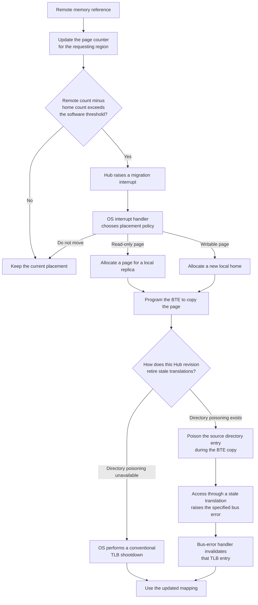

# Datasheet: Hub Block Transfer Engine

References rendered as citation identities name material outside this document
set. Those targets are not included or cleared for redistribution. Review and
runtime statements retain their recorded dates and scope.

**Status:** reviewed (independent second reader at the delegated gate,
2026-08-18) — **the per-engine register contract, the PROM diagnostic path,
and the kernel-facing behavioral contract are cleared and may be implemented;
the error-path clauses are cleared with the review's two must-fix
corrections, which this revision carries.** The verdict, the claim-by-claim
verification and the six applied notes are in
the gate review (citation: `docs/reviews/hub-bte-datasheet-review.md`). No review
findings remain open; the document's open questions are hardware unknowns,
each audited by the review.

**Fork file(s):** none yet. The Hub register block lives in `hw/misc/sgi-hub.c`
and the two engines decode inside its register window; where the engine code
lands is the implementer's choice. This document was written by a source-reader
who has read the IRIX tree and must not write the fork code for this device
(cleanroom, D-0002).

**Sources used:**

- IRIX 6.5.7 `stand/arcs/IP27prom/hub_diags.c` (`$Revision: 1.9 $`) and
  `hub_diags.h` (`$Revision: 1.4 $`) — the PROM's BTE diagnostic, the sequence
  our firmware boot fails today.
- IRIX 6.5.7 `stand/arcs/IP27prom/main.c` (no revision ident) — where and when
  the diagnostic runs.
- IRIX 6.5.7 `stand/arcs/include/hub.h` (`$Revision: 1.35 $`) — the PROM's
  interrupt test/set/clear macros, which define what the diagnostic's polling
  actually reads.
- IRIX 6.5.7 `stand/arcs/lib/libkl/hwreg/hwreg_hub.hwreg` (no revision ident) —
  the machine-readable Hub register table: field positions, per-field access
  types and reset values.
- IRIX 6.5.7 `irix/kern/ml/SN/SN0/bte.c` (`$Revision: 1.83 $`) and
  `irix/kern/sys/SN/SN0/bte.h` (no revision ident) — the kernel driver:
  launch order, completion by notification, error recovery, alignment rules.
- IRIX 6.5.7 `irix/kern/ml/SN/SN0/hubio.c` (`$Revision: 1.110 $`),
  `irix/kern/ml/SN/SN0/huberror.c` (no revision ident) and
  `irix/kern/os/vmdump.c` — the enable-mask sense witnesses and the
  crash-dump reader of the count register, added at review.
- IRIX 6.5.7 `irix/kern/sys/SN/SN0/hubio.h` (`$Revision: 1.80 $`),
  `irix/kern/sys/SN/SN0/addrs.h` (`$Revision: 1.127 $`),
  `irix/kern/sys/SN/kldiag.h` (no revision ident),
  `stand/arcs/include/rtc.h` (`$Revision: 1.9 $`) — register names and bits,
  the diagnostic's buffer addresses, the result codes, the timeout units.
- IRIX 6.5.5 `irix/kern/ml/SN/SN0/bte.c` (`$Revision: 1.78 $`) and
  `irix/kern/sys/SN/SN0/bte.h` — release-agreement check; the 6.5.5 tree has no
  `stand/arcs`, so the PROM diagnostic exists only in our 6.5.7 copy.
- Linux mainline `arch/mips/include/asm/sn/sn0/hubio.h` (public, GPL) — the
  public names for every register and bit in this document. The file declares
  in its own comment that it is derived from the IRIX header at revision 1.80,
  the exact revision we hold, so
  it is one source read twice, not two (citation: `docs/library/linux-sn0-headers-are-irix-derivatives.md`).
  The stale 2018 snapshot in `refs/linux-mips` carries the same block-transfer
  definitions. Linux mainline `arch/mips/sgi-ip27/ip27-klnuma.c` shows Linux
  does not use the engine.
- OpenBSD 7.9, pinned branch `origin/sgi-is-alive-at-7.9` of the
  `the-machine-hall/openbsd-sgi` tree, searched through git over
  `sys/arch/sgi` — carries no block-transfer register, bit, or code at all.
  The searches and their controls are recorded in the behavioral notes.
- SGI *Origin2000 and Onyx2 Power-On Diagnostics*, `108-0161-002`
  (`docs/library/cache/prom/`, published) — the test's public description, its
  failure-does-not-stop-boot behavior, and result codes 159 and 160.
  The library's full read (citation: `docs/library/origin2000-power-on-diagnostics.md`).
- SGI *Origin2000 and Onyx2 Diagnostic Roadmap*, `108-0164-002` (cached,
  vendor-internal) — a real machine's passing console transcript.
  The library's full read (citation: `docs/library/origin2000-diagnostic-roadmap.md`).
- SGI *IP27 PROM Technical Reference*, `108-0170-001` (cached) — checked and
  carries nothing on the block-transfer engine; the searches are in the
  behavioral notes.
- SGI *Origin and Onyx2 Theory of Operations Manual*, `007-3439-002`, revision
  002 — the Origin 2000 page-reference counters, migration interrupt, OS policy,
  BTE copy, and the proposed directory-poisoning path.[^theory-bte-migration]
- Our own capture
  `docs/boot-logs/firmware.boot.2026-08-16T15:56-07:00` — the stock PROM 6.11
  failing this device's diagnostic on our machine.

We read reference sources and never copy their code or file structure
(source-use policy, D-0002).

**Which facts came from where.** Register offsets and bit positions are public
in the Linux mainline header, and that header is a declared copy of the IRIX
header we also hold — so the register map rests on SGI's own account of
its own part, stated once and published twice. OpenBSD carries nothing on this
device, so unlike the widget-identity register in
[the Hub I/O interface datasheet](hub-io-interface.md) there is no independent
second source anywhere in this document. Field access types and reset values
are single-sourced from the IRIX machine-readable register table, as they are
for every Hub register covered here. Review does not create an independent
source. Everything operational — what launches a transfer,
what completes one, what the notification write contains, what a read of the
control register does — is single-sourced from IRIX driver and PROM code,
with two narrow exceptions: the *existence* of the copy, termination,
zero-fill, poison, interrupt and notification modes is confirmed by the
published power-on diagnostics manual, and the diagnostic's result codes and
console strings are confirmed by that manual and by our own capture of the
real PROM binary.

## Role

The Hub contains two identical block-transfer engines, publicly named BTE0 and
BTE1. Each is a cache-coherent memory-to-memory copy engine: software gives it
a source physical address, a destination physical address and a length in
128-byte cache lines, and the engine copies or zero-fills that range without
the processor touching the data. The engines sit in the Hub's I/O section —
their registers decode inside the same Hub register window as
[the Hub I/O interface](hub-io-interface.md) — but they move node memory, not
crosstalk traffic. IRIX pairs one engine with each processor slice (the
CPU-number register decides which; kernel `bte.c`, the init routine) and uses
them for page copy, page zero and page-migration poisoning. Linux and OpenBSD
never touch them. The one guest consumer that blocks us today is the stock
IP27 PROM 6.11: its `hub_bte_diag` power-on test programs both engines, waits
thirty seconds for their completion interrupts, and reports
`Hub BTE test failed: hang.` (result code 160) on our machine because no
engine exists to answer. The published diagnostics manual says a BTE failure
does not stop the boot, and our capture confirms the boot continues — so this
device is about making the diagnostic *pass*, not unblocking the boot.

## Page migration and replication path

The Theory of Operations describes a policy loop around the BTE for Origin
2000. Each page has 64 reference counters. Hardware compares the counter for
the accessing region with the home region's counter. When their difference
crosses a threshold chosen by software, the Hub interrupts the operating
system. The operating system then decides whether to leave the page in place,
replicate a read-only page, or migrate a writable page closer to the requester.
The BTE moves the bytes only after that policy decision.[^theory-bte-migration]

The 64 counters are an Origin 2000 description, not a portable requirement for
every machine containing a Hub. The manual calls each counter owner a region.
For the systems it describes, a region normally corresponds to the two
processors sharing one Hub. It also describes a different grouping for systems
above 128 processors. Regular directory memory provides 12-bit counters and
extended directory memory provides 20-bit counters. None of those facts chooses
the threshold or the migration policy. Software owns both.

The interrupt is a request for an operating-system decision, not a command to
the BTE. The manual does not identify the interrupt level, the register that
holds the threshold, the counter saturation rule, or the synchronization used
while the handler moves a page. Those details must come from a register
specification or an observed driver. They must not be inferred from this
system-level sequence.

### Directory-poisoning revision caveat

Revision 002 labels directory poisoning as proposed for future implementations.
Its following description is therefore a proposed protocol, not proof that any
particular Hub revision shipped it. In that protocol, the BTE copy poisons the
source page's directory entry. A processor using a stale TLB entry receives a
special bus error that preserves the virtual address. The bus-error handler can
then invalidate that one translation, and the next access resolves through an
updated or invalid mapping. This is a lazy TLB shootdown.

When poisoning is unavailable, the operating system performs a conventional TLB
shootdown after moving the page. That is the only path the manual states for
existing implementations. A machine model must select it unless a source tied
to the modelled Hub revision establishes directory poisoning. Implementing the
BTE poison control bit as an ordinary copy is not a partial implementation of
this protocol: without directory state, the special bus error, and TLB-handler
interaction, stale translations remain silently usable.

The diagram leaves mapping publication after the copy abstract. Revision 002
does not specify the exact order among the BTE completion, page-table update,
and TLB invalidation. The operating-system driver and the supported Hub revision
must settle that ordering before it becomes a machine contract.

## Register map

Each engine owns six 64-bit registers. All offsets are from the base of the
Hub register window (how a processor reaches that window is specified in
[the Hub I/O interface datasheet](hub-io-interface.md)); engine 0 starts at
`0x41_0000`, engine 1 at `0x42_0000`, and the layouts are identical — a
per-engine stride of `0x1_0000`. Every access observed is a 64-bit load or
store. All reset values are zero, single-sourced from the IRIX register table.

| Offset | Name | Width | Reset | R/W | Behavior (as guest drivers use it) |
|---|---|---|---|---|---|
| `0x41_0000` | `IIO_IBLS_0` — length/status | 64 | 0 | RW + hardware-updated | Bit 20 busy, bit 16 error, bits 15:0 length in 128-byte cache lines. Software writes busy + length to arm; hardware counts length down to zero and clears busy on completion; error latches on a failed transfer. |
| `0x41_0008` | `IIO_IBSA_0` — source address | 64 | 0 | RW | Physical byte address of the source. Only bits 39:7 are stored; bits 63:40 and 6:0 do not participate. |
| `0x41_0010` | `IIO_IBDA_0` — destination address | 64 | 0 | RW | Physical byte address of the destination, same field layout as the source register. |
| `0x41_0018` | `IIO_IBCT_0` — control/terminate | 64 | 0 | RW, side effects | Bit 8 poison, bit 4 notify, bit 0 zero-fill. **A store launches the armed transfer. A load terminates the transfer in progress.** |
| `0x41_0020` | `IIO_IBNA_0` — notification address | 64 | 0 | RW | Physical address of a 128-byte-aligned memory line; bits 39:7 stored, 63:40 and 6:0 read zero. In notify mode the engine writes its final length/status value here as a 64-bit doubleword on completion. |
| `0x41_0028` | `IIO_IBIA_0` — interrupt address | 64 | 0 | RW | Bits 22:16 interrupt level, bits 8:0 destination node. In interrupt mode the engine delivers its completion as pending interrupt *level* on that node's processor interface. |
| `0x42_0000`–`0x42_0028` | `IIO_IBLS_1` … `IIO_IBIA_1` | 64 | 0 | as engine 0 | Engine 1, identical layout at `+0x1_0000`. |

Field details, all from the IRIX register table (single-sourced) with the bit
masks confirmed by the public header:

- **Length/status**: bits 63:21 reserved, 20 busy (RW), 19:17 reserved,
  16 error (the table marks it RW, but vendor code shows a store cannot
  clear it once set — the stall-path evidence in the behavioral notes),
  15:0 length (RW). Length is a cache-line count, so the
  largest single transfer is 65,535 lines.
- **Source and destination address**: bits 63:40 reserved, 39:7 the address,
  6:0 reserved. The register table marks the source register's address field
  read-only and its low reserved bits writable — the mirror image of the
  notification register and of how every driver behaves — which we read as a
  transposition defect in the table; the behavioral notes lay this out.
- **Control/terminate**: bits 63:9 reserved, 8 poison, 7:5 reserved, 4 notify,
  3:1 reserved, 0 zero-fill.
- **Notification address**: bits 63:40 reserved, 39:7 the address (RW),
  6:0 reserved read-only.
- **Interrupt address**: bits 63:23 reserved, 22:16 the level (the table names
  this field as address bits, the public header as the interrupt level — same
  position, and the behavioral notes reconcile the two), 15:9 reserved,
  8:0 the destination node number. The public header's masks allow levels 0
  through 127 and nodes 0 through 511.

Three registers *outside* the per-engine blocks carry BTE state. The first
two participate in the error path; they live among the Hub I/O interface's
error registers, and only their BTE-relevant bits are stated here:

- **I/O error clear** (`IIO_IECLR`, `0x40_01f8`): writing bit 17 clears
  engine 0's latched error state, bit 18 engine 1's (public bit names; the
  kernel writes them at boot and during error recovery — exactly which
  visible bits they clear is open, narrowed by the stall-path evidence in
  the behavioral notes).
- **Miscellaneous enable mask** (`IIO_IMEM`, `0x40_01e8`): bit 4 is engine 0's
  enable, bit 8 engine 1's. The Linux mainline header's comment describes a
  clear bit as "shut down due to error"; the kernel *sets* the bits to
  re-enable after an error. Read together: the engine clears its own enable
  when a transfer errors, and recovery writes it back. **The fields reset to
  zero, and nothing the machine boots writes this register before first use —
  the PROM diagnostic never touches it and depends on both engines working
  from power-on. So whatever these bits gate, transfers must complete from
  reset with no enable-mask write; a model that gates launches on an enable
  bit that resets to zero reproduces exactly the hang this device exists to
  remove.**
- **BTE CRB count** (`IIO_IBCN`, `0x40_0200`): named publicly; performance
  and diagnosis machinery with no operational reader — IRIX's crash-dump
  register sweep lists it among the Hub registers it dumps (kernel
  `vmdump.c`), which needs a decoded read and nothing more; out of scope.

## Behavioral contract

**Programming a transfer.** Every observed launch is the same five stores to
one engine, in an order that varies except for the last one:

1. Source address register ← source physical address.
2. Destination address register ← destination physical address.
3. Length/status ← busy bit + length in cache lines.
4. Notification address ← a cache-line-aligned physical address (kernel), or
   interrupt address ← level + node (PROM diagnostic).
5. **Control/terminate ← the mode bits. This store launches the transfer.**

The kernel writes them in that numbered order (kernel `bte.c`, the transfer
routine); the PROM diagnostic writes length/status *first*, then source,
destination and interrupt address, then control (PROM `hub_diags.c`,
`hub_bte_diag`). Since the diagnostic arms busy + length before the source
register holds anything, arming the length/status register cannot itself
start the engine; the control store, last in both observed sequences, is the
trigger.
Every observed launch has the busy bit armed; what a control store does when
busy is clear is unobserved and left open (the proposal: nothing).

**Addresses are physical, cache-line-aligned, and truncated to 40 bits.**
Source, destination and notification addresses are physical byte addresses of
which the register keeps bits 39:7 — so a full SN0 physical address including
its node field (the node field's position is
[the address map datasheet](address-map.md)'s), and both local and remote
memory are reachable; IRIX migrates pages between nodes with this engine
(kernel `bte.c`, the poison-copy path). The kernel masks its addresses to
physical before storing; the PROM stores its buffer addresses as
*cached-memory* window addresses ([the address map datasheet](address-map.md)'s
name for the `0xa800…` space) — values with several bits above bit 39 set —
and depends on the
register dropping everything above bit 39. The model must truncate stored
address values, or the diagnostic's transfers land nowhere. Alignment rules
from the kernel's parameter checks (kernel `bte.h`): source and destination
128-byte aligned, length a multiple of 128 bytes, minimum one line. Nothing
enforces these in any observed hardware path; misaligned programming is
unobserved and the model should log it as a guest error. A length of zero is
never programmed (the kernel returns success without touching the engine);
what the hardware does with an armed zero length is open.

**Physical node ownership, not processor aliases.** Source, destination
and notification addresses retain their programmed node field. Resolve
that field by the [address-map contract's programmed node ownership](address-map.md),
not by fixed board position and not by substituting the launching Hub's
node. The local Hub serves an address matching its programmed NASID.
In the supported two-node topology, otherwise select the peer if its
programmed NASID matches, or use the existing unclaimed-target behavior.
When both Hubs still have reset NASID zero, their own zero-field requests
therefore remain local. Assigning distinct NASIDs changes ownership.

BTE transactions do not inherit processor Calias, Ualias or slice-specific
address transformations. A CPU's MMIO address selects the BTE register to
program. The physical address stored in that register controls the later
memory transaction. This separation applies to all three memory-address
roles, including addresses below the processor's Calias boundary. Derived
routing must follow NASID writes, reset and migration load.

This is a synthesis of positive hardware descriptions with the existing
physical-address contract. SGI's
[programmer's reference, 007-3410-001](https://techpubs.jurassic.nl/library/manuals/3000/007-3410-001/pdf/007-3410-001.pdf),
printed pages 12–13, limits Calias to local processors. Laudon and Lenoski's
[Origin 200/2000 system overview](https://www.ecb.torontomu.ca/~courses/ee8218/sgi.pdf),
pages 4–5, places the BTEs and their request tracking in the I/O interface,
separate from the processor interface. Christie's
[SGI partitioning paper](https://cug.org/5-publications/proceedings_attendee_lists/1998CD/S98PROC/AUTHORS/CHRISTIE/ACROBAT.PDF),
printed pages 3–4, describes BTE read-shared requests targeting the node
owning the physical memory. These passages do not supply a complete
register-by-register decoder specification. They establish the request-path
distinction behind this rule, rather than an undocumented BTE local alias.

**Completion, notify mode (control bit 4 set).** The engine copies, counts
the length field down to zero, clears the busy bit, and writes its final
length/status value — zero on success — as a 64-bit doubleword, in guest byte
order, to the notification address. The kernel's whole completion protocol is
built on that write: it sets the notification word to all-ones, launches, and
spins on the word changing (kernel `bte.c`, the wait routine); on success it
then asserts the length/status register reads with busy clear. During a
transfer the register's length field reads back as the *remaining* count —
the kernel's drain loop polls it down to zero and prints the remainder as a
byte count (kernel `bte.c`, the transfer-completion wait). Whether the
engine writes more than the first doubleword of the notification line is
unobserved (the kernel reads only the first); the proposal is to write
exactly eight bytes.

**Completion, interrupt mode (control bit 4 clear).** The engine delivers
its completion as an interrupt instead: pending bit *level* (interrupt
address bits 22:16) is set on the processor interface of node *node*
(bits 8:0) — the same arrival point as any device interrupt, specified in
[the Hub processor interface datasheet](hub-processor-interface.md): levels
0 through 63 land in the first pending bank, 64 through 127 in the second,
and software clears the bit through the interrupt-modify register. This is
the mode the PROM diagnostic uses (it names it "interrupt mode" with all
control bits zero) and the mode the kernel's compiled-out interrupt variant
uses, programming the interrupt address with a reserved level and its own
node exactly as the field layout describes. The two completion signals are
programmed mutually exclusively in everything we can see: the kernel in
notify mode never programs the interrupt address, and the PROM in interrupt
mode never programs the notification address. If either signal fired
regardless of the notify bit, the other program would take a stray interrupt
or a stray memory write at whatever the unprogrammed register holds — reset
zero — on every transfer; neither program guards against that, and a real
machine runs both. So the model should deliver exactly one signal, chosen by
the notify bit. That exclusivity is an inference from two programs' behavior,
not a stated fact; it is the open question most worth an answer if a
real-hardware probe ever runs.

**Termination.** A *load* of the control/terminate register stops the engine.
The kernel performs that load at three sites — entering the notification
workaround, in the workaround's one-line transfer, and in the engine-stall
workaround (kernel `bte.c`). Its error handler intends a fourth, but a
mis-typed pointer scales the offset and that load never reaches the
register — intent, not execution, and the defect is identical in IRIX 6.5.5
and 6.5.7. The published diagnostics manual lists
"termination of a copy in progress" among the part's modes. What the load
returns is unobserved (the kernel discards it); the proposal is the written
control bits. What a terminated engine's length/status shows afterwards is
also unobserved — the kernel always rearms from scratch.

**Zero-fill mode (control bit 0, with notify).** Every observed zero-fill
leaves the destination range zeroed — and every observed launch programs a
zeroed page as the source, so three models are indistinguishable in
everything we can see: write constant zeros, ignore the source, or replicate
the source's 128-byte block across the destination (the kernel header's own
description of the fill capability is that replication). The guest-visible
contract — the destination reads zero afterwards — is a property of every
observed program; under replication semantics it would not be a property of
the mode itself. Open.
The kernel only uses zero-fill on Hub chips at or above revision 2.3 and
falls back to plain copy from the zero page on older parts (kernel `bte.c`,
the init routine) — so which path IRIX exercises depends on the revision our
Hub model reports.

**Poison mode (control bit 8).** IRIX requests it during page migration so that,
after the copy, stale references to the source fault through poisoned directory
state. That is the hardware contract, not behavior a RAM-only copy can reproduce.
Until the memory/directory model represents poison and the resulting faults, QEMU
must not report poison mode as implemented merely because it copied the bytes.
The register and launch semantics belong here. The observable directory effect
remains out of scope.

**Errors.** A failed transfer latches the error bit in length/status and
shuts the engine down (its enable bit in the miscellaneous enable mask
clears). The error itself surfaces through the Hub I/O interface's coherent
request buffer machinery and error interrupt, not through a BTE register:
the kernel's recovery sequence (kernel `bte.c`, the error-recovery comment
block and handler) is — process and flush the failed request buffers, load
the control/terminate register to stop the engine, set the engine's enable
bit back in the miscellaneous enable mask, write the engine's clear bit in
the I/O error clear register, and clear the interrupt-sent bit in the Hub's
interrupt-destination register. The kernel also writes the engine's I/O
error clear bit once at every boot before first use (kernel `bte.c`, the
init routine). Distinguishing failure modes from the guest's seat: error bit
set means the transfer errored; busy never clearing and no completion signal
means the engine hung — the PROM's two result codes, 159 "failed" and 160
"hung", draw exactly this line, and both codes are public in the diagnostics
manual. On success the hardware notification carries zero; the kernel's
CRB-error path writes an error value into the notification word *in
software*, so a hardware notification write on error is not established —
the model should set the error bit and raise the error machinery, not
fabricate a notification.

**Reset.** All twelve registers read zero at reset (single-sourced from the
IRIX register table). No source describes what a chip reset does to an
in-flight transfer; the proposal — unobserved, so it stays a proposal — is
that reset aborts the transfer and zeroes the registers, which is what the
QEMU reset phases give us anyway.

**Concurrency.** The two engines run simultaneously — the PROM diagnostic
launches both and waits for both. IRIX assigns engine 0 to processor slice A
and engine 1 to slice B by convention (kernel `bte.c`, the init routine
keyed on the CPU-number register); nothing observed enforces ownership in
hardware.

## The PROM diagnostic's contract

This is the sequence the implementer must satisfy first, restated as behavior
from PROM `hub_diags.c` (`$Revision: 1.9 $`), `hub_diags.h`
(`$Revision: 1.4 $`) and `main.c` (no ident) in IRIX 6.5.7. The running
firmware is the PROM 6.11 binary from the 6.5 base assets, not a build of
this source; its failure banner, its result code 160 and its two
pending-register dumps match this source's failure path exactly, which is the
evidence this sequence is what our machine executes.

The diagnostic runs on the local master CPU only, before network discovery,
and only when diagnostics are not disabled. It uses four half-megabyte
buffers in node-local memory at physical `0x0150_0000`, `0x0158_0000`
(sources for engines 0 and 1) and `0x0160_0000`, `0x0168_0000`
(destinations), inside a region the PROM reserves for diagnostics. It fills
each source with a distinct byte pattern and both destinations with a third,
through cached stores.

Then, per engine — engine 0 first, all four stores, then engine 1:

1. Length/status ← busy bit + `0x1000` (4,096 cache lines, 512 KB).
   The stored value is `0x0010_1000`.
2. Source address ← the buffer's cached-memory window address (bits above
   39 set — the truncation rule in the behavioral contract is load-bearing
   here).
3. Destination address ← likewise.
4. Interrupt address ← level 63, node 0 for engine 0 (`0x003f_0000`);
   level 62, node 0 for engine 1 (`0x003e_0000`).

Then it launches both: control/terminate of engine 0 ← 0, control/terminate
of engine 1 ← 0. All control bits zero is interrupt-mode plain copy.

Then it polls, with a thirty-second budget (thirty million microseconds on
the PROM's microsecond clock):

- It reads the first interrupt-pending bank of its own Hub's processor
  interface and tests bit 63 (engine 0's programmed level). Until that bit
  sets, it loops; if the budget expires first it prints both pending banks
  (the two `INT_PEND0:`/`INT_PEND1:` lines in our capture — both zero on our
  machine, because nothing ever sets bit 63), declares result code 160,
  "hang", and returns failure.
- Once bit 63 is set it tests bit 62 (engine 1). Only if *both* are set does
  it clear both, by writing the interrupt number to the processor interface's
  interrupt-modify register. If engine 1's bit is not yet set the diagnostic
  does **not** loop back — it proceeds with engine 1's bit still pending and
  the bits never cleared. A model that completes both transfers before the
  first poll avoids this window entirely.
- It then compares each engine's source buffer against its destination,
  eight bytes at a time, through cached loads. Any difference is result code
  159, "failed". Both equal is a pass.

So the model's minimum obligations for a pass: truncate the stored
addresses; copy 512 KB from each source to each destination in ordinary
physical memory, complete by the time the guest polls (instant completion is
fine); set pending bit 63 and bit 62 in the node's first interrupt-pending
bank as interrupt-mode completions; leave the notification path silent; and
let the interrupt-modify register clear the bits, which
[the Hub processor interface](hub-processor-interface.md) already implements.
On a pass at normal diagnostic verbosity the test prints nothing — the
`BTE0 completed.`-style lines in the vendor's roadmap transcript are the
verbose diagnostic mode — so the observable success on our machine is the
*absence* of the three failure lines and the two pending-bank dumps.

The published diagnostics manual describes this test as covering copy,
termination, zero-fill, poison, interrupt and notification modes; the 6.5.7
source performs only the two-engine interrupt-mode copy just specified. We
take the
manual as naming the part's real feature set and the source as what the test
actually does; if a later PROM exercises more modes, the behavioral contract
already specifies them.

## Interrupts

The engines produce no interrupt of their own wiring. Completion in interrupt
mode arrives as a pending bit on a processor interface — any level 0–127, any
node — exactly as a device interrupt arrives at the interrupt-modify
register, and is cleared the same way; the pending banks, masks and CPU lines
are wholly [the Hub processor interface datasheet](hub-processor-interface.md)'s.
Completion in notify mode raises nothing. Errors raise the Hub's own error
interrupt through the interrupt-destination register, which is
[the Hub I/O interface datasheet](hub-io-interface.md)'s.

## DMA

The engines read and write ordinary physical memory, 128-byte lines at a
time, cache-coherently — on real hardware their traffic participates in the
directory protocol (the public header's request-buffer encodings name BTE
block-read, exclusive-read and write-invalidate message types), which on our
cache-less model reduces to plain reads and writes of guest RAM. Local and
remote targets follow programmed physical node ownership. The
notification write is a single 64-bit doubleword in guest byte order at the
programmed (line-aligned) address. Nothing here crosses the Bridge or any
crosstalk widget, so the Bridge's IOMMU and byte-swap machinery are not
involved.

## Out of scope

- **Poison mode's directory effect.** The control bit and its launch
  semantics are in scope. The poisoned directory state and the faults it
  causes belong to the memory-directory model. IRIX can reach this path during
  migration, so treating poison as a successful plain copy would silently leave
  the source valid and violate migration semantics.
- **The BTE CRB count register** (`0x40_0200`) and the per-request-buffer
  fields that name an owning engine — performance/diagnosis machinery with no
  observed guest reader.
- **The notification-loss hardware bug and its workarounds.** Real Hubs
  sometimes fail to write the completion notification; IRIX carries a
  retry-and-nudge workaround (one-line transfers on both engines, up to
  sixteen retries) and a separate engine-stall workaround for old chip
  revisions that deliberately wedges both engines against a bad address at
  boot on routered systems. A model that always notifies makes the workaround
  code a no-op on the success path. The stall workaround is gated on routers
  being present, which our machine never has. Do not model the bug.
- **Transfer-rate realism.** Instant completion is not only acceptable but
  actively simplifies the PROM diagnostic's no-loop-back window.
- **CRB-level error recovery.** The flush-and-rewrite of individual coherent
  request buffers during BTE error recovery is the Hub I/O interface's
  machinery; this datasheet only requires that the error bit, enable bit and
  error-clear bit behave as stated. No guest we boot takes a BTE error on a
  correct model.

## Behavioral notes

**The register table's source-address entry has its access types transposed.**
It marks bits 39:7 (the address) read-only and bits 6:0 (reserved) writable —
the exact mirror of its own notification-address entry, and irreconcilable
with every driver, which stores source addresses and depends on them. The
destination entry inherits the same annotation by reference. We read the
address fields of both as writable and the low bits as reserved. Same shape
as the one-wire timing-mask defect this project has already caught in SGI's
own headers: internal consistency, not blind trust in either artifact.

**The interrupt-address register's level field is named two ways.** The
register table calls bits 22:16 address bits; the public header calls them
the interrupt level. The positions agree, and the kernel's interrupt-mode
variant composes the register as level-shifted-left-16 or'd with the node —
so "level" is what the field means to software, and the table's name is
presumably how the interrupt write's target address is formed inside the
chip. We follow the header.

**The enable-mask comments and the recovery code point opposite ways, and
reconcile — with the vendor tree split against itself.** The Linux mainline
header annotates the miscellaneous-enable-mask bits as "shut down due to
error"; the kernel *sets* those bits to bring an engine back. Both fit a
register whose bits read as the enable state — cleared by hardware on an
error shutdown, written back by software to re-enable. Two further vendor
witnesses split on the bit sense. The crosstalk error handler (IRIX 6.5.7
`hubio.c`, revision 1.110) reads the mask and refuses to touch widget
registers when the widget-0 and engine-0 bits are both *clear* — a
functional decision only consistent with set-means-alive, and the strongest
witness on file — while its own comment reads the bit the other way. A Hub
error path (IRIX 6.5.7 `huberror.c`, no revision ident) picks a shutdown
reason string for a *set* bit — the opposite sense, in a cosmetic string on
a panic path. We follow the functional code. The register table marks the
bits write-only, which would make the read-back half unobservable; the
kernel reads, ORs and writes the register, so we read the table's W as
under-documentation rather than a contradiction. Open in the strict sense
that no source states the semantics outright — and pinned down enough for
the model by the works-from-reset requirement in the register map: whatever
the sense, no software sets these bits before the diagnostic must pass.

**A store to length/status clears busy but cannot clear a set error bit.**
The engine-stall workaround deliberately errors both engines — each then
reads error and busy set together — stores zero to each length/status, and
then requires error still set with busy clear (kernel `bte.c`, the stall
workaround). Direct vendor evidence, on a path no guest we boot runs (it is
gated on routers and old chip revisions): busy and length are write-through,
error is not — it clears through the I/O error clear register's engine bit,
or not at all. This narrows the error-clear open question without closing
it: that register's bit is the only clearing mechanism any code relies on,
and no code observes its effect on a register a guest then reads.

**Level 63 and 62 are the diagnostic's choice, not the hardware's.** The
kernel's interrupt-mode variant allocates whatever level the interrupt
subsystem hands it. Nothing is special about the top of the first pending
bank; a model must take the level from the register, not hardwire the
diagnostic's values.

**The searches behind the negatives.** OpenBSD: the pinned 7.9 branch,
`sys/arch/sgi`, searched through git for the register names
(`IIO_IB*`, `IBLS`, `IBCT_`, `IBNA`, `IBIA`, `BTEOFF`) — zero matches — and
for the word `bte` — zero matches as a word; a looser case-insensitive
pattern returned twenty-seven hits, every one the string `libsa`/`LIBSA`
(which contains `ibsa`), which is the control showing the search mechanism
works. The IP27 PROM Technical Reference `108-0170-001`: text-extracted and
searched for `bte` and `block transfer`, zero matches, against the same
extraction finding both terms in the power-on diagnostics manual. Linux
mainline: the only `arch/mips/sgi-ip27` reference to the engine is a comment
deferring to it ("when the BTE works"), and the code copies with the CPU
instead — Linux never programs these registers. Roots searched for every
claim in this document: `refs/irix-source` (both releases),
`refs/linux`, `refs/linux-mips`, `refs/openbsd-sgi` (pinned branch, via
git), and the library cache's three PROM-related manuals.

**Release agreement.** The kernel driver's header is byte-identical between
IRIX 6.5.5 and 6.5.7 except for one function prototype gaining a parameter;
the driver advanced from revision 1.78 to 1.83. Register constants, modes
and alignment rules agree across both releases. The PROM diagnostic exists
only in the 6.5.7 tree (6.5.5 has no `stand/arcs`), so every PROM-side claim
is single-release as well as single-sourced.

**The capture is consistent with the source's failure path, line for line.**
The two zero pending-bank dumps, then the three-line failure block naming
result code 160, then the boot continuing into network discovery — each is
what `hub_diags.c` prints on the timeout path and what the published manual
says about the boot continuing. That is the full extent of what the capture
establishes: our machine, no BTE, timeout path taken.

## qtest checklist

Register contract, per engine (run the whole set at both engine bases):

- All six registers read zero after machine reset.
- Length/status: busy and length hold written values before a launch; the
  reserved ranges 63:21 and 19:17 read zero. Do not assert that a store
  clears a set error bit — vendor code stores zero to an errored engine and
  then requires the error bit still set (the stall-path evidence in the
  behavioral notes); the error bit's writability is open. Assert only that
  it reads zero when never set.
- Source, destination, notification address: store a value with bits 63:40
  and 6:0 set, read back only bits 39:7 (the truncation assertion — use an
  address with the cached-memory window's upper bits set, since the PROM
  depends on exactly that).
- Interrupt address: level and node fields hold written values; reserved
  bits read zero.
- Control/terminate: mode bits hold written values; a load does not fault
  and (proposed contract) returns the written bits.

Transfer behavior:

- Interrupt-mode copy, the diagnostic's shape: arm busy + length, program
  source/destination/interrupt-address, store zero to control; assert the
  destination bytes equal the source, length/status reads zero, the
  programmed pending bit is set in the processor interface's pending bank,
  and the notification address's memory is untouched.
- Both engines at once, the diagnostic's exact values: 4,096 lines each,
  levels 63 and 62, node 0; both pending bits set, both copies correct.
- Notify-mode copy: set the notify control bit and a notification address;
  assert the doubleword at that address reads zero after completion, busy is
  clear, and no pending bit was set.
- Zero-fill: notify + zero-fill bits; destination range reads zero,
  completion notification arrives.
- Address truncation end-to-end: program a source with upper bits set and
  verify the copy read the intended physical range (not a wrapped or void
  one).
- Guest-error logging (not a crash): misaligned address or zero length.

The firmware gate that motivates the whole device: the stock PROM 6.11 boot
must lose the
`hub_bte_diag` failure block — no `RSLT hub_bte_diag FAIL`, no result code
160, no pending-bank dumps — with the rest of the recorded boot progress
unchanged.

[^theory-bte-migration]: *Origin and Onyx2 Theory of Operations Manual*, SGI
    part `007-3439-002`, revision 002, “Page Migration and Replication,” Figure
    2-12, and “Directory Poisoning,” printed pages 49-51/PDF pages 63-65.
    SHA-256
    `f6f30191b662aeef6c9888f109c4997d58ac9c4a77acd24263937c6392113309`.
