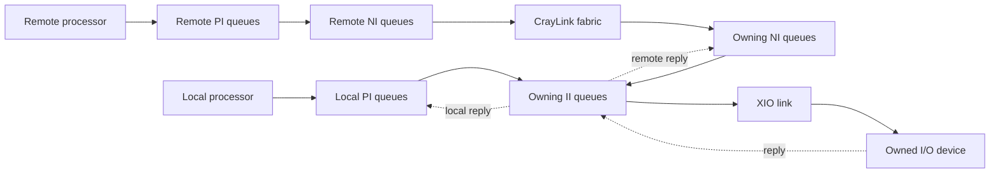

# Datasheet: Hub I/O interface

References rendered as citation identities name material outside this document
set. Those targets are not included or cleared for redistribution. Review and
runtime statements retain their recorded dates and scope.

**Status:** reviewed (coordinator with codex, 2026-08-09) — **ready**. The
crosstalk link-up contract this was made conditional on is written and ratified.
The inbound-link-reset boundary added in 2026-09-06 has
independent source clearance (citation: `docs/reviews/crossbow-dma-reset-independent-review-20260907.md`)
for the bounded behavior stated here.
The graphics routing pair entry, added 2026-09-27, is not yet independently
reviewed.
**Fork file(s):** `hw/misc/sgi-hub.c` (the register block and the big-window
translation), `hw/mips/sn0.c` (the address decode the translation feeds)

**Sources used:** the IRIX 6.5.7 machine-readable Hub register table
`stand/arcs/lib/libkl/hwreg/hwreg_hub.hwreg` and the IRIX header
`irix/kern/sys/SN/SN0/hubio.h`; Linux `arch/mips/include/asm/sn/sn0/hubio.h`,
`arch/mips/include/asm/sn/io.h`, `arch/mips/include/asm/xtalk/xwidget.h` and
`arch/mips/sgi-ip27/ip27-init.c` (public, GPL, and themselves derived from the
SGI headers); OpenBSD `sys/arch/sgi/xbow/hub.h` and `sys/arch/sgi/xbow/widget.h`
from the `the-machine-hall/openbsd-sgi` tree (public, ISC). OpenBSD retired its
SGI port, so those files exist on no checked-out branch and are read with
`git -C refs/openbsd-sgi show 2df91d80c1:sys/arch/sgi/xbow/hub.h`. The
published *Crossbow ASIC Specification*, revision 12.0, supplies the remote LLP
reset and renegotiation behavior. The
address arithmetic that reaches this unit is specified in
[the SN0 address map datasheet](address-map.md), the interrupt bits this unit
sets are specified in
[the Hub processor interface datasheet](hub-processor-interface.md), and the
device on the modeled base machine's direct crosstalk path is specified in
[the Bridge datasheet](bridge.md). We only read reference sources and never copy
their code or file structure (source-use policy, decision D-0002).

**Which facts came from where, and most of it is one source rather than two.**
Register offsets, field positions and widths agree between the IRIX header and
Linux's — **and Linux's declares in its own comments that it is derived from that
exact IRIX header, at a named revision.** So this is a header and its own copy,
not two sources, and **it is the weakest form of the case**: unlike a
machine-readable table agreeing with a header, there is no second artifact here
at all. The bit-field structures covering the widget identity, widget control,
widget status, link control and status, link log, the two widget-access registers
and the interrupt-destination register appear in both because one was copied from
the other. **Every field this datasheet states still matches those structures
position for position and width for width** — that check was real and its result
stands; what it establishes is that the transcription is faithful, not that two
sources agree.

**One register does have an independent second source, and it is worth knowing
which.** OpenBSD's `sys/arch/sgi/xbow/widget.h` carries the **widget identity**
register with its own revision, product and vendor masks and shifts, written
independently under the ISC licence. **Its `hub.h` carries none of the Hub
I/O-specific registers** — no link control or status, no log, no widget-access
pair, no interrupt destination, no big-window translation entries. **So the
independent check reaches the identity register and stops there**, and the rest
of this page rests on SGI's own account of its own part.
The big-window translation entry's layout is corroborated a third time, across
chip generations, by the generated header for the later Bedrock part, which gives
the same offset, widget and space-select fields at the same positions for the
same seven entries.

**Reset values and per-field access types are single-sourced from the IRIX
machine-readable register table**, because nothing public carries either; every
reset value in the register map should be read as resting on that one source
alone.

One register, the interrupt destination, is described two incompatible ways
inside each header — by masks and by a structure — and this datasheet follows the
structure. The reasoning is set out in the behavioural notes rather than
compressed into a footnote, because an earlier reading of the same evidence
reached the opposite conclusion.

Nothing here comes from the Bedrock or SN1 material except that one
cross-generation corroboration, which is flagged where it is used. The older
Linux kernels were checked for a richer SN0 header — the 2.5 series and the
historical MIPS 2.4 tree both carry SN0 headers equivalent to current mainline's,
and the generated field-by-field style exists only for the later SN1 and SN2
parts, which are a different chip.

## Role

The Hub's I/O interface is the Hub's port onto crosstalk. It does three
jobs that matter to a booting guest and several that do not.

It is the Hub *as a widget*. Every crosstalk widget begins its address
space with the same identification, status and control registers, and this unit
is where the Hub presents that face. Crossbow, when a machine contains one, or
firmware walking the I/O topology
reads the Hub here and learns it is a Hub.

Crossbow is not intrinsic to this interface. The base Origin 200 reaches its fixed
Bridge directly. Origin 200 GIGAchannel reaches an external Crossbow through paired
Crosstown adapters, and Origin 2000 uses Crossbow in its documented I/O topology.
The public product diagrams establish those placements but do not establish a
single physical Hub crosstalk-port count.

The placement boundary comes from *Origin200 and Origin200 GIGAchannel Owner's
Guide* 007-3708-002, revision 002, SHA-256
`ae6857707a113bd63b77a3a8187c81beed76cea1406592a38a735c4aa2c462dc`,
Figures 1-4 and 1-5 on printed pages 6-7/PDF pages 32-33. The printed-to-PDF
offset of 26 is trusted, and both original pages were visually checked.

It owns the big-window translation table. The address map gives each node seven
512 MB windows onto crosstalk space; the entries that say which widget and which
part of that widget's space each window reaches live in this unit, at eight-byte
intervals. Firmware programs big window 6 to cover widget 0's first 512 MB. The
public accounts give two unreconciled reasons for avoiding widget 0: an
unestablished processor-interface fault and firmware's narrower warning about
error handling. Small window 0 still decodes because Linux reaches widget 0
through that path, while OpenBSD uses big window 6.

### Local and remote I/O flow

The I/O interface converts between the Hub's internal request/reply format and
XIO. Its input and output FIFOs each reserve independent logical queues for
requests and replies. A local processor reaches its device through PI and II.
A remote processor first crosses the network to the Hub that owns the device,
then uses that owner's II path.[^theory-hub-ii]

This ownership rule matters when two Hubs share one Crossbow: physical proximity
does not make every attached widget local to both Hubs. Static partitioning
selects one owner, and remote access relays through that Hub. The machine model
must supply the ownership map. This ASIC-level contract does not infer one from
port numbers.

It carries the Hub's own interrupt-destination register — where the Hub sends an
interrupt when the Hub itself has something to report, as opposed to a device
behind the Bridge. That register is the second producer of bits in the processor
interface's pending banks, and the processor interface datasheet defers its
specification here.

Everything else in the unit — the read-request table, the coherent request
buffers, the response buffers, the block-transfer engine's counters, the
crosstalk credit and timeout machinery — exists to make a real chip fast and
diagnosable, and has no functional signature a guest can observe on a machine
whose transfers complete instantly.

## Register map

All offsets are from the base of the Hub register window. A processor reaches
that window two ways. The position-independent way is the crosstalk I/O base with
the node-number field *zero* plus `0x0100_0000` — widget 1's small window on node
zero — which reaches whichever Hub the reading processor is attached to, on every
node, without the reader knowing its own node number. The node-explicit way is
the named node's crosstalk I/O base plus `0x0180_0000`. Every register is 64 bits
and every access is a 64-bit load or store.

The 64-bit access rule describes the processor's full Hub register path. The
common Crosstalk widget block separately uses 32-bit values in the low halves
of eight-byte slots, with the public headers naming offsets plus four, as
described by [Bridge](bridge.md) and [Crossbow](xbow.md). That slot layout does
not establish the complete initiating packet class or receiving Hub alias for
a short widget-ID access. The local register selector one is distinct from a
Hub's physical Crossbow port number, so it does not exclude a peer Hub from
probes of external ports eight through fifteen. The
[incoming-address contract](#incoming-memory-and-full-register-address-classes)
clears only its stated full-register probe and preserves the short widget-ID
mapping as unresolved.

### The widget face

The widget-identification revision and the network-interface revision in
`NI_STATUS` are separate chip fields. A machine inventory must name each field
explicitly rather than treating either one as a generic Hub revision.

| Offset | Name | Width | Reset | Access | Behavior as guest drivers use it |
|---|---|---|---|---|---|
| `0x40_0000` | Widget identification | 32 | fixed | readable | Bits 31:28 revision, resetting to 1; bits 27:12 part number, **resetting to `0xc101`**; bits 11:1 manufacturer, **in dispute — `0x24` or `0x36`**, resolved in the behavioural notes; bit 0 reads one. This is how anything walking the crossbar recognises a Hub. |
Bit 0 is not declared by any Hub source: the register table's field list stops at
bit 1 and the header structure calls the bit reserved. It reads one because this
is the common crosstalk widget identification register in the JTAG device
identification format, and both the Bridge and the Crossbow specifications state
that its lowest bit is always set. We follow the widget contract rather than
invent a Hub-specific answer, and the qtest records it as inherited rather than
sourced.

| Offset | Name | Width | Reset | Access | Behavior as guest drivers use it |
|---|---|---|---|---|---|
| `0x40_0008` | Widget status | 33 | 0 | mixed | Bit 32 flags an unrecoverable state and is readable. Bits 23:16 count link transmit retries — **eight bits, and one source says seven**, resolved in the behavioural notes — and bit 9 flags the retry maximum; both are readable and cleared by writing ones. Bit 6 flags a tail timeout and bit 5 a credit timeout, both readable. Bits 3:0 count outstanding requests. |
| `0x40_0020` | Widget control | 23 | mixed | readable and writable | Bits 22:18 an elasticity threshold; bit 17 direct-connect; bit 16 forces a bad packet; bits 15:13 the crossbar credit, **resetting to 2**; bit 4 tag mode, readable only; bits 3:0 **this Hub's own widget number, resetting to 1**. |

The widget number resetting to 1 is the register-level counterpart of the address
map's statement that widget 1 is the Hub. A model that resets it to zero
contradicts its own address decode.

**What guests do with direct-connect, bit 17 (established from disassembly of
the stock PROM 6.156 image and the IRIX 6.5.30 kernel).** The PROM's I/O
interface setup (its routine at `0x1fc56d68`) clears bit 17, reads widget 0's
identification, and for a Bridge part (`0xc002` or `0xd002`) sets bit 17 with a
crossbar credit of 3, or with a credit of 4 for part `0xc003` or `0xc102` (the
routine at `0x1fc451ec`); a crossbar leaves it clear. IRIX never writes the
widget control register. Its `hub_set_piomode` reads bit 17 to size widget 0's
programmed-I/O request credits, 3 when the bit is set and 1 when it is clear,
and gives widgets 8 through 15 three each. **The model stores the bit and gives
it no effect**, because it models no credits: every access completes at once,
so a credit count changes nothing a guest can observe.

### Access protection

| Offset | Name | Width | Reset | Access | Behavior as guest drivers use it |
|---|---|---|---|---|---|
| `0x40_0100` | Local access protection | 64 | all ones | readable and writable | One bit per memory region controlling which regions may reach this unit. |
| `0x40_0108` | Protection override | 64 | **none — the field is write-only** | special action occurs on write | Writing the eight characters `SGIrules`, which is `0x5347_4972_756c_6573`, unlocks the protection registers. The same password unlocks the processor interface's protection. |
| `0x40_0110` | Outbound widget access | 16 | 0 | readable and writable | One enable bit per widget: bit 0 for widget 0 and bits 15:8 for widgets 8 through 15. Bits 7:1 are reserved. Controls which widgets this Hub may issue requests to. |
| `0x40_0118` | Inbound widget access | 16 | 0 | readable and writable | Same layout, controlling which widgets may issue requests to this Hub. |
| `0x40_0120` | Inbound device error mask | 64 | all ones | readable and writable | Eight bits per widget for widgets 8 through 15, selecting which of that widget's devices may report errors. |

Both access registers reset to zero, meaning nothing is permitted until firmware
opens them. Neither OpenBSD nor Linux writes them — real firmware is what opens
them, in IRIX's crosstalk-interface bring-up routine's own protection-setup step,
which writes both unconditionally during Hub bring-up, so the diagnostics track's
guest does depend on the write even though no guest we currently boot does. The model
stores them and does not enforce, for the same reason the processor interface's
protection registers are storage: enforcing a register our synthesized firmware
forgets to open produces a machine with no working I/O and no diagnostic. That
choice already covers the diagnostics-track write correctly, regardless of
which specific bits it sets, so this is a scope note rather than a gap.

### Link control

| Offset | Name | Width | Reset | Access | Behavior as guest drivers use it |
|---|---|---|---|---|---|
| `0x40_0128` | Link control and status | 42 | mixed — **the link state is a deliberate departure** | mixed | Bits 41:32 the maximum burst, resetting to `0x3fc`; bits 25:16 the maximum retry count, resetting to `0x3ff`; bits 13:12 the link state, readable only, which the register table resets to zero and which **our model must instead present as up**; bit 11 eight-bit mode, readable only; **bit 10 link enabled, writable** — real firmware operates it itself (IRIX's own link-enable routine, an ordinary load-modify-store through this register once a real part is identified on the link), unset at reset; bit 8 a warm reset trigger, a one-shot that reads zero (see below); bits 5:0 a null-packet timeout resetting to `0xa`. |
| `0x40_0130` | Link log | 32 | 0 | readable and writable | Bits 31:16 a check-bit error count, bits 15:0 a sequence-number error count. |

The link state field encodes four values, and the encoding is not the obvious
one: zero means the link failed, one means it never came up, and both two and
three mean it is working. A model reporting zero for a working link, or a guest
test asserting that a working link reads one, would be wrong in opposite
directions. The encoding has a convenient consequence that both a guest and our
model rely on: because the two working values are the two with the high bit of
the field set, testing bit 13 alone answers "is this link up?", and that is
exactly the test mainline Linux performs.

An inbound Crossbow per-link reset clears the Hub-side LLP transmit buffer and
protocol state and restarts width negotiation. The observable link state must
therefore leave a working value while negotiation or failure is in progress and
return to a working value only if negotiation succeeds. The IRIX 6.5.7 Hub
register sources name failed, never-up and working values but do not specify the
exact transient value or any reset of the wider Hub I/O-interface register
block. Non-LLP Hub state retention remains open.

That requirement and that missing value cannot both stand. The field is two bits
and all four codes are spoken for: failed, never came up, and two that mean
working. No code is left to mean "negotiating". Departing from a working value
therefore means reading failed or never-came-up while renegotiation runs, and
neither is established — the requirement can be met only by inventing the value
withheld alongside it.

Until that is settled a model keeps the field reading its working value, and says
so at runtime rather than choosing a code. That is a departure from the
requirement above, stated rather than silent. What would settle it: SGI's own Hub
or I/O-interface specification giving the field's value during renegotiation, or a
read of the link control and status register on hardware while a Crossbow link
reset is in progress.

**The link log accretes LLP errors, is cleared by writing zero, and a healthy link leaves it at
zero.** The link log at `0x40_0130` counts two kinds of crosstalk link-level-protocol error —
check-bit errors in bits 31:16 and sequence-number errors in bits 15:0 — each incrementing when
the LLP layer detects that fault on the link. A link that is up and error-free never increments
either, so both counts stay at their reset zero. The register is **read, then cleared by a write
of zero**: a consumer reads the current counts and writes zero to reset the interval; a read alone
does not clear it.

**What reads it, and why the served value is not passive.** On the IRIX 6.5.30 kernel a periodic
hub error-statistics capture — roughly once a second — reads this log, writes zero to clear it,
and a companion routine evaluates the accumulated error rate. This is a **new consumer in 6.5.30**:
the 6.5.7 kernel defines the register but never reads it, so a model validated only against the
older kernel would never see the log exercised. Because that consumer *evaluates* the counts
rather than merely reporting them, the value the model serves is an input to a decision, not a
passive read — a fabricated nonzero count is an intervention. A model must therefore keep both
counts at zero for a healthy link: a read returns zero, and the consumer's periodic write of zero
clears an already-zero log. Do not synthesize link errors the emulated link did not commit.
(Whether the error-rate evaluator takes a corrective action on a nonzero count — disabling the
link, demoting a resource — is **not established**: the 6.5.7 source carries no such routine to
read, and the 6.5.30 kernel could not be disassembled with the tooling to hand. It is flagged as
the reason to serve zero rather than guess, consistent with a separate case where a served value
drove firmware to demote a processor. Serving zero makes the question moot.)

**The warm-reset trigger, bit 8, is written at every boot, and each write with it set sends
a warm reset down the link.** The stock PROM 6.156 sets it from its reset-vector code (the
routine at `0x1fc0230c`) and, on the direct-Bridge path, writes it set twice, 10 ms apart,
never writing it clear (the routine at `0x1fc44cdc`); the IRIX 6.5.30 kernel sets it in its
power-fail handling, `do_powerfail_wars` (established from disassembly). Linux `hubio.h`
names the bit `ILCSR_WARM_RESET`. The published *Crossbow ASIC Specification*, revision 12.0,
says what a Crossbow does with a warm-reset pattern arriving on one of its links: it treats
it as a power-on reset of its own core logic, sends warm resets out on every link, and its
link layer ignores further resets for 1024 cycles (its "Reset of Device" section, printed
pages 132-133). That a Hub's bit 8 sends that pattern is inferred from the bit's name and
that section, and that it sends one per write from the PROM's two writes. A Bridge cabled
straight to the Hub resets its core, since "the core logic reset is driven from the link
reset out of the LLP section" (Bridge ASIC specification rev 4.0, section 7.5, printed page
89); that a received warm-reset pattern drives that output as a received link reset does is
inferred, and the Crossbow's own LLP keeps the two apart, with a separate RcvWarmReset output
(Crossbow rev 12.0, printed page 103) and a SendWarmReset that "causes remote WarmReset line
to pulse instead of LinkReset line" (page 126). **The model** sends a reset pulse to the far
end of the XIO link on each write with the bit set, and the bit reads zero, a one-shot like
the Crossbow's own link reset bit. That it reads zero is inferred from the PROM: after its
reset vector sets bit 8, it brings each node's link up by setting the link-enable bit, 10,
with a read-modify-write of this register (the routine at `0x1fc453a8`), and a bit that read
back set would send a second warm reset there. A four-node Origin 2000 run with the bit
stored did send it, one node's link enable resetting the Crossbow and the BaseIO Bridge under
the node loading the BaseIO PROM, and hung. A Hub that receives a warm reset changes nothing,
as for a per-link reset.

**Provenance.** The register layout and the link-state encoding are read from the IRIX 6.5.7 I/O
interface register header — stable register definitions. The active statistics consumer is
identified in the 6.5.30 kernel by its debug line information and is absent from the 6.5.7 kernel;
the once-a-second read-then-clear cadence is measured on the hung 6.5.30 boot. Stated
behaviourally, in our own words.

### Interrupt destination

| Offset | Name | Width | Reset | Access | Behavior as guest drivers use it |
|---|---|---|---|---|---|
| `0x40_0138` | Interrupt destination | 29 | 0 | mixed | Bit 28 reports that an interrupt has been sent, readable and writable. Bit 24 enables the Hub's own interrupt, readable and writable. **Bits 16:8 name the destination node**, nine bits. **Bits 6:0 name the interrupt number**, seven bits. Bits 27:25, 23:17 and bit 7 are reserved and read zero. |

**The two field widths were nearly recorded wrong, and the wrong widths would
have constrained the firmware.** Both the IRIX I/O interface header and Linux's
copy of it carry two contradictory descriptions of this one register: a set of
`#define` masks that make the node field eight bits at 15:8 and the number field
six bits at 5:0, and a bit-field structure a few hundred lines further down the
same file that makes them nine bits at 16:8 and seven bits at 6:0. The wide
reading is the right one, and the reasoning is set out in the behavioural notes.

**The model stores the register and never sends the Hub's own interrupt.** IRIX 6.5.30's
`hubii_eint_init` programs it with the interrupt number, the enable bit and the node, and
its handler reads the widget status (the unrecoverable-state bit and the retry, tail and
credit time-out bits), writes the error clear register and clears the sent bit (established
from disassembly). The model raises none of those conditions, so nothing ever sends the
interrupt; that follows from the absent causes rather than from a gap in the register. The
widget-status conditions are link-level, the unrecoverable state and the retry, tail and
credit time-outs, and the model has no link retries, packet tails or credits to run out.
The other II error source IRIX handles is the PIO request buffers, at `0x40_0198` to
`0x40_01d8` (Linux `hubio.h`, `IIO_IOPRB_0` to `IIO_IOPRB_F`), which IRIX's
`hubiio_prb_error_handler` reads (established from disassembly). Neither this datasheet nor
the public headers give their field layout or say which outcome of a processor's I/O-space
request sets their error state, so a failed request cannot be recorded there. A reviewed
layout, from a specification or from the IRIX handler's decode, would let the model record
a failed programmed-I/O request there and send the interrupt.

Seven bits matter because the interrupt-number space is flat and 128 wide: the
processor interface's two pending banks are numbers 0 through 63 and 64 through
127, and the Hub's own error interrupt is conventionally numbered in the second
bank. A six-bit field could not name it. Our synthesized firmware is therefore
free to allocate the Hub error interrupt anywhere in the 128, and nine bits of
node cover the 512 nodes an N-mode machine can have rather than only M mode's
256.

### Big-window translation

| Offset | Name | Width | Reset | Access | Behavior as guest drivers use it |
|---|---|---|---|---|---|
| `0x40_0160` + 8×*n*, for *n* = 0 to 6 | Translation entry *n* | 13 | 0 | readable and writable | Bit 12 clear selects the widget's memory space and set selects its other space, which Linux and IRIX call I/O space and OpenBSD calls device space — one bit, two vocabularies, and a reader checking either header needs both names. Bits 11:8 name the target widget. Bits 4:0 supply crosstalk address bits 33:29, choosing which 512 MB slice of that widget's space the window lands on. |

**The model aims an I/O-space big window only for entry 0 at slice 0**, the
firmware's peer identity probe, which is the one I/O-space use the
[incoming-address contract](#incoming-memory-and-full-register-address-classes)
clears. Any other entry or slice with bit 12 set is logged as unimplemented and
reaches nothing. A memory-space entry works for every window and slice.

Seven entries for seven big windows. Linux numbers them 0 through 6 and notes
that SGI's hardware manuals number them 1 through 7; the IRIX register table
indeed names them starting at one, at the same offsets. Only the names differ.

### Incoming memory and full-register address classes

This bounded contract is independently reviewed (citation: `docs/reviews/hub-peer-identity-independent-contract-review-20260908.md`).
The source evidence (citation: `docs/research/hub-remote-widget-address-source-review-20260908.md`)
and exact reviewed proposal (citation: `docs/research/hub-incoming-address-contract-proposal-20260908.md`)
record its basis. The
publication record (citation: `docs/research/hub-peer-identity-publication-20260908.md`)
identifies the proposal hash and editorial adoption changes. Revision-bound
receiver (citation: `docs/reviews/origin2000-hub-peer-identity-implementation-review-20260908.md`),
outgoing-adapter (citation: `docs/reviews/origin2000-hub-outgoing-ownership-review-20260908.md`),
and finalizer (citation: `docs/reviews/origin2000-hub-outgoing-qom-finalizer-review-20260908.md`)
reviews clear only their named QEMU subsets. Short widget-ID discovery and
complete machine acceptance remain uncleared.

A Crosstalk target widget identifies the physically receiving Hub. It is not
interchangeable with the node field inside a request address. Keep both identities
available until the address class determines how the receiving Hub handles the
request.

The IRIX 6.5.7 incoming-address header distinguishes memory requests, with
Crosstalk address bit 47 clear, from I/O requests, with bit 47 set. The memory
class carries a system memory address in bits 39:0. Its node placement follows
the selected memory-address mode. The header marks bits 46:40 unused, but this
does not establish acceptance of arbitrary values in them. The bounded model
supports the zero-extended memory form and rejects unsupported high-bit forms
observably before target state changes.

This classification refines the existing statement that incoming DMA is
untranslated: that statement applies to the memory class, not every possible
48-bit Crosstalk address. Memory address four must not become a common-widget
register access. Existing memory reachability, protection and routing rules
still apply. Classifying an address as memory does not guarantee a successful
transfer. The admitted physical-memory domain and existing claim/protection
failures remain unchanged. This classification must not expose internal MMIO
carriers.

For the full-register I/O class, the same header assigns bits 46:38 to a node,
30:28 to a big-window selector, 27:24 to a small-window selector, bit 23 to local
or remote access, and 22:0 to a register address. Small-window selector one
identifies Hub access. Register bits 22:21 select the processor interface,
memory/directory, I/O interface or network interface. The I/O-interface CSR
range therefore begins at register offset `0x400000`.

These field meanings describe the source's address convention. They are not
clearance for a generic decoder accepting every combination. In particular,
the header's local-access description concerns access checks. It does not
explicitly establish that local access ignores every possible nonzero node
field. The supported local probe defined here requires that node field to be
zero. Nonzero node fields in that local form remain unsupported.

#### Proposed amendment: the memory class ignores bits 46:40

**Status: proposed, not cleared.** This subsection records evidence for
changing the bounded memory-class rule above. Until it clears independent
review the model keeps refusing a memory-class address with any of bits 46:40
set, and nothing here is implemented.

The published *Origin and Onyx2 Programmer's Reference Manual*, 007-3410-001,
says in its chapter on the XIO view of I/O space that the Hub ignores bits
46:40 of a memory-view address, which makes those bits an alias space over the
40-bit memory space (printed page 36, Figure 4-1, "XIO Memory View Address
Map", which labels the region above 1 TB "Alias A[46:40]"). Figure 4-2 on
printed page 37 draws the M-mode memory-view packet with bits 46:40 labelled
"Alias space" and the destination node at 39:32. The same chapter says the
Hub ignores bits 37:32 of an I/O-view address (printed page 39, Figure 4-4)
and gives software the job of zeroing bit 46, the top of the node field, in
the I/O view (printed page 38, footnote to Figure 4-3).

**Grade.** Established for M mode by one published SGI source, stated in prose
and drawn in two figures. The header this contract cites marks the bits
unused, which does not conflict: unused bits the Hub ignores are an alias. Not
established for N mode, which the manual's figures do not draw; a change
would apply the alias in M mode only, or state that it assumes N mode alike.
No guest is known to set these bits, so the change is fidelity, not a fix for
an observed failure.

**What the change would be.** A memory-class access masks bits 46:40 off its
address before the length and memory-domain checks, so it reaches the same
physical memory as the zero-extended form. Nothing about the I/O class
changes.

**Discriminating checks the change must add.**

- A widget's DMA write to a memory-class address with one of bits 40 to 46
  set, for each bit on its own, lands at the same physical memory as the same
  write with the bit clear, and the zero-extended location reads it back.
- The same write with bit 47 set is still an I/O-class access, decoded only
  by the bounded I/O rules below, so the alias never makes an I/O-class
  address into memory.
- A memory-class access whose masked address runs past the top of physical
  memory is still refused, as the zero-extended form is today.

#### Bounded peer-Hub identity probe

IRIX 6.5.7 firmware programs big-window translation entry zero with the peer's
widget number, zero slice offset and I/O-space selection. It then performs a
64-bit read at the CPU big-window base plus `0x01000000` plus network-interface
register offset `0x600000`. The result supplies the peer's node identity.

The adopted functional mapping preserves that sequence: for this probe only,
I/O-space selection supplies the incoming I/O class, and the offset within the
big window supplies the remaining address. The resulting address is bit 47 set
with low address `0x01600000`. It has node field zero, big-window field zero,
small-window field one, local selection and network-interface offset
`0x600000`. Bits described as unused are zero.

The entry's CPU window index is not copied into the incoming address's
big-window field. Firmware uses an outgoing translation entry to reach a peer
Hub's local register path. Those are different stages of addressing.

This space-selection-to-packet-class mapping is a software-backed inference
from the firmware sequence and incoming-address definition. It is an explicit
bounded modeling choice, not a measured packet trace or a general hardware
translation formula.

Within this exact node-field-zero/local probe, the physical receiving Hub
supplies its own network status, revision and identity register. The receiver
must not be selected by looking up node zero. This preserves the purpose of
probing a selected physical peer before the caller knows its node identity and
also avoids identifying multiple physical Hubs as one device while their node
identity fields have equal reset values.

Support here is limited to that aligned 64-bit read. It does not add writes,
other widths, arbitrary local CSRs, nonzero node fields, nonzero incoming
big-window fields or reserved-bit aliases. Such requests remain observable as
unsupported and must not fall through to RAM or an unrelated Hub register.

The bounded outgoing I/O-space architecture (citation: `docs/designs/origin2000-hub-outgoing-io-space.md`) has independent design clearance (citation: `docs/reviews/hub-outgoing-space-independent-design-review-20260908.md`). It preserves outgoing space selection and physical receiver identity for this exact probe. This is internal architecture clearance, not additional hardware behavior or implementation acceptance.

#### Existing remote interrupt destination

The already established interrupt-modify write uses bit 47 set, the node at
bit 38, and low address `0x01800090`. It has small-window selector one and
remote selection. It continues to use its existing destination, protection and
interrupt-write contract. The physical-receiver rule for the local identity
probe must not replace its node-directed semantics.

This contract establishes no new remote CSR access, unknown-node fallback or
permission bypass. Other bit-47-set combinations require their own evidence.

#### Short widget offsets remain unresolved

Hub's common widget registers and its full local I/O-interface CSRs are two
documented views. The generic 32-bit widget-ID access at slot offset plus four
does not supply the missing conversion between them. This contract does not
map raw packet address four to I/O-interface offset `0x400000`, nor does it use
“CPU requester” as an implicit alias selector. Ordinary remote widget-ID
discovery remains open until the initiating class and receiving alias are
established.

#### Discriminating checks required for this approximation

- Attach two physical Hub objects with equal initial node identity fields and
  distinguishable valid network-status state. Send the exact local probe to
  each widget. Each result must come from that physical receiver. After changing
  one Hub's node identity through an already supported mechanism, the same
  widget-targeted probe must still reach it and report its current state.
- Exercise the evidenced CPU entry-zero, I/O-space, zero-offset sequence and
  verify that its request reaches the same local probe. Changing the space
  selector to memory must stop this CSR decode, even when the low address is
  unchanged. The memory result follows existing memory rules.
- Probe raw memory address four and verify that it never enters widget-CSR
  decode. Keep the short widget-offset alias outside acceptance expectations.
- Vary one field of the local probe at a time: nonzero node, incoming
  big-window selection, remote selection, unused bit, register offset or access
  width. Unsupported variants must be observable and preserve Hub/RAM state.
  The separately supported remote interrupt form remains a positive case under
  its existing interrupt tests, not an unsupported variant.

These checks protect the adopted functional boundary. They do not prove real
hardware's behavior for excluded address combinations.

### Graphics node and widget map

| Offset | Name | Reset | Access | Purpose |
|---|---|---|---|---|
| `0x40_0140`, `0x40_0148` | Graphics node and widget map, two entries | 0 | readable and writable | Routes a graphics widget's write responses, as credits, to a processor slot's graphics credit counter: bits 3:0 widget number, bits 12:4 node number, bit 16 processor slot, bit 20 valid. The model stores bits 20:0 and reads the rest as zero. Corrected 2026-09-28; see below. |

**The graphics routing pair's field layout is established.** Linux
`arch/mips/include/asm/sn/sn0/hubio.h` at tag `v4.0` (commit
`39a8804455fb23f09157341d3ba7db6d7ae6ee76`) defines `IIO_IGFX_0` and
`IIO_IGFX_1` at these offsets, and its `IIO_IGFX_INIT` macro and field
constants give the widget, node, processor and valid positions in the table.
Unlike the widths in the companion
[processor-interface graphics flow-control block](hub-processor-interface.md#graphics-flow-control),
this layout is stated for SN0 itself.

This pair left the out-of-scope list because the Origin 2000 graphics products
now attach a graphics pipe. The model stores and returns the pair and
routes a head's returned credits by it, as the processor interface's
graphics flow-control section describes. Graphics interrupts never
went through the pair: the SI Viz model delivers its interrupts as crosstalk
interrupt writes to destinations the driver programs into the board itself.
(Corrected 2026-09-28: this paragraph used to say no graphics interrupt was
routed by the pair's contents, which framed the pair as an interrupt router.)

**Corrected 2026-09-28: the pair routes returned graphics credits, not
graphics interrupts.** The row above used to say the pair "directs graphics
interrupts". The evidence says otherwise, graded as follows.

- **Established, SN0 layout:** widget number 3:0, node number 12:4 (nine
  bits), processor slot 16, valid 20, from `IIO_IGFX_INIT` and its field
  constants in Linux `include/asm-mips64/sn/sn0/hubio.h` lines 116 to 134 at
  `linux-history` tag `v2.5.40` (commit `7570df54ef8c`), the same layout the
  `v4.0` header gives.
- **Established, IRIX dependence:** IRIX 6.5.30's flow-control attach,
  `gfx_flow_attach_me` in `IP27boot` `gfxs.a(gfx_flow.o)` (SHA-256
  `70f668a5a117d389f093a524a8a349c061698c7caa3b7d106946e14e09f21af0`, object
  offsets `0x794` to `0x7e0`), writes the valid bit, the attaching
  processor's slot, its node and the pipe's widget number into the entry the
  flow owns on the pipe's master node; detach writes zero (`0x86c`). In
  doubleword credit mode IRIX uses only the first entry.
- **Established for the succeeding chip, inferred for SN0:** the SN1 header
  describes the pair as matching write responses from a graphics widget to
  the processor that started the operation and converting them to that
  processor's graphics credits (`include/asm-ia64/sn/sn1/hubio.h` lines 1290
  to 1296, same tag). SN1 moves the node to bits 12:5, adds a PI bit at 4
  and drops the valid bit (`sn1/hubio_next.h` lines 93 to 109).
- **Unknown:** what the Hub does with a response from a widget no valid
  entry names.

IRIX's graphics flow control depends on the pair once credits are counted,
so it moved out of the registers a guest does not depend on into this
section (corrected 2026-09-28). The credit accounting it feeds is specified in the processor interface's
[graphics flow-control section](hub-processor-interface.md#graphics-flow-control).

### Registers a guest touches but does not depend on

| Offset | Name | Reset | Access | Purpose |
|---|---|---|---|---|
| `0x40_0150`, `0x40_0158` | Scratch, two registers | 0 | readable and writable | Firmware scribble space with no hardware effect. |
| `0x40_01e8` | Miscellaneous enable mask | 0 | mixed | Bit 12 clears a precise-error latch and is write-only. Bits 0, 4 and 8 say that widget 0, BTE 0 or BTE 1 shut down after an error, and are readable; see [the shutdown flags](#the-miscellaneous-enable-masks-shutdown-flags). |
| `0x40_01f8` | Error clear | — | writable | Writing a bit clears the corresponding error latch, including the unrecoverable-state bit in the widget status register. |
| `0x40_03b8` | Crosstalk timeout | 0 | readable and writable | Bits 7:0. Linux writes `0xff` here during Hub initialisation. |
| `0x40_03c0` | Crosstalk timeout prescale | 0 | readable and writable | Bits 23:0. Linux writes `0x800` here during Hub initialisation, with a comment that it is setting the coherent-request timeout to five milliseconds so that it fires before the processor interface's own ten-millisecond timeout. |

#### The miscellaneous enable mask's shutdown flags

This row said until 2026-09-28 that bits 8, 4 and 0 are write-only controls that
shut a widget down on error. Two sources contradict that reading of those bits.
Mainline Linux (`arch/mips/include/asm/sn/sn0/hubio.h`, commit
`db2ddb87143519e20a95aa36c60b36107b736a58`) names them `IIO_IMEM_W0ESD` "Widget 0
shut down due to error", `IIO_IMEM_B0ESD` "BTE 0 shut down due to error" and
`IIO_IMEM_B1ESD` "BTE 1 Shut down due to error": state, not a control. And IRIX
6.5.30 reads them (established from disassembly of `unix.IP27`):

- `hubii_eint_handler` loads the register at `0xc000_0000_0003_4ff4` and tests bit 0,
  then bit 4, choosing a message for each.
- `hub_xp_error_handler` loads it at `0xc000_0000_0002_7778` and masks it with `0x11`.
- `bte_error_handler` loads it at `0xc000_0000_0003_abb4`, sets bits 8 and 0
  (`ori 0x101`), and stores it back at `0xc000_0000_0003_abcc`, after reading the
  error-clear register at `0x40_01f8`.

A kernel that tests these bits expects to read them, so they are readable
(inferred from that use). That a store of one clears a flag, restarting the unit, is
inferred from the error handler's store after it handles the error; no source states
it. Bit 12's write-only precise-error clear is unchanged by this. The model reads the
whole register as zero, since nothing in it shuts a widget or an engine down, and logs
a store of any of the four bits as unimplemented. What would settle the store's
effect: on a real Hub, provoke a BTE error, read `0x40_01e8`, store the value read
back, and read it again.

### CRB and I/O-queue management registers IRIX touches

An earlier version of this datasheet put this group under "no functional signature,
out of scope." That was wrong: IRIX touches the five registers below. Two of them, the
PIO-table and CRB deallocation registers, are written with a *pending* bit set and then
**polled until the Hub clears it** — a model that echoed the written pending bit back would
spin those loops forever, so on read they must present the pending bit **clear**. The rest
are read for a value (a queue-depth field, a valid-CRB bitmap) or written and left.
**Honest-zero satisfies every one.** Names and offsets are the public SN0 Hub I/O
definitions (Linux `asm/sn/sn0/hubio.h`); the read behaviour is what the IRIX Hub driver,
its error path, and its block-transfer path require. Only ICMR and IFDR are read on a clean
single-node boot; IPDR, ICDR and ICCR are reached on error and block-transfer recovery paths,
where modelling them honest-zero is equally correct and free.

| Offset | Name | Reset | Access | Read contract |
|---|---|---|---|---|
| `0x40_0388` | IPDR — PIO-table-entry deallocation | 0 | written; read (kernel assert, PROM spin-wait) | Written as `widget \| pending` (pending = bit 4) to free a PIO map entry; the Hub clears the pending bit when done. The kernel reads it back in a debug assert and the PROM spin-waits on it, both expecting **bit 4 clear**. |
| `0x40_0390` | ICDR — CRB-entry deallocation | 0 | written; **spin-waited in the error path** | The Hub error handler writes `pending \| crbnum` to free a CRB, then loops reading until the pending bit (bit 4) clears. A read must show **bit 4 clear**, or the error path hangs. |
| `0x40_0398` | IFDR — I/O-queue FIFO depth | 0 | **polled at boot (CRB-timeout workaround)** | A workaround for a Hub CRB-timeout bug reads this and checks a max-reply-pointer field, expecting it **≤ 0x28** (a larger value logs "upgrade your PROM" and rewrites it). It is compiled into every SN0 kernel and run unconditionally at boot — *not* gated on the Hub revision — so the model must answer this register on every boot. Reading the whole register as 0 gives a max-reply-pointer of 0, which passes. |
| `0x40_03a8` | ICMR — CRB management | 0 | read (boot and merge-clean); read-modify-written | Read for the valid-CRB bitmap. Zero means no CRB is valid, so the merge-clean routine iterates nothing — correct whenever no transaction is outstanding, which is always so on this model. Also read-modify-written at boot to program count fields; the model need not preserve them. |
| `0x40_03b0` | ICCR — CRB control | 0 | written (block-transfer error path) | The block-transfer engine writes `pending \| flush \| crbnum` to flush a CRB. The spin-wait that follows reads a *different* Hub offset (`0x1_0000` — an IRIX bug that misuses the pending-bit constant as an address), **not** ICCR, so ICCR itself only needs to accept the write; both it and the errant `0x1_0000` read are satisfied by honest-zero. Reached only on the block-transfer error path. |

`0x40_03a0` (IIAP, the I/O-queue arbitration parameters) stays out of scope: no IRIX path
reads or writes it, so there is nothing for the model to answer there.

The read pattern above generalises, and a sweep of the IRIX Hub driver and error path
confirmed it: IRIX tests the Hub's status, error, pending and depth registers for a bit to
**clear** (idle, complete, drained) or for a **valid** bit, and never spins waiting for a
Hub bit to be *set*. So honest-zero — idle, no error, complete, no valid entry — is the safe
and correct read across the Hub registers the boot and error path touch, including the
processor-interface error block (`0x40_0400`–`0x40_04b8`, where a clear valid bit reads as
"no error recorded"). The single Hub register that must **not** read zero is the chip
revision, and it is outside this interface: `NI_STATUS_REV_ID`'s revision field (see the
Hub network-interface datasheet), which the model already presents as revision 2 so IRIX
identifies the chip and applies the right errata workarounds.

## Behavioral contract

**The crosstalk link must report itself up, and this is a deliberate departure
from the reset value the register table gives.** Mainline Linux probes crosstalk
by reading this unit's link control and status register at `0x40_0128` and
testing bit 13. If that bit is clear it returns immediately — before it reads
widget 0, before it identifies anything, before any Bridge exists. There is no
retry, no timeout, and no message. A machine whose Hub reports its crosstalk link
down therefore boots mainline Linux with no crosstalk at all: no Bridge, so no
PCI bus, so no IOC3, so no console and no disk, and nothing in the log saying
why. It is the quietest way to lose a machine in this whole document.

The IRIX machine-readable register table resets the link state field to zero, and
that same table's own note says zero means the link failed. Implementing the
reset value faithfully would therefore produce exactly the dead machine described
above. **Our model must present the link as up — link state two or three, so that
the bit Linux tests is set — from reset, and this is one of the few places where
we knowingly do not implement a documented reset value.** The justification is
that the reset value describes a Hub whose link has not yet been trained, and on
our machine the link is permanently and instantaneously connected to a Bridge
that is always present; there is no interval during which "not yet up" is true.

**James ratified this departure, and the signature is worth finding rather than
taking on this page's word.** A model that reports a value its own register table
contradicts is the shape of a defect, and the reader who eventually notices it will
be someone who was not in the room — so the record exists to tell them it was
chosen. It is
the decision that the machine reports the crosstalk link up (citation: `docs/decisions/D-0015-crosstalk-link-reports-up.md`),
which also carries the consequence for whoever tests this: a check asserting the
register table's reset value here asserts the wrong thing, because the model departs
from the table deliberately and the check has to encode the departure.

**This is the opposite of what the Hub's network interface must report, and the
two must not be reconciled.** The network interface's status register has its own
link-up bit, and
[the Hub network interface datasheet](hub-network-interface.md) requires it to
read *down*, because the modeled machine is single-node and its CrayLink path is
unconnected. These are two different links on two different units in two
different registers: the one specified here is the crosstalk link to the Bridge,
which genuinely is connected, and the other is the modeled node-to-node link,
which genuinely is not. A published two-module Origin 200 uses that CrayLink path
to a peer Hub, so the down state is a model-configuration contract rather than a
product-family fact. Anyone who notices the apparent inconsistency and
"fixes" one of them to match the other will break either mainline Linux's
crosstalk probe or a multi-node guest's fabric discovery.

**OpenBSD 7.9 never reads this register**, so the first-banner milestone is
unaffected either way. This contract is owed to mainline Linux, and it costs one
line in the reset path to honour.

**The widget identification register must read `0xc101` in its part field.** This
is the single assertion that proves the Hub is present and identifiable on the
crossbar. Anything walking the fabric reads it first.

**Hub initialisation writes the two crosstalk timeout registers before anything
else.** Linux's per-Hub setup writes the prescale register and then the timeout
register, and only afterwards enables the real-time counter. Both registers must
accept a write at reset with no unlock step.

**Big-window entry six is consumed by the small-window-zero workaround.** The
address map records that a defect on the processor-interface side makes small
window zero unreliable and that the firmware redirects widget zero onto the last
big window. That redirection is a write to translation entry six naming widget
zero. Our synthesized firmware performs it, and both guests we boot expect to find it
already done.

**That last sentence survives a true fact that appears to contradict it, so it is worth
saying why here rather than leaving the next reader to re-derive it.** OpenBSD *does*
program translation entries — its large-window mapping routine claims a free one, writes
it and reads it back. **It does not program this one.** The symbol naming entry six occurs
three times in the whole SGI architecture tree: its definition, one line computing an
address *through* the window, and one line in the allocator that skips that entry when
hunting for a spare. There is no write to it anywhere. So OpenBSD reads through entry six
expecting it already set up, and programs only the others — the general fact and this
specific claim are both true and do not touch.

**Three people reached the opposite conclusion from the general fact in a single day**,
each correctly, each about a claim it does not reach. A sentence that is right but fragile
against a true neighbouring fact needs its reconciliation written next to it, because the
next person to arrive will have the neighbouring fact and not this paragraph's reasoning.

**The redirection writes the value the entry already holds, so on this machine it
changes nothing.** The entry resets to zero, and zero decodes to widget zero, slice
zero, memory space — field for field exactly what the redirection programs. That
follows from the register's reset value and the field layout rather than from anything
about our model, so it holds on the real machine too: the firmware's write is
belt-and-braces on any machine whose I/O bridge sits behind widget zero, rather than
the thing that makes widget zero reachable.

**Say so wherever this write is described, because the natural reading of "the firmware
redirects widget zero" is that the redirection is what makes widget zero work.** It is
not; the reset value is. Keep the write, since a real firmware performs it and the
coincidence belongs to one machine's reset values rather than to the mechanism — but
label it as changing nothing, so a successful boot is never read as evidence that it
happened.

**A check on this entry cannot distinguish a machine whose firmware ran from one whose
did not, and nothing can fix that**: the two states are identical in the register. The
check is still worth having as a guard on the constant, and it should state what it
cannot tell you rather than let a reader assume it proves the firmware ran.

**A guest treats an entry whose widget field is zero as free, and that makes our reset
value a requirement rather than a convenience.** OpenBSD's large-window mapping routine
scans the entries looking for one to claim, takes any whose widget field reads zero as
unused, and writes it. So the reset of zero means *every entry is available*, which is
what a guest expects to find. **A non-zero reset would make the guest believe entries were
already in use** and hand out fewer large windows than the machine has, silently, with a
mapping failure appearing much later in whatever driver needed one.

**It also means the widget-zero redirect must be excluded from that scan by number, and
it is.** The redirect entry holds widget zero, which is exactly the pattern the scan reads
as free, so nothing about its contents protects it — the routine skips it by index. Two
consequences for us: an entry holding widget zero is ambiguous by construction, and a
model must not assume a guest will leave the redirect alone for any reason other than that
one hard-coded exclusion.

**And every access to these entries is read back, by a guest rather than by a rule we
invented.** The scan reads each entry, and the routine reads the entry again immediately
after writing it. So the read-back requirement this datasheet states is exercised on a
real boot path rather than merely asserted, and a model that accepts a write without
making it visible to the next read fails against a guest rather than only against a test.

**The entry number and the space bit are both sourced now.** The space bit was open until
2026-08-10 and an earlier version of this section asserted it wrongly before that; the
history of both is kept below, because the wrong answer is one a reader can reach again
from the same material.

**Entry six is confirmed, from the guest side.** Linux's Origin address header redirects
widget zero to a named big window, that name resolves to the count of translation entries
minus one — **six**, with entries numbered zero through six — and the header says why in a
comment: a permanent workaround for a defect on the processor-interface side of the Hub,
redefining the top big window as small window zero. **Note the numbering trap the same
header flags: SGI's hardware manuals number these windows one through seven, so the
window called "big window 7" in a manual is entry six in software.**

| Field | Value | Standing |
|---|---|---|
| Target widget, at bit 8 | **zero** | confirmed |
| Offset, at bits 4:0 | **zero**, so the window covers the widget's first 512 MB | confirmed |
| Space select, at bit 12 | **zero, selecting memory space** | confirmed |

**The space bit is clear: the widget-zero redirect selects memory space, not I/O space.**
IRIX's own kernel programs this entry, in code compiled for this machine family rather
than behind a disabled conditional, writing the map-to-memory value with widget zero and
offset zero — and its comment beside the write says memory mode, widget zero, offset zero
in those words. That is the call site this section previously said was missing and would
settle the question: it programs *this* entry for *this* purpose. Linux carries the same
write, with the same values and the same comment, in its Origin memory setup; that copy is
compiled out behind a never-defined conditional, and it is the same lineage rather than an
independent witness, so it corroborates the reading and adds no weight to the conclusion.

**OpenBSD supplies the independent witness, from a codebase that shares no ancestry with
the other two, and it is the strongest form of evidence available here.** Its large-window
mapping routine programs a spare entry with **memory space** — and the line above the one
that composes the value carries a comment from its author saying he does not understand why
it is not the other space. He wrote memory anyway. **An author choosing against his own
stated intuition is worth more than a confident assertion**, because the cost of being wrong
fell on him: he had a machine that either worked or did not, and he kept the value that
worked while saying plainly that he could not explain it.

**That the same author cannot explain it is itself worth recording.** The two spaces are
not well understood by the people who wrote the guests, so a future reader finding our
model unhelpfully silent about *why* memory space is right should know the answer was not
available to be copied from anywhere — it is settled by what the guests do, not by what
anyone has explained.

**The corpus contains exactly one call site that selects I/O space, and it is not this
one.** Counted across every reference tree rather than sampled, the map-to-I/O constant
appears nine times: eight are the definition itself in eight header copies, and the ninth
is a write in an IRIX error-injection file that programs **window zero, widget ten, on a
peer node**. Different window, different widget, different purpose. Every other write of a
translation entry anywhere in the corpus — the widget-zero redirect, the general
big-window mapping helper, and the teardown path — selects memory space.

**Do not take the value from the firmware's big-window helper**, which is what an earlier
version of this datasheet did. That routine does write the map-to-I/O value — but its call
site programs **window zero with a variable widget**, to reach a peer Hub across the
interconnect during multi-node discovery. **Different window, different purpose, and its
space bit is a fact about peer-Hub probing rather than about the widget-zero redirect.**
Generalising it here was taking a value established for one purpose and applying it to
another, and the error is worth leaving on the page because the routine is the first thing
a search for this field finds.

**What this settles, and what it does not.** It settles what a guest writes into the
entry, which is what the model has to decode, and that is the whole of the contract here.
It does not settle what the two spaces *are* on real crosstalk — whether a widget answers
its registers in both halves, or only in the half this window selects. We have no capture
either way, and nothing on the first-boot path depends on the answer.

**A window aimed at the wrong half is silent in both directions**, which is why this needed
a source rather than a choice. On real hardware both halves answer, so a wrong window
returns plausible values that are not the registers the guest asked for, and nothing in
what it returns says which half it came from. In a model that implements one half and
leaves the other empty, the same wrong window instead reaches nothing — and if the model
implements the half its *own* firmware programs, every test passes while a guest that
programs the entry itself, as IRIX does here in live code, reaches the empty half.

**A disabled window is expressed by naming a widget that does not exist, and SGI's
firmware uses widget number three for it.** Its headers name that value as the invalid
widget, and its own teardown path writes a whole entry of zeros. Linux
disables a big window by programming it with an invalid widget number rather than
by clearing a valid bit, because the entry has no valid bit. The model must
therefore accept any widget number without faulting, and simply fail to decode
for widgets that are not present.

**The macro that expresses it has its arguments in the wrong order in most releases, and
a model that assumes the intended behaviour will not match the guest.** The write helper
takes the node, the window, the space bit, the widget and the offset in that order. The
disable helper calls it with the space constant where the window belongs and the window
where the space bit belongs. So asking to disable window *n* actually writes **entry
zero**, with the invalid widget, and with *n* landing on the space bit and above it —
unmasked, so a window number above one spills into the bits over the space select. Every
window other than zero is left exactly as it was, and entry zero is destroyed instead.

**This is release-dependent and the disagreement is the useful part.** The IRIX 6.5 base
headers and the IRIX 6.5.5f kernel headers both have the arguments crossed, and 6.5.5f's
kernel calls the helper in live code on two teardown paths — so a running IRIX 6.5.5f
disables the wrong window every time it frees a big-window mapping. The IRIX 6.5.30 headers
have it corrected, arguments in the declared order. Linux inherited the crossed version and
still carries it; mainline never calls it, having no big-window allocator at all, but the
Linux-MIPS tree does, in the loop that disables every window during Hub initialisation.

**What this costs us is a qtest, not a feature.** The model already accepts any widget
number without faulting, which is all a crossed call needs. But a test asserting that
disabling window *n* leaves entry *n* naming the invalid widget describes the intent of the
macro rather than what most guests do, and would fail against a guest running the crossed
version while the model was right. Assert against the entry the guest actually writes, and
name the release the expectation came from.

**The interrupt-destination register resets to zero and stays inert until
programmed.** With the enable bit clear the Hub sends nothing, which is the state
both guests leave it in, because neither programs it. Our model never generates a
Hub error, so nothing is ever sent regardless. The register must still store and
read back what is written.

**Nothing in this unit is on the first-banner path except the widget
identification register and the translation entries.** The banner is printed
through a firmware call implemented as a C function. This unit becomes
load-bearing at the step after that, when a processor access has to reach the
Bridge through a window, and when a device interrupt has to come back.

## Interrupts

This unit produces one interrupt: the Hub's own, reporting an error in the Hub's
crosstalk interface. It is directed by the interrupt-destination register to a
node and an interrupt number, and it arrives at the destination Hub's processor
interface exactly as a device interrupt does — as a write to the interrupt-modify
register that sets a bit in a pending bank. The full path from a bit in a pending
bank to a processor exception is specified in
[the Hub processor interface datasheet](hub-processor-interface.md).

This unit is also the *route* for every device interrupt, but not their source. A
device interrupt is a crosstalk write issued by the Bridge, addressed to the
Hub's interrupt-modify register; it passes through this unit as ordinary traffic
and is not mediated by the interrupt-destination register. Confusing the two is
easy and produces a model where either the Hub cannot report its own errors or
devices cannot interrupt at all.

## DMA

This unit performs no transfers of its own on our machine. The block-transfer
engine that lives here — the mechanism a Hub uses to copy memory between nodes
without processor involvement — is a real transfer master, but it is multi-node
machinery with no single-node use, and no guest we boot programs it.

What this unit does do on the transfer path is translate. A crosstalk request
arriving from the Bridge carries a physical address that the address map already
defines, and this unit passes it to memory unchanged. The translation in the
other direction, from a processor address through a big window to a crosstalk
address, is the translation table specified here.

## Out of scope

- **The block-transfer engine.** Its two channels, their counters and their error
  registers are multi-node machinery. Logged catch-all.
- **The coherent request buffers, with one slice now implemented rather than
  out of scope.** Fifteen buffers (slots 0 through 0xE) with four registers each
  (A/B/C/D), making up the bulk of the unit's register space. They exist so that
  a real chip can track outstanding transactions and so that diagnostics can
  inspect a stuck one. Our transfers complete synchronously, so there is never an
  outstanding transaction to track — that reasoning still holds and is why the
  remaining fifty-nine registers stay out of scope. **What no longer holds is
  "nothing on any path we model reads it":** a boot with the unimplemented-access
  trace class enabled (the measured-demand method this datasheet's qtest
  checklist now credits) shows real firmware reading slots 7 through 14's C
  register, four times each — a diagnostic sweep of the array's upper half, not
  a wait on any one of them. Implemented to match exactly that: `hw/misc/sgi-hub.c`
  answers those eight registers as zero and refuses writes to them. Zero is the
  honest answer for the same reason the blanket claim below was — no slot has
  ever tracked a real transaction — but the *access* is read-only here rather
  than the "storage where writable" the rest of the array still carries below,
  because mainline Linux's hubio.h describes the C register as pure
  per-transaction metadata (a read count, priority fields, byte enables,
  response flags) that real hardware populates from an arriving crosstalk
  packet. **That is a claim about where the register's state comes from, not a
  claim that software never addresses it — a second measured-demand pass found
  real firmware writes `0x0` to all eight of these registers early in every
  boot, in both machine configurations, well before either console fault
  fires.** The refusal itself is still right, but for the reason that this
  model never tracks a real crosstalk transaction and so never has anything a
  write could usefully change — not because a guest never stores there. The
  write is the shape of a generic range clear that has no reason to know this
  address is special, not a guest deliberately addressing this register, so it
  logs as unimplemented rather than as a guest error, the same
  guest-error-vs-unimplemented distinction this project already draws for the
  processor-number register's logic-analyzer convention. The remaining
  fifty-nine registers — A, B and D across all fifteen slots, and C for slots 0
  through 6 — keep the reasoning below unless a future measured boot shows
  demand for them too:

  Storage where writable, zero where readable — **with one exception that this
  line covered up until 2026-08-10.**

  **Each buffer's first register carries a credit count at bits 7:0 that resets to one, not
  zero.** The other fields in that register — the error and reserved bits, the two
  negative-acknowledgement counters, the outstanding-flit count and the two mode bits — do
  all reset to zero, so the blanket statement was right about everything except the one
  field that is a count of something available rather than a record of something that
  happened. **A buffer advertising one credit at reset rather than none reads as a design
  choice**, and it is what SGI's own register table gives for the first buffer and for each
  of the eight replicas that refer to it.

  Nothing on any path we model reads it, because we never have an outstanding transaction —
  **so this changes no behaviour and would still fail a reset-value test**, which is the
  category most likely to be written from a page like this one and then to disagree with the
  machine for a reason nobody can see.
- **The read-request table entries.** Same reason — but their deallocation registers are
  *not* out of scope; IRIX depends on the read contract of those, spec'd in the CRB and
  I/O-queue management group above.
- **The response buffer entries, one per widget.** Same reason.
- **The crosstalk credit and tail timeouts, and the I/O-queue arbitration parameters
  (`0x40_03a0`).** Performance tuning with no functional signature. The I/O-queue *depth*
  register (`0x40_0398`) is the exception the earlier blanket missed — IRIX's DMA-timeout
  workaround polls it — and it is spec'd above.
- **The performance counters at the unit's own sub-block.** They count packets in
  a fabric we model as instantaneous. They read zero.
- **The two deliberate bus-error addresses.** The I/O interface register at
  `0x40_0208` raises a bus error when read. A separate old workaround address is
  physical `0xffff_ff00`, outside the eight-megabyte Hub register window. The
  PROM 6.11 reads the old address inside a fault guard. Current Linux defines
  both addresses but contains no code reference to the old workaround. Pinned
  OpenBSD 7.9 does not define it. The public Linux headers name both addresses,
  and
  the stock-PROM PI capture (citation: `docs/library/origin200-hub-pi-capture.md`) records the
  old-address access on this machine.

## Behavioral notes

**The interrupt-destination register contradicts itself inside one header, and
the bit-field structure wins.** This is the only field-level conflict in the
document, and it is worth setting out fully because the obvious way of counting
sources gets it backwards.

IRIX's I/O interface header describes this register twice. Near the register's
offset it defines four `#define` masks, which put the destination node in bits
15:8 and the interrupt number in bits 5:0. Several hundred lines later the same
file declares a bit-field structure over the same register, and that structure
lays out thirty-five reserved bits, the sent flag at 28, three reserved, the
enable at 24, seven reserved, a **nine-bit** node field, one reserved bit, and a
**seven-bit** number field — that is, node at 16:8 and number at 6:0. Linux
carries both descriptions too, because Linux's header is a transcription of
IRIX's; the masks and the structure are the same two claims, not four
independent ones. Counting them as "two headers against one derived table" is
what an earlier reading of this register did, and it is wrong: there is one
lineage, and it disagrees with itself.

Five things settle it in favour of the wide reading.

The IRIX machine-readable register table independently gives nine and seven,
agreeing with the structure rather than the masks.

Nothing anywhere executes the masks. No Linux driver of any era reads or writes
this register — not current mainline, not the 2.5 series, not the historical
MIPS 2.4 tree — and nothing in the IRIX tree outside the header itself
references them either. Our source-authority rule treats code that runs as the
tiebreaker for functional claims; these constants have never run, so they carry
no more weight than any other single written claim, and less than a structure
that at least has to add up to sixty-four bits.

The register beside it in the same header, which routes graphics interrupts to a
node and processor, declares its node field as nine bits explicitly. Same chip,
same job, nine bits.

Nine bits is the width a destination-node field has to be. Node numbers are eight
bits in M mode and nine in N mode, and the network interface's own status
register carries this Hub's node number as a nine-bit field. An eight-bit
destination field could not name half the nodes an N-mode machine can have.

Seven bits is the width an interrupt-number field has to be. The number space is
flat and 128 wide — Linux sizes its Hub interrupt domain at 128 and maps second
pending bank bit *n* to number *n* plus 64 — and the Hub's own I/O error
interrupt is conventionally allocated in the second bank, which a six-bit field
cannot reach at all. The masks would make the Hub unable to report its own errors
using the number the operating system expects.

The later Bedrock generation of this same register, whose header is generated
field by field, widens the number field to eight bits and the node field to
eleven while keeping the enable at 24 and the sent flag at 28. The family trend
is wider, not narrower.

The practical consequence: our synthesized firmware may allocate the Hub error
interrupt anywhere in the 128 numbers, and a model that masked the field to six
bits would silently corrupt any number above 63.

**The reset values are the part of this document with one source.** Every reset
value here comes from the IRIX machine-readable register table and from nothing
else. The public headers carry offsets and field positions but no reset state at
all. Three of them are load-bearing rather than decorative: the widget number
resetting to 1, the crossbar credit resetting to 2, and the two access-protection
registers resetting to zero while the local-access and device-error registers
reset to all ones. A model that resets the whole unit to zero contradicts the
address map on the first of those.

**The Hub's manufacturer number is a two-source conflict and should not be
implemented as settled.** The part number is not in doubt: `0xc101` is given by
the IRIX machine-readable register table, by two separate Linux headers, and by
OpenBSD's crosstalk device table, and the structure comment in Linux's I/O
interface header names it in passing as well. The manufacturer number beside it
has exactly two witnesses and they disagree.

The IRIX register table gives `0x24`. OpenBSD's crosstalk device table lists the
Hub under `0x36`, and the way that table is organised is the interesting part: it
groups the Hub with the Bridge and the Heart — the parts of this machine
generation — under one vendor number, and puts XBridge, PIC and the later parts
under `0x24`. Read that way, `0x24` is the *next* generation's manufacturer, and
a Hub carrying it would be the only chip on the board not sharing a manufacturer
with the Bridge sitting beside it. Our own Bridge datasheet records the same
split from the other end: Bridge is manufacturer `0x36` and XBridge is `0x24`.

Neither source can be promoted over the other on the evidence we hold. The
register table is the only source that carries reset values at all, which is an
argument for it, but it is a derived artifact with proven transcription slips,
which is an argument against. OpenBSD's table is organised by observed
enumeration rather than transcribed from a specification, which is an argument
for it, but nothing in OpenBSD ever reads a *Hub's* widget identity, so its entry
may never have been exercised. Linux is not a witness either way: it defines the
Hub's part number twice and its manufacturer nowhere.

The manufacturer field remains uncertain. The local Hub register selector one
does not establish whether software will probe a physical Hub port on the
Crossbow. Keep the settled part number and record the selected manufacturer
value in the machine description, without asserting that choice as a hardware
fact. A matching hardware capture or independent primary source could resolve
the manufacturer value. A PROM run under the emulator can show which access
software makes and which value the model returns, but cannot establish the
physical chip's manufacturer value.

**The widget status register's transmit-retry count is one bit wide in dispute,
and it resolves the same way the interrupt-destination register did.** This
datasheet gives eight bits at 23:16. The counter-extraction macro in the IRIX I/O
interface header masks seven bits at shift 16, which is 22:16, and Linux carries
the same macro because Linux's header is a transcription of IRIX's. Set against
that, the bit-field structure in *both* of those same headers declares the field
eight bits wide, and the IRIX machine-readable register table gives it as 23:16.

So the count is two forms agreeing on eight against one macro lineage saying
seven — and the macro and the structure sit in the same file, which is the shape
of conflict this document has already had to resolve once. The reasoning that
settled the interrupt-destination register settles this one identically, and this
datasheet keeps eight bits. Nothing in any guest reads the field, so the practical
stake is nil; it is recorded because a reviewer comparing our table against the
extraction macro will otherwise think we are wrong by a bit, and because the same
two-descriptions-one-file pattern is now known to appear more than once in this
header.

**The widget status register has an undefined bit, and two sources show the same
hole.** The machine-readable register table carries a note saying bit 4 is not
defined in the specification and is assumed reserved — SGI's own uncertainty,
preserved rather than resolved. The bit-field structure in both headers shows the
hole from the other side: its fields add up to sixty-three bits, one short of the
register, so whoever wrote it also had a bit they could not place. Insert one
undefined bit immediately above the outstanding-request count and the structure
totals sixty-four with that count at bits 3:0, which is where this datasheet puts
it and where the register table puts it. Our model reads bit 4 as zero.

**This unit and the Bridge both begin with the same widget register block.**
Identification, status, control, error address, request timeout, interrupt
destination and target flush appear at the same offsets in both, because that
block is the crosstalk contract every widget implements. The Bridge datasheet
describes the same registers from the other end of the link. Where the two
datasheets describe the same field differently, they are describing different
chips implementing a common interface, not contradicting each other.

## qtest checklist

- The widget identification register at `0x40_0000` reads part number `0xc101`,
  a non-zero revision, and bit 0 set from the common widget contract rather than
  from a Hub source. The test asserts the manufacturer field
  against whatever number the machine description chose, not against a constant
  written here, because the two sources disagree about it.
- The widget control register resets with its widget-number field reading 1 and
  its crossbar-credit field reading 2.
- **The widget status register at `0x40_0008` refuses writes, and real firmware
  writes it.** A real part's error, retry and timeout bits in this register are
  cleared by writing ones, so the part does act on a write; the shipped PROM
  writes zero here once during power-on, on every boot, measured with and
  without this fork's synthesized structures resident. The model answers zero
  unconditionally and never sets any of those bits, so there is nothing for a
  clear to act on and refusing the write is indistinguishable to a guest — which
  is why it logs as unimplemented rather than as a guest error. **The gap this
  leaves is real but currently unreachable:** the first change that lets this
  model set a status bit makes the refusal observable, because a guest clearing
  the bit would then read it back still set.
- **The error clear register at `0x40_01f8` accepts a write and does nothing,
  because there is nothing here to clear.** Its documented effect is clearing
  error latches, including the widget status register's unrecoverable-state
  bit — but nothing in this model ever raises that bit or any other error latch
  in the first place, so the write has no state to act on. Real firmware writes
  here as part of its normal error-handling path (measured, three writes per
  boot), not because a guest is asking for unimplemented behaviour, so this
  logs as unimplemented rather than as a guest error, the same distinction as
  the widget status register above. The same reachability note applies: the
  gap becomes observable only once something in this model can set an error
  latch for a write here to clear.
- The local access protection register and the inbound device error mask reset to
  all ones, while the outbound and inbound widget access registers reset to zero.
- The link control and status register resets with its burst field `0x3fc`, its
  retry field `0x3ff` and its null-timeout field `0xa`.
- **The link state field reads two or three at reset, so that bit 13 is set.**
  This is the assertion that keeps mainline Linux's crosstalk probe alive, and it
  deliberately contradicts the register table's reset of zero — a test written
  from the table alone would lock in a machine with no PCI bus. It reports a
  working link as two or three, never as one.
- Writing a node number and an interrupt number to the interrupt-destination
  register and reading it back returns both unchanged.
- Writing all ones to the interrupt-destination register reads back with bits
  63:29, 27:25, 23:17 and bit 7 clear, proving the reserved fields do not store,
  and with the node field holding nine bits and the number field seven. An
  interrupt number above 63 survives the round trip — this is the assertion that
  catches a model built from the header's masks instead of its structure.
- Translation entries decode at `0x40_0160` through `0x40_0190`, eight bytes
  apart, and there is no eighth entry — an access at `0x40_0198` decodes to
  nothing. Stated as a count rather than as an index, because SGI's manuals
  number these same seven entries one through seven, so "entry seven" under their
  numbering is this document's index six and does exist.
- Writing a translation entry with a widget number and an offset, then reading it
  back, returns them unchanged, and the corresponding big window then decodes to
  that widget.
- A big window whose entry names a widget that is not present does not fault the
  machine on access; the access is logged.
- Both crosstalk timeout registers accept the values Linux writes during Hub
  initialisation and read them back.
- **The two scratch registers store and return a masked value, not an arbitrary
  64-bit one — this line was wrong until implementation caught it.** SGI's own
  register table and mainline Linux's header agree byte-for-byte that only four
  sub-fields packed into bits 35:0 exist; a write of all ones reads back masked
  to `0x0000000f00f11fff`, and the two registers are independent storage, not
  aliases of each other.
- Slots 7 through 14's C register in the incoming-request-buffer array read zero
  and refuse writes. Real hardware fills this state from a transaction in flight,
  and this model has never tracked one, so there is nothing a write could
  usefully change — **which is the reason for the refusal, and it is not that
  software leaves the register alone.** Real firmware writes zero to every
  register of the array at power-on, on every boot, in both firmware
  configurations. The remaining fifty-nine registers in the array are out of
  scope and answer through the generic unimplemented-access path.
- An access to the block-transfer engine's registers is logged as unimplemented
  rather than silently succeeding.

[^theory-hub-ii]: *Origin and Onyx2 Theory of Operations Manual*, SGI
    `007-3439-002`, revision 002, Figure 3-2 and the programmed and remote I/O
    paths on printed pages 78-79, PDF pages 92-93. SHA-256
    `f6f30191b662aeef6c9888f109c4997d58ac9c4a77acd24263937c6392113309`.

## Origin 2000 address transport

The reviewed address-transport design (citation: `docs/designs/origin2000-crossbow-packet-interface.md`)
defines two independently implementable scopes: Crossbow/Bridge address transport
and a bounded incoming Hub packet adapter. Its
independent clearance (citation: `docs/reviews/origin2000-crossbow-packet-interface-independent-review-v2-20260908.md`)
excludes the remote Hub CPU-facing decoder, complete machine assembly and packet
command synthesis. These are internal transport interfaces and explicit model
bounds, not additional silicon address bits or a general Crosstalk decoder.
