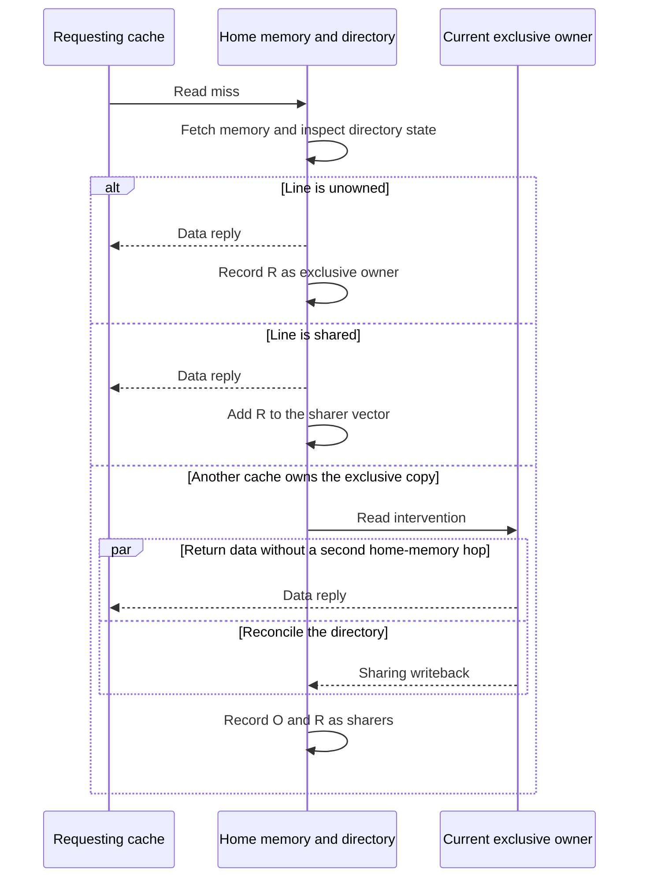
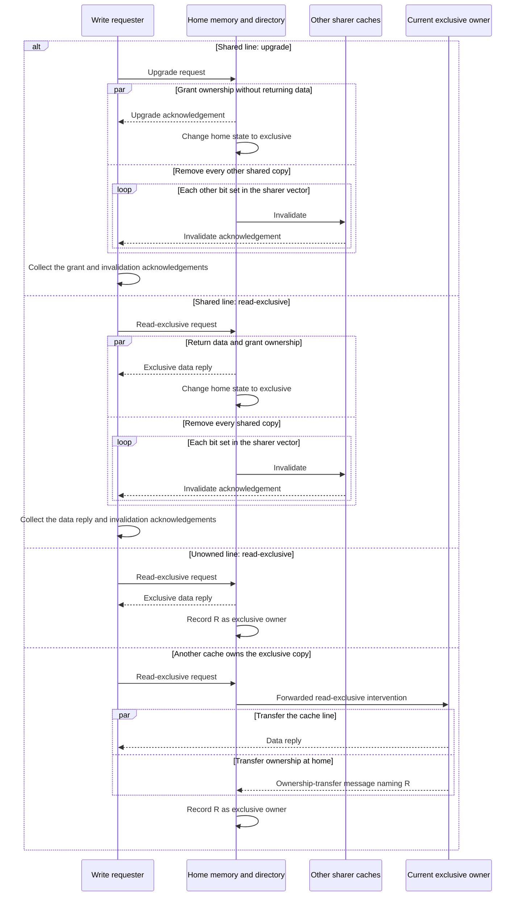

# Datasheet: Hub memory and directory interface

References rendered as citation identities name material outside this document
set. Those targets are not included or cleared for redistribution. Review and
runtime statements retain their recorded dates and scope.

**Status:** reviewed (the re-staffed datasheet review, with OpenAI Codex run as a
second independent reader, 2026-08-10) — **ready**. The gate found two
correctness defects and four should-fix items; a same-day re-review of the
commits that answered them confirmed all six taken and cleared the datasheet.
**Revised 2026-08-12, after that review, for the junk-bus serial interface only**: a capture
of the shipped firmware measured the presence probe running, which settled the register
width and the byte lane, and James ruled that origami may fit the port as an off-by-default
bring-up instrument. The section on that interface, its behavioural contract and its qtest
items were rewritten rather than annotated; nothing else on this page moved. The rest of the
page still stands on the 2026-08-10 gate. **The revision's own second-opinion pass is
the junk-bus UART gate (citation: `docs/reviews/junk-bus-uart-gate.md`)**, which the device it specifies
does not land ahead of.
**Fork file(s):** `hw/misc/sgi-hub.c` (the register block), `hw/mips/sn0.c` (the memory
and boot-flash decode this unit's configuration describes)

**Sources used:** SGI's machine-readable register table for the Hub,
`stand/arcs/lib/libkl/hwreg/hwreg_hub.hwreg` in the IRIX 6.5.7 source tree, together with
its companion directory table `hwreg_dir.hwreg` and the table's own compiler and
access-mode dictionary in `hwreg.c` and `hwreg_compile.c`; the IRIX configuration-block
structure `irix/kern/sys/SN/SN0/ip27config.h`; Linux
`arch/mips/include/asm/sn/sn0/hubmd.h` (public, GPL, itself derived from the SGI headers);
OpenBSD `sys/arch/sgi/sgi/sginode.c` for the configuration-graph consumer, read with
`git -C refs/openbsd-sgi show 2df91d80c1:sys/arch/sgi/sgi/sginode.c`. For the two
microcontroller/UART register blocks: SGI's own console-selection code in
`stand/arcs/IP27prom/pod.c` and `main.c`, the production driver in
`stand/arcs/lib/libkl/io/junkuart.c`, the simulator-only driver and its own file header in
`stand/arcs/IP27prom/hubuart.c`, the register-name-to-address mapping in
`irix/kern/sys/SN/SN0/addrs.h`, and SGI's PROM reference documentation
`stand/arcs/IP27prom/doc/html/ip27prom.html`. **For the junk-bus serial interface, the public
sources carry most of what this page asserts and are cited in preference wherever both have a
fact**: Linux `arch/mips/include/asm/sn/sn0/hubmd.h` for the register block, its eight-byte
stride and every offset; SGI's published *Origin2000 and Onyx2 hardware quick-reference
booklet* for the operator command that names the junk bus UART, and a public reproduction of
SGI's POD progress-code table for the probe's own code, both cached under
`library/cache/guides/` and `library/cache/prom/` and both load-bearing for the decision to use
SGI's name for the part rather than invent one; and
the bring-up serial port probe measurement (citation: `docs/notebooks/d1-fault3.md`) for the probe's
behaviour, its access width and its byte lane, which are observations of a running machine
rather than readings of anyone's source. For the indicator registers' own established
purpose: `stand/arcs/IP27prom/prom_leds.h` (the complete progress- and failure-code
enumeration; IRIX 6.5.7, the header's own `#ident "$Revision: 1.41 $"`), the register-writing
routine in `stand/arcs/lib/libkl/ml/hub_asm.s` and its
address macro in `stand/arcs/include/hub.h`, the character-wait routine in
`stand/arcs/IP27prom/libc.c` for the one documented use of this register that is not a code from that
enumeration, and `stand/arcs/IP27prom/main.c` for what the firmware is doing around three
progress codes the header itself leaves uncommented. Linux
`arch/mips/include/asm/sn/sn0/hubmd.h` (public, GPL) states the same two addresses and the
per-processor field name ("LED for CPU A"/"CPU B") — **and that is replication rather than
confirmation**, because that header declares in its own comments that it derives from the
corresponding IRIX header. It remains a legitimate public citation for the name and the value;
it is not a second opinion about facts whose first opinion is SGI's tree. The
production-build conclusion drawn from
those is independently confirmed against the user-supplied firmware asset itself,
`assets/firmware/6.5-base/ip27prom.img` (gitignored per the asset rules; checksum in
`assets/MANIFEST.sha256`), by direct string search. For the four error registers and what
real firmware requires of them: `stand/arcs/IP27prom/mdir.c` (its error get-and-clear, check
and decode routines), `stand/arcs/IP27prom/mdir.h` for their prototypes,
`stand/arcs/IP27prom/mtest.c` (the basic memory-diagnostic entry point, which requires them
clean before it runs), and `stand/arcs/IP27prom/exec.c` (the two command handlers that call
it) and `cmd.c` (the table registering the `dirtest` and `memtest` commands — those two are
names an operator types at the monitor prompt and the vendor's own command reference
documents, not internal symbols). For
how real firmware determines which banks are actually populated, before it can trust
anything this register itself reports: `stand/arcs/IP27prom/mdir.c` (the bank-configuration
routine and its two probe primitives) and `irix/kern/sys/SN/addrs.h` (the back-door
directory-entry address macro). For the physical DIMM population this machine actually
ships with: the *Origin200 and Origin200 GIGAchannel Owner's Guide* (techpubs `007-3708-002`,
Chapter 1, "Memory") — held locally, verified against the mirror's own recorded file size —
independently corroborating the board-population facts SGI's PROM manual and a real capture
already gave this page. The *Origin and Onyx2 Theory of Operations Manual* was
also checked and excluded from the board-population claims: its memory-slot and DIMM-size
figures describe the Origin 2000 node board (sixteen memory slots), a different, larger board
this machine does not share, not the Origin 200 main system board this page describes. The
address arithmetic that reaches this unit is specified in
[the SN0 address map datasheet](address-map.md), and the firmware
structures that describe memory to a guest are specified in
[the synthesized firmware structures datasheet](firmware-structures.md). We only read
reference sources and never copy their code or file structure (source-use policy,
decision D-0002).

**This is the first datasheet in this project written *from* the register table rather than
checked against it afterwards**, which is worth stating because the two preceding
comparisons — the Crossbow's and the Hub's other three units' — both found the same defect
class: everything transcribed was correct, and the gaps were fields nobody had enumerated. A
page built by enumeration cannot have that gap by construction, and can have others.

**Which facts came from where.** Register offsets, field positions and widths, per-field
access types and reset values come from the machine-readable table. **For most registers here
it is the only source carrying the last two — but not for the configuration register**, whose
whole reset value is also defined as a composite constant in SGI's own memory-and-directory
header and in the copy Linux carries. Linux's header carries the same offsets and bank-size code
enumeration, which — being that copy — **adds coverage rather than corroboration**: it shows the
two agree, which is weaker than two sources concurring and is worth stating because this page
otherwise reads as dual-sourced throughout. The behaviour of the configuration graph's memory description — as
distinct from this unit's registers — comes from OpenBSD, which walks it. **What real firmware
writes into this unit** comes from SGI's own PROM sources under `stand/arcs/IP27prom/`, which
are the closest thing we hold to what our synthesized firmware replaces.

**Read the access column as the table's own dictionary defines it**, unchanged here:
*readable*; *writable*; *readable and writable*; *writable, value ignored*; *special action
occurs on write*; *readable, and a write clears every bit written as one*; *readable, clears
on read*. A dash in the reset column means the table declares no defined value.

## Role

The memory and directory unit is the Hub's memory controller and the keeper of the cache
coherence directory. Three of its jobs matter to a booting guest, and most of the register
block does not.

**It decides how much memory the node has and where.** Eight bank descriptors in one
register give each bank's size, and the address map's node-memory geometry is the
consequence. A guest does not normally read them — it reads the configuration graph — but
the two must agree, and this unit is the one the hardware actually decodes from.

**It owns the boot flash's timing and its ready signal.** The flash's cycle-speed and
write-speed controls are two fields of this unit's configuration register, and the flash's
ready bit is in this unit's slot-identity and status register. **The flash's address decode
is not here** — this unit carries no base, limit or enable register naming where the flash
appears, which is established in the address map from two independent instruments.

**It owns a one-wire bus master and two indicator registers**, and the bus master is how real
firmware reads the installed PIMM's manufacturing record. Base Origin 200 has three ASIC
one-wire masters: this one, Bridge's, and IOC3's MicroLAN. GIGAchannel retains those three
functional masters. Crossbow's NIC register exists, but its MicroLAN controller is
nonfunctional. The buses have distinct responder roles: IOC3 supplies the Ethernet address,
Bridge supplies the IP29 board identity, and the Hub reaches a DS2505-compatible record
describing PIMM population, part number, revision and barcode serial.

**The logical responder is settled; its physical placement is not.** The reviewed contract does
not establish whether the package sits on the PIMM or IP29 System Board, or identify its reference
designator, connector contact or copper route. The Origin-family identity and topology evidence
ledger (citation: `docs/library/origin-family-identity-and-topology-evidence.md`) records the evidence boundary.

**Do not assume it is the same part as any other bus's.** The same NIC family appears on
several one-wire buses with different contents on at least two of them. A reading from one
bus does not establish another bus's responder.

**It also carries the register blocks behind the Hub's two microcontroller/UART
interfaces, and one of the two is a real console path our firmware oracle work depends
on.** The first block is the base for what SGI's own source calls a debugging port for the
Sable and RTL simulators, present only in simulator PROM builds and compiled out of the
real one entirely. The second is the base for the Junk UART: a real NS16550-compatible
serial interface, driven by a production driver, that real firmware's own console-selection
loop probes before it probes the I/O controller's console — but SGI's PROM reference
documentation states plainly that a Junk UART is fitted only for manufacturing and bring-up,
so on a shipped machine its probe legitimately reports absent and firmware falls through to
the I/O controller. This is detailed below because getting it backwards — modelling the
first block as a real console, or the second as populated on a production machine — sends
firmware down the wrong path before it ever reaches the console this project's boot work
already depends on.

Everything else — the page-migration machinery, the refresh counter, the fetch-and-op cache
status and the six performance counters — exists to make a real chip fast, diagnosable and
recoverable, and has no functional signature a guest can observe on a machine whose memory
never fails and whose transfers complete instantly. **The four error registers and their
aliases are the exception**, and belong in that list only for the OS-level guests we boot:
real firmware's own memory and directory diagnostics read all four before running, and
require them to read clean. Detailed below rather than dismissed here, for the same reason
the two microcontroller/UART blocks are.

### Message and coherence boundary

The memory/directory interface accepts local-memory requests from the processor,
I/O, and network interfaces through its input FIFO. Like every Hub interface,
its input and output FIFOs keep requests and replies in separate logical queues.
The directory state may produce a direct reply or additional requests, such as
an intervention or invalidation, before the original transaction completes.[^theory-hub-md]

```mermaid
flowchart LR
    SOURCES[PI, II, or NI<br/>request queues] --> MDIN[MD input FIFO<br/>request | reply]
    MDIN --> DIR[Memory and directory state]
    DIR --> MEM[Local memory]
    MEM --> DIR
    DIR --> REPLY[MD output reply queue]
    DIR --> COH[MD output request queue<br/>intervention or invalidation]
    REPLY --> TARGET[Requesting interface]
    COH --> SHARER[PI or remote NI]
    SHARER --> MDIN
```

The interface owns memory service and directory decisions. The queue network
transports their messages. The diagram does not assign a separate Hub crossbar
unit or imply that a single-node emulator must implement remote coherence.

#### Read miss and intervention sequence

A cache hit never enters the directory protocol. On a miss, the home Hub reads
memory and the directory entry together. The directory state selects one of
three paths.[^theory-hub-md]



The exclusive-owner case is a split transaction. The owner returns data
directly to the requester while a separate message changes the home directory
from one owner to two sharers. Those messages run in parallel, so the diagram
does not impose an arrival order between them. An emulator that routes all data
back through home, or treats the direct data reply as the directory update,
models a different protocol.

The state names in this sequence describe ownership, not a proposed register
encoding. The manual establishes the message roles and state transitions. It
does not give packet formats, FIFO arbitration, retry rules, or a cycle-accurate
ordering contract.

#### Write, invalidation, and acknowledgement sequence

A processor can write a cache line immediately when its local copy is already
clean-exclusive or dirty. A shared hit sends an upgrade request to home. A miss
sends a read-exclusive request because the requester needs both the data and
ownership.



Invalidation acknowledgements return to the write requester, not to home. The
requester must therefore track the fanout independently of the home reply. An
upgrade reply carries no data because the requester already holds the line. A
read-exclusive reply does carry data. Collapsing those reply types loses a
distinction visible to the processor-side transaction.

The manual describes invalidation fanout and the home reply as concurrent work.
It does not state their relative arrival order or the requester's internal
completion rule. Requiring the grant or data reply plus every expected
invalidation acknowledgement is the conservative implementation contract. A
hardware trace would be needed to specify finer ordering.

## Register map

All offsets are from the base of the Hub register window, reached as the address map
describes. Every register is 64 bits and every access is a 64-bit load or store.

The unit's registers fall in three groups at three bases: the main block at `0x20_0000`, the
performance counters at `0x21_0000`, and the two microcontroller/UART blocks together with
slot identity and the indicator registers at `0x22_0000`.

### The configuration register, which is the one that matters

**Implemented as plain masked storage with the correct reset value** (measured demand:
real firmware both reads and writes this register, three distinct values each, in a
150-second boot). `hw/misc/sgi-hub.c` stores whatever a guest writes, masked to the
register's 54 bits, and answers reads with what was last stored. This gets the one fact
that is load-bearing right — the reset value is not zero — without inventing behaviour
for anything the fields below describe: no bank-descriptor write resizes what memory this
model presents, no write to the directory-format bit changes how this model reports
directory errors, and the two unnamed timing fields time nothing, because nothing on our
boot path is known to depend on any of those effects actually happening. If a future
measured boot or a guest's observed behaviour shows one of them matters, that is new
scope, not a gap in what is written below.

| Offset | Name | Width | Reset | Access | Behavior as guest drivers use it |
|---|---|---|---|---|---|
| `0x20_0018` | Memory configuration | 54 | **`0x001e_7fbc_3fff_ffff`** | readable and writable | Eight three-bit bank descriptors at bits 23:0, one per bank, **each resetting to 7**; a four-bit reply-guarantee count at 27:24 resetting to `0xf`; a directory-format bit at 28 and an error-correction-ignore bit at 29, **both resetting set**; an arbitration bit at 30 and an I/O-protection enable at 31, both resetting clear; a two-bit memory-module select at 33:32; and four timing fields — the boot flash's write and cycle speeds at 48:44 and 53:49, and a second pair at 38:34 and 43:39 whose abbreviated name **no source we hold expands**, so what they time is open. |

**This register does not reset to zero, and a model that zeroes it is wrong in six ways at
once** — it would claim eight empty banks, enable error correction the hardware leaves
ignored, clear the directory-format bit that resets set, drop the reply-guarantee count from
full to zero, and drive both timing pairs at zero cycles. **The whole-register value above is the check to
write**, rather than any single field, because every one of those six is individually
plausible and only the total is verifiable.

**The whole-register form is SGI's own method, not our invention**, which answers the
objection that it asserts bits the table declares nothing for. The table's own reader has a
routine returning a register's contents at reset: it starts from zero and ORs in each field
that declares a reset value, shifted into place. **Undeclared bits come out zero because
that reader leaves them zero** — so the total above is what SGI's tooling prints from this
table, rather than a composition we chose.

**And this value is dual-sourced, which an earlier version of this page denied.** The sources
note said the machine-readable table is the only source carrying reset values. **That is
wrong for the one constant the page rests on**: SGI's own memory-and-directory header defines
a composite reset-defaults constant for this register — both flash timings, both of the other
timing pair, the error-correction and directory-format bits, the reply guarantee and all eight
banks — and it evaluates to the same 54 bits. **Not two lineages**, since the header and the
table are both SGI's, so this is not independent confirmation; but two artifacts kept for
different purposes agreeing bit for bit is better than the single source the page claimed.

**The directory-format bit resets to the premium format, and this board almost certainly ends
up in the other one — a second chip-against-board divergence in the same register.** Stated as
a question with its evidence, because **nobody has read this register on the machine**:

- **At reset it is set**, meaning premium. That is the table's value and it is not in doubt.
- **SGI's manual says the Origin 200 does not support premium directory memory.**
- **SGI's firmware does not take the reset value on trust: it probes.** Its directory code
  writes a test pattern into a directory location, reads back which of the two formats
  survives, and the caller then writes the bit **set or clear to match what it found**. On a
  board with no premium directory memory that probe reports standard and firmware **clears**
  the bit.
- **And firmware reads the bit back later** to interpret directory errors, so it is a live
  value rather than write-only state.

**So the reset value and the operational value are opposites here**, and both belong on the
page: a reset check must see it **set**, while a machine that has been through firmware would
have it **clear**. **The second is inferred from the manual and from firmware's behaviour, not
observed** — but it is what whoever writes our synthesized firmware needs, and the transient
toggle this page already records during memory sizing is the less useful half of the same
story.

**This is the bank-count divergence again one bit away**: the chip's default describes the
larger family, the board is the smaller case, and only the register table shows the first.

**The eight bank descriptors reset to seven, meaning an unprogrammed Hub claims eight full
banks of the largest size.** That is a real hardware default and not a placeholder: firmware
sizes memory and writes the true codes. A model must not confuse this reset state with an
empty machine — **code zero, not the reset value, is what says a bank is absent.**

**The register has eight descriptors and this machine has four banks, which is a board fact
rather than a chip fact.** SGI's PROM manual states it directly for the Origin 200: its banks
are populated from the two outermost memory slots, making bank 0, to the two innermost,
making **bank 3**. The chip carries eight descriptors because the Hub serves larger members of
the family; **our board wires four of them.** A real capture agrees — a 1 GB machine reporting
four banks and no more, in sizes that sum to exactly that gigabyte.

**Name what produced that figure, because it is not a reading of these descriptors.** It is
**firmware's own report** of the banks it found, printed while walking the configuration
graph. So it corroborates the manual about the *board* and leaves the *descriptors*
unobserved — which is the same residue the first open question names, and **the 256 MB bank in
that very layout is that question's case.** The manual, this capture and SGI's firmware
writing the unannotated code are **one thread of evidence rather than three independent
ones**, and should not be counted as three.

**So descriptors four through seven read as empty on a correctly configured machine of ours**,
and a model populating eight is describing a board that does not exist. **This is the first
place the chip and the board diverge in a way a test can see**, and the reset value does not
show it: at reset all eight claim to be full, and only firmware's sizing makes the four-bank
shape appear.

**Bank sizes may differ from one another, and on this machine they do.** The manual states
that each bank may hold a different amount, with the two modules within a single bank
required to match; the captured machine has banks of 256, 512, 128 and 128 MB, **in that
index order** — bank 0 is 256 MB, bank 1 is 512 MB, bank 2 and bank 3 are 128 MB each,
read directly from the capture's own per-bank printout rather than assumed from the set of
four sizes. **So a test using equal banks is not merely weaker — it exercises a
configuration the hardware is explicitly designed not to require**, and would pass a model
that read bank zero's size and applied it to all four.

**The order is a wiring fact of this specific board, not something the sizes alone
determine.** Bank index follows physical slot position — outermost pair to bank 0,
innermost pair to bank 3, as stated above — so which size lands in which slot depends on
which DIMMs were installed where, not on any rule a model could derive from the four
numbers. Stating the sizes as a set invites a reader to pick an order; this machine's real
order is 256, 512, 128, 128 and no other machine's need match it.

**One further Origin 200 constraint from the same section: there should be memory in bank
zero.** A model whose bank zero is empty is outside what the manual describes as a supported
population, whatever the other three hold. **A second, independent manual agrees, and names
the physical reason.** The Origin200 Owner's Guide describes the main system board's eight
DIMM sockets as four banks of two sockets each — DIMMs install in pairs, one pair per bank —
and states plainly that every module must have at least one DIMM pair installed in bank 0;
the other three banks are genuinely optional, populated independently, and may hold different
DIMM sizes from each other. This is the same four-bank, mandatory-bank-zero shape the PROM
manual and the real capture already gave this page, from a manual written for a different
audience (an operator installing memory, not firmware sizing it) — real independent
corroboration, not the same source read twice.

**And this board has no fifth, sixth, seventh or eighth bank to populate, ever, regardless of
how much memory is installed.** Eight DIMM sockets in four pairs is the whole board; there is
no larger population this specific main system board can physically accept. A model that
lets `-m` grow into more than four populated banks, or that leaves banks four through seven
reachable at all, is not describing a machine that could exist with this board — the chip's
own eight-descriptor register exists to serve larger family members, as already stated above,
and this board simply does not wire the other four.

**The Origin 2000 node board (IP27) is one of those larger members, and its bank sizes differ.**
It wires all eight banks, each a pair of main-memory DIMMs (007-3439-002 printed p.35-36). Its
DIMMs make 64 or 128 MB banks from 16-Mb parts and 512 MB banks from 64-Mb parts; no IP27 part
makes a 256 MB bank. The stock IP27 PROM 6.156 disables one if it sees it: "256 MB dimm banks
not allowed on IP27 node boards". A real Origin 2000 with 256 MB on node n1 reports two 128 MB
banks (the real machine's hinv (citation: `docs/library/ip27-real-machine-enumeration.md`)). The model's
IP27 bank sizes live in
the IP27 assembly layer (citation: `docs/machines/layers/assemblies/ip27.yaml`).

**A bank's size is written two different ways in two places, and crossing them is the trap —
and it is worse in one direction than the other.** Here it is a three-bit code, four megabytes
shifted left by the code. In the configuration graph it is a plain megabyte count. Our
synthesized firmware must write each in its own form.

**Put a code where a count belongs and a bank shrinks: the graph reports five megabytes where
128 was meant.** Wrong, and visibly so — a guest prints a memory total that is obviously
short.

**Put a count where a code belongs and the bank disappears.** The field is three bits, so a
megabyte count of 128 truncates to **zero** — and zero is precisely the encoding that declares
a bank absent, as stated above. **A populated bank silently becomes an empty one**, the total
comes out plausible for a smaller machine, and nothing anywhere reports an error. An earlier
version of this page had this direction decoding as 512 MB, which is what the *reset* code
happens to mean; that is a true fact about the neighbouring trap and not about this one.

The graph's side is specified in the firmware structures datasheet.

**The code table has eleven entries and SGI annotates four of them as valid in this
register** — empty, 64 MB, 128 MB and 512 MB — with a fifth marked broken on the first Hub
revision. A real Origin 200's configuration graph describes a **256 MB** bank, which is one of
the unannotated codes.

**SGI's own firmware writes the unannotated code into this field, which settles most of what
this page previously left open — through two functions in two files, not one.** The PROM's
memory-sizing routine probes a bank downward from the largest code, runs a check written
specifically for the 256 MB case that decrements the result when it fires, and **writes that
code into this register**. A second, separate routine in the firmware's configuration library, not in
the PROM's own sizing code, runs later, **reads the register back**, and builds the
configuration-graph structure the guest actually parses. Its accompanying source
comment describes reading the configuration register after the PROM programs it.
**So the register is the handoff between the two**, and a real machine's descriptor holds the
unannotated code because the second routine copies whatever the first wrote. An earlier version
of this page told the story as one function writing the descriptor directly, which does not
survive reading `klconfig.c`. The other PROM maps a plain 256 MB count to the same code
directly. **The alternative that a 256 MB bank appears as two 128 MB banks is eliminated
either way.**

**What stays open is narrower and is not answerable by argument:** what the annotation means,
and whether the silicon honours a code its own table does not mark valid. **Firmware writing a
value is intent, not hardware content** — but it removes the three-way choice this page posed
and leaves a residue. A register capture would close the residue; an earlier version of this
page said the whole question wanted a capture rather than an argument, and an argument has
since done most of it.

**The two flash timing fields have a firmware source**, and it is the configuration block in
the boot flash: SGI's structure names those members after these fields. Real firmware for
this machine carries 15 for the cycle field — **already the reset value, so that write
changes nothing** — and 4 for the write field, which is a genuine reprogramming from the
reset value of 7. A firmware that omitted the first write would be indistinguishable from one
that performed it.

**Real firmware touches more of this register than that, and three fields this page presents
as reset values are things it moves.** SGI's PROM writes the register at two sites by
read-modify-write:

- It reloads **both** flash timings from the configuration block, as above — **and also
  writes the second timing pair's write-speed field to a hard-coded value**, which this page
  did not mention at all.
- It **clears the error-correction-ignore bit** in the same operation and sets it back **only
  if the configuration block disables error correction.** So on a machine with error
  correction enabled, firmware leaves that bit **clear** — the opposite of the reset value
  this page emphasises.
- The memory-sizing code separately **toggles the directory-format bit and forces the
  ignore bit while probing**, restoring both afterwards.

**So the reset value is what the register holds before firmware runs, and not what a guest
finds.** Both statements matter and they are different: a reset-value check reads the first, a
guest reads the second, and a model that produces the reset value and never moves it would
pass the check while presenting a machine no firmware ever produced.

### How firmware discovers which banks are actually populated, before it trusts this register at all

**The configuration register above records bank presence, but firmware does not start by
trusting it — the register only holds what firmware itself measured and wrote, and something
has to do that measuring safely, before any bank's size is known.** Real firmware's answer is
a second, physically separate access path into the same memory-and-directory hardware: a
diagnostic address range, distinct from the ordinary cached and uncached views of main
memory, that reaches the directory and error-correction storage directly rather than the data
a program would read or write. SGI's PROM sizing routine uses this path, and only this path,
to determine each bank's real presence and size, before it ever touches that bank's ordinary
memory contents.

**The test itself is a plain write followed by a read-back, and it works because of what sits
behind an unpopulated bank's directory address on real hardware: nothing.** Firmware writes a
fixed bit pattern to a bank's diagnostic-path entry and reads it back. A populated bank has
real directory and ECC storage behind that address, so the pattern round-trips, and its
particular bit layout tells firmware whether the bank is standard or premium width. An
unpopulated bank has no such storage behind that address at all — the write has nothing to
land in — so the read-back does not match what was written, in either format, and firmware
concludes the bank is absent. **No exception, no trap, no fault handler anywhere in this
path**: presence is read off a comparison, not caught as an error, which is exactly why real
firmware never registers one here. This is a separate, additional safety measure layered on
top of the design, not a substitute for it: firmware also temporarily widens every bank's
*advertised* size to the maximum before running this test, specifically so the diagnostic
probe itself cannot provoke an address-range fault on hardware whose decoder gates access by
the size a bank currently claims — belt and braces around a mechanism that, absent that
widening, would already be safe by the write-doesn't-stick logic above, but SGI clearly did
not want to depend on that alone.

**What this means for the model.** A diagnostic-path region that is uniform, always-writable,
always-readable storage — correct for the *narrower* property that the probe itself must
never fault, which is a real requirement — cannot reproduce the *write does not stick*
signature for a bank that does not exist, because there is nothing architecturally
distinguishing one bank's entry from another's within it. A probe run against such a region
reports every bank present, for any bank index the chip's own eight-descriptor format can
address, regardless of how many banks the board actually wires or `-m` actually backs. The
fix this implies is not "make the diagnostic path fault correctly" — real hardware's path
never faults, by design, as described above — it is that the region's *contents* need to
depend on which banks are genuinely populated, the same way real absent directory storage
depends on whether a DIMM pair is actually seated in that bank's sockets.

### Refresh

| Offset | Name | Width | Reset | Access | Behavior as guest drivers use it |
|---|---|---|---|---|---|
| `0x20_0020` | Refresh control | 64 | **`0x0000_0000_0000_0400`** | readable and writable | A twelve-bit threshold at bits 11:0 **resetting to `0x400`**, a twelve-bit counter at 23:12, and an enable at bit 63, resetting clear. Refresh is off at reset with its threshold already programmed. |

### The rest of the main block

The remaining registers at `0x20_0000` are, in order: two protection registers and their
override, a fetch-and-op cache status, the four-register page-migration group with its
candidate and candidate-clear pair, four error registers each with a same-layout alias eight
bytes above it, two module-initialisation registers, an output-queue size, and the serial-bus
control. **The prediction in the paragraph this replaces has now been checked and confirmed
true, not left standing on inference:** real firmware measurably reads all four error
registers and all four aliases, and writes both module-initialisation registers, in a
150-second boot — this is the diagnostics track the earlier text named as the one guest that
would read registers no OS-level guest touches, doing exactly that. `hw/misc/sgi-hub.c`
implements all eight error-cluster registers and both DIMM-initialisation registers to match.

**The naming calls the second register of each pair a clear alias, and what real firmware
does with it is read it, not write it.** SGI's PROM directory-error routine reads the
directory, memory, protocol and miscellaneous error registers' aliases — `MD_DIR_ERROR_CLR`
at `0x20_0058`, `MD_MEM_ERROR_CLR` at `0x20_0078`, `MD_PROTOCOL_ERROR_CLR` at `0x20_0068`,
`MD_MISC_ERROR_CLR` at `0x20_0088` — as its first action, before checking any of the four
plain error registers eight bytes below each alias for a live error. **The table gives the
alias the identical field layout as the plain register** (`see MD_DIR_ERROR` and so on) and
marks every field plain *readable*, not the table's own *readable, clears on read* — so the
table does not itself state that reading the alias clears anything. That the read is
expected to clear is an inference from the routine's own name and from the general shape of
the other clear-on-read status this page already documents elsewhere, not something the
table declares for this register; flagged as inferred rather than observed.

**What is not open to inference is that firmware requires all four to read as clean before it
will run a memory or directory test at all**, and says so in words: its basic memory
diagnostic reads all four aliases, checks each plain register's valid bits, and prints
"Unable to clear memory errors" and aborts the test if any are set. A machine whose memory never fails needs these
four aliases and their four plain registers to read as all-zero — no valid bit set in any of
them — which is a weaker requirement than modelling clear-on-read behaviour and is what this
page's existing zero-failure framing already implies; it had just not been connected to a
guest that checks it.

**Five of them reset non-zero, and those values are stated because not being read does not
excuse omitting a reset.** An earlier version of this page grouped them away on the grounds
that nothing reads them — which justifies not modelling behaviour, and does not reach reset
values, since a snapshot restore, a diagnostic and the reset-value check below all read them
whatever a guest does. **This page makes exactly the opposite argument two sections above
about the configuration register**, and the inconsistency was the defect.

**Implemented: the four error registers and their four aliases answer zero, unconditionally,
every read.** This is not a placeholder pending a richer model — it is what that diagnostic
needs, exactly as the paragraph above establishes, and this model never raises a memory,
directory, protocol or miscellaneous error in the first place, so zero is also the honest
answer rather than merely the convenient one. Writes to any of the eight are accepted and
logged as unimplemented rather than as guest misbehaviour, the same distinction this page
already draws elsewhere for a register real firmware touches routinely and harmlessly.

**The two module-initialisation registers, `MD_MEM_DIMM_INIT` at `0x20_0090` and
`MD_DIR_DIMM_INIT` at `0x20_0098`, are write-only in both dual sources** (mainline Linux's
`hubmd.h` and SGI's own register table agree): a four-bit `DIMM_SELECT` field at bits 35:32
and a twelve-bit `DIMM_MODE` field at bits 11:0, both resetting to zero, no readable bits
declared at all. Real firmware writes both registers sixteen times each in lockstep, one
iteration per DIMM slot — `DIMM_SELECT` stepping `0x0` through `0xf` while `DIMM_MODE` holds
a constant `0x029` — a per-DIMM programming sweep across the sixteen slots the eight-bank,
two-module-per-bank layout implies. Implemented as accepted, unstored writes: real hardware's
DIMM mode setting has no functional signature on a machine whose transfers complete
instantly and whose memory never needs the timing this field would otherwise control, and
nothing declares either field readable for a model to answer regardless.

| Offset | Name | Reset | Notes |
|---|---|---|---|
| `0x20_0000` | I/O access protection | **all ones** | Permissive at reset, not closed. |
| `0x20_0010` | Hub-special access protection | **all ones** | The same. |
| `0x20_0028` | Fetch-and-op cache status | address field **3** | The rest zero. |
| `0x20_00a0` | Output-queue sizes | reply **`0x32`**, request **`0x12`** | Two independent size fields. |
| `0x20_00a8` | Serial-bus control — the node's one-wire bus master, `MD_MLAN_CTL` in the public Linux header | two clock dividers **`0x31`**; **the completion bit's reset value is not settled — do not implement from this cell** | Read-only completion bit. Real firmware drives this register to read the node's NIC. This row previously asserted the completion bit resets **set**; that was unsourced and three documents in this tree have since disagreed about it. It does not affect correctness: starting a transaction must clear completion, so the first poll spins whichever way reset leaves it. [The Hub's one-wire bus master](hub-onewire.md) carries the argument and is the document to implement from. |

**The serial-bus control's completion reset is deliberately unspecified here.** The public
header's named reset constant leaves it clear, an earlier version of this page reasoned that
idle should read complete, and the sibling Bridge specification cannot settle a Hub field.
[The Hub's one-wire bus master](hub-onewire.md) reconciles those sources. An implementation
must clear completion when a transaction starts, so firmware observes a transfer in progress
under either reset value.

**No guest we boot reads this register, and real firmware does — which decides how much of it
matters and when.** OpenBSD names no register in this unit except the first indicator, so
nothing on the first-banner path touches the bus master. **Our synthesized firmware replaces
the code that would.** The register therefore needs its two documented timing-divider reset
values right because a reset-value check reads them. It needed no bus behaviour until the
diagnostics track runs real firmware against this machine — **at which point the part on
that bus has to answer in the format that firmware parses**, which is a string carrying a
processor-node record name and a laser-identity field, not a raw serial number. That is a
requirement on a future track rather than on any current one, recorded here so it is not
discovered by firmware that silently concludes the node has no identity.

**The protection override behaves as the other units' do**: writing the eight-character
password unlocks the protection registers, its access type is *special action occurs on
write*, and **it therefore has no reset value** — the register table's entry for it holds the
value to write, not a power-on state.

### Performance counters

Six counters and a selector at `0x21_0000`. **The first counter (`0x21_0010`,
`MD_PERF_CNT0`) is now modelled — measured demand found it, not inference.** A
boot with the unimplemented-access trace class enabled shows real firmware
reading this specific counter 144 times against 23 writes: repeated resets and
re-samples, the shape of a benchmark or a timed diagnostic loop rather than a
single setup-then-poll. IRIX's own header and mainline Linux's agree it is a
20-bit event counter (`field <19:00> RW - PERF_CNT` in SGI's own machine-readable
table); nothing establishes what real hardware counts into it, and this model
counts no real hardware event either, since nothing here tracks memory or
directory bus activity for a counter to report. Modelled as plain masked
storage instead: a write is kept and read back, the register never advances on
its own. Honest for a self-test that resets the counter and checks the reset
stuck; unable to satisfy anything that depends on the count changing between
two reads with no write between them, and nothing on our boot path is known to
need that.

The selector (`0x21_0000`) and the five sibling counters (`0x21_0018` through
`0x21_0038`) remain out of scope: the measured boot writes each once, consistent
with a setup step rather than a dependency, and nothing reads them back. Reads
return zero and writes are logged as unimplemented, same as before.

#### Early-PROM lock use of performance counter zero

Stock Origin 2000 PROM 6.156 also uses `MD_PERF_CNT0` as retained software-lock
storage. In the exact binary window `0xc00000001fc54710` through
`0xc00000001fc54730`, the firmware reads the Hub real-time counter, compares it
with a deadline, then reads `MD_PERF_CNT0` and repeats while bit 15 remains set.
The timeout test is an unsigned `deadline < current count` comparison. Equality
therefore permits one more lock test. The next counter sample normally exceeds
the deadline. Only an interval at the 52-bit counter wrap can turn that ordinary
unsigned ordering into a wrap-length wait.

The observed deadline was 30,078,140, far from the wrap boundary. The register
snapshot does not establish the current count because the instruction in this
window has already replaced the helper's return value.

The IRIX 6.5.7 Hub support source corroborates the binary interpretation. Lines
25 through 28 select performance counter zero as the lock word. Lines 833
through 971 implement the local two-processor exclusion and the outer timed
bit-lock operation. The companion Hub declaration at lines 46 through 51 assigns
lock level 15 to I2C. That source builds PROM 6.49, while the disassembled binary
is PROM 6.156. The source explains the mechanism but does not establish that the
two releases have identical control flow.

A later instruction-counted sample from the same run reached the controller
probe after the lock wait. PC `0xc00000001fc5ad4c` is the entry to a short
real-time-counter helper, called from `0xc00000001fc584d8`. Its caller reads the
low byte at the Hub I2C data register, then repeats while that byte remains equal
to its initial value and the current time remains below the deadline. In the
observed state the byte was `0xaf`. IRIX 6.5.7 I2C support lines 339 through 360
describe the same probe for system-controller tokens. The helper contains no
loop. One processor can therefore visit the lock wait and the controller probe
in sequence. These samples do not establish that one processor held the lock
in the probe while its peer waited.

The other stable PC, `0xc00000001fc57ffc`, is a different state. The preceding
PROM 6.156 instructions place value `0x9a` in the processor's progress register,
clear its firmware interrupt state, and clear that slice's processor-enable
register. The published *IP27 PROM Technical Reference*, SGI 108-0170-001,
Table 3-2 on printed page 3-6 (PDF page 44), defines `0x9a` as a processor
disabled by configuration. IRIX 6.5.7 PROM main source lines 2741 through 2793
corroborate that configuration check and disable sequence. This PC is the
endpoint after processor disable, not a real-time-counter or lock poll.

The public hardware sources do not establish a stronger counter contract. The
mainline Linux Hub header names `MD_PERF_CNT0` and its offset but gives no field,
write-retention, or reset semantics. The published *Origin and Onyx2
Programmer's Reference Manual*, SGI 007-3410-001, printed pages 28 through 31
(PDF pages 40 through 43), locates the memory/directory register region and
defines how processors address Hub local registers, but does not describe this
counter. SGI's machine-readable register table for IRIX 6.5.7, lines 703 through
712, is the only held hardware description that marks bits 19 through 0
read/write, and it leaves their reset value unspecified. Firmware use supports
retained bit storage after a write. It does not establish a silicon reset value
or prove that the hardware never increments the counter for a selected event.

### The two microcontroller/UART blocks

Two eight-register blocks in the third group, `0x22_0000` through `0x22_0038` and
`0x22_0080` through `0x22_00f8`, are each named "uController/UART" in the machine-readable
table and neither is general-purpose storage — each is the register file behind one of two
distinct serial interfaces the Hub chip exposes, and real firmware treats them very
differently.

**The first block is not a UART on a shipped machine at all — but it is heavily used, for a
different job.** SGI's own file header for the *UART* driver says so directly, in its own
words: it is "not actually a UART per se," but "a debugging port for which Sable and RTL
simulators have support." Its device-table entry, its init/poll/read/write routines and the
one call site that selects it are all compiled only when the PROM is built for the Sable
simulator; the production PROM build (`IP27.O`, the plain `make` target) carries none of
it. **A model does not need to give this block UART behaviour**, because no PROM that ever
runs on real or emulated production hardware asks it to act like one.

**But the same eight registers are also named `KL_I2C_REG` in production, and that name is
what the real PROM actually calls at this block's base — heavily.** `irix/kern/sys/SN/SN0/addrs.h`
defines `KL_I2C_REG` as this block's first register, and `stand/arcs/lib/libkl/ml/i2c.c` —
linked into every production PROM build, not gated by any simulator define — drives the
Hub's PCF8584 I2C controller chip through it, at this address and this address plus eight.
`stand/arcs/IP27prom/entry.s` initialises that same chip within microseconds of reset, with
a comment naming the engineer and the reason: get the part into the right mode before any
other write on the same bus, including LED writes. **"uController/UART" in the register
table's own name is the tell the earlier version of this page read backwards** — the UART
half is simulator-only, but the microcontroller half is a real, production I2C interface,
and confirmed against a real trace: a boot on the current fork spends the large majority of
its time — over 8,000 of roughly 8,300 logged accesses in one run — polling exactly these
two registers, in two bursts, each ending only when firmware's own I2C timeout expires and
it moves on. **The block needs no UART behaviour and cannot be dismissed as unused; a model
that answers these two registers immediately as "no device present" rather than leaving
them silently unimplemented would remove tens of seconds of firmware-side timeout spinning
without changing what the timeout already causes firmware to do.**

**The chip behind the first block is a PCF8584 I2C-bus controller — a third-party part
with a public register interface, not an SGI one — and its own two registers explain
precisely what "no device present" should mean.** Philips' own application report for
this chip, cited by name in the driver's header comment, gives the layout directly:

| Offset | Name | Width | PCF8584 register | Behavior as guest drivers use it |
|---|---|---|---|---|
| `0x22_0000` | I2C data | 8 | S0/S0'/S2/S3 (selected by the control register) | The chip's selected working register — the data byte transferred, its own bus address, clock-divider setting or interrupt vector, depending on how the control register last configured it. IRIX's liveness-probe routine reads this repeatedly and looks only for the value to *change*, which is how it tells a live device from an empty bus. |
| `0x22_0008` | I2C control/status | 8 | S1 | **Write-only control bits** (`PIN`, `ESO`, `ES1`, `ES2`, `ENI`, `STA`, `STO`, `ACK`) while `ESO` (serial output enable, bit `0x40`) is clear; **read-only status bits** once `ESO` is set, matching a different half of the same chip register rather than two separate ones. The status half's bits, high to low: pending-interrupt-not (`0x80`), stop-detected (`0x20`), bus-error (`0x10`), last-received-bit/general-call (`0x08`), addressed-as-slave (`0x04`), lost-arbitration (`0x02`), bus-not-busy (`0x01`). |

**"No device present" is a specific, checkable claim about this layout, not a vague
absence.** The chip itself — the PCF8584 — is real hardware on every Origin 200; what is
absent is every *other* party on the shared I2C bus this project's model does not
simulate (the embedded system controller, temperature and fan-speed sensors). The honest
reset/idle answer for the status half is therefore the controller reporting itself ready
and the bus free — pending-interrupt-not and bus-not-busy both set, `0x81` — not a
bus-error or an all-zero non-answer, either of which would claim a fault condition that
is not present.

**That answer measurably shortens one of the two nested waits IRIX's I2C arbitration routine
runs per I2C-dependent step, not the whole poll.** That routine waits for the system
controller to grant the local node a turn as bus master, and it has an inner loop that exits
only on reading one of two specific arbitration-grant byte values on the data register
(values only a real system-controller chip, absent here, would ever write), so that inner
wait stays bounded by firmware's own timeout regardless of what this model answers. But its
*outer* loop — waiting for any signal already in progress to clear before watching for its
own turn — exits as soon as bus-not-busy reads set *and* the data register does not happen to
hold one of those two values, which a static `0x81`/idle-data answer satisfies on the very
first check instead of never. The outer wait shortens; the inner one, which genuinely
needs a device this model does not have, stays timeout-bound — a partial, honest
improvement rather than a claim that this removes the wait entirely. (A third phase in
the same function, holding the signal for a minimum duration once matched, is downstream
of the inner wait succeeding and is never reached either way, so it adds nothing to this
comparison.)

**The second block is a real, production NS16550-compatible serial interface — the junk-bus
UART — and firmware running on this machine has been measured probing it.** Its eight
registers sit at Hub-local `0x22_00c0`, `0x22_00c8` and so on up to `0x22_00f8`: the standard
16550 register order, one register per eight bytes rather than one per byte. The public Linux
header `arch/mips/include/asm/sn/sn0/hubmd.h` names the sixteen offsets of this block
`MD_UREG1_0` through `MD_UREG1_15` and gives each address directly; the serial interface takes
the upper eight of them, which is what "based at its eighth register" means. **The spacing
belongs to the bus rather than to the chip** — an NS16550's registers are a byte wide, and it
is the junk bus that requires each on an eight-byte boundary — so the public header's offsets
step by eight.

**That header is a second, independent witness for values this project otherwise holds
single-sourced, and it should be recorded as one rather than as corroboration in passing.**
The base address, the eight-byte stride and the two offsets the presence test touches were
measured dynamically from a running boot; the header states the same offsets statically, in a
public GPL source with no connection to our capture. Those are two different kinds of evidence
for one set of values, which is what independence means here — not two readings of one
source. This project's standing position is that register facts of this kind have no second
witness available. For these, one exists.

**The reference clock is 12 MHz and the line runs at 9600 baud**, and the guest's own
arithmetic confirms the first: with the port fitted, the firmware writes a divisor latch of
78, and 12 MHz over 9600 baud at the standard sixteen samples per bit is 78.125, truncated to
78. **The port takes no interrupt.** Nothing on this machine drives or reads one; the port is
polled, and its own driver carries no handler for it. Whether anything elsewhere in SGI's tree
wires an interrupt from it has not been checked.

**The presence test has a second half that never runs on a machine without the port, and
anything written to check for this behaviour has to know that.** The test writes `0x55` to the
scratch register, writes zero to the interrupt-enable register so the bus is not left
floating, and reads the scratch register back; the second round, which repeats the whole thing
with `0xAA`, happens only when that read returns `0x55`. **The `0xAA` round is downstream of
the `0x55` round succeeding.**

**That ordering is established from our own capture rather than from reading anyone's
source**, which matters because it is the fact the qtest is built on. The capture records
instruction fetches with the instruction word in the value field, so the branch and its target
are visible in the measurement itself: on a machine without the port, no instruction is
fetched at or beyond the branch that a successful comparison would have taken. **The success
path provably did not run**, and that is an observation rather than an inference from
somebody's code.

So a test or a trace signature phrased as "writes `0x55`, then `0xAA`" can only match where
the port is already answering: aimed at a machine without one it returns a clean miss that is
an artifact of the signature rather than a fact about the machine. What discriminates is the
first write, the read-back, and the value the read-back returns.

**What a capture of the shipped firmware shows is the probe running and failing.** Three
consecutive instructions store `0x55` to the scratch register at `0x22_00f8`, store zero to
the interrupt-enable register at `0x22_00c8`, and read the scratch register back. Our Hub
answers that read with zero, the comparison fails, and the routine returns absent. No
instruction is fetched at or beyond the branch the successful comparison would have taken, so
the success path provably never ran. The firmware computes the base itself out of the same
three address terms our own address map is built from, which corroborates the base from the
firmware's side rather than from ours. The capture, the run configuration and the counts are
in the bring-up serial port probe measurement (citation: `docs/notebooks/d1-fault3.md`).

**Two properties of those accesses constrain a model, and a model can satisfy one while
failing the other.** They are **64 bits wide** — the firmware's own instruction encoding, read out of
the executed instruction stream, not a narrow access that a memory system widened — so a model
whose handler is written for four-byte accesses gets called twice for each one, which on a
UART means a read of the receive buffer pops two characters and returns one, with nothing
anywhere reporting it. And the register's byte sits **at the bottom of the 64-bit word**: the
value stored is `0x55`, and the firmware masks what it reads back to a byte before comparing.
On this big-endian target that is the last of the eight bytes at the register's address, not
the first.

**A shipped Origin 200 has no such part, and the default machine says so.** SGI's PROM
reference documentation states plainly that this UART is fitted only in manufacturing and
bring-up. Firmware's console-selection routine — SGI's own, in `stand/arcs/IP27prom/pod.c` —
takes an ordered list of candidates from its caller and stops at the first that answers
present.

**What is fixed is that this port comes first; what follows it is not fixed, and an earlier
version of this page stated one order as though it were.** Three distinct lists are handed to
that routine across the firmware, at `stand/arcs/IP27prom/main.c` twice and inside the
diagnostic loop in `pod.c` once, and the diagnostic loop chooses between two of them at run
time. The bring-up port heads every one of them. After it the lists disagree: one tries the
I/O controller's UART before the module system controller, another reverses those two, and the
earliest of them names no I/O controller at all, because it runs before I/O has been brought
up. A network fallback is last wherever it appears. SGI's PROM reference documentation gives
the I/O-controller-first arrangement as the normal one. **On a production Origin 200 the
bring-up port is not fitted, so whichever list is in force the console real firmware settles
on is the I/O controller's** — the same console path this project's boot work already depends
on. Answering the presence test as absent is the honest model, and it is what origami does
unless it is asked otherwise.

**origami can fit one on purpose, which overrides "a shipped Origin 200 has no such part"
deliberately rather than contradicting it.** James ruled that the machine may present this port as a
bring-up instrument, because it is the only console candidate whose probe needs no other
device working: eight registers in the Hub's own local register space, reachable before the
crosstalk link, the crossbar, the Bridge or the I/O controller have done anything at all. It
is an explicit machine option and it is **off by default**, so the machine anyone gets without
asking is unchanged register for register and still answers the presence test as absent.

**The name is SGI's and it is public, which is why we use it rather than inventing one.** It
appears in `refs/` only inside SGI's own source tree, so it had to clear the two-step test
before it could be written here or in the fork. It clears the first step: SGI's *published*
Origin2000 and Onyx2 hardware quick-reference booklet documents an operator command `junk`
whose help line is "Use the junk bus UART", and a public reproduction of SGI's POD
progress-code table carries "Probe for Junk UART" against code `0x1b`. Both are cached in the
library, at `library/cache/guides/origin2k-hardware-guide-pod.txt` and
`library/cache/prom/preterhuman-origin2000-node-boards.html`. The name is therefore a public
name for a thing an operator can see, not an internal codename, and it is what somebody who
has read SGI's own documentation will search our tree for. **The second step — where being
reconstructible from a public source is not the same as being contained in one — never
arises.**

**Fitted with no character device behind it, the port answers its registers and drops what it
transmits, and that is by construction rather than a defect.** The machine gives the port the
fourth character device: the first three belong to the base I/O controller's two ports (one of
them also the synthesized firmware's console) and the system controller's AUX port, two
frontends cannot share one backend, and putting the option last keeps the shipped machine's
serial numbering fixed whether or not it is used — the whole technique is to select, not to
substitute. So a run that turns the port on without supplying a fourth serial backend gets
working registers and silence. The presence probe passes, the firmware selects the port and
configures it, and the characters go nowhere. **Anyone meeting that silence should reach for
the missing backend before suspecting the model.**
**This is a weaker departure than the crosstalk link reporting itself up, deliberately so.**
That one makes the default machine report a value its own register table contradicts and
needed a ratified decision to do it; this one adds a part the operator has to name on the
command line, and leaves the unasked-for machine giving the answer the hardware gives.

**The warning against making the presence test pass gets stronger rather than weaker once the
port is available, and it is the part to carry away.** Now that a deliberate pass exists, the
one to guard against is an *accidental* pass. The selection loop stops at the first candidate that answers, and this
port is first in every one of the three device lists the firmware uses. So anything that makes
the read-back return what was written — a scratch-register fallback across the Hub's local
window, a read-what-was-last-written default, a register range drawn one entry too wide —
selects this port as the console without anyone having chosen it, and hides both real
candidates behind it. **What that produces is a console the firmware believes in with nothing
behind it, which is worse than the silence it replaces**, because silence gets investigated
and a selected-but-dead console reads as a different bug entirely. Nothing may implement
`0x22_00c0`–`0x22_00ff` as a plain read-write register except the port itself.

**A third source agrees about the bring-up UART, and it is a different kind of evidence than
either of the two above.** Both the reasoning above and the image check below are about
firmware — what SGI's documentation says is fitted, and what the shipped binary was built to
talk to. SGI's *Origin 200 and Origin 200 GIGAchannel Owner's Guide*, `007-3708-002`, is about
the machine: it labels every connector on the rear of a CPU module in a callout figure
(page 55) and gives pinouts for five connector families in an appendix (page 183). **The rear
panel carries two general-purpose serial connectors and the system controller's port, and
nothing else that a terminal plugs into.** On a shipped Origin 200 there is no place to attach a
bring-up serial device at all, which is a statement about the hardware rather than about the
firmware's build flags. The figure was read as a rendered image rather than a text extraction,
because what a callout figure asserts is which label points at which connector; the citation
and the scope of the negative are in
the Owner's Guide diagnostics read (citation: `docs/library/origin200-owners-guide-diagnostics.md`).

**The system-controller candidate in that list terminates in a port every Origin 200 physically
has, and that is worth stating because it decides whether the candidate is a dead end.** The
same manual calls the rear connector the diagnostic port in its own words (page 86), documents
its line settings and pinout, and documents a command set through which **anything typed that is
not escaped with Ctrl+T is relayed to a selected processor** (page 132). So the third candidate
in the selection order is a real bidirectional console on our machine, not a vestige of the
Origin 2000's front panel — the full contract for it is in
[the PCF8584 and system-controller datasheet](pcf8584-elsc.md). **What the order means in
practice is therefore unchanged and better supported: the bring-up UART is absent, so firmware
falls through it, and the two candidates that remain are both real ports on this machine.**

**This is now confirmed against the shipped image itself, not only against the source
tree.** Everything above was reasoned from SGI's PROM source and its README; the user-supplied
`ip27prom.img` (from the IRIX 6.5 base install media, `assets/firmware/6.5-base/ip27prom.img`,
recorded in `assets/MANIFEST.sha256`) is a separate, independent artifact, and a direct string
search of it agrees on every count. Neither `hubuart` nor `junkuart` occurs in the image at
all. `ioc3` occurs 29 times, and the embedded compiler-invocation string the PROM prints at
boot carries `-DIOC3_UART` with no `-DSABLE` anywhere in it — **checked as an exact flag and
as a whole-word match, because a case-insensitive substring search for `sable` returns 43
hits and every one of them is `disable`/`Disabled`/`DisableExpress` and their kin.** So the
image is the production build the README predicts, by a source neither the README nor the
source tree could supply: an observation of the artifact this project actually loads, not an
argument about what its build process should have produced.

### Identity, indicators and the slot-identity/LED registers

The slot-identity and two indicator (LED) registers below sit at addresses between the two
microcontroller/UART blocks, in the same third group at base `0x22_0000`.

| Offset | Name | Width | Reset | Access | Behavior as guest drivers use it |
|---|---|---|---|---|---|
| `0x22_0048` | Slot identity and status | 8 | none declared | readable | **Carries the boot flash's ready bit.** The rest of the register is machine-variant and is described below. |
| `0x22_0050` | Indicator register zero | 8 | 0 | **writable — write-only** | Real firmware's own diagnostic-progress register for the Hub's first processor socket — the value written is one of a fixed, enumerated set of boot-stage and failure codes, set out in full in the behavioural contract. **A guest OS's use of the same address disagrees with that documented purpose**; also set out below. |
| `0x22_0058` | Indicator register one | 8 | 0 | **writable — write-only** | The second; the table defines it by reference to the first. IRIX's own header names the pair by processor slice — one register per CPU socket, eight bytes apart — so the second exists for the Hub's second CPU slot, not a second, unrelated field. |

**These two are write-only, and an earlier version of this page said readable and writable
with no width and no reset.** The table gives an eight-bit field with a reset of zero and the
access type meaning *writable* — which this page's own dictionary defines as write-only, and
which both guests match: neither ever reads these. **A model that returns what was last
written would be inventing readable state, and a test asserting a read-back would certify
it.**

**The slot-identity register has two different field layouts at the same address, one per
machine variant, and ours is not the one a reader would assume.** The larger machine's layout
(`MD_SLOT_ID_USTAT_SN0` in the register table) gives a slot identity with reversed sense, a
clock-select and a network-synchronisation select. **This machine's layout
(`MD_SLOT_ID_USTAT_SN00`) has none of those**; it carries a master/slave sense bit
(`SC_MSTSLV`, bit 7), a bus-fault bit (`PCIBAD3`, bit 5), a jumper identity (`XJMP_ID`, bit
2), a processor-speed bit (`P_HIGH`, bit 1), and the flash ready bit (`FPROM_RDY`) — **at
bit 4 and bit 0**, both individually named field entries in the table, whose own note reads
"Bits 0 and 4 are same" (`stand/arcs/lib/libkl/hwreg/hwreg_hub.hwreg`, the
`MD_SLOT_ID_USTAT_SN00` entry). Every field in this variant is a single named bit; nothing
in the table groups any of them, including the speed bit, into a wider field.

**No reset value is declared for either variant**, which is consistent with a read-only
status register sampling external signals. A model must decide what those signals read on a
machine that has no jumpers and no second board, and that decision belongs in the machine
description rather than here.

### Origin 2000 slot and processor identity

**Established — register shape.** On the larger Origin 2000, `MD_SLOTID_USTAT` is the
eight-bit, read-only register at Hub-local offset `0x22_0048`. Bits 2:0 are the physical node
slot field in reversed sense. Bit 3 is the controller interrupt/input signal, bit 4 is boot-flash
ready, and bits 5–7 are clock and network synchronization inputs. The machine-readable register
table declares no reset value for any of these fields. Writes cannot change them. Sources:
Linux `arch/mips/include/asm/sn/sn0/hubmd.h`, revision
`db2ddb87143519e20a95aa36c60b36107b736a58`, lines 65–75 and 208–232; IRIX 6.5.7
`stand/arcs/lib/libkl/hwreg/hwreg_hub.hwreg`, lines 809–829.

**Established — slot encoding.** The IRIX 6.5.7 Origin 2000 decoder masks bits 2:0 and maps
raw values 7, 6, 5, and 4 to physical node slots 1, 2, 3, and 4 respectively. Raw values 0 and
1 are invalid for this decoder; 2 and 3 identify a different node class. The four-node machine
composition assigns physical slots 1–4, so its Hubs require the following low-three-bit values:

| Physical node slot | `MD_SLOTID_USTAT[2:0]` | Zero-based slot term | CPU A code / signals | CPU B code / signals |
|---:|---:|---:|---|---|
| 1 | `111` (`7`) | 0 | 0 / `0xe0`, `0xe8` | 1 / `0xe1`, `0xe9` |
| 2 | `110` (`6`) | 1 | 2 / `0xe2`, `0xea` | 3 / `0xe3`, `0xeb` |
| 3 | `101` (`5`) | 2 | 4 / `0xe4`, `0xec` | 5 / `0xe5`, `0xed` |
| 4 | `100` (`4`) | 3 | 6 / `0xe6`, `0xee` | 7 / `0xe7`, `0xef` |

Source: IRIX 6.5.7 `stand/arcs/lib/libkl/ml/slots.c`, lines 135–155, 267–290, and
396–408. The processor-code and signal derivation is in IRIX 6.5.7
`stand/arcs/lib/libkl/ml/i2c.c`, lines 76–89 and 378–495. The table states only the slot field;
the whole register also contains the independent status inputs above and must not be hardcoded
to `0x14`–`0x17`.

**Established — processor-number interaction.** `PI_CPU_NUM` is bit 0 of the read-only
processor-interface register at Hub-local offset `0x20`. A local read identifies the executing
processor within that Hub: CPU A reads 0 and CPU B reads 1. The register table gives bit 0 a
reset value of zero, but firmware uses the read as a live slice identity and does not program
it. The arbitration code is `2 × (physical slot - 1) + PI_CPU_NUM`, giving one code to each of
the eight processors. Sources: Linux `arch/mips/include/asm/sn/sn0/hubpi.h`, revision
`db2ddb87143519e20a95aa36c60b36107b736a58`, lines 24–35; Linux
`arch/mips/sgi-ip27/ip27-irq.c`, the same revision, lines 252–261; IRIX 6.5.7
`stand/arcs/lib/libkl/hwreg/hwreg_hub.hwreg`, lines 33–36; and IRIX 6.5.7
`stand/arcs/lib/libkl/ml/i2c.c`, lines 76–89.

**Inferred model reset contract.** The slot field is configured physical identity, not mutable
guest state. Machine reset must restore the composition's slot value on each Hub, and a guest
write must leave it unchanged. `PI_CPU_NUM` must identify CPU A or B immediately before and
after reset. The vendor table does not establish power-on values for the upper slot/status
fields, so tests must mask bits 2:0 when checking node-slot identity rather than invent values
for bits 3–7.

**Established current-model defect.** Origami revision
`f0942bb4301f86821f3ab4d232cbc93f4245142c` generates an Origin 2000 QEMU descriptor with
physical slots 1–4. The generated `hw/mips/sn0-origin2000-model.c` has SHA-256
`474b5878a37d916347e71125c6eef7a61f417465619a01fffd9224909ce3fcee`; it is a build artifact,
not a file tracked by QEMU. QEMU revision `975239d39b9f7db7ccb7a7ff535d684620fba877`
consumes that descriptor, but its tracked `hw/mips/sn0.c` passes no physical-slot property to
the Hub. Its `hw/misc/sgi-hub.c` uses the small-machine field layout at `0x22_0048` for every
machine, which produces low bits `101` on all four Origin 2000 Hubs. All nodes consequently
decode as physical slot 3. The same QEMU revision's `PI_CPU_NUM` path correctly returns 0 or 1
relative to the current Hub, so the defect is confined to the slot term.

**Inferred failure mechanism.** Duplicate slot 3 makes all four CPU A instances accept code 4
and all four CPU B instances accept code 5. Grant `0xe4` or `0xe5` can therefore release four
nodes onto the one management bus. A parent investigation reported the predicted busy-START
signature in stock Origin 2000 PROM 6.156 run `prom-20260910T080016-3e58a0`, but the launcher
removed that run and this review could not inspect it independently. The full handoff is in
[the PCF8584/ELSC arbitration contract](pcf8584-elsc.md#origin-2000-grant-handoff-and-the-duplicated-slot-collision).

## The boot-flash command interface on the junk bus

**Status: reviewed (Hub owner, 2026-08-30) — cleared for implementation.** Written to settle
whether the model's `/8` command-address stride is a fact or a convention, for the flash
refactor to `pflash_cfi02` plus a Hub shim. The review judged it documentation of landed,
qtest-pinned model behaviour rather than a contract change — the stride predates this
section and is confirmed here from the vendor programmer, with the single-source provenance
stated below; a fresh reader independently re-derived both load-bearing mappings from the
same source before this review.

The boot flash is a byte-wide AMD-family device — an Am29F080 of 1 MB in sixteen 64 KB
sectors — on the Hub's memory-directory junk bus, the same low-speed bus as the bring-up
UART, reached through the boot-flash region the [address map](address-map.md) places at the
Hub-special boot window. Being a byte-wide device on that bus, it obeys the junk bus's
eight-byte-boundary rule, as the junk-bus UART does — but reads and command writes use that
rule differently, and the difference is the whole subject here.

**Reads are packed; execution runs at natural offsets.** The Hub answers a flash read only
on a word or double-word cycle and packs consecutive flash bytes into it — a double-word
read returns eight flash bytes, a word read four. So the instruction stream sits at 1:1
offsets and executes normally; this is the half already observed. A model wanting one flash
byte back extracts it from the packed word.

**Command writes are strided by eight, on 64-bit cycles only.** The byte-wide command
register is written **only** on a double-word (64-bit) write; only the low byte carries the
command, and the chip's byte offset is placed at **eight times** that offset on the bus. So
the standard AMD unlock — the software writes the JEDEC command bytes to chip offsets
`0x5555` and `0x2aaa` — appears on the bus at `0x2aaa8` and `0x15550` (`0x5555 × 8`,
`0x2aaa × 8`). The command bytes are the ordinary AMD/JEDEC set: `0xaa`/`0x55` unlock prefix,
then `0x90` autoselect, `0x80`…`0x10` chip erase, `0x80`…`0x30` sector erase, `0xa0` program.
This is the mapping our command path (`sn0_flash_command`) implements, now confirmed against
the vendor programmer rather than assumed — see provenance.

**The read/write asymmetry is the thing to get right.** Reads pack 1:1 (image byte N at bus
offset N, inside a wider cycle); command writes spread by eight (chip byte N at bus offset
8·N). A model using one rule for both fetches code correctly and then fails every command
sequence, or the reverse. The `pflash_cfi02` + Hub-shim refactor must keep the two distinct:
the CFI device sees a byte-wide chip at chip addresses, and the Hub shim maps command writes
at ×8 on 64-bit cycles while packing reads.

**Two devices, do not conflate.** The mapping above is the **Hub CPU/boot flash** — the one
the model models, holding the boot PROM image. The base-I/O board carries a separate **I/O
PROM** reached a different way (half-word cycles, offset strided by **two**, upper byte
unused). That is a different device on a different path; its ×2 mapping must not be applied
to the Hub flash.

**One defect variant, out of scope.** A specific early board revision wired the flash's
address and data lines permuted, and the vendor programmer carries a runtime workaround: it
probes the device the plain way first and, only if that fails, retries with address and data
bits reversed. A normal board — the Origin 200 we model included — passes the plain probe and
uses the straight ×8 mapping with no permutation. The permuted variant is a defective-hardware
path, out of scope; a model that ever needed it would bit-reverse both address and data,
detected the same probe-and-fall-back way.

**Provenance.** The read/write mapping is stated directly by the IRIX 6.5.7 flash programmer
for these machines (`irix/cmd/flashio/fprom_sn0.c`, device header `sys/SN/fprom.h`): the code
writes the command register through a 64-bit pointer indexed by the chip offset — which
multiplies the offset by eight — and its own header note says the command register "must be
multiplied by 8," while the I/O-PROM path multiplies by two. The AMD/JEDEC command set and the
Am29F080 geometry are public device facts. **No public operating-system source corroborates
the command path** — Linux mainline and OpenBSD 7.9 ship IP27 address and register headers but
no flash *writer* — so this is single-sourced from the IRIX tool. It is a direct statement
there, not an inference, but a reviewer should know it rests on one source, with the model's
own qtests as the other pin.

## Behavioural contract

**The configuration register's reset value is load-bearing and the bank descriptors are the
reason.** Everything a guest learns about memory size comes from the configuration graph, so
a wrong value here does not break a boot — **it breaks the moment anything reads the hardware
instead**, which is what a diagnostic, a reset, or a snapshot restore does.

**The flash ready bit must read ready.** A guest or firmware polling it before a flash access
will otherwise wait forever, and the failure presents as a stalled boot with no error. This is
the same shape as the crosstalk link-up departure and the one-wire slot-finished bit: **a
status bit whose wrong reset value looks like the absence of the thing it reports on**, not
like a wrong value.

**The junk-bus UART's presence test decides which console real firmware ends up on, so the
default machine must fail it and only an explicit machine option may make it pass.**
Firmware's console-selection routine treats this port as the highest-priority console and
only moves on when its presence test fails. A model that lets the test pass *by accident* —
by returning the last value written to any register in this block, or by covering the range
with a general fallback — silently redirects real firmware's console away from the one this
project's boot work depends on, with no error anywhere in the path. A model that lets it pass
because the operator asked for the port by name is a different thing: there the port is
fitted, it has a character device behind it, and being selected is the point.

**The indicator registers' own documented purpose is now established: real firmware's
diagnostic progress and failure codes, one register per processor socket.** The vendor's own
indicator-write routine (`stand/arcs/lib/libkl/ml/hub_asm.s`, IRIX 6.5.7) writes whichever of
these two addresses belongs to the calling processor — index zero for the Hub's first CPU
slot, index one for the second, eight bytes apart — with a single 64-bit store, no
read-modify-write.
The value it stores is drawn from a fixed, complete, SGI-numbered set of one-byte codes,
each naming one stage of the boot sequence or one diagnosed failure; the full set, in our
own words rather than SGI's own identifiers or comments, is below. This is the same
mechanism the firmware's character-wait routine (`stand/arcs/IP27prom/libc.c`) uses for its own, different
purpose — flashing a device-identifying bit pattern while it waits for a keystroke, XORed
against the base value `0x80` rather than drawn from the enumerated set — so a value seen on
this register that is not one of the codes below is not necessarily a fault; it may be that
flashing pattern instead.

**A guest OS's use of the same address is a second, unrelated thing, and it stays exactly as
open as it was.** OpenBSD writes it twice on this machine under a comment saying it seems to
properly initialise on-board devices, and mainline Linux writes the same value to enable an
ethernet transceiver on a second module — neither guest is writing one of the codes below,
and neither is asking about boot progress. **Two guests, two different stated purposes,
neither the firmware's, and the model accepts and logs any of the three uses**: it must,
since the register is write-only and nothing distinguishes a guest's write from firmware's by
the bus transaction alone.

**The complete progress- and failure-code enumeration**, transcribed as facts —
value, and what stage or failure it names, in our own prose — from
`stand/arcs/IP27prom/prom_leds.h` (IRIX 6.5.7). Progress codes run `0x00`–`0x60` in the order
a successful boot passes through them; failure codes run `0x81`–`0xb5` and are not ordered —
each names one specific diagnosed condition. A few progress values are marked reserved in the
source itself, kept here as reserved rather than silently dropped, so a value in range that
is not on this list is distinguishable from one the source itself set aside.

| Value | Stage | | Value | Stage |
|---|---|---|---|---|
| `0x00` | processor reset | | `0x31` | handling a non-maskable interrupt |
| `0x01` | initializing the CPU | | `0x32` | slave processor invalidating instruction/data caches |
| `0x02` | testing the floating-point unit | | `0x33` | slave processor invalidating the secondary cache |
| `0x03` | running the TLB test | | `0x34` | writing the configuration entry |
| `0x04` | testing the instruction cache | | `0x35` | initializing the real-time clock |
| `0x05` | testing the data cache | | `0x36` | real-time clock initialization complete |
| `0x06` | testing the secondary cache | | `0x37` | taking a hardware lock |
| `0x07` | flushing caches | | `0x38` | synchronization barrier cleared |
| `0x08` | checking the Hub's local registers | | `0x39` | hardware lock acquired |
| `0x09` | checking the Hub's configuration | | `0x3a` | initializing the flash PROM |
| `0x0a` | invalidating the instruction cache | | `0x3b` | flash PROM initialization complete |
| `0x0b` | invalidating the data cache | | `0x3c` | jumping to code running from RAM, uncached |
| `0x0c` | invalidating the secondary cache | | `0x3d` | running from uncached RAM, confirmed |
| `0x0d` | early `main()` entry | | `0x3e` | jumping to code running from RAM, cached |
| `0x0e` | measuring processor speed | | `0x3f` | running from cached RAM, confirmed |
| `0x0f` | processor speed measured | | `0x40` | switching the stack to RAM |
| `0x10` | initializing the data cache | | `0x41` | stack running from RAM, confirmed |
| `0x11` | initializing the instruction cache | | `0x42` | signalling a slave processor |
| `0x12` | initializing coprocessor 0 | | `0x43` | calling into a slave processor's routine |
| `0x13` | flushing the TLB | | `0x44` | a slave processor's routine returned |
| `0x14` | clearing cache tags | | `0x45` | waiting in the processor-launch loop |
| `0x15` | UART init failed (one path) | | `0x46` | processor-launch interrupt received |
| `0x16` | initializing the Hub | | `0x47` | calling the launched routine |
| `0x17` | UART init failed (another path) | | `0x48` | processor launch complete |
| `0x18` | UART init failed, no clock detected | | `0x49` | computing the UART base address |
| `0x19` | Hub initialization complete | | `0x4a` | beginning memory/directory unit setup |
| `0x1a` | probing the system controller | | `0x4b` | configuring the memory/directory unit |
| `0x1b` | probing the Junk UART | | `0x4c` | starting I2C bus initialization |
| `0x1c` | console device probing complete | | `0x4d` | I2C bus initialization complete |
| `0x1d` | initializing the UART | | `0x4e` | beginning configuration-graph construction |
| `0x1e` | UART initialization complete | | `0x4f` | discovering I/O widgets |
| `0x1f` | checking the Hub chip | | `0x50` | writing the Hub's own configuration entry |
| `0x20` | entering POD diagnostics | | `0x51` | writing a router's configuration entry |
| `0x21` | running the POD diagnostic loop | | `0x52` | initializing I/O devices |
| `0x22` | at the POD command prompt | | `0x53` | locating the console device |
| `0x23` | POD mode | | `0x54` | console device located |
| `0x24` | arbitrating for local resources | | `0x55` | reserved (source marks this value avoid-use) |
| `0x25` | initializing the system controller | | `0x56` | I/O device initialization complete |
| `0x26` | arbitrating for boot-master status | | `0x57` | the Hub's error-status registers have been saved off |
| `0x27` | elected boot master | | `0x58` | the Hub's error-status registers have been cleared |
| `0x28` | waiting at a synchronization barrier | | `0x59` | Hub error-interrupt checking is now enabled |
| `0x29` | checking the primary data cache | | `0x5a` | I/O widget discovery complete |
| `0x2a` | setting up the boot stack | | `0x5b` | setting up the non-maskable-interrupt path |
| `0x2b` | entering `main()` | | `0x5c` | testing interrupts |
| `0x2c` | loading the I/O-board firmware | | `0x5d` | resetting I/O devices |
| `0x2d` | checking secondary cache RAM | | `0x5e` | the processor has exited its reset state |
| `0x2e` | checking secondary cache tags | | `0x5f` | about to reset the I2C bus |
| `0x2f` | entering slave-processor mode | | `0x60` | I2C bus reset complete |
| `0x30` | jumping into the loaded firmware | | | |

| Value | Failure | | Value | Failure |
|---|---|---|---|---|
| `0x81` | floating-point unit failed self-test | | `0x9d` | I/O widget discovery failed |
| `0x82` | restarting after failure | | `0x9e` | writing the Hub's configuration entry failed |
| `0x83` | instruction cache failed self-test | | `0x9f` | writing a router's configuration entry failed |
| `0x84` | data cache failed self-test | | `0xa0` | Hub I/O interface initialization failed |
| `0x85` | secondary cache failed self-test | | `0xa1` | node configuration-graph construction failed |
| `0x86` | processor disabled by another processor | | `0xa2` | router chip failed diagnostics |
| `0x87` | real-time counter is broken | | `0xa3` | a fabric link failed diagnostics |
| `0x88` | ECC error | | `0xa4` | Hub chip failed its built-in self-test |
| `0x89` | unexpected extended TLB miss | | `0xa5` | router chip failed its built-in self-test |
| `0x8a` | unexpected user TLB miss | | `0xa6` | waiting for a reset to complete |
| `0x8b` | unexpected kernel TLB miss | | `0xa7` | low-level fabric protocol failed after reset |
| `0x8c` | the processor took an exception outside every specifically-handled category | | `0xa8` | low-level fabric protocol never came up after reset |
| `0x8d` | unimplemented-instruction exception | | `0xa9` | no good local memory found |
| `0x8e` | the processor signaled a cache parity or ECC fault | | `0xaa` | reserved (source marks this value avoid-use) |
| `0x8f` | the operating system requested this code | | `0xab` | surveying the rest of the interconnect fabric did not succeed |
| `0x90` | Hub interrupt self-test failed | | `0xac` | node-id calculation failed |
| `0x91` | Hub local-register self-test failed | | `0xad` | computing the paths packets should take between nodes did not succeed |
| `0x92` | Hub configuration self-test failed | | `0xae` | sending the computed routing table out to the rest of the machine did not succeed |
| `0x93` | a node reported non-premium unexpectedly | | `0xaf` | node-id distribution failed |
| `0x94` | reserved (a POD re-entry via NMI was requested) | | `0xb0` | boot master assigned no node id |
| `0x95` | Hub UART initialization failed | | `0xb1` | module-id arbitration failed |
| `0x96` | Hub cross-processor interrupt self-test failed | | `0xb2` | an SN0 node mixed with an SN00 node |
| `0x97` | execution fell out of the firmware's `main()` routine, which should never return | | `0xb3` | a partition-configuration error |
| `0x98` | this node has no memory of its own installed | | `0xb4` | an error copying mode bits |
| `0x99` | an I2C condition that should be impossible occurred | | `0xb5` | an error calculating the backplane frequency |
| `0x9a` | this processor is disabled by an environment variable | | | |
| `0x9b` | a data transfer into memory did not complete correctly | | | |
| `0x9c` | could not set the core-debug register | | | |

**Four value pairs look like duplicates and are not a transcription error — each is the same
named activity's two possible outcomes, one progress code and one failure code sharing the
same underlying SGI identifier.** `0x4e`/`0xa1` for the whole configuration-graph
construction step, `0x4f`/`0x9d` for I/O widget discovery, `0x50`/`0x9e` for writing the
Hub's own configuration entry, and `0x51`/`0x9f` for writing a router's. Checked
systematically against every identifier in both sets, not spot-checked: these four are the
only pairs that share a name; every other progress or failure code is otherwise unique.
This transcription gives each member of a pair matching English wording on purpose, so the
pairing stays legible from the prose alone rather than needing the two original identifiers
side by side to notice it.

## Out of scope

- **The page-migration machinery.** Four registers driving a facility that moves pages
  between nodes under a reference-count threshold. Single-node machine; no second node to
  migrate to. Storage where writable, logged where read.
- **Error *behaviour* in the four error registers and their aliases — but not their reset
  values, and not for every guest.** Our memory does not fail, so nothing needs to inject or
  report an error. But real firmware's own diagnostics read all four aliases and check all
  four plain registers before running a memory or directory test, and require every valid bit
  clear. A model must read as clean there for the diagnostics track even though no guest we
  boot touches these registers at all — detailed above, not fully out of scope.
- **The refresh counter's running value.** The threshold and enable are storage; nothing
  counts.
- **The performance counters.**
- **UART behaviour behind the first microcontroller/UART block** — but not the block
  itself, which real firmware exercises heavily as the Hub's I2C controller (`KL_I2C_REG`).
  No PROM build that runs on real or emulated production hardware asks these registers to
  act like a UART; only the Sable/RTL simulator build does. What is out of scope is
  specifically the UART interpretation. A model answering the registers as "no I2C device
  present" is in scope and would shorten a real, observed firmware timeout; see above.
- **The directory storage and packet engine.** The coherence sequences in the role section
  define the architectural messages and ownership changes. A single-node implementation has
  no remote sharers, and the directory entries, packet encodings, retry rules, and timing
  remain out of scope. Twelve registers in a separate table, **every field of which
  resets to zero** — a uniform claim rather than a field-by-field one, which is what makes it
  safe to state in a sentence. A single-node machine has no remote sharers to track.

  **And this machine has only one kind of directory memory, which removes a distinction the
  larger family carries.** SGI's PROM manual states that the Origin 200 **does not support
  premium directory memory** — the additional modules that give a larger system finer
  tracking. Standard directory memory lives in the same modules as system memory and is
  populated automatically with it. **So there is no separate directory population to model,
  no empty directory slots, and no configuration in which the two kinds differ.**

## qtest checklist

- The memory configuration register reads `0x001e_7fbc_3fff_ffff` at reset. **Assert the
  whole register, not a field** — five distinct fields reset non-zero and each is plausible
  alone.
- Each of the eight bank descriptors reads code 7 at reset, and writing a code and reading it
  back returns it unchanged. **All eight, because the register has eight regardless of how
  many the board wires.**
- **A configured machine reports four banks of unequal size, not eight and not four equal
  ones.** Give the four a layout in which no two adjacent banks match — the captured machine's
  256, 512, 128 and 128 MB will do — and assert each descriptor separately. **An equal-banks
  case cannot fail against a model that reads bank zero and applies its size to the rest**,
  and unequal banks are what the hardware is designed for rather than an awkward edge.
- **Descriptors four through seven read empty on a configured machine of ours**, because this
  board wires four banks. A model populating eight is describing a different board.
- The refresh control register reads `0x400` at reset, with its enable clear.
- The flash ready bit reads ready at reset, at **both bit 4 and bit 0**, and the two track
  each other.
- Writing the password to the protection override unlocks the protection registers; reading
  the override returns no meaningful value and the test asserts nothing about it.
- Writing an indicator register is accepted and logged. **Do not assert a read-back** — these
  are write-only, and a test that read one would certify readable state the hardware does not
  have.
- **Not asserted, deliberately:** any reset value for the slot-identity register beyond the
  flash ready bit, because the table declares none and the remaining bits sample signals this
  machine does not have.
- **For Origin 2000, read `MD_SLOTID_USTAT` from all four node-qualified Hub windows and mask
  bits 2:0.** Require `7`, `6`, `5`, and `4` for composition slots 1, 2, 3, and 4. Write a
  different value and assert that the field is unchanged, then reset the machine and assert the
  four values again. Do not assert bits 3–7 in this identity test; their reset values are not
  established.
- **Exercise `PI_CPU_NUM` from guest code running on all eight processors.** Each processor
  stores its read into a separate RAM cell; require `0, 1` on every Hub in CPU A, CPU B order.
  A direct qtest MMIO read has no executing-processor context and cannot distinguish the two
  slices. Repeat the guest-code check after reset. Combine each stored processor number with
  its node's masked slot value and require codes `0` through `7` exactly once. This catches the
  present four-way alias while a test of node zero or CPU A alone cannot.
- **The junk-bus UART's presence test must fail on the default machine and pass when the port
  is fitted, and both directions have to be asserted.** Assert the sequence the firmware
  actually runs — write `0x55` to the scratch register at `0x22_00f8`, write zero to the
  interrupt-enable register at `0x22_00c8`, read `0x22_00f8` back — and assert the value that
  comes back: zero with the port absent, `0x55` with it fitted. **Do not phrase the check as
  `0x55` followed by `0xAA`.** The firmware only writes `0xAA` after the `0x55` read-back has
  succeeded, so on the default machine that half of the sequence never executes; a check
  written around it tests something narrower than what has to hold and reports a wrong model
  as a clean pass. Asserting only the absent direction is the same weakness one step up: it
  passes against a machine with no register there at all, which is what a range drawn too
  narrow or a device that failed to realize both look like.
- **Assert the whole eight bytes of the read-back, not a property of them.** Read them raw
  rather than through a helper that decodes a number, and require
  `00 00 00 00 00 00 00 55`. Each of the three ways this can be wrong produces a different
  pattern, and the whole-value comparison catches all three with nothing weaker left to pass:
  a model whose implementation access width is undeclared gets called twice per 64-bit
  access, and because the two calls decode to the same register and land in different halves
  of the assembled result it answers `00 00 00 55 00 00 00 55`; a model declaring the wrong
  endianness masks the byte away on the write and answers all zeroes; a model with nothing at
  the address answers all zeroes too.
- **The wrong endianness and an absent port give the same answer, which is why the absent and
  fitted cases have to be asserted as a pair.** Neither alone distinguishes a correct model
  from a byte-swapped one. The fitted case is the one that fails when the endianness is
  wrong, and the absent case is the one that fails when a stray register answers where no
  port should be.
- **The doubled-call defect is worth catching here even though the scratch register survives
  it.** Reading a scratch register twice is harmless; reading the receive buffer twice pops
  two characters and returns one, and that is the same declaration governing the whole
  region. The read-back pattern above is what counts the dispatches, without needing a
  character device to watch.
- **All four error registers and all four aliases read with every valid bit clear.** Real
  firmware's memory and directory diagnostics check every one before running a test and
  abort with an explicit error message if any is set — a model presenting even one spurious
  error there fails the diagnostics track's own console output, not just a qtest assertion.
- The first performance counter (`0x21_0010`) stores and returns a value masked
  to its 20-bit field, and does not advance on its own between two reads with no
  write between them — asserting otherwise would assert a behaviour this model
  does not provide, since nothing here counts a real hardware event.

## Implementing the bring-up serial port: what to reproduce, and what fails silently

**This section exists because the device was written once and removed again.** It landed,
gated clean, and was reverted as a cleanroom provenance measure — its author had read the
vendor driver, and the project's split requires that whoever reads the vendor sources does not
write the fork code. Nothing about the specification changed. **What is written down here is
everything that implementation learned, so the rewrite does not have to rediscover it**, and
none of it requires reading any vendor source: the register contract is above, and the rest
is QEMU behaviour and this project's own measurements.

**Do not read the reverted commit, and this paragraph exists because the one above it invites
you to.** Saying that an implementation was written and removed tells a curious engineer that
one exists, and it is still in the trunk's history where `git show` will find it — the revert
removed it from the tree, not from the log. **Reading it would put you in the position the
revert was performed to avoid**, because that code was written by someone who had read the
vendor driver, and this section is the laundered form of what they learned. Everything you
need is on this page. **If something here is unclear, the fix is to ask the specification's
owner to write it down better, not to go and look at what they wrote.**

**Reuse rather than write.** QEMU's memory-mapped 16550 already implements this register file.
The parameters are a register shift of three, big-endian, and the reference clock divided by
sixteen; the character device is the second one, not the first.

**Three things that are wrong in ways nothing reports.**

- **The clock argument is not the oscillator.** QEMU's 16550 computes its line rate as the
  value it is handed divided by the divisor latch alone, so it wants the oscillator already
  divided by sixteen — 750 kHz, not 12 MHz. **Getting this wrong fails no test and breaks no
  boot**, because it changes only the rate reported to whatever sits behind the character
  device: invisible against a pipe, garbage against a real serial port, which is the one case
  a bring-up instrument exists for. The first implementation had it wrong and a review caught
  it, not a run. **The guest checks it for you if you look**: with the port fitted, the
  firmware writes a divisor latch of 78, and 12 MHz over 9600 baud at sixteen samples a bit is
  78.125.
- **The port's region belongs inside the Hub's register region, not beside it in the address
  space.** That region is mapped twice — at an address resolving to the reading processor's
  own node, and at an address naming a node — and a chip on the Hub's local bus answers both
  ways. A region placed as a peer answers one and not the other, and **no test that follows the
  firmware's own path can catch it, because real firmware only ever uses the node-local
  address.** QEMU permits this: a terminating I/O region may hold subregions, the flattening
  pass renders subregions before letting the parent fill the gaps, and rendering an alias
  recurses into its target's subregions, which is what makes the second view work.
- **The interrupt line is absent on purpose.** Nothing on this machine drives or reads one and
  the port is polled. Pass a null interrupt; QEMU treats it as disconnected. **Say that in the
  comment as a fact about our machine rather than as a description of the vendor driver's
  behaviour** — the distinction is a cleanroom one and it is the easiest place to lose it.

**The verification to reproduce, which is what makes the rewrite safe.** Both directions of
the presence test were observed failing under a deliberately introduced defect, rather than
inferred from a declared value or from a pass nobody tried to break.

- **The fitted case, broken by declaring the region little-endian.** It answers all zeroes,
  because the 16550's write path keeps the low byte of what it is handed and a byte-swapped
  `0x55` has none. Assert the eight raw bytes and this fails at the last of them.
- **The absent case, broken by defaulting the option on.** It answers `0x55` where zero was
  required.

**Run both. The pair is the point:** a byte-swapped model and an absent port give the same
answer, so the absent case alone cannot tell a correct model from a swapped one, and the
fitted case alone cannot tell a correct default from a wrong one.

**And run new or changed tests through the check target rather than invoking the built test
binary**, or a stale binary's clean pass is indistinguishable from a current one's.

## Implementing absent memory banks in the back door: the fix that must not be the obvious one

**Written for someone who will build this without reading the vendor sources.** Everything here
comes from the absent-bank probe determination (citation: `docs/library/absent-memory-bank-probe.md`), which
read them; nothing below needs that tree opened again.

**The defect.** Our two back-door windows are a gibibyte of plain read-write memory each. Every
address returns what was last written to it — which is precisely the property the vendor
firmware's bank-presence probe reads as **populated**. It writes a test pattern into a directory
entry, writes a zero through the same data lines, reads back, and calls the bank *unpopulated*
only when the pattern fails to survive. The zero write exists so the lines are not left floating
at the value just stored. **Our window survives both writes for every bank, so every bank
reports present**, the memory-sizing walk then touches a bank the machine does not have, and
takes a data bus error. **The bus error itself is correct — real hardware faults there too — but
it is reached from an answer real hardware would never have given.**

**Which locations belong to which bank: the window is the node's memory address space
compressed four to one.** A back-door entry's address is built by taking the physical address it
describes, **shifting it right by two**, masking it to the window, and adding the window's base.
So the node's 4 GiB of memory address space maps onto the 1 GiB window with the bank number
riding along in the same order: **with eight banks of 512 MiB each, bank `b`'s entries occupy
`[b × 128 MiB, (b+1) × 128 MiB)` within the window.** The masks and the bank stride are both
named in the public Linux headers for this platform, so this is a shared fact rather than a
reading of the vendor's private tree.

**That is exactly the four-to-one relationship an implementer would guess from the two sizes,
and here the clean arithmetic is the true answer** — the compression really is a straight
two-bit shift with the bank bits carried through, not a coincidence of sizes.

**And it is now observed rather than only derived, which is a different class of evidence.**
The derivation above comes from the public headers' masks and bank stride. A real-firmware boot
trace, taken after the fix, shows the walk probing **banks 1 through 7 at exactly 128 MiB
apart** — **the firmware's own address arithmetic agreeing with the formula**, rather than a
second reading of the source the formula came from. Two independent routes to one mapping, and
the second is the machine doing it.

**The requirement, stated as behaviour rather than as an implementation.** For a bank the
machine does not have, a back-door directory location must:

- **accept the write**, and
- **return, on read, a value that matches neither of the two values the probe wrote.**

**An earlier revision of this section said "do not return zero" and that was wrong.** It was
based on a misreading — that the probe writes both of its values to the location it then reads.
It does not: the two writes go to **different addresses**, and only one of them is compared.
Corrected here rather than silently, because it was circulated as an urgent warning and
somebody may be building against it.

**What the probe actually does, and it is worth having exactly**, since the contract falls out
of it:

1. It **saves** the two doublewords at the entry and the entry plus eight — the probe is
   non-destructive and restores them afterwards, so a model must let both round-trip for
   populated banks.
2. It writes a **test pattern of alternating bits** — the byte `0x55` repeated across the
   doubleword — to the **first** location.
3. It writes **zero to the second** location, eight bytes further on. That write exists to
   disturb the shared data lines so they are not merely floating at the value just stored;
   **its value is never compared against anything.**
4. It reads back the **first** location only.

**The classification, which is what the fix has to change:**

- if the low **48** bits read back match the pattern, the bank is **populated with the
  richer directory format**;
- otherwise, if the low **16** bits match, it is **populated with the plainer format**;
- otherwise it is **absent**.

**So the real requirement is narrow and easy to satisfy: the low sixteen bits of a read from an
absent bank's entry must never come back as the repeated `0x55` pattern.** Zero satisfies that.
So does all-ones. What fails is what we do today — returning whatever was written — because
then the pattern comes back intact and the bank reads populated.

**The requirement is a classification, not a value.** What must come out of the probe is the
judgement **absent**, because that judgement is what makes the walk skip the bank. A value that
avoids the pattern but still classifies as populated would be worse than no fix: it removes the
fault while making the machine report memory it does not have.

That is the whole contract. A location for a populated bank keeps working exactly as it does
now.

**The trap, and it is the fix everybody reaches for first.** Do not leave the absent region
unmapped, and **do not make it raise a bus error.** The vendor's memory-sizing path runs with
**no fault guard at all**, and that is deliberate rather than an oversight: the same firmware
uses a guard in six other files, and here instead widens the memory decoder before probing —
in its own words, to prevent address exceptions from reaching memory holes. **So a back door
that faults for an absent bank would fault the one routine in the firmware that has nothing to
catch it.** The region must answer. It must simply answer something the probe cannot mistake
for storage.

**What is a modelling choice and must be recorded as one.** What an absent back-door location
actually reads as **is indeterminate by construction** — the vendor source says the data lines
float. So any value that cannot collide with a written pattern satisfies the contract, and the
one chosen is **our decision rather than a fact about the machine.** Write it down as a choice
where the code makes it. This is the same distinction as the arbitration signal byte in
[the system-controller datasheet](pcf8584-elsc.md): the rule transfers, the number is a
property of today's tree.

**The test shape: assert the classification, not the value.** The thing to check is that **the
firmware reaches the conclusion that the bank is skipped**, not what came back from the absent
location. The value is the arbitrary half; asserting it would freeze a modelling choice as
though it were a contract, and a later change to that choice would fail a test that was never
about it.

**The baseline to beat, with its configuration**, because a count without one reads as
unconditional: vendor firmware alone, 256 MiB, I/O bridge at its default, trunk at
`701b590fae` — **two bus errors in 9,147,444 recorded accesses**, one of them an eight-byte
store at bank 1's base plus `0x18`, confirmed by address decode as the ordinary uncached path
rather than the back door.

**A prediction is registered against this before the work starts**, in
this stream's notebook (citation: `docs/notebooks/ds-hub.md`), and the implementer should read it before
running anything. Its load-bearing part: **the error count should fall from two to one and not
to zero** — the second error is unrelated and must survive, so a completely clean run means
something else changed and is not the success it resembles. And **the probe count should rise
rather than fall**, because the walk currently stops at the fault and never reaches the later
banks; a correct absent answer lets it finish. **So the risk worth watching is this fix
succeeding**, not failing: everything downstream of a completed memory walk would then run on
this machine for the first time.

**Read "the walk stops at the fault" precisely, because the result will be read against it.**
The fault is one level below the walk: it happens **inside the routine that sizes a bank,
before that routine returns any size at all**. So today the walk does not skip bank 1 and move
on — **it never gets an answer for bank 1 and never resumes.** What rises after the fix is the
number of banks the sizer is *entered for and returns from*: today that is bank 0 plus a bank 1
that does not come back, and afterwards it should be all eight. **"The loop completed all eight
banks" is the right success signal; "the loop skipped bank 1" was never what happened.**

**Why the fault stops the walk, which was an open question and is now answered** — see
this stream's notebook (citation: `docs/notebooks/ds-hub.md`), recorded before any fix existed. In short:
**the loop does not stop, the routine is abandoned.** The walk runs all eight banks with no
break and skips empty ones; what happens is that a size the back door reports triggers a
*second* check, and **that check writes to ordinary memory at the bank base** to initialise
error correction before storing its markers. That write is the fault. **The file contains no
fault guard at all**, so the exception is unhandled and control leaves before the later banks
are reached.

**Which second check fires was misattributed here at first, and the correction matters more
than it looks.** There are **two** such checks, near-identical twins: one disambiguates a 32 MB
bank from a 64 MB one, the other a 256 MB bank from a 512 MB one. **They perform the same
directory initialisation, the same clear of the same bank base with the same comment, and the
same marker stores**, differing only in the address of their *second* probe — 32 MB past the
base against 64 MB past it. **So the measured store at the bank base cannot tell them apart**,
and this section originally named the wrong one on the strength of it. Caught by irix-structs,
who found the twin rather than agreeing with the reading.

**On this machine it should be the 256 MB check, and that is a prediction rather than a
reading.** Our back door is plain memory, so the initial probe reports the bank populated;
the sizing loop then tries each capacity from the largest down, and its test is that a second
back-door location is **not an alias** of the first and reports the same directory format.
**Plain memory satisfies both at the very first try**, so the loop should settle on the largest
size immediately — and the largest size is exactly the one that calls the 256 MB check. The
32 MB check would only be reached later, from a size the loop should never get down to.

**If that holds, the fault happens *inside* the sizer, before it ever returns a size to the
walk** — so for bank 1 the walk's own skip is never reached either, which is a step earlier
than this section first said.

**The discriminating observation is irix-structs': the two checks touch different second
addresses**, 32 MB versus 64 MB past the bank base, and either is the kind of address our
access logging already records. **One capture names the routine outright.** The prediction
above says it will be the 64 MB one.

**And the answer is diagnostic about our own model rather than about the firmware, which is the
better reason to run it.** The two checks are guarded by different size codes, so **which one
fires tells us what our back-door window reported**: the 32 MB check firing means it answered
the **64 MB** capacity, the 256 MB check firing means it answered **512 MB**. **Those are
different defects in our window**, and the prediction above is really a claim about ours —
that plain memory passes the sizer's alias-and-format test at the first attempt and therefore
reports the largest capacity. **A capture that says 32 MB would mean our window is wrong in a
way nobody has described.**

**Both checks are cut by the fix, and by two different mechanisms** — worth stating because the
requirement rests on it. An empty bank takes the walk loop's skip, which is above the 32 MB
check; and it sets the size code to zero, which fails the guard on the 256 MB check. **The
second is skipped by value rather than by an early return.** On this machine the first of those
is belt-and-braces: if the mechanism above holds, the 32 MB check is **unreachable** rather than
merely unattributed, because the sizer never returns the capacity that would call it.

**And the two wrong answers are one defect seen twice: our window stores more bits per entry
than the hardware has.** The two masks the format test compares against are **different
widths** — the richer format's entry is wide, the plainer one's is narrow — so *which* format a
location reports is decided by **how many of the written bits survive**. Our window stores all
of them. **That single fact produces both symptoms**: storage where an absent bank should have
none, and a wide entry where a populated bank should have a narrow one. **The fix is therefore
not "make absent banks fail a test" but "give an entry the width the hardware gives it"**, from
which both correct answers fall out.

**So there is a third requirement, and it is a standing defect rather than something the
fault-fix sweeps up.** The populated bank must classify as the **plainer** format, which means
its entry must **match the narrow mask and fail the wide one** — bits beyond the narrow width
must not read back as written. **A fix satisfying only the absent-bank requirement leaves bank
zero reporting a directory format this machine does not have**, with the fault gone and every
existing test passing. **That is this Hub's recurring shape again, and this time it is named
before it ships rather than after.**

Established by irix-structs, who went looking for whether this document over-claimed on their
own finding and established the opposite. **The supporting fact was already in this datasheet**:
SGI's manual states the Origin 200 does not support the richer directory memory at all — it is
the additional hardware a larger machine carries. So the correct answer for our one populated
bank is the plainer format, and we report the richer one.

**A second lie from the same cause, which nobody had stated and which the fix should address
together with the first.** The format test tries two masks **in order**, and the richer format
is tried first. **Plain memory matches it**, so **our back-door window reports every bank not
just as populated but as carrying the richer directory format** — which then feeds the walk's
own bookkeeping and the mask it fills in. "Reports every bank populated" and "reports every
bank premium" are **two different wrong answers from one cause**, and a fix that produces
*absent* for absent banks resolves both; a fix that only suppresses the round trip for the
populated case would leave the second standing. Verified at the primitive level by
irix-structs, as a consequence of the mechanism above rather than as a separate observation.

**So the back-door lie does not cause the fault directly** — it causes a size classification
that calls a real-memory probe, and that probe faults. Which is the reason the contract above
is stated as a classification rather than as a value.

**The decoder-widening question is answered: our model does nothing with it.** Before probing,
the firmware writes the memory-configuration register to set every bank to its maximum size and
the richer directory format, and restores the previous value afterwards — on real hardware, to
widen the decode so the probe cannot reach an address hole. **In this fork that register is a
store-and-return value**: writes are masked to its width and kept, reads give back what was
written, reset loads a fixed value, and it is carried in migration state. **Nothing in the tree
consumes it.** The only other reference to it is a test asserting the round trip.

**Two consequences, and the first matters for this fix.** The widening **cannot be relied on to
make an absent-bank access safe here**, because we do not implement the mechanism it drives —
our windows are fixed regions and do not grow or shrink with those fields. Whether a probe is
safe depends entirely on what those windows do, which is the thing this section is about. And
the restore afterwards changes nothing either, so neither write needs modelling for the fix to
work.

**The second is forward-looking and is the reason this is recorded rather than dismissed.** A
later model that *did* decode bank sizes from that register would have to honour the widening,
or the probe would fault in a new place — and the register already looks implemented, because
it round-trips and has a test. **A store-and-return register with a passing test is
indistinguishable from a working one until something depends on it.**

**One question nobody has answered, and it touches this model.** Whether we honour the
decoder-widening write the firmware performs before probing and restores afterwards — nobody
has checked whether anything downstream depends on it.

**One thing that is dead, recorded so it is not rediscovered:** a presence register cannot fix
this. The walk is unconditional, and the processor interface's region-present register is never
read at all.

## The one-wire control register at `0x20_00a8`, and why answering it plausibly is the trap

**A firmware stall was traced to this register: written once, then polled 294,907 times while
our model answers zero. It is the Hub's one-wire bus controller** — the public Linux headers for
this platform name it as the MicroLAN control register and give its whole field layout, so this
is a shared name for a shared thing rather than a reading of anybody's private tree.

**The field layout, from those public headers.** Two seven-bit timing-phase fields at the top;
a ten-bit pulse-width field; an eight-bit sample-point field; and at the bottom **two single
bits: a completion flag and a received-data bit.**

**The written value decodes cleanly under that layout**, which is the check that the
identification is right rather than merely plausible: both phase fields carry the same value,
the pulse and sample fields carry sensible widths, and **both low bits are clear** — a request
being issued, not a result being reported.

**The value being wider than a 32-bit word is meaningful rather than incidental, and a model
that assumes otherwise corrupts the field that matters most.** The upper timing-phase field
starts at bit 27 and is seven bits, so it **occupies bits 33 down to 27** — the register is at
least 34 bits wide, and the written value genuinely sets bit 32. **Truncating to 32 bits does
not lose a spare bit; it rewrites that phase field from 44 to 12**, a timing parameter off by
nearly a factor of four, with everything below it intact and looking perfectly reasonable.
That is why the access is eight bytes wide, and it is a concrete instance of the access-width
hazard this project already carries: the wrong answer here is not a fault but a plausible
number.

**So it is a request-then-poll register.** Firmware programs the timing of a one-wire bit
operation, starts it, and spins until the completion flag comes back set; the received bit
arrives beside it. **We answer zero forever, so the flag never sets and the loop is infinite.**

**Two things follow that matter more than the stall.**

**The completion bit's reset value is not established.** The public header carries a constant
*named* for this register's reset defaults, holding both phase fields non-zero and completion
clear, but it has no consumer anywhere in mainline. An earlier version of this page reasoned
that idle should read complete. Neither reading establishes the Hub's hardware reset state.
[The one-wire datasheet](hub-onewire.md) records the resolution that makes the question
non-blocking: **starting a transaction clears the completion flag**, after which either reset
value leaves the poll spinning and the stall loud.

**And setting the completion flag would be the trap rather than the fix.** Making the read
return "done" empties the loop immediately and the firmware proceeds — **into reading a one-wire
device's response, one bit at a time, off the data bit beside it.** A model that reports
completion without modelling the bus hands the firmware **a fabricated NIC**: every
bit it asks for, answered by whatever constant we chose, assembled into a serial number and a
device type that were never on any wire. **The stall is loud and a fabricated part is silent**,
which makes the obvious fix strictly worse than the current failure.

**So this is a device to be specified and built, not a register to be answered.** It now has
its own datasheet: [the Hub's one-wire bus master](hub-onewire.md), which carries the full field
layout, the reset uncertainty, the access-width constraint, the settled PIMM-responder contract,
and the open physical placement question.

**And the claim that this project has no one-wire bus master anywhere is withdrawn.** Its reuse
survey recorded that, and it is wrong now: **the Bridge carries one, we model it, and its low
twenty bits are this register's layout field for field.** We also model a responder for it, with
a four-round history worth reading before anyone writes this one. That prior art is the largest
single thing the new datasheet has to hand over.

**What a correct model owes, stated as behaviour:** accept the timing parameters, and on each
started operation, drive one bit onto a modelled bus, return the bit the attached part drives
back, and set the completion flag. **What it must not do is set the flag with an invented data
bit.** If no part is attached, the honest answer is the one an empty bus gives, and what that is
belongs in the device's own datasheet rather than being guessed here.

## Open questions

- **Whether the silicon honours a bank-size code its own table does not annotate as valid**,
  and what that annotation means. **Narrowed**: SGI's firmware demonstrably writes the
  unannotated code for a 256 MB bank, so the descriptor's *contents* on a real machine are no
  longer in doubt and the two-half-banks alternative is eliminated. What firmware writes is
  intent rather than hardware content, so a register capture would close the residue.

  **That means a read of the register on real hardware, not a trace of our own machine.**
  The two are both called captures and have opposite standing here: a trace of our emulator
  can only report what our firmware wrote into that field, so using it would be an output of
  the model standing in as evidence about the model's input. **Only the real machine can
  answer this one.**
- **What the second timing pair times.** The table's abbreviated field name is expanded by
  nothing we hold, so identifying it with any particular bus would be a guess.
- **What the first indicator register does.** Two guests write it for two stated purposes and
  neither purpose is an indicator.
- **What the slot-identity register's non-flash bits read** on a machine with no jumpers and
  no second processor board.
- **Whether the errata this generation compiles around touch this unit's modelled
  behaviour.** SGI's firmware guards a migration workaround and an error-status workaround,
  both of which name this unit. The names are known and what they do has not been read.

[^theory-hub-md]: *Origin and Onyx2 Theory of Operations Manual*, SGI part
    `007-3439-002`, revision 002, “Sample Read Traversal of Memory” and “Sample
    Write Traversal of the Memory Hierarchy,” printed pages 46-47/PDF pages
    60-61, plus Figure 3-2 and the Hub cache-coherence discussion on printed
    pages 78-79/PDF pages 92-93. SHA-256
    `f6f30191b662aeef6c9888f109c4997d58ac9c4a77acd24263937c6392113309`.
