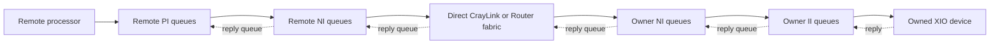

# Datasheet: Hub network interface

References rendered as citation identities name material outside this document
set. Those targets are not included or cleared for redistribution. Review and
runtime statements retain their recorded dates and scope.

**Status:** reviewed (coordinator with codex, 2026-08-09) — **ready**; one
minor finding, closed. The 2026-08-27 vector-routing revision — the status
register's fields, the measured boot-time vector operations, and the open
no-peer response question — reviewed by an independent second reader,
2026-08-27: three must-fix findings applied, review notes folded in
(the review record (citation: `docs/reviews/hub-ni-vector-corrections-review.md`),
source-readers only).
The programmed first-turn selector has
independent source clearance (citation: `docs/reviews/hub-first-turn-independent-review-20260907.md`)
for the bounded routed contract stated here.
The 2026-09-20 addition below — the `mgras_attach` graphics-attach gate and
the code-5 override it first motivated on Origin 2000 — is new
evidence, not yet independently reviewed. The 2026-09-25 peerless down-reason
contract (bit 28 on a Hub with no cabled peer) is likewise new and awaiting
independent review.
**Fork file(s):** `hw/misc/sgi-hub.c`

**Sources used:** the IRIX 6.5.7 machine-readable Hub register table
`stand/arcs/lib/libkl/hwreg/hwreg_hub.hwreg`; Linux
`arch/mips/include/asm/sn/sn0/hubni.h`, `arch/mips/include/asm/sn/sn0/hub.h`,
`arch/mips/sgi-ip27/ip27-init.c` and `arch/mips/sgi-ip27/ip27-reset.c` (public,
GPL, and derived from the SGI headers); OpenBSD `sys/arch/sgi/xbow/hub.h`,
`sys/arch/sgi/sgi/sginode.c` and `sys/arch/sgi/sgi/ip27_machdep.c` from the
`the-machine-hall/openbsd-sgi` tree (public, ISC), read without checking out a
branch as in
`git -C refs/openbsd-sgi show 2df91d80c1:sys/arch/sgi/sgi/sginode.c`;
SGI's *Origin200/2000 IP27 PROM Technical Reference Manual*, document
108-0170-001, in the project document library. The address arithmetic that
reaches this unit and the meaning of the addressing mode it reports are specified
in [the SN0 address map datasheet](address-map.md). The 2026-08-27
vector-routing revision adds two inputs: the vector-PIO trace measured on this
machine 2026-08-26 (the irix-wall notebook (citation: `docs/notebooks/irix-wall.md`)), and
the restricted library analysis `docs/library/irix-failsoft-and-vector-ops.md`,
which carries the vendor-source evidentiary chain and is for source-readers
only. IRIX 6.5.30's inventory predicate and the retained-source cross-check are
recorded in
the Origin 2000 ASIC revision source review (citation: `docs/reviews/origin2000-asic-revision-source-review-20260912.md`).
Implementers rely on these datasheets' distillation. We only read
reference sources and never copy their code or file structure (source-use
policy, decision D-0002).

The 2026-09-20 `mgras_attach` addition below draws on the shipped IRIX
6.5.30 `mgras_init.o` object's disassembly,
`docs/analysis/mgras_init.o-mgras.a-IP27boot/capstone-linear@37712a086fe5.json`
(function existence and address range directly confirmed here), and on
prior, not-yet-independently-reviewed project research at
`docs/plans/si-graphics-widget-wiring-handoff-20260916.md`, commit
`4da48b87f1` on the retained, unmerged branch `emdash/si-graphics-78hez`, whose
origami PR 1421 closed without merging (the exact
comparison threshold and warning text, inherited rather than re-derived —
see the paragraph below for why).

A same-day addition separately cites public-forum evidence for the fielded Hub
revision code itself, independent of that disassembly: real-machine `hinv -v`
captures read through the Library or fetched externally, cited in full in
provenance (citation: `docs/provenance.md`).

**Which facts came from where, and how much the agreement is worth.** Register
offsets and field positions appear both in the IRIX machine-readable register
table and in Linux's network-interface header, and they agree throughout —
**but that is not two independent sources.** Linux's header declares in its own
comments that it derives from the corresponding IRIX header at a named revision,
so the agreement is between one SGI artifact and a copy of a *sibling* SGI
artifact. **Two artifacts SGI kept for different purposes agreeing bit for bit is
worth more than a single source and less than independent confirmation**, and
this page previously claimed the latter.

The port error register rests on a bit-field structure rather than a bare mask,
and every one of the ten fields listed here matches it position for position and
width for width, with the structure adding that bit 32 is reserved. **That
structure is Linux's, and it is the derivative** — so it is a more detailed
witness than a mask, not a second one. **OpenBSD cannot supply the missing
independent check here**: its Hub header carries no port-error structure at all,
which is worth stating because OpenBSD is this datasheet's genuinely independent
source elsewhere and a reader would reasonably expect it to serve here too. The older Linux
kernels were checked for a richer network-interface header and have none — the
2.5 series and the historical MIPS 2.4 tree carry SN0 headers equivalent to
current mainline's, and the generated field-by-field style exists only for the
later SN1 and SN2 parts, which are a different chip.
**Every reset value is single-sourced from the IRIX machine-readable register
table**, and two of them are load-bearing for the first banner, so they are
called out where they appear rather than left in a column. The behaviour of the
two fields a guest reads is triple-sourced: Linux and OpenBSD read them
independently of each other, and SGI's own PROM manual describes the node
numbering they carry.

## Role

The Hub's network interface is the port onto CrayLink, the fabric that joins
nodes to each other. On a machine with more than one node it carries every remote
memory reference, every remote interrupt and the routing tables that get them
there. **On the modeled single-node Origin 200, the link is unconnected.** The
published two-module Origin 200 joins the peer Hubs directly by CrayLink. Larger
Origin-family fabrics may place a six-port Router between Hub links, but Router
placement belongs to the machine topology rather than this register block.

The direct peer placement is visible in *Origin200 and Origin200 GIGAchannel
Owner's Guide* 007-3708-002, revision 002, SHA-256
`ae6857707a113bd63b77a3a8187c81beed76cea1406592a38a735c4aa2c462dc`,
Figure 1-4 on printed page 6/PDF page 32. The printed-to-PDF offset of 26 is
trusted, and the original page was visually checked.

That would make this the most skippable unit in the machine, except for one
register. The first register in the block reports the Hub's own node number, the
addressing mode the machine is running in, and the chip's identity — and every
guest reads it before it does anything else. Linux reads it to learn its own node
number, in both C and assembly, because a kernel that does not yet know which
node it is on cannot address anything node-relative. OpenBSD reads it to decide
whether the machine is in M mode or N mode, and then prints that decision as part
of the line the first-banner boot is aiming at.

So this unit is on the critical path for the banner despite the modeled machine
having no attached peer. The rest of the unit — the routing tables, the vector-routing
mechanism the firmware uses to reach a Hub before node numbers are assigned, the
link error counters, the ageing controls — is real hardware that a single-node
machine mostly leaves idle. One measured exception: IRIX 6.5.30 launches a
handful of vector operations at boot, recorded with the vector-routing
registers.

### Remote traffic flow

The network interface converts Hub requests and replies to and from the external
CrayLink message format. Its input and output FIFOs keep request and reply
traffic in separate logical queues, matching the other three Hub interfaces.
That separation must survive across a direct Hub link or a Router fabric so a
blocked request cannot consume the path needed for its reply.[^theory-hub-ni]



NI owns fabric transport and link state. II owns XIO conversion, and PI owns
processor delivery. A Router may forward the middle hop, but its presence and
port attachment belong to the machine topology.

## Register map

All offsets are from the base of the Hub register window. A processor reaches
that window two ways. The position-independent way is the crosstalk I/O base
with the node-number field *zero* plus `0x0100_0000` — widget 1's small window on
node zero — which reaches whichever Hub the reading processor is attached to, on
every node, without the reader knowing its own node number. The node-explicit way
is the named node's crosstalk I/O base plus `0x0180_0000`. Every register is
64 bits.

### Status, revision and identity — the one that matters

| Offset | Name | Width | Reset | Access | Behavior as guest drivers use it |
|---|---|---|---|---|---|
| `0x60_0000` | Status, revision and identity | 31 | see below | mixed | The register every guest reads first. Fields below. |

| Bits | Name | Reset | Access | Meaning |
|---|---|---|---|---|
| 30 | Eight-bit mode | 0 | readable | The link is running eight bits wide rather than sixteen. |
| 29 | Link up | 0 | readable | The link came out of reset and is working. |
| 28 | Reason the link is down | table: 0; model: 1 until the link first comes up | readable | Zero means it failed; one means it never came out of reset. Meaningful only when the link-up bit is clear. A Hub with no cabled peer reads one; see [the down reason on a Hub with no peer](#the-down-reason-on-a-hub-with-no-peer). |
| 18 | More nodes | **0** | readable and writable | **Zero selects M mode, one selects N mode.** |
| 17 | Region size | **1** | readable and writable | One selects fine regions, where each node is its own region; zero selects coarse regions, where eight nodes share one. |
| 16:8 | Node number | **0** | readable and writable | This Hub's own node number, nine bits. Writable, because firmware assigns it. |
| 7:4 | Chip revision | configured; target 3 general baseline, 5 on the stock Origin 2000 topologies | readable | Immutable silicon identity. The register table's documented reset is 2. |
| 3:0 | Chip identity | 0 | readable | |

The IRIX register table groups bits 30 through 28 as a single port-status field;
Linux names the three bits separately. Both put them in the same places, so this
datasheet uses Linux's finer names.

**Three of those reset values are the whole reason this datasheet exists.** The
more-nodes bit resetting to zero is what makes an unprogrammed Hub report M mode.
The node-number field resetting to zero is what makes it report node zero. Both
are exactly what an Origin 200 needs, so a model that implements this register as
reset-to-zero gets the banner's mode line right for free — and a model that
invents a non-zero default gets it wrong in a way that changes the guest's entire
address arithmetic.

The chip revision field is also the source for the Hub component revision that stock
firmware places in KLCONFIG. A stock-PROM A/B capture on an Origin 200 changes the
KLCONFIG revision when only this field changes, while changing the Hub's separate widget
identification revision does not. The reusable node-board module selects chip
revision code 3, which IRIX names 2.1, and the plain four-node `origin2000` reference and
the two-module product keep it. The graphics-capable four-node module products
(`origin2000-module`, `-ir2`, `-menet`, `-pci-carrier` and `-pci-shoehorn`) and
`origin2000-one-node` override every node's Hub to code 5, for the graphics-attach reason
given below. The model must use one configured property both in bits 7:4 here and in the generated Hub component record. Two unrelated constants
can drift into the exact warning seen when the register and inventory disagree.

IRIX 6.5.30's Hub inventory routine (`hinv`) reads the KLCONFIG component revision, not
this register, while building its Hub listing. It maps codes 0 through 5 to 0.0, 1.0,
2.0, 2.1, 2.2, and 2.3, then warns when the code is below 3. A separate condition
requires code 5 or later only when the configured processor count exceeds 32. The
retained IRIX 6.5.5 and 6.5.7 source has the same two comparisons. This is `hinv`'s own
contract; a second, independent consumer of the same field is described below, so this
paragraph's thresholds bind only `hinv`. The eight-processor target therefore accepts
code 3 for `hinv`'s purposes. The public four-node module references do not state the
fitted silicon revision, so code 3 is the baseline's selected supported Hub variant,
backed by the observed Origin 200 component: a real, non-graphics Origin 200's 2001
Linux boot capture independently reports `ASIC HUB Rev 3` (cited in full in
provenance (citation: `docs/provenance.md`)), not an attribution to the reference module's
manufacturing lot.

**A second, separate consumer gates SI Viz graphics attachment at a different
threshold.** IRIX's `mgras_attach` — the SI Viz/Impact-class graphics attach callback,
distinct from the `hinv` inventory routine above — reads `NI_STATUS_REV_ID` on the
master node directly rather than through KLCONFIG. The function is a real, named
symbol (from `.symtab`, not a guessed address) in the shipped `mgras_init.o` object,
`irix-media/6.5-base/usr/cpu/sysgen/IP27boot/mgras.a(mgras_init.o)`, SHA-256
`37712a086fe5ca7a28a8d29fcdb7a736924acb51c8eda835b3d5a67439f06794`, spanning address
range `0x1f64`-`0x236c` (258 instructions, including three `cmn_err` calls consistent
with a warning-and-decline path rather than a hard failure); see
`docs/analysis/mgras_init.o-mgras.a-IP27boot/capstone-linear@37712a086fe5.json`. That
much is independently confirmed here. The exact comparison immediate and the exact
warning text are not: disassembling further into that shipped object risks clean-room
exposure for an implementer under this project's rules, so this datasheet inherits a
specific finding from prior, not-yet-independently-reviewed project work
(`docs/plans/si-graphics-widget-wiring-handoff-20260916.md`, commit `4da48b87f1`
on the retained, unmerged branch `emdash/si-graphics-78hez`) rather than re-deriving
it: a printed warning naming Hub 2.3 (code 5) alongside a coded minimum of Hub 2.2
(code 4) — the message one step more conservative than the code it guards.

Public Linux headers (`arch/mips/include/asm/sn/sn0/hub.h`) name the same code table
this datasheet already uses for `hinv`, extended one step further: code 1 is Hub 1.0,
2 is 2.0, 3 is 2.1, 4 is 2.2, 5 is 2.3, 6 is 2.4. That table is independently
established from GPL source, not from the disassembly finding above.

**Which Hub revision code real, fielded Impact-class/SI Viz-capable Origin 200/2000/2100
or Onyx2 nodes report is now established by citation for the graphics-equipped case:
code 5.** A bounded public-forum search, cited in full in provenance (citation: `docs/provenance.md`),
found two real machines independently confirmed to carry InfiniteReality-class graphics
hardware, both reporting code 5, plus a third real Origin 2000 reporting code 5 whose
graphics configuration was not established, and no machine of any configuration
reporting code 4. The strongest case is a real two-module Origin
200 with a KONA/InfiniteReality2 graphics board: `hinv -v` reports `ASIC HUB Rev 5` on
both node boards in the same capture that lists the KONA board, and the reading
reproduced across two independent IRIX installs on the same physical machine — a
verbatim Library read, the highest confidence source here. A second machine, an Onyx2
with InfiniteReality3 graphics, shows the same code-5 reading on both node boards, at a
different Hub link clock than the first. That reading came from a summarized fetch
rather than a verbatim page read, so it carries a lower confidence level. A third
machine, an Origin 2000 deskside unit, also reports code 5 on both node boards, but its
graphics configuration was never established in the source thread, so it corroborates
fielded Hub revisions generally rather than a graphics-equipped node specifically. No
real machine of any configuration, graphics-equipped or not, was found reporting code 4
anywhere in this search.
`docs/machines/layers/products/origin2000-rack.yaml`'s override selects code 5,
Hub 2.3, on every node of the stock module, and the deskside's does the same. It no
longer depends on graphics: the stock topologies carry none, and a stock two-node
Origin 2200 with no graphics (capture `model-toad`, an `8P12_MPLN` module; see
[the Onyx2 datasheet](onyx2.md)) reports `HUB Revision 5` on both node slots. Code 5
also satisfies the guest's own printed, more conservative `mgras_attach` threshold
when an SI board is fitted at launch. This needs renewed independent review — see
the contract review (citation: `docs/reviews/origin2000-asic-revision-contract-review-20260912.md`),
whose examined scope was `hinv`'s thresholds only and never covered `mgras_attach`.

The selected revision is immutable hardware identity. Reset reconstructs the status word
from the configured revision and the reset values of its other named fields. Migration
between identical machine definitions restores the mutable fields and reconstructs the
same revision at the destination. The revision is not mutable migrated state.

### Reset and protection

| Offset | Name | Width | Reset | Access | Behavior as guest drivers use it |
|---|---|---|---|---|---|
| `0x60_0008` | Port reset | 8 | 0 | writable | Bit 7 sends a warm reset over the link, bit 1 resets the link, bit 0 resets this entire Hub. Linux's reboot path writes bits 7 and 0 together. |
| `0x60_0010` | Protection configuration | 1 | 1 | readable and writable | Bit 0 permits reset. Resets permissive. |
| `0x60_0400` | Programmed-access protection | 64 | all ones | readable and writable | One bit per region controlling which regions may reach this unit. |
| `0x60_0408` | Protection override | 64 | **none — the field is write-only** | special action occurs on write | Writing the eight characters `SGIrules`, which is `0x5347_4972_756c_6573`, unlocks the protection. The same password appears in the processor interface and the I/O interface. |

### Link parameters and errors

| Offset | Name | Width | Reset | Access | Behavior as guest drivers use it |
|---|---|---|---|---|---|
| `0x60_0018` | Global parameters | 58 | mixed | readable and writable | Bits 57:48 the maximum retry count, resetting to `0x3ff`; bits 47:32 a tail-timeout wrap value resetting to `0xfffe`; bits 19:16 a credit timeout and bits 7:4 a tail timeout, both resetting to `0xf`. |
| `0x60_0110` | Diagnostic parameters | 19 | mixed | readable and writable | Bit 18 a port-timeout reset with no defined reset state, bit 12 forces eight-bit mode, bit 6 disables the port, bit 0 sends deliberate data errors. |
| `0x60_8000` | Port parameters | 16 | mixed | readable and writable | Bits 15:10 a null-packet timeout resetting to 6, bits 9:0 a maximum burst resetting to `0x3f0`. |
| `0x60_8008` | Port error | 38 | undefined | readable and writable | Bit 37 link reset, 36 internal error, 35 bad message, 34 bad destination, 33 queue overflow, bit 32 reserved, 31:28 a credit timeout count, 27:24 a tail timeout count, 23:16 a retry count, 15:8 a check-bit error count, 7:0 a sequence-number error count. |
| `0x60_8088` | Port error, clearing | 38 | undefined | readable, clears on read | The same register; reading it also clears it. |

### Vector routing — how firmware reaches a Hub with no node number

| Offset | Name | Width | Reset | Access | Behavior as guest drivers use it |
|---|---|---|---|---|---|
| `0x60_0200` | Vector parameters | 51 | undefined | readable and writable | Bits 50:40 an access identifier, 39:32 a write identifier, 19:3 the register address to reach, 1:0 the operation: zero reads, one writes, three is an exchange. |
| `0x60_0208` | Vector | 64 | undefined | readable and writable | The hop-by-hop route to the target. |
| `0x60_0210` | Vector write data | 64 | undefined | readable and writable | |
| `0x60_0300` | Vector status | 64 | valid and overrun 0, rest undefined | readable | Field-by-field layout in this section's vector status fields table. |
| `0x60_0308` | Return vector | 64 | undefined | readable and writable | Software can read and write all 64 bits. |
| `0x60_0310` | Vector read data | 64 | undefined | readable | |
| `0x60_0380` | Vector status, clearing | 64 | valid and overrun 0, rest undefined | readable, clears on read | The same status; reading it also clears it. |

The return-vector register's software access is distinct from automatic
completion behavior. IRIX 6.5.7's machine-readable register table specifies
all 64 bits as readable and writable with no defined reset value. The PROM
initializes it to zero and a diagnostic command writes a recognizable value
before launching a vector operation. These writes corroborate software access.
They establish neither a hardware reset value nor which successful or failed
transactions replace, preserve or clear the register.

Evidence: IRIX 6.5.7 `stand/arcs/lib/libkl/hwreg/hwreg_hub.hwreg`, lines
1815–1818; `stand/arcs/IP27prom/net.c`, revision 1.34, lines 150–214; and
`stand/arcs/IP27prom/exec.c`, lines 1840–1934. The source reader and independent
reviewer read these bounded passages. No return-route encoding, automatic
success/failure update rule or stale-value behavior is cleared by this access
correction.

SGI's PROM manual explains what this machinery is for, and the explanation is the
reason it exists at all: after a reset no node has been assigned a number, every
node believes it is node zero, and no node can address any other. Vector routing
reaches a small subset of another Hub's registers by describing the *route*
rather than the *destination*, and it is how the firmware discovers the fabric,
elects a master, assigns node numbers and programs the routing tables. Once
numbers exist, ordinary addressing works and discovery never needs it again —
but discovery is not the only user. IRIX reaches for the same machinery at boot
to inspect a neighbor's link registers, and does so on this machine; this
section records the five measured operations and what the model answered.

**A vector operation can never target the local Hub.** The PROM manual (printed
page 6-2, PDF page 96 — the manual paginates per chapter): a vector is a string
of router exit ports, and "The vector 0x0 accesses the device immediately
connected to the local Hub" — a Router normally, the peer Hub on a machine
wired Hub-to-Hub. There is no route that means "myself"; the manual's own route
table sends a node to itself out through a Router and back, and local Hub
registers are reached by direct PIO. Every vector operation is therefore a link
transaction, and on a single-node Origin 200 every one of them addresses a
device that does not exist.

The status register's field layout comes from the IRIX machine-readable
register table. **The layout and both reset values are single-sourced from that
table** — Linux's network-interface header carries matching masks for most
fields, but it is the derivative artifact the source note at the top of this
datasheet already discounts, so it corroborates lineage, not the hardware. The
clearing register carries the same fields by alias identity: the table gives it
only a single undivided read-clear field, so reading it as the same status
behind a clearing access is an inference, supported by the table's access type
and the public header's naming and consistent with the clears-on-read row
already reviewed. The table and the header disagree by one bit on three field
widths: the table gives the status register's source and access-identifier
fields as 61:51 and 50:40 and the vector parameters' access identifier likewise
as 50:40 (the parameters row states the table's spans), while the header's
masks cover 60:51 and 49:40 in both registers. Immaterial to every value
observed on this machine (each field's extra bit has read zero); recorded so a
reviewer does not rediscover it.

| Bits | Name | Reset | Meaning |
|---|---|---|---|
| 63 | Valid | **0** | A response has been latched. Guests poll this after a launch; reading the clearing alias clears it. |
| 62 | Overrun | **0** | A second response arrived while one was still latched. |
| 61:51 | Source | none | Source field. Router-response encoding remains unresolved in the reply evidence gap (citation: `docs/research/router-vector-reply-source-boundary.md`). |
| 50:40 | Access identifier | none | Echo of the identifier the launch wrote into the vector parameters. |
| 39:32 | Write identifier | none | Echo of the launch's write identifier. |
| 31:3 | Address | none | Echo of the target register address. |
| 2:0 | Response type | none | Zero a read response, one a write response, three an exchange response; four an address error, five a command error, six a protection violation, seven an unknown response. |

**The three error types are verdicts a receiver renders** — judgments only a
device that received the request can make about its address, command or
protection — and the request side can only carry the read, write and exchange
types (the vector parameters' operation field is two bits). That asymmetry plus
the valid bit resetting to zero is the load-bearing pair for this section's
open no-peer question.

**Measured on this machine, 2026-08-26** (the vector-PIO trace in the
irix-wall notebook (citation: `docs/notebooks/irix-wall.md`)): the stock 6.156 PROM issues
zero vector operations across the whole boot — its fabric discovery sees the
link down and skips — and the IRIX 6.5.30 kernel issues exactly five, in one
burst as its fail-soft daemon starts: a status read, a diagnostic-parameters
read, that pair again, then a diagnostic-parameters write, every one on the
null route, so every one aimed at the absent neighbor. The count of five is
from that one traced boot; the previous day's boot corroborates the final
write through its identical latched status, and every-boot regularity is an
inference from the launch sitting on a deterministic initialization path. The
current model completes each with the address-error response type, and the
last status stays latched. That latch is what the kernel's hardware-error dump
printed as the "6: Protection violation" console line of the 2026-08-25 wall —
the guest's own dump decoder misnames a type-4 address error, and the dump ran
because of the since-fixed CPU cache-op fault, not because anything acted on
this register. The kernel survives all five failures: no fault follows the
burst, and the same day's diagnosis found it healthy well past this point —
full tick rate, the miniroot's make-filesystem script running — wedged only by
the unrelated console serial-DMA wall (the dead-console entry in the
irix-single-cpu notebook (citation: `docs/notebooks/irix-single-cpu.md`)). The full
evidentiary chain, including why the burst reads as the kernel checking and
restoring the peer link's width, is in the restricted library analysis
`docs/library/irix-failsoft-and-vector-ops.md` (source-readers only — this
datasheet carries everything an implementer needs).

**What real hardware answers to an unanswerable launch is open, and the model
currently asserts one of the two candidates rather than the better-supported
one.** The model answers with an address-error response, which claims a device
received and judged the request. The other candidate is no response at all:
nothing exists to render a verdict, the valid bit — which resets to zero —
never sets, and the guest's own launch loop times out harmlessly (IRIX's
timeout arm is on the order of a millisecond and every caller tolerates any
failure). The no-response reading is supported by the receiver-rendered
semantics of the error types, by the reset value, and by the absence of the
dump's vector-status line from every real-hardware transcript held — but it is
unobserved on silicon, so it enters this datasheet as an open question, not a
contract clause. What would settle it: a Hub ASIC document if one is ever
acquired, or the PROM's own vector-read command run on a real peerless
Origin 200 (a timeout-style failure would confirm no-response; an error-status
would confirm the model). Until settled, the proposal on the table for the
model is no-response — leave the status register untouched on an unanswerable
launch — because it removes a console line real machines have never been seen
to print and stops telling callers that a Hub answered when none did.

### Routing tables and ageing

| Offset | Name | Count | Width | Access | Purpose |
|---|---|---|---|---|---|
| `0x63_8000` + 8×*n* | Meta routing table entry *n* | 32 | 4 | readable and writable | Bits 3:0 hold the relative turn at the attached Router toward a region. |
| `0x63_8100` + 8×*n* | Local routing table entry *n* | 16 | 4 | readable and writable | The relative turn within the issuing Hub's meta region. |
| `0x60_0500` through `0x60_0538` | Ageing controls, eight registers | 8 | 12 | readable and writable | One pair per requester class — each processor, the block-transfer engine and the I/O interface — with separate memory and programmed-access entries. Bits 11:10 a virtual channel, 9:8 a congestion control, 7:0 an age. All reset to zero. |


For supported programmed routes, compare destination node bits 8:4 with the
issuing Hub's programmed node bits 8:4. Equal values select the local table,
indexed by destination bits 3:0. Different values select the meta table,
indexed by destination bits 8:4. The existing M-mode fabric limits destination
numbers to 0 through 255. This comparison does not extend that address range.
No additional Hub force-local control is established by the reviewed evidence.

The selected nibble is a relative turn at the directly attached Router. The
Router combines it with the physical ingress port using its
[reviewed turn arithmetic](router.md#routing-table-entry-encoding-and-lookup). It is not an absolute
output port. Zero resolves to the ingress port under that arithmetic and is
not a vector terminator or an automatic missing-route marker. This does not
claim that the inspected firmware programs same-port routes. Directions 6
through 15 and never-programmed entries retain the Router contract's open
failure semantics. An undefined reset entry must not create invented traffic
or successful completion.

The public IP27 PROM manual, printed page 4-20, establishes the table sizes
and four-bit entries. The table selector and relative-turn construction are
bounded software-programmed behavior from independently reviewed IRIX 6.5.7
firmware. They do not establish every Hub routing mode. An implementation
must test different local and meta entries, a nonzero issuing NASID, table
mutation, and an ingress port where the relative and absolute interpretations
choose different outputs. Physical node-array indices never replace the
programmed destination identity.

## Behavioral contract

**Reading the status register must report M mode and node zero.** This is the one
thing this unit must get right for the first banner. OpenBSD reads the register at
Hub offset `0x60_0000`, tests bit 18, sets its mode flag from it, derives its
node-number shift from that flag, and prints the mode in the line it emits during
early startup. Linux reads bit 18 for the same purpose in its own initialisation,
and separately masks bits 16:8 out of the same register every time it needs to
know its own node number. With the register reset to zero in both fields, both
guests reach the right answer without anything being programmed.

**The consequences of getting bit 18 wrong are larger than one printed word.**
The addressing mode decides how wide the node-number field in a physical address
is and how large each node's window is — four gigabytes in M mode against two in
N mode, with the node number one bit lower. A guest that reads N mode will
compute every node-relative address differently. It would not merely print the
wrong line; it would address the wrong memory.

**The node number is writable, and that is not a mistake.** Firmware assigns node
numbers by writing this field, which is why it is readable and writable rather
than a strap. On a single-node machine nothing writes it and the reset value
stands. The model must still accept a write and return it, because a firmware
that assigns node zero to itself explicitly is doing something legitimate.

**A guest reboots through this unit, and the two guests do it differently enough
that both paths must work.** Linux writes the port-reset register once, with the
warm-reset bit and the local-reset bit together — bits 7 and 0. OpenBSD writes the
same register with the link-reset bit and the local-reset bit — bits 1 and 0 — and
before that it writes a one to the protection register at `0x60_0010` to permit
the reset at all. So the model must treat a write to the port-reset register with
the local-reset bit set as a machine reset regardless of which companion bit is
set, and must not require the protection register to have been armed, since Linux
does not arm it.

**A third consumer was not anticipated when that clause was written, and it changes how
the machine behaves on every single boot: the vendor firmware writes the local-reset bit
itself, early, before it has printed anything.** Measured 2026-08-13 on trunk `0dbc6f3413`
once the clause was finally implemented. So this is not a path taken only by a guest that
chose to reboot — **it is on the ordinary power-on path**, and the machine resets once and
carries on. It does not loop, and it boots to the firmware banner afterwards.

**The operational consequence, which cost a near-revert of the trunk within the hour and
belongs here rather than in anyone's memory: `-no-reboot` is now incompatible with this
machine.** QEMU's `-no-reboot` means *exit instead of resetting*, and since the firmware
asks for a reset before emitting any output, the emulator exits at that write having
printed nothing:

```
0dbc6f3413   -no-reboot   exit=0     0 bytes
0dbc6f3413   (no flag)    exit=124   251 bytes, boots to the banner
```

Same binary, same firmware image, same three real character devices, minutes apart, the
flag the only difference. **Bound a run with a `timeout` budget instead** — that is what
produces the exit 124 above, and it bounds the run whether or not the guest asks for a
reset.

**Say the failure shape out loud, because it is the dangerous part rather than the
inconvenience: zero bytes and exit 0 is indistinguishable from a run that worked and had
nothing to say.** No harness can tell those apart, and one engineer here nearly filed it
as a silent stall. The only tell available was a contradiction rather than a bad value —
a 150-second timeout returning instantly.

**One question this raises is open and is the datasheet owner's, not the implementer's:
whether the hardware bit resets the Hub or the whole machine with it.** The clause says
machine reset and the model does that, which is self-consistent and boots. But the fact
that firmware exercises it on every power-on is new evidence bearing on the clause, and it
was not in view when the clause was ratified.

OpenBSD also writes a code describing what kind of restart it wants into a
processor-interface register before it resets, and its comment about the location
being in a different castle is worth reading before anyone assumes the reboot
path is tidy. That register belongs to
[the Hub processor interface datasheet](hub-processor-interface.md); what matters
here is that the write lands before the reset and must not be lost by it.

**For the two public guests, nothing else in this unit is exercised on a
single-node machine.** Linux mainline defines the vector registers in its
network-interface header and no code under its MIPS tree uses them; OpenBSD 7.9
GENERIC-IP27 does not reference them at all — its Hub header does not even
define them (both negatives bounded with control searches, recorded in the
restricted library analysis named with the vector-routing registers). For those
guests the routing tables stay empty, the vector machinery sits idle and the
link error counters never advance. **IRIX 6.5.30 is the third guest and it does
exercise vector routing at boot** — five operations at its fail-soft daemon's
start in the traced boot, measured and recorded with the vector-routing
registers.

**The link must report itself as down, never out of reset, and that must be
harmless.** With no fabric attached, the link-up bit reads zero and the reason
bit reads one: the link never came out of reset. Neither public guest checks
either bit on a single-node machine; IRIX checks the link-up bit at every
boot — its kernel fabric probe reads it first and skips probing when the link
is down, and the stock PROM's discovery does the same — and IRIX reads both
bits on every bus error, which is why the reason bit matters. A model that
reported the link as up would be claiming a fabric that is not there, and
would invite a multi-node guest to try to use it. A model that reported the
reason as zero, a link that came up and failed, makes IRIX 6.5.30 panic on its
first bus error; the next section records the evidence.

### The down reason on a Hub with no peer

Applies to the Origin 200 base module and the router-less one-node Origin
2000: a Hub whose network port has no cabled peer. Hubs with a peer (the
two-module Origin 200, the four-node Origin 2000 through its Routers) read
link-up and are unaffected. The Bedrock-based Origin 300 is a different chip.

**Contract.** Reset sets the reason bit. The link coming up clears it, and it
stays clear until the next reset, so a link that comes up and later drops reads
zero, "failed". A peerless Hub therefore reads link-up zero and reason one at
every point after reset. The bit is read-only.

**Evidence, graded.**

- *Established, disassembly of IRIX 6.5.30 `unix.IP27`.* `check_ni_errors`
  (called from `dobuserre` for every instruction or data bus error, and from the
  Hub PI and II error-interrupt handlers) first tests the port-error register's
  error fields. Otherwise it reads the status register, and if bits 29 and 28
  are both zero it reads the protection register at `0x60_0010`: nonzero prints
  "NI Link went down" and returns fatal, and the caller panics "Fatal Craylink
  error"; zero prints "Detected a link reset due to other partition reset",
  clears the port errors and continues. With either bit set it goes on to test
  two remote-error bits in the processor interface's second pending register
  and otherwise returns harmless. The kernel's only references to the
  protection register through its constant table are reads.
- *Established, disassembly of stock IP27 PROM 6.156.* The network-interface
  initialisation writes one to the protection register; node bring-up briefly
  writes all ones but bit 0 and then one again. The PROM never sets the
  status register's bits 30:28: its NI initialisation stores `0x2_0000` there,
  zeros into those bits, which are read-only and keep their value. Discovery polls link-up
  for one second and prints "Local hub NUMAlink is down." when it stays zero.
  A separate routine decodes bit 28 into "LLP Link never came out of reset"
  (one) and "LLP Link failed after reset" (zero), confirming the bit's
  meaning independently of the public header.
- *Established, real hardware.* A real single-module Origin 200 booting PROM
  6.156 with verbose output prints "Local hub NUMAlink is down." and "Found 1
  objects (1 hubs, 0 routers)" (Joshua Kinard, linux-mips, 2017-10-10, cited in
  provenance (citation: `docs/provenance.md`)). Its link-up bit read zero, and the same
  PROM version writes protection one. That capture's "Port status: NF" is the partition-fence
  flag, not the link reason, so it does not show bit 28.
- *Secondary.* Linux `hubni.h` (derived from the IRIX header) names bit 28
  "0=failed, 1=never came out of reset".
- *Inferred.* A real peerless Origin 200 running IRIX survives bus errors,
  including the ones its probe of empty PCI configuration slots takes when the
  Bridge reports an unclaimed cycle. With protection one and link-up zero, only
  a reason of one avoids the fatal branch. A port with no partner has nothing
  to complete link-layer reset with, which is the "never came out of reset"
  case. No real capture of the register value exists.
- *Reconciled, inferred.* The IRIX 6.5.7 register table gives bits 30:28 a
  reset value of zero. Reading that as the value at the reset instant, which
  the link logic then owns, is an inference. The table does not describe what a
  peerless port settles to. The model presents the settled value from reset
  because nothing in the model can observe the interval.

**Measured on the model, 2026-09-25**, with the Bridge change that makes an
unclaimed configuration cycle fault (the Bridge master-timeout change): without this
contract Origin 200 IRIX 6.5.30 printed "NI Link went down (0x0)" and "PANIC:
Fatal Craylink error." on its first boot; with it, the Origin 200, the
two-module Origin 200, the one-node Origin 2000 and the four-node Origin 2000
all reached the login prompt.

**What would settle the inference:** reading `0x60_0000` on a real peerless
Origin 200 or one-node Origin 2000, for example with the PROM monitor's memory
read; bit 28 one confirms the contract.

## Interrupts

This unit is a source of one interrupt on real hardware: the network-interface
error, which reaches the processor interface's second pending bank as a fixed
hardware-assigned bit. The processor interface datasheet lists that bit among the
ones hardware assigns rather than software.

On our machine no network error can occur, so the interrupt is never raised. The
error registers read zero — our choice, since the hardware leaves them undefined
at reset — and the pending bit stays clear. This is safe because neither public
guest enables that interrupt on a single-node machine; IRIX enables it at every
boot, but no network error can occur on our machine, so it never fires — the
safety rests on the interrupt never being raised, not on it never being
enabled. The two public guests also only
read the error registers after a failure our model cannot produce; IRIX reads
the vector status and port error registers with plain PIO in every kernel
fault's hardware-error dump — harmless reads, since the dump uses the
non-clearing port-error offset, and the 2026-08-25 wall is a held instance of
exactly that dump running.

## DMA

The network interface is not an endpoint DMA engine. It carries coherent remote
traffic, including a DMA request that entered through another node's I/O path. On
the modeled single-node machine no such traffic exists. The ageing registers
describe how requester classes are prioritised when a fabric is present.

## Out of scope

- **Routing-table runtime outside the direct topology.** The direct Origin 200
  adapter does not consult the stored tables. Router-connected compositions
  use the cleared first-turn selector and the Router contract. Complete
  packet timing and behavior for unsupported table contents remain open.
- **Vector routing is no longer out of scope.** An earlier revision parked the
  seven registers here on the belief that nothing uses them; IRIX 6.5.30 uses
  them at every boot, so their behavior now lives with the vector-routing
  registers, along with the status fields and the open no-peer response
  question. What remains true and out of scope: neither public guest touches
  these registers, and the route a vector describes has no reachable target
  until a second node exists.
- **Link parameters, port parameters and diagnostic parameters.** Tuning and
  fault injection for a link we do not model. Storage.
- **Port error and its clearing alias.** The hardware leaves this register
  *undefined* at reset — the machine-readable register table gives it no reset
  value, and the register map says so. **Reading zero is our modelling choice, not
  the chip's behaviour**, and it is a sound one because our machine has no fabric
  and can generate no network error, so there is never anything to report. The two
  claims are kept apart here the way the Crossbow datasheet keeps its link-reset
  policy apart from the chip's one-shot: the chip does something we are choosing
  not to model, and a reader must be able to see which is which.
- **Ageing controls.** Eight registers of fabric arbitration policy. Storage.
- **Programmed-access protection.** Storage, not enforcement, for the same reason
  the other Hub units' protection registers are storage: enforcing a register our
  synthesized firmware might not open produces a dead machine with no diagnostic.
- **The second node.** Everything here that is storage today becomes real when a
  second node exists. The register block is specified in full so that the later
  work is filling in behaviour rather than discovering the interface.

## Behavioral notes

**This is the smallest unit with the largest consequence.** Two fields of one
register decide what machine the guest thinks it is running on. Of the rest of
the block's roughly forty registers, a single-node machine meaningfully touches
only the vector-operation group — IRIX launches vector operations at boot, five
in the traced boot, and the model must answer with something, which is the open
question recorded with those registers. The imbalance is still worth stating plainly so the
implementation effort goes where it belongs: get the status register exactly
right, settle the vector-operation response policy, make everything else store
and read back, and move on.

**The reset values are single-sourced and two of them are load-bearing.** The
more-nodes bit resetting to zero and the node-number field resetting to zero both
come from the IRIX machine-readable register table alone; no public header carries
reset state. They are also exactly the values our machine needs, which is a
pleasant coincidence rather than something the model may assume — if a reviewer
finds the table wrong about either, the model must set them explicitly rather than
rely on a zeroed register block.

**The region-size bit resets to fine, and nothing on our path reads it.** Linux
defines both settings and explains that a fine region is one node while a coarse
region is eight. It matters for how the region-presence bitmap in the processor
interface is interpreted on a large machine. On a single node either setting
describes the same thing, so the reset value is recorded for completeness rather
than because anything depends on it.

**The register table's chip revision reset is 2, which denotes Hub 2.0.** That
is a documented shipped value, but it is not any of this project's selected
variants: every product supplies its own configured code — 3 for the general
baseline, which `hinv` accepts, or 5 for the stock Origin 2000 topologies, which
both `hinv` and `mgras_attach` accept — rather than inheriting the generic
device default by accident.

**Vector routing is the mechanism that makes the multi-node story coherent, and
reading about it explains an oddity elsewhere.** The address map records that each
node's Hub registers appear both at a position-independent window and at a
node-numbered one. Vector routing is why the first exists and is not merely a
convenience: before numbers are assigned there is no node-numbered address that
means anything, so a Hub must be reachable without one.

## Open questions

- What NASID firmware discovery assigns each node in a two-module Origin
  2000 Xpress pairing. A witnessed real two-module Onyx2 assigned module 1
  slots 1-4 NASIDs 0-3 and module 2 slots 1-4 NASIDs 4-7, but NASID is a
  firmware-programmed value, not a static composition field, so a
  different physical cabling or discovery sequence could produce a
  different order. A two-module composition orders its node components by
  physical slot only and assigns no NASID field. Settled by stock-PROM
  discovery on the emulator once a routed builder consumes more than one
  physical module.

## qtest checklist

- The status register at `0x60_0000` reads zero in bit 18, so a guest computing
  its addressing mode from it concludes M mode.
- The same register reads zero in bits 16:8, so a guest reading its own node
  number gets zero.
- With the Hub revision property set to 3, the same register reads one in bit 17,
  three in bits 7:4 and zero in bits 3:0. A second case selects revision 5 and reads
  five in bits 7:4, proving the status word is composed from the property and its
  named fields.
- The link-up bit reads zero and the down-reason bit reads one on a Hub with no
  cabled peer, at boot and after reset, and a guest write does not clear it. On
  a cabled pair the link reads up with the reason zero; dropping the cable
  reads the reason zero (failed), and a reset with the cable still down reads
  one.
- Writing a node number into bits 16:8 and reading it back returns it, proving
  the field is writable rather than a constant.
- Writing to bits 30:28, which are read-only, leaves them unchanged and is
  logged.
- Reset leaves the configured revision field unchanged while restoring writable status
  fields. Save and restore with an identical machine definition preserves the configured
  revision without migrating it as writable device state.
- The protection-configuration register resets to one and the programmed-access
  protection register resets to all ones.
- The global parameters register resets with its retry field `0x3ff` and its two
  timeout fields `0xf`, and the port parameters register resets with its
  null-timeout field 6 and its burst field `0x3f0`.
- Writing the warm-reset and local-reset bits together to the port-reset register
  resets the machine, rather than storing the value.
- Writing the link-reset and local-reset bits together to the same register also
  resets the machine, with and without the protection register having been armed
  first, because the two guests differ on both points.
- The port error register and its clearing alias both read zero, and reading the
  clearing alias does not fault. This asserts our modelling choice rather than a
  hardware reset value, because the hardware defines none.
- A vector-operation launch never completes as success: the status register
  never reports a read, write or exchange response type on a machine with no
  peer. Whether it should report an error response (what the model does today)
  or never set the valid bit at all (the no-response reading of real hardware)
  is the open question recorded with the vector-routing registers; this item
  pins only the invariant both answers share.
- Every routing table entry stores and returns a four-bit value, and entry 32 of
  the meta table and entry 16 of the local table do not exist.

[^theory-hub-ni]: *Origin and Onyx2 Theory of Operations Manual*, SGI
    `007-3439-002`, revision 002, Figure 3-2 and the Hub message description on
    printed pages 78-79, PDF pages 92-93. SHA-256
    `f6f30191b662aeef6c9888f109c4997d58ac9c4a77acd24263937c6392113309`.
