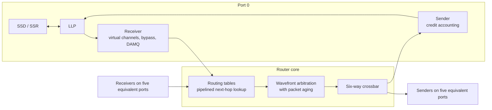

# Datasheet: Router ASIC

References rendered as citation identities name material outside this document
set. Those targets are not included or cleared for redistribution. Review and
runtime statements retain their recorded dates and scope.

## Status

**Protected-source facts are present.** This revision (2026-09-03) adds the
guest-visible register map, reset values, field layouts, the routing-table entry
encoding, the reset-fence controls, and the order in which the stock PROM reads and
writes those registers during discovery, numbering, route programming, and link
checks. They were read from the held IRIX 6.5.7 source (the PROM's Router register
table, the kernel's Router header, and the PROM's discovery, routing, diagnostic,
and built-in-self-test code; every file and revision is listed under sources) by
the Router source-reader and restated here in our own words. Nothing is
transcribed. The public sections (role, message layer, routing, vector routing,
register names, link boundary, board attachment, implementer contract) stand as
established by the 2026-09-03 public revision and remain cited, by the subject of
their row, in the Origin 2000 evidence matrix (citation: `docs/library/origin2000-module-and-32p-evidence-matrix.md`).

**Cleared for the bounded register and valid-route implementation described here.**
The independent source review (citation: `docs/reviews/router-source-independent-review-20260905.md`)
clears the inspected offsets, field masks, per-field cold-reset values, scratch
and routing-table storage, plain-address write-one-to-clear and clearing-alias reads,
conditional scratch exchange, vector reply-field preservation, valid programmed
turn arithmetic, and software LED reads and writes. Undefined table reset
contents remain undefined. Preserve the recorded LED source discrepancy.

Reset propagation, invalid-route replies, and silicon BIST signatures remain
uncleared. The
BIST and reset proposal (citation: `docs/notebooks/router-bist-reset-contract.md`) defines the
PROM-visible scan protocol and bounded link, administration-block, warm-reset,
and BIST-reset extents for independent review. A bootable Router also needs
reviewed one-wire responder behavior and histogram runtime behavior with tests.
The one-wire dependency must cover bus
presence, slot timing, done/data transitions, and identity reads. The histogram
sections give a bounded contract for register writes, utilisation events, the
50 MHz timebase, common rescaling, reset, and migration. The
corrected independent review (citation: `docs/reviews/router-histogram-contract-corrected-independent-review-20260909.md`)
clears that documentation contract and its explicit model choices. Age, DAMQ,
absolute mode, and silicon reset details beyond the bounded reset policy remain
unsupported. The software-derived expectations in
this document do not by themselves clear full diagnostics acceptance.

The Router gap ledger (citation: `docs/library/router-gap-ledger.md`) records the supported
claims and open remainders. The source reader and reviewer are excluded from
implementing the Router, its fabric adapter, and PROM discovery.

**Fork file(s):** none. No QEMU type exists.

**Sources used (public):** the Theory of Operations manual; the IP27 PROM Technical
Reference (public); Mike Galles's 1997 IEEE Micro paper, which describes the
Router chip under its published name, Spider; US patent 5,721,819 on programmable
distributed routing; Uros Prestor's 2001 thesis *Evaluating the Memory
Performance of a ccNUMA System*; the public Linux SN0 Hub NI header for the Hub
side of the vector protocol; the MDK field-diagnostics manual for the printed
behaviour of a real system. The public Linux
`arch/mips/include/asm/sn/sn0/hub.h` and
`arch/mips/include/asm/sn/addrs.h` supply the chip-identity values (Hub 0, Router
1) and the node-number split (four local bits, five meta bits) by name.

**Sources used (protected, IRIX 6.5.7 unless stated; read by the source-reader
only):**

- `stand/arcs/lib/libkl/hwreg/hwreg_router.hwreg` (no revision ident): the PROM's
  machine-readable Router register table, giving every register's address, every
  field's bit span, access type, and reset value. The same table, compiled into a
  string table, is held identically in the 6.5.5 and 6.5.7 crash-analyser trees
  (`irix/cmd/icrash/lib/libhwreg/hwreg_router.c`, byte-identical across releases).
- `irix/kern/sys/SN/router.h` (`$Revision: 1.53 $`; the 6.5.5 copy is
  `$Revision: 1.52 $` and differs only in two size limits): the kernel's register
  addresses, field masks, and the software conventions layered on the scratch
  registers.
- `stand/arcs/IP27prom/discover.c` (`$Revision: 1.110 $`), `discover.h`
  (`$Revision: 1.25 $`): the depth-first fabric discovery and the route-to-table
  translation.
- `stand/arcs/IP27prom/net.c` (`$Revision: 1.34 $`), `net.h`
  (`$Revision: 1.14 $`): the POD-mode route programming and the Hub link checks.
- `stand/arcs/IP27prom/router.c` (no revision ident), `router.h`
  (`$Revision: 1.13 $`): Router locking, NIC reading, LED and chip-output access,
  fence programming, and the midplane-speed measurement.
- `stand/arcs/IP27prom/route.c` (no revision ident): the route calculation.
- `stand/arcs/IP27prom/rtr_diags.c` (`$Revision: 1.39 $`), `rtr_diags.h`
  (`$Revision: 1.7 $`): the link diagnostics discovery runs.
- `stand/arcs/IP27prom/router_war.c` (`$Revision: 1.11 $`): a first-silicon
  workaround that the held build files do not compile in.
- `stand/arcs/IP27prom/bist.c` (`$Revision: 1.30 $`), `bist.h`
  (`$Revision: 1.13 $`), and `bist_data.src` (no revision ident): the built-in
  self-test driver, result status, scan widths, and input vectors shared by Hub
  and Router.
- `stand/arcs/IP27prom/partition.c` (no revision ident): partition fences.
- `stand/arcs/IP27prom/main.c` (no revision ident): the boot sequence that calls
  the above, the table distribution, and the power-fail link-mode workaround.
- `stand/arcs/IP27prom/exec.c`, `testing.c` (no revision idents): the POD commands
  and the PROM's own simulation-era vector tests.
- `stand/arcs/lib/libkl/ml/vector.c`, `router.c`, `slots.c` (no revision idents)
  and `irix/kern/sys/SN/vector.h` (no revision ident): the vector-operation
  primitives, the POD status dump, and the slot-strap decode.
- `stand/arcs/lib/libsk/ml/nic.c` (no revision ident) and `irix/kern/sys/nic.h`:
  the one-wire bit timings driven through the identity register.
- `irix/kern/ml/SN/router.c` (no revision ident; the 6.5.5 copy differs only in
  the bypass-enable policy), `irix/kern/ml/SN/SN0/sn0drv.c`,
  `irix/kern/ml/SN/SN0/sn0net.c`, `irix/kern/ml/SN/error_dump.c`, and
  `irix/cmd/linkstat/linkstat.c` (revision 1.16): read only where they fix
  register semantics and histogram consumers (histogram selection, clearing,
  display, error decode, fences, port-state decode).
- The exact PROM 6.156 payload from IRIX 6.5.30, SHA-256
  `c2c69bf33c375b43ec7ac511fab41ddf595be1b6838ae717e58a9a1273437fdd`:
  bounded disassembly of Router vector completion and its error display. The
  binary review (citation: `docs/reviews/router-reply-source-prom6156-binary-review-20260906.md`)
  records the addresses, masks, branch coverage, and tooling without reproducing
  code or private identifiers.

No vendor code, comment, field name, macro name, structure name, or file layout is
reproduced. Public `RR_` register names from the PROM manual are used as names.

## Role

The Router is a six-port CrayLink switch. It connects Hubs and other Routers,
chooses an output for each incoming message, and moves the message through a
six-way crossbar. The Theory of Operations manual calls the routing adaptive and
says different messages for one destination may take different paths (printed
80, PDF 94); the designer's paper describes software-programmed tables that
define a static route between every pair of endpoints, with software free to
reprogram them (printed 36, PDF 3). The public record does not reconcile the
two and this datasheet leaves the conflict open. A functional model that routes
each message by one table-determined path follows the designer's account; what
would settle the question is a Router register document or a console
observation of two messages to one destination taking different paths. The
faithful Router decision (citation: `docs/decisions/D-0021-origin2000-faithful-routers-and-stock-prom.md`)
requires forwarding by the tables programmed by stock firmware. Wormhole forwarding lets a message advance
before the Router has received its final unit.

Each port has a source-synchronous physical interface, link-level protocol
logic, a receiver, a sender, and routing-table access. The receiver manages
virtual channels and temporarily stores blocked traffic in dynamically allocated
memory queues (DAMQs). It bypasses those queues when the requested output is
available. The sender accounts for link credits before transmitting. Packet
age raises the priority of traffic that has failed to advance.

The drawing expands one of six identical ports. A message enters through LLP,
the receiver selects a virtual channel, and the routing table determines the
direction the message should take after its next Router hop. If the output is
free, bypass logic presents the message directly to the crossbar. Otherwise the
receiver assigns DAMQ storage. Arbitration chooses among contenders, giving
older traffic priority, and the selected sender transmits only while the remote
link grants enough credits.[^theory-router]

## Message layer

Established by the designer's paper (the matrix's message-header and
flow-control rows):

- A message is a header micropacket followed by zero or more data micropackets;
  a tail bit marks the last one. A micropacket is 128 bits of data plus 8 bits of
  sideband, and the sideband carries virtual-channel tags and credits.
- The header carries a 9-bit destination identifier, a 4-bit direction, an 8-bit
  age, and 2 bits of congestion control, 23 bits in all. How many of the
  remaining bits carry data is open: the paper's figure labels a 42-bit data
  field while its prose reserves 23 of 128 bits and says the rest function as
  data (the matrix's message-header row). The direction
  is the exit port of the chip that receives the header. Direction 0 is reserved
  for the chip's own administration block, so a data message uses directions 1
  through 6.
- The destination identifier is the node number, which the PROM manual describes
  as the nine-bit value placed in address bits 40:32 to reach a node (the
  remote-addressing row). Its upper 5 bits are the meta address and its lower 4
  bits the local address.
- Four virtual channels, credit-based flow control per channel, 256-byte receive
  buffers per virtual channel per port, and a per-port set of linked lists, one
  per output port per virtual channel, so a blocked head does not stall traffic
  for other outputs.
- Age is 0 to 239 for ordinary traffic and 240 to 255 for sixteen high-priority
  levels; a message ages at a programmable rate as it crosses chips and the
  arbiter favours the oldest. A tail-timeout timer fabricates a tail and flags an
  error when a channel stalls mid-message; a deadlock timer resets a port that
  stays full with no progress.

None of this is a register contract. It is listed so that a functional model's
omissions (no cycle-level arbitration, no credit accounting) are conscious. The
paper's "direction" and the routing-table entry encoding established below are
reconciled in the routing-table section: the value the PROM writes is a turn
count relative to the port a message enters on, and the paper's statement that
the direction names an exit port is true of the port the count resolves to.

## Routing

Established by the paper, the patent, the Theory of Operations manual, and the
PROM manual (the table-shapes, two-level-tables, and pipelined-lookup rows):

- Each chip holds two software-programmed tables: a 16-entry local table indexed
  by the destination's 4 local bits and a 32-entry meta table indexed by its 5
  meta bits. A programmable meta-ID register names the chip's own meta domain;
  when the destination's meta address matches it the local table decides, else
  the meta table does. A force-local register overrides the compare.
- Lookup is pipelined one hop ahead: a chip reads the direction its own crossbar
  uses from the header and looks up the direction the *next* chip will use. A
  Router entry therefore holds one direction per output port: the PROM manual
  states a Router's tables as 16 local and 32 meta entries of 24 bits organised
  as six 4-bit directions each, against the Hub's 16 and 32 entries of a single
  4-bit direction.
- Tables define a static route between every pair of endpoints; software programs
  them at configuration and may reprogram around faults. Routes must be
  cycle-free.
- The bit packing of a 24-bit entry, the addresses of the meta-ID and force-local
  controls, and the order the PROM programs them are established from protected
  source in the routing-table and programming-sequence sections below.

## Vector routing

Established by the PROM manual and the patent (the vector-addressing rows and the
network-exploration row):

- Before node numbers exist, ordinary remote addressing is invalid. Vector
  routing reaches a Router's registers and a subset of a remote Hub's NI
  registers by giving the route instead of the destination.
- A vector is a string of output port numbers 1 to 6 (hardware labels A to F),
  one per nybble, in reverse order: `0x512` leaves the Hub into its Router, exits
  port 2, exits port 1 of the next Router, and exits port 5 of the third into a
  Hub or a Router. Vector `0x0` reaches the device directly connected to the
  local Hub.
- The response follows the reverse path. Each chip along the outbound route
  consumes the head vector field and appends the port the packet entered on, so
  the packet arrives carrying its own return route.
- Address 0 is the status register on both a Hub (`NI_STATUS_REV_ID`) and a
  Router (`RR_STATUS_REV_ID`), placed there so a probe can tell which type
  answered from a bit field. The Hub's side of that field is public (chip
  identity in bits 3:0, revision in bits 7:4). The Router's layout of the same
  register, and the value it reports, are in the register map below: the same
  two low fields, with chip identity 1.
- The Hub side of the protocol (the vector, parameters, data, status, return
  vector, and clearing registers, and the status types 0 to 7) is in
  [the Hub NI datasheet](hub-network-interface.md).
- Within one full module the PROM manual's own route table reads: from a node on
  R1, N1 is `5`, N2 is `4`, N3 is `0x56`, N4 is `0x46`, R1 is `0`, R2 is `6`;
  from a node on R2, N1 is `0x56`, N2 is `0x46`, N3 is `5`, N4 is `4`, R1 is `6`,
  R2 is `0`. That fixes R1's port 5 to N1, port 4 to N2, port 6 to R2, and R2's
  port 5 to N3, port 4 to N4, port 6 to R1. A node reaching itself out through its
  Router and back is a listed, legal route.
- A vector holds at most fifteen hops. The vector register is sixteen nybbles and
  the terminating nybble must be zero, so the PROM refuses to probe past a path
  fifteen hops long (`discover.c`).

## Register set

The PROM manual lists the Router registers by name (the register-names row):
forty-six names, of which the two table names stand for 16 and 32 indexed
entries. The offsets, widths, fields, and reset values behind the names are in
the register map that follows.

| Group | Names |
| --- | --- |
| Identity and control | `RR_STATUS_REV_ID`, `RR_PORT_RESET`, `RR_PROTECTION_CONFIG`, `RR_GLOBAL_PARMS`, `RR_DIAG_PARMS`, `RR_SCRATCH_REG0`, `RR_SCRATCH_REG1`, `RR_NIC_ULAN` |
| Per port, six each | `RR_PORT_PARMS1-6`, `RR_STATUS_ERROR1-6`, `RR_ERROR_CLEAR1-6`, `RR_RESET_MASK1-6`, `RR_HISTOGRAM1-6` |
| Routing tables | `RR_LOCAL_TABLE` (16 entries), `RR_META_TABLE` (32 entries) |
| Built-in self test | `RR_BIST_COUNT_TARGET`, `RR_BIST_DATA`, `RR_BIST_ENTER_RUN`, `RR_BIST_READY`, `RR_BIST_SHIFT_LOAD`, `RR_BIST_SHIFT_UNLOAD` |

The per-port reset-mask registers are the paper's reset fences (the
errors-and-fences row), and the PROM's `FencePorts` log variable lists the ports
it fences; the fence section below gives the two registers that implement a
fence. The per-port status/error registers carry the check-bit and
sequence-number error counts the MDK Router test reads (the Router SSO row).

## Register map

Every fact in this section comes from the PROM's machine-readable Router register
table, cross-checked against the kernel's Router header; the two agree on every
address and every field position. Where software behaviour qualifies a table
entry (a field the table marks read-only that software writes, a clearing
behaviour the table does not state), the qualification is given with the
register and its source named.

### How a vector access selects a register

A Router has no window in the processor's address space. Every access is a vector
operation launched from a Hub: the Hub's vector-parameters register carries a
17-bit register address in its bits 19:3 and a two-bit operation (read, write, or
exchange), the vector register carries the route, and the vector-data register
carries a 64-bit datum ([the Hub NI datasheet](hub-network-interface.md), whose
address field the PROM's Hub register table gives as bits 19:3 too). Consequences
for the Router:

- **Addresses are 20 bits with the low three bits always zero.** Every Router
  register sits on an 8-byte boundary and the table entries are 8 bytes apart.
- **Bits 19:16 select a block.** Block 0 holds the chip-wide registers, blocks 1
  through 6 hold that port's five registers at the same low offsets, and block 7
  holds the two routing tables. Bits 15:0 select the register within the block.
- **Every access is a whole-register, 64-bit operation.** There are no byte,
  halfword, or word vector accesses; a register narrower than 64 bits returns its
  defined bits and ignores writes to the rest, except where the map says the
  upper bits read undefined.
- **The three operations.** A read returns the register. A write stores the
  datum. An exchange is what the PROM's own vector code describes: the datum is
  stored only if the register currently holds zero, and the value before the
  operation is returned either way (`libkl/ml/vector.c`, the exchange routine's
  description). Every exchange the PROM issues targets scratch register 1, and
  its lock protocol works under either a conditional or an unconditional
  exchange, so the conditional reading rests on the routine's description alone.
- **The response echoes the request.** The reply the Router builds carries back
  the access identifier, write identifier, register address, and operation type
  the request carried, and the Hub latches them in its vector-status register.
  Software checks the request identifiers, operation type, and address and
  treats a mismatch as a fatal reply error.
- **Reply source encoding remains open.** The Hub vector-status source field
  has a documented position, but the inspected sources do not establish its
  value for a Router reply. The machine-readable table assigns bits 61:51;
  the shared IRIX and public Linux header mask assigns bits 60:51. The
  disagreement persists across the held IRIX 6.5.5 and 6.5.7 copies.
  The inspected IRIX 6.5.7 standalone PROM driver tests valid, overrun,
  response type, and the echoed request fields without masking or comparing
  the source field. The inspected 6.5.7 discovery and automatic Router
  diagnostic paths receive only that driver's result and read data. The one
  direct consumer in that tree is a maintenance command that prints the
  masked field after an error. Error capture can also preserve the complete
  raw status word. The 6.5.7 kernel vector driver makes the same
  field-independent completion checks, and both inspected IRIX 6.5.5 kernel
  copies are byte-identical to it. These exact paths and releases therefore do
  not depend on bits 61:51. A Router reply qtest may mask the whole 61:51 range
  as a bounded model choice instead of asserting an ungrounded numeric value.
  The project's four-node acceptance image uses PROM 6.156 from IRIX 6.5.30.
  Bounded disassembly of the exact payload shows that successful mapped read,
  write, and exchange completion does not consume, mask, compare, or branch on
  bits 61:51. A zero reply-source field is consumer-safe for those operations
  on that exact payload. After another check has classified an operation as
  failed, the maintenance error display extracts bits 60:51. Unmapped accesses,
  failed completions, raw-status reporting, other firmware, and the separate
  Return Vector latch remain outside this consumer result. It does not choose a
  hardware width, value, or generation rule. A fixed zero remains an explicit
  model approximation rather than faithful reply status.
- **A vector that ends at this chip.** When the remaining vector nybble is zero
  the request is for this Router's own registers. The status register's
  input-port field then tells the requester which port the request arrived on.
- **What an access to an unmapped address does is not established.** No code
  read touches an address outside the map, and no comment says what the chip
  answers. The Hub-side status type 4 (address error) is the receiver's verdict
  for a bad address in the vector protocol; whether the Router renders it, or
  answers with the undefined register contents, is open. The model must pick one
  and say so; answering with the address-error type keeps the Hub-side taxonomy
  honest and is what the Hub NI datasheet's open question already assumes for the
  peerless case.

### Access-type legend

The register table classifies every field. The classes that occur in the Router
table, in this datasheet's words:

| Class | Meaning |
| --- | --- |
| read-only | Readable; writes are ignored. |
| read-write | Readable and writable. |
| write, one clears | Readable; writing a one to a bit clears that bit. Software clears these registers by writing zero, which under this class would clear nothing; the histogram and error sections record the bounded zero-write compatibility rule and its evidence limit. |
| read-clear | Readable; the read itself clears the register. |
| write, side effect | Not readable as state; a write performs an action. |
| write, value ignored | A write performs an action and the datum does not matter. |
| write-only | The field can be written and does not read back. |

### Chip-wide registers (block 0)

| Offset | Name | Width | Access | Reset | Purpose |
| --- | --- | --- | --- | --- | --- |
| `0x00000` | `RR_STATUS_REV_ID` | 49 | mixed | see fields | Identity, revision, straps, per-port link state, local errors, LEDs, and the port a request arrived on. |
| `0x00008` | `RR_PORT_RESET` | 8 | write, side effect | 0 | Reset triggers: bit 7 a warm reset, bits 6:1 reset link 6 through 1 (bit *p* resets port *p*), bit 0 resets the chip's own administration block. |
| `0x00010` | `RR_PROTECTION_CONFIG` | 21 | read-write | see fields | Partition identifier, force-local, meta identifier and its valid bit, and the six chip-level reset permits. |
| `0x00018` | `RR_GLOBAL_PARMS` | 64 | read-write | see fields | Timeouts, aging, retry limit, clock select, bypass enable. |
| `0x00020` | `RR_SCRATCH_REG0` | 64 | read-write | 0 | Scratch. Software keeps the cached NIC, the local identifier, and the booted flag here. |
| `0x00028` | `RR_SCRATCH_REG1` | 16 | read-write | 0 | Scratch, 16 bits. The kernel header says the upper 48 bits read back as garbage; software masks them. Used as the Router lock. |
| `0x00030` | `RR_DIAG_PARMS` | 20 | read-write | 0 | Histogram mode, reset-on-deadlock, per-port force-eight-bit, per-port disable, per-port send-data-error. |
| `0x00038` | `RR_NIC_ULAN` | 34 | mixed | see fields | The one-wire bus master for the board's identity chip. |

**`RR_STATUS_REV_ID` fields.** Bits 63:49 are not defined.

| Bits | Access | Reset | Meaning |
| --- | --- | --- | --- |
| 48:46 | read-only | 0 | Input port: the port number (1 to 6) on which the request that is reading this register arrived. |
| 45, 44, 43 | read-only | 0 | Port 6: eight-bit mode, link working, reset failed. |
| 42, 41, 40 | read-only | 0 | Port 5: the same three. |
| 39, 38, 37 | read-only | 0 | Port 4: the same three. |
| 36, 35, 34 | read-only | 0 | Port 3: the same three. |
| 33, 32, 31 | read-only | 0 | Port 2: the same three. |
| 30, 29, 28 | read-only | 0 | Port 1: the same three. In general port *p* has reset-failed at bit 25+3*p*, link-working at 26+3*p*, eight-bit-mode at 27+3*p*. |
| 27 | write, one clears | 0 | Local single-bit (sideband) error. |
| 26 | write, one clears | 0 | Local stuck error. |
| 25 | write, one clears | 0 | Local bad direction: a vector or direction the administration block could not use. |
| 24 | write, one clears | 0 | Local tail error. |
| 23:22 | read-write | 0 | Unused. |
| 21:16 | see note | 0 | Software LEDs: one bit per port, port *p* at bit 15+*p*. These drive the board's yellow LEDs, which the PROM manual says system software controls. The register table marks the field read-only; the PROM and the kernel both write it through a whole-register write, so the model must accept the write and read it back. |
| 15:12 | read-write | 1 | Chip outputs, four general-purpose output pins. |
| 11:8 | read-only | 1 (table) | Chip inputs, four general-purpose input pins wired to board straps; the strap decode is below. |
| 7:4 | read-only | 1 | Chip revision. |
| 3:0 | read-only | 1 | Chip identity. 1 is a Router; 0 is a Hub (public Linux `hub.h`). |

The kernel decodes each port's link-working and reset-failed pair as a two-bit
state: both clear, the link came up and then failed; reset-failed alone, the link
never came out of reset; link-working set, the link is up (the fourth combination
is not used).

**Chip-input straps.** The PROM reads bits 11:8 and treats bit 3 of the field
(bit 11 of the register) clear as "this is a MetaRouter". For an ordinary Router
the field's value 15 is slot R1 and 14 is slot R2 (values 0 to 13 map to no
slot); for a MetaRouter values 0 through 7 are slots 8 down to 1 (`slots.c`,
`discover.c`). So the Origin 2000 module's R1 Router reports `0xf` and R2 reports
`0xe` in bits 11:8; a machine model sets the field per board.

**`RR_PROTECTION_CONFIG` fields.**

| Bits | Access | Reset | Meaning |
| --- | --- | --- | --- |
| 20:13 | read-write | 0 | Partition identifier, eight bits. |
| 12 | read-write | 0 | Force local: every lookup uses the local table. |
| 11 | read-write | 0 | Meta identifier valid. |
| 10:6 | read-write | 0 | Meta identifier, five bits: this chip's own meta domain. |
| 5:0 | read-write | all ones | Reset permitted from port *p* at bit *p*-1 (the chip-level half of a fence). |

**`RR_GLOBAL_PARMS` fields.** Reset values are those of the register table.

| Bits | Reset | Meaning |
| --- | --- | --- |
| 63:58 | `0x0f` | Local grant timeout. |
| 57:48 | `0x3ff` | Maximum retry count before a link is given up. |
| 47:36 | `0xffe` | Tail-timeout wrap. |
| 35:28 | `0x0a` | Age wrap: the aging rate. |
| 27:20 | `0x01` | Urgent wrap. |
| 19:16 | `0xf` | Deadlock timeout value. |
| 15:12 | `0xf` | Age value at which a message becomes urgent. |
| 11:10 | 3 | Read-only, reads 3. |
| 9:8 | 3 | Local urgent timeout. |
| 7:4 | `0xf` | Tail-timeout value. |
| 3:1 | 0 | Global clock select. |
| 0 | 1 | Bypass enable: the receiver may present a message directly to the crossbar. |

Every field is read-write except bits 11:10. Which of these are timeouts, which
aging, and which credits: bits 63:58, 47:36, 19:16, 9:8, and 7:4 are timeouts
(the tail timeout has a value and a wrap, the deadlock timeout a value, the
local grant and local urgent timeouts a value each); bits 35:28, 27:20, and 15:12
are aging (the rate at which age advances, the urgent-level wrap, and the urgent
threshold); bits 57:48 are the LLP retry limit. No field of this register holds a
credit count. No credit-count field is identified in the documented register map.
This does not establish that every software observation mechanism is absent.

**`RR_DIAG_PARMS` fields.** All read-write, all reset 0.

| Bits | Meaning |
| --- | --- |
| 19 | Absolute histogram mode. |
| 18 | Reset a port on deadlock timeout. |
| 17:12 | Force eight-bit link mode on port *p* at bit 11+*p*. |
| 11:6 | Disable port *p* at bit 5+*p*. |
| 5:0 | Send a deliberate data error on port *p* at bit *p*-1. |

**`RR_NIC_ULAN` fields.** Bits 63:34 are not defined.

| Bits | Access | Reset | Meaning |
| --- | --- | --- | --- |
| 33:27 | read-write | `0x31` | Clock divider, second phase. |
| 26:20 | read-write | `0x31` | Clock divider, first phase. |
| 19:10 | write-only | 0 | Pulse width. |
| 9:2 | write-only | 0 | Sample point. |
| 1 | read-only | 1 | Done: the bit slot has completed. |
| 0 | read-only | 0 | Received data: the wire level sampled in the slot just completed. |

The layout is the Hub's one-wire master register, field for field
([the Hub one-wire datasheet](hub-onewire.md)), and the behavioural contract is
the same: one write starts one bit slot, software polls the done bit, and the
data bit beside it is the bit read. The inspected IRIX 6.5.7 consumer derives
both divider fields from the configured Hub frequency, including when addressing
a Router. It first truncates the frequency to whole megahertz, halves that integer
with truncation, then subtracts one. A 97.5 MHz configuration therefore programs
47 in both fields; a 100 MHz configuration programs 49, matching the register's
reset fields. These are observed software calibration values, not a specification
of the Router's divider circuitry or the physical duration of arbitrary settings.
The independent calibration review (citation: `docs/reviews/router-nic-clock-source-review-20260907.md`)
records the release-bound evidence and descriptor checks. The bit timings the PROM requests
are the standard one-wire ones: a reset pulse of 520 µs with sample argument 65 and a 500 µs recovery (presence detect), a
write-one as a 6 µs pulse sampled at 110 µs, a write-zero as an 80 µs pulse
sampled at 30 µs, and a read as a 6 µs pulse sampled at 13 µs then a 100 µs
recovery (`nic.c`). A model therefore needs a one-wire responder behind this
register, exactly as the Hub one-wire datasheet warns; the PROM reads a Router's
NIC through this register during discovery, and later reads the NIC's
manufacturing pages through it as well.

### Per-port registers (blocks 1 to 6)

Port *p*'s registers are at `(p << 16) + offset`, so `RR_PORT_PARMS1` is
`0x10000` and `RR_ERROR_CLEAR6` is `0x60088`.

| Offset | Name | Width | Access | Reset | Purpose |
| --- | --- | --- | --- | --- | --- |
| `0x0000` | `RR_PORT_PARMS`*p* | 20 | read-write | see fields | LLP tuning and histogram selection. |
| `0x0008` | `RR_STATUS_ERROR`*p* | 34 | write, one clears | 0 | Error flags and counters. |
| `0x0010` | `RR_HISTOGRAM`*p* | 64 | write, one clears | 0 | Four 16-bit counters. |
| `0x0018` | `RR_RESET_MASK`*p* | 6 | read-write | all ones | The per-port half of a fence. |
| `0x0088` | `RR_ERROR_CLEAR`*p* | 34 | read-clear | 0 | The status/error register behind a clearing read. |

**`RR_PORT_PARMS` fields.**

| Bits | Reset | Meaning |
| --- | --- | --- |
| 19:18 | 0 | Histogram select: 0 characterises message age, 1 measures link utilisation, 2 characterises the DAMQ (kernel header). |
| 17:16 | 0 | Virtual channel selected for the DAMQ histogram. |
| 15:10 | 6 | Null-packet timeout. |
| 9:0 | `0x3f0` | Maximum burst. |

**`RR_STATUS_ERROR` and `RR_ERROR_CLEAR` fields.** The same layout; bits 63:34
are not defined.

| Bits | Meaning |
| --- | --- |
| 33 | Receiver FIFO overflow. |
| 32 | A packet arrived for an illegal port. |
| 31:28 | Deadlock timeout bits. |
| 27:24 | Receiver tail timeout bits. |
| 23:16 | Retry count. |
| 15:8 | Check-bit error count. |
| 7:0 | Sequence-number error count. |

The kernel treats a count that reads as all ones as having overflowed. The PROM's
link diagnostics compare the check-bit count before and after a burst of vector
reads and fail the link when it grew by more than 5 (`rtr_diags.h`).

**`RR_HISTOGRAM` fields.** Bits 63:48 bucket 3, 47:32 bucket 2, 31:16 bucket 1,
15:0 bucket 0. What the buckets count depends on the port's histogram select.
The exact definitions, 50 MHz utilisation timebase, write behavior, and bounded
model rules are in the histogram sections.

**`RR_RESET_MASK` fields.** Bits 5:0, bit *p*-1 for port *p*, all ones at reset.
Their reading is in the fence section.

### Routing tables (block 7)

| Offset | Name | Count | Width | Access | Reset |
| --- | --- | --- | --- | --- | --- |
| `0x70000` + 8×*n* | `RR_META_TABLE` entry *n* | 32 (*n* = 0 to 31) | 24 | read-write | undefined |
| `0x70100` + 8×*n* | `RR_LOCAL_TABLE` entry *n* | 16 (*n* = 0 to 15) | 24 | read-write | undefined |

An entry holds six 4-bit fields, one per exit port: the field for exit port *p*
occupies bits 4*p*-1 down to 4*p*-4, so port 1 is bits 3:0 and port 6 is bits
23:20. The register table gives no reset value; the PROM writes every entry of
every Router before any table-routed traffic exists. Entry encoding and lookup
are in the routing-table section below.

### Built-in self-test registers (block 0)

| Offset | Name | Width | Access | Reset | Purpose |
| --- | --- | --- | --- | --- | --- |
| `0x00050` | `RR_BIST_DATA` | 64 | read-write | 0 | Scan data in and out. |
| `0x00058` | `RR_BIST_READY` | 1 | read-only | 0 | Bit 0: the scan engine is ready for the next operation. |
| `0x00060` | `RR_BIST_COUNT_TARGET` | 8 | write-only | 0 | Bits 7:6 the target scan chain (1 logic self-test, 2 array self-test, 3 clock control); bits 5:0 the number of bits in the next shift, where 0 means 64. |
| `0x00068` | `RR_BIST_SHIFT_LOAD` | 64 | write, value ignored | 0 | Shift the data register into the target chain. |
| `0x00070` | `RR_BIST_SHIFT_UNLOAD` | 64 | write, value ignored | 0 | Shift the target chain out into the data register. |
| `0x00078` | `RR_BIST_ENTER_RUN` | 64 | write, value ignored | 0 | Start the self-test. The Router resets itself when it finishes. |

The PROM drives these only from the POD `rbist` command, never on the boot path.
Its first action is an unbounded ready poll, so a Router that can answer vectors
must eventually report ready. No source establishes that delay. The bounded
model may expose ready synchronously when reset ends and between scan
transactions. The register table's zero is the asserted-reset value, before the
administration interface becomes available.

The driver's sequence, for a chain written 64 bits at a time, waits for ready,
writes count and target, waits again, writes a bit-reversed data word, triggers a
load, and waits for completion. Reading replaces the data write and load with an
unload followed by a data read. A zero count means 64 bits. Targets 1, 2, and 3
select the logic, array, and clock chains.

`rbist le` loads the one-bit clock chain and the 191-bit logic chain before
starting the test. `rbist ae` loads the clock chain and the 110-bit array chain.
Both reset the Router. The selected result chain survives reset so the later
`rbist lr` or `rbist ar` command can unload it after the Router returns. A
completed run reports status 2. Any other status is incomplete or failed for
acceptance. The logic result chain contains a 62-bit signature, but the
inspected PROM narrows it to a 32-bit integer before printing it. Array results
expose and print 12 result bits. The PROM compares neither result with an
expected Router value and emits no Router pass/fail result. Deterministic opaque
result fields are enough for compatibility when status is 2, but remain a model
approximation. Literal Router BIST acceptance needs a revision-matched expected
result or an observed known-good Router result.

The enter-run request may lose its normal vector reply when the Router resets.
The command interpreter discards the execution return value and relies on a
later result command. The
BIST and reset evidence (citation: `docs/notebooks/router-bist-reset-contract.md`) records the
source boundaries, proposed reset behavior, and required tests. A ready bit or
an echo of loaded scan data is not a completed BIST.

## Behaviour

### Reset state

At reset every register holds the reset value in the map: identity 1, revision 1,
chip outputs 1, every link-state bit clear, no local errors, LEDs off, every reset
permit set (protection configuration bits 5:0 and every port's reset mask all
ones), meta identifier 0 and not valid, force-local clear, partition 0, the global
parameters at their table values with bypass enabled, diagnostic parameters 0,
both scratch registers 0, every port's parameters at null-timeout 6 and maximum
burst `0x3f0`, error and histogram registers 0, self-test ready 0, and the
one-wire dividers at 49 with done set. The routing tables hold undefined values.
The PROM's discovery relies on scratch register 0 and 1 being zero after a reset
(its own precondition list says so) and on the tables being unprogrammed.

The port-reset register defines three scopes. Bits 1 through 6 reset one link
engine, bit 0 resets the local administration block, and bit 7 requests a warm
whole-chip reset. The published block boundary and the firmware's port-reset
consumer do not provide a register-retention table. The bounded model therefore
uses the explicit reset policy below. It keeps a port reset local to transport,
resets administration-owned state for bit 0, and applies the cold state to the
whole chip for bit 7. BIST completion applies the warm-reset extent while
retaining the selected result chain for the later result command.

### Link state, and the port a request arrived on

Each port comes up when its peer does: link-working sets, reset-failed stays
clear, and eight-bit-mode reflects the width negotiated (or forced through the
diagnostic parameters). The kernel reads reset-failed set as a port that never
came out of reset and both bits clear as a port that came up and then dropped;
whether an unconnected port reports the former or the latter is not fixed by the
source read. Every reader of a Router's
status register learns which port it is attached to from bits 48:46, which the
chip fills per request with the arrival port. The PROM uses that field to learn
the topology (which port of the Router the current hop entered), to pick which
per-port error register describes the link it just crossed, and to decide which
diagnostic-parameter bit sends an error back along it.

A port shuts down after the retry limit is exceeded (the paper) and its
link-working bit clears; software sees this only by polling, and the kernel
polls every Router every 2 seconds. Nothing in the source read raises an
interrupt from a Router toward a Hub; the Hub's own NI error interrupt covers the
Hub's end of the link only.

### Errors the chip latches

Bits 27:24 of the status register are the administration block's own errors
(single-bit error, stuck, bad direction, tail error), write-one-to-clear. The
kernel prints them when dumping Router state and uses them to decide the chip has
an error state worth printing; nothing acts on them. The bad-direction bit is the
one an implementer will meet first: it is where a vector nybble or a table
direction that names no usable port ends up. Which values trigger it (a direction
of 0 in a data message, a direction above 6, a fenced or down port) is not stated
in the source read and stays open.

### Error counters and the clearing alias

Each port's status/error register and its clearing alias are one register at two
addresses. Software reads the plain address to inspect (discovery saves all six
per Router, the diagnostics compare before and after, the kernel's state dump
prints them) and reads the clearing alias to inspect-and-clear (the POD `rstat`
command and the kernel's periodic poll). The PROM's diagnostic path also writes
zero to the clearing alias, expecting it to clear the counters. The register
table specifies write-one-to-clear for the plain register and read-clear for the
alias. Preserve those separate address contracts. The diagnostic zero write
establishes a software expectation at the alias only. It does not establish that
arbitrary nonzero writes store values at either address, or that zero clears
the plain register.

### Histograms

Each port has its own 64-bit histogram register at address
`(p << 16) + 0x0010`, from `0x10010` for port 1 through `0x60010` for port 6.
Every vector access transfers the complete 64-bit register. Its four 16-bit
buckets are interpreted by the selector in that port's parameters:

| Selector | Bucket 0 | Bucket 1 | Bucket 2 | Bucket 3 |
| --- | --- | --- | --- | --- |
| 0, message age | Age 0 to 63 | Age 64 to 127 | Age 128 to 191 | Age 192 to 255 |
| 1, link utilisation | A received micropacket bypassed queued arbitration | A micropacket was received | A micropacket was sent | One tick of a 50 MHz timebase |
| 2, selected DAMQ virtual channel | No entries occupied | 1 to 7 entries occupied | 8 to 14 entries occupied | 15 entries occupied |

Prestor's thesis, printed page 81 (PDF page 82), supplies these definitions. A
bypass count requires a received micropacket to find its dynamically allocated
queue empty and no contention for the requested crossbar output. The thesis
does not say which event samples age or DAMQ occupancy, so those two modes have
defined bucket ranges but no cleared progression rule.

The kernel selects utilisation mode on every port at Router initialisation and
uses buckets 0 through 2 against bucket 3 to report bypass, receive, and send
utilisation. The PROM's midplane-speed measurement uses that same mode on the
local Router's port toward the booting Hub. The complete timing, clearing,
rescaling, mode-transition, reset, and migration contract follows under the
first-boot dependencies.

### First-boot behavioral dependencies

**Reviewed with bounded clearance.** The
first-boot dependency review (citation: `docs/reviews/router-first-boot-independent-review-20260905.md`)
clears the public Dallas ROM protocol and the existing request/completion
boundary. Router-specific timing remains a sibling-interface inference proposal.
The histogram has a cleared bounded contract for rate, clearing, utilisation
events, common rescaling, cold reset, and migration. The corrected independent
review named in the histogram section clears its evidence limits and model
choices. Exact
PROM 6.156 compatibility with a zero source field is established only for
successful mapped operations. This does not settle reset propagation, invalid
routes, BIST, failure reporting, Return Vector behavior, or manufacturing-record
contents.

#### One-wire discovery

The public IP27 PROM manual, printed page 1-3 (PDF 17), places a Dallas NIC on
each Router board. It describes a unique 48-bit number plus nonvolatile inventory
memory. The public DS2505 specification, revision 071107, pages 4, 15, and 18,
describes the ROM layout, reset/presence sequence, and search protocol. Its held
copy is `docs/library/cache/io-chip/ds2505-1-wire-eeprom-datasheet.pdf`.
These establish a compatible protocol, not that every Router board fits that
exact part number.

The register adapter must drive an attached one-wire bus and return its sampled
level. Each write begins a slot. Completion belongs to that slot, so a preceding
slot's completion or data must not answer a new request. Polling completion must
not advance the ROM search by itself. A poll may carry out a release whose
deadline has already elapsed, which performs the one bus operation that slot's
write requested, but never ahead of that deadline or beyond that request. An
absent responder leaves the released
line high rather than returning a fabricated identity. The reviewed
[Hub one-wire contract](hub-onewire.md) establishes the same request/completion
boundary. The Router register map supplies its own address and field layout.

For the discovered part, the protocol must support reset/presence, the `0xf0`
Search ROM command, and all 64 read-bit/read-complement/write-choice triplets.
Bits and command bytes travel least-significant bit first. The resulting ROM
contains a family byte, a 48-bit serial, and a valid ROM CRC-8. After a branch
choice mismatches its ROM, a responder releases the line for the remaining
search until reset. The public Dallas specification owns these bus semantics.
The original-prose Dallas part contract (citation: `docs/library/dallas-1wire-part-specs.md`)
owns the selected part's memory and CRC behavior.

The inspected IRIX 6.5.7 discovery consumer verifies the complete ROM CRC and
extracts the serial without selecting a particular family. That is a consumer
observation, not permission to label one chip family as another. Give each
Router its own stable synthetic identity through the composition's identity
policy. Repeating discovery through another arrival port must find that same
part. Later manufacturing-page reads require a compatible supplied memory image
and the selected part's real protocol. A successful ROM search alone does not
prove those reads, inventory parsing, or a complete first boot.

The observed software programs divider fields using the configured Hub clock.
Its reset, write, and read pulse/sample arguments are recorded in the NIC
register section. The published Bridge ASIC specification, revision 4.0, printed page 31
(PDF 45), Table 24, defines the matching low twenty bits: the pulse is measured
in microseconds, and sampling follows release of the master pulse by the
programmed offset. Its original page was visually checked. The public Linux
`drivers/w1/masters/sgi_w1.c` consumer corroborates reset, read, and write-zero
timing pairs. Its write-one uses the read pair with recovery instead of the
inspected PROM's dedicated write-one pair.

The proposed Router compatibility rule uses that timing origin: release after
the programmed pulse, sample after the additional offset, then report completion.
For example, the reset sequence releases after 520 microseconds and samples
65 microseconds later. This transfers the published sibling master's timing to
a matching Router interface as an explicit inference, not a Router silicon
measurement. The concrete software calibration cases are:

| Configured Hub frequency | First phase | Second phase |
| --- | --- | --- |
| 97.5 MHz | 47 | 47 |
| 100 MHz | 49 | 49 |

The checked four-node Origin 2000 composition (citation: `docs/machines/layers/products/origin2000-rack.yaml`)
selects 97.5 MHz. Its compiled descriptor carries 97,500,000 Hz. The reset pair alone does not establish
the configured frequency or clear timing for this composition. Applying the
microsecond compatibility rule to either listed pair still requires independent
review of that approximation and its discriminating tests. Other pairs, unequal
phases, the general clock-to-duration mapping, and replacement of an in-flight
request remain unverified. An implementation must define observable handling of
unsupported settings before it can be cleared; silent universal microsecond timing
is not permitted. The separate recovery delay occurs after polling completion in
the inspected Router accessor.

A register qtest must perform a complete search through vector writes and reads,
check the ROM CRC, repeat it through another arrival port, and cover no-responder
and mismatched-search-branch cases. A poll-only sequence must not consume serial
bits. A memory-read test must use the selected part's public protocol and validate
its framing CRC independently from any inventory-record checksum.

The bounded one-wire adapter contract (citation: `docs/designs/router-onewire-bounded-adapter.md`)
defines the reviewed compatibility subset for these two calibrations and four
specified pulse/sample pairs. Its admission rules, rejection of unsupported or
overlapping requests, retained logical read candidate, reset/migration invariants,
and discriminating tests are independently cleared as explicit model
approximations in the contract review (citation: `docs/reviews/router-onewire-bounded-review-20260908.md`).
This does not clear general divider timing, arbitrary waveforms, manufacturing
inventory, or firmware acceptance. Device implementation must satisfy that
contract and its register qtests before claiming the subset supported.

Slot deadlines remain anchored to the captured virtual start and release times.
A delayed callback that observes both deadlines elapsed must release and complete
once, in order, without extending the slot. A test must advance past both
deadlines and prove this.

An access to the register carries out the same elapsed steps, in the same order,
before it reads or writes. Completion is therefore reported from the slot's own
deadline on the virtual clock rather than from whenever the callback runs, which
is how the [Hub one-wire contract](hub-onewire.md#when-completion-arrives-which-is-a-separate-question-from-when-it-must-not)
already reports it. Nothing is carried out ahead of its deadline. Polling without
virtual time passing consumes no serial bits, and a write before the sampling
deadline is still refused as overlapping. A reset written to the port reset
register, and a built-in self test run, carry out the same elapsed steps before
they discard the slot, because neither resets the responder and the bus operation
has already happened on the wire. An independent review examined the model change at QEMU
`d7431f9dbf` and cleared it, requiring the further tests below. The bounded
adapter contract records why and what it changes.

Tests must advance virtual time past both deadlines without dispatching the timer,
then prove that an access reports completion with the correct sampled bit and that
the next write is admitted. They must write a run of slots with neither a read nor
a dispatch between them and prove each is admitted with exactly one bus operation
per slot. They must write between the release and sampling deadlines with no
dispatch and prove the write is refused while completion still arrives at the
original sampling deadline carrying the right bit. They must reset through the port
reset register, and start a built-in self test, on each side of a release deadline
with no dispatch, and prove the next slot reads the bit the responder actually
holds.

The flat memory-read test must continue from a
non-page-aligned address through the final data byte and trailing CRC, so an
incorrect per-page CRC cannot pass unnoticed.

#### Histogram clock measurement

Prestor's thesis describes bucket 3 in utilisation mode as a 50 MHz
full-link-speed counter. It is a histogram timebase, not the 100 MHz Router core
or the 390 MHz node-facing link named elsewhere in the thesis. The bounded model
uses one Router-wide 20-nanosecond virtual-time grid. Cold reset arms the first
grid point exactly 20 nanoseconds after reset completes. At a grid point, a port
advances bucket 3 exactly when its selector is link utilisation and the
absolute-histogram bit is clear. Selector and absolute-control changes preserve
the grid. Stopping and restarting progression does not start a new per-port
interval. Host time while a virtual machine is stopped does not count. Link-down
and administrative-disable states do not enter the timer predicate. This is a
bounded emulator approximation that avoids assigning either state a hardware
timing meaning. It does not establish whether silicon does the same.

This rate is consistent with the inspected IRIX 6.5.7 PROM. The PROM selects
utilisation mode on the port facing the measuring Hub, writes zero to the
histogram, waits 100 microseconds using the Hub real-time clock, then compares
bucket 3 with elapsed processor Count ticks. Under the machine contract, a
250 MHz processor advances Count at 125 MHz. An ideal interval therefore gives
12,500 Count ticks and 5,000 histogram ticks. The PROM's integer expression,
`12500 * 1170 / 5000`, gives 2,925, inside its 390 MHz classification band,
strictly greater than 2,700 and strictly less than 3,125. A zero bucket or a
value outside the applicable band fails
the measurement. This arithmetic establishes compatibility; it is not a
measurement of another Router clock domain.

#### Histogram writes and selector transitions

The protected register table classifies the 64-bit histogram as readable with
written one bits clearing the corresponding counter bits. The inspected IRIX
6.5.7 PROM consumers and the IRIX 6.5.5 and 6.5.7 kernel-side consumers instead
write a 64-bit zero when they need a fresh interval. No inspected consumer
writes a nonzero value. The bounded model reconciles both observations as
follows:

- A 64-bit zero write clears all four buckets on the addressed port.
- A nonzero write clears each state bit whose written bit is one and leaves the
  other bits unchanged. It never loads a counter value.
- A write affects only the addressed port. Reads have no clearing side effect.

The zero case is an explicit software-compatibility approximation. The nonzero
case follows the table's per-bit access classification. The hardware reason for
zero clearing, and whether arbitrary mixed writes behave exactly this way on
silicon, remain unknown.

The two-bit mode selector and the two-bit DAMQ virtual-channel selector are
ordinary read-write fields. A write preserves the other port parameters. The
model does not clear or reinterpret existing bucket bits merely because either
selector changed; each inspected consumer issues a separate zero write after a
change. This preservation rule is a bounded model choice because the sources do
not state the hardware transition behavior. The reviewed SN0 register map has
no separate histogram enable field; the selected supported mode controls
progression.

Selector 0 and selector 2 read back normally, but their counters do not progress
until the age-event and DAMQ-sampling rules are established. Selector 3 is
unassigned and likewise stops progression. A guest write that changes a port
from another selector to 0, 2, or 3 emits one unsupported-mode diagnostic that
identifies the port and new selector. Repeating the same value emits no further
diagnostic. Changing to a different unsupported selector emits one diagnostic,
and returning through utilisation mode makes a later transition to that
unsupported selector emit one again.

The diagnostic absolute-histogram bit reads and writes normally, but setting it
stops progression because its effect is unknown. A guest write that changes the
bit from clear to set emits one chip-level unsupported-mode diagnostic. Repeated
writes while it remains set emit none. Clearing and setting it again emits one
again. Cold reset and timer activity do not emit selector or absolute-mode
diagnostics. These suppression rules derive only from the guest-visible selector
and absolute-control fields and require no separate state. Existing buckets
remain readable and clearable in every setting. This avoids fabricating
statistics while preserving register discovery and software recovery.

#### Events and common rescaling

In utilisation mode, the model increments bucket 0 once when a received
micropacket bypasses queued arbitration because its dynamically allocated queue
is empty and its requested crossbar output is uncontended. It increments bucket
1 once for every micropacket received on the port and bucket 2 once for every
micropacket sent from the port. Bucket 3 receives the 50 MHz virtual-time ticks.
The candidate model schedules those updates at the visible link boundaries:

- A successful input acceptance updates bucket 1 and, if both published bypass
  conditions hold, bucket 0 in the same atomic port update.
- A successful output acceptance updates bucket 2 in a separate atomic update.
- A grid deadline updates bucket 3 once. A callback delayed past more than one
  deadline applies the missed updates in deadline order.

A refused message, a message waiting only in a model queue, and a failed output
acceptance do not count. An implementation that collapses buffering and
arbitration may count a bypass only when it can establish both published
conditions; it must not equate every forwarded micropacket with a bypass. The
source establishes the event meanings, but these boundaries and their ordering
are deterministic model approximations.

At a virtual-time instant shared by more than one event, the model first applies
every grid deadline through that instant in deadline order. It then performs the
guest-visible histogram register access, selector or absolute-control write, or
link acceptance. A selector or absolute-control write at a grid deadline
therefore charges that deadline under the old fields. Successful traffic
acceptances at the same instant follow their callback order. The receive and
eligible-bypass increments from one input acceptance remain one atomic update.
Cold reset is the exception: it discards the old grid and pending updates before
restoring reset state and arming the new grid. This ordering is a deterministic
model choice because the sources do not specify simultaneous-event behavior.

The thesis states that overflow of any one bucket divides all four by two. It
does not define integer order or rounding. The bounded model applies the
following deterministic arithmetic for one micropacket event or one
20-nanosecond clock tick:

1. Compute every increment belonging to that update in a temporary value wider
   than 16 bits.
2. If every result is at most `0xffff`, store the results unchanged.
3. If any result exceeds `0xffff`, shift all four post-increment results right
   once and store the low 16 bits.

The right shift rounds odd values down. Simultaneous increments cause one common
rescale after all increments in that update. Thus an increment from `0xffff`
becomes `0x8000`, while an untouched odd peer loses its low bit. Common division
is published behavior; post-increment order, rounding down, and one rescale per
atomic update are explicit model approximations. A delayed timer may batch work
internally only if its result is identical to applying each elapsed
20-nanosecond tick in order. These choices must be migration-stable and covered
by tests.

#### Link state, reset, and migration

No traffic event occurs on a port that cannot receive or send a micropacket.
The sources do not establish whether the 50 MHz bucket continues while the link
is down or administratively disabled. The candidate timer is intentionally
independent of those states, as the clock section specifies. This is not a
claim about silicon. It keeps the timebase deterministic without turning either
unknown hardware result into a required link behavior.

A cold QEMU system reset has a separate, established contract: every histogram
returns to zero; every port selector returns to age mode with DAMQ virtual
channel 0; and the diagnostic absolute-histogram bit returns to zero. No timer
or pending event from before reset may modify the reset state. The reset cancels
the old grid and arms a new first deadline 20 nanoseconds after reset completes.

The bounded port reset changes only the selected link's operational and
transient transport state. It preserves programmed registers, error history,
histograms, and the shared timer phase. Firmware sets forced width and then
resets selected ports without rebuilding the Router, which rules out a
whole-chip reset. Preserving the remaining state is the narrowest model choice
because no source says that a link reset clears it.

The local administration-block reset restores every administration-owned
register to its documented cold value. This includes the global and diagnostic
controls, protection and reset masks, scratch and one-wire state, BIST control,
port parameters, error state, and histograms. It cancels pending histogram
updates and restarts the 50 MHz grid. Routing-table contents become undefined.
The six physical link engines remain connected and their visible link state is
recomputed after the administration state returns.

The warm reset applies the cold-reset contract to the entire Router. It drops
in-flight traffic, resets every port and administration-owned register, cancels
pending timer work, makes routing-table contents undefined, and retrains fitted
links. Immutable model wiring and configured identity remain. BIST completion
uses this extent but retains the selected result chain and later exposes ready.
These register-by-register extents are bounded model policy. The public paper
establishes the administration boundary, and the register table establishes
the three request scopes, but neither describes retention or timing.

The triggering register transaction is accepted before the local transition.
No source establishes a delay, so the model may complete each reset
synchronously. Protection and per-port reset masks still govern resets arriving
over links. The BIST and reset evidence (citation: `docs/notebooks/router-bist-reset-contract.md`)
records the derivation and discriminating tests.

Migration is an emulator lifecycle contract. For migration between identical
builds, save and restore all four raw buckets per port, both selector fields, the
absolute-histogram bit, the 50 MHz timer phase or next virtual deadline, and any
pending atomic update. Restore must neither clear the counters nor charge host
time spent stopped. After virtual time resumes, the next tick occurs at the same
phase and no tick is duplicated. Unsupported age, DAMQ, selector-3, and absolute
modes have no mode-specific hidden counters or diagnostic-suppression state. The
shared grid phase remains active lifecycle state while those modes stop counter
progression.

The histogram contract evidence (citation: `docs/notebooks/router-histogram-contract.md`)
records the release comparison, source identities, approximations, and remaining
hardware questions. The
corrected independent review (citation: `docs/reviews/router-histogram-contract-corrected-independent-review-20260909.md`)
clears this bounded documentation contract. A passing firmware boot cannot
substitute for the required implementation tests and review.

### Scratch registers and the Router lock

Scratch register 0 is 64 bits of storage with a software convention layered on
it: bits 47:0 hold the Router's 48-bit NIC once some Hub has read it, bits 59:56
hold the local part of the Router's assigned identifier, and bit 60 is a "booted"
flag the global master sets when it programs the Router. Scratch register 1 is 16
bits and is the Router lock: a Hub takes the lock by exchanging `0xffff` into it
and treating a returned low 16 bits of zero as success (polling every 10 ms for up
to 3 s), and releases it by writing zero. The lock protects the slow NIC read
during discovery and the identifier and fence writes later.

### The one-wire identity register

See the NIC register's fields above. The Router's NIC is read through it during
discovery by the first Hub to reach the Router (which caches the 48-bit value in
scratch register 0 so every other Hub can skip the read), and the NIC's
manufacturing pages are read through it after configuration by one Hub per Router
for the inventory. A failed NIC read leaves the PROM using the real-time clock
value as a stand-in identifier; the model must not make that path look like
success, which is the Hub one-wire datasheet's trap restated: the done bit is the
output of a bus that has to exist.

### Reset fences: protection configuration and the per-port reset masks

Two registers implement a fence, and the PROM programs them together under the
Router lock:

- The protection configuration's bits 5:0 are the chip-level permits: bit *p*-1
  clear means a reset arriving on port *p* does not reset this chip.
- Each port *n*'s reset mask has bits 5:0, bit *p*-1 for port *p*, and controls the
  propagation of a reset between port *p* and port *n*.

What the PROM writes (`router.c`, `partition.c`): for a Router in the booting
partition it computes the set F of fenced ports (ports with no connection, ports
whose peer is in another partition, and ports toward a MetaRouter that does not
need to pass resets through), clears the permit bits of F in the protection
configuration and clears the bits of F in every port's reset mask, then sets the
permit bits and every mask's bits for the ports not in F. For a MetaRouter
attached to the partition it clears all six permits (a MetaRouter is never reset
by a partition), and for each of its ports toward the partition sets that port's
mask to exactly the partition's port set. The kernel, after each Router comes up,
clears the permit bit of every port that is down and clears every down port's bit
in every up port's mask, describing the effect as turning off resets from ports
that are down. The POD partitioning command does the same as the PROM for a
port list.

The direction of the per-port mask is not fixed by the code read, because every
programming of it is symmetric: either port *n*'s mask bit *p* means "a reset
arriving on *p* is forwarded out *n*" or it means "a reset arriving on *n* is
forwarded out *p*". The naming pattern (the register's fields carry the same
per-port "reset permitted" names as the chip-level permits) and the kernel's
"resets from ports that are down" description both favour the first reading, and
this datasheet records it as the working reading with the alternative named. A
real-machine partition reset is what would settle it.

The PROM manual's `FencePorts` variable is the list the PROM derives F from at a
partition boundary.

### Routing-table entry encoding and lookup

This is the fact that closes the gap ledger's largest item, and it is not what a
reader of the paper would guess: **a table direction is a turn count relative to
the port the message enters on, not an absolute exit port.** The PROM computes
every entry as (exit port − entry port) modulo 6, a value 0 to 5, and the chip
resolves a direction *d* received on port *e* to the exit port *e*+*d*, wrapping
from 6 back to 1 (`discover.c`, `net.c`, and the kernel header's turn and distance
helpers, which are the only arithmetic the PROM ever applies to a direction). A
Hub's own table entry (public Hub NI datasheet: a 4-bit direction per entry) is
the same quantity computed at the Router the Hub is attached to.

The lookup, hop by hop, as the PROM's table construction implies it:

1. A message enters Router R on port *e* carrying direction *d* in its header. R
   exits it on port *x* = *e*+*d* (mod 6, in 1..6).
2. While doing so, R looks up the direction the *next* chip will use: it selects
   the local table if the destination's meta bits (node number bits 8:4) equal
   R's meta identifier or R's force-local bit is set, else the meta table; indexes
   it by the destination's local bits (node number bits 3:0) or meta bits
   respectively; and takes the 4-bit field for exit port *x* from the entry. That
   field is the turn count at the next chip relative to the port the link enters
   it on, and it replaces *d* in the outgoing header.
3. A Hub, being the endpoint, is where a route ends; a Hub's own table gives the
   direction for the first Router.

The supported routing adapter consumes relative turns `0..5`: zero resolves to
the ingress port itself. This clears the arithmetic for both the first carried
turn and a table field consumed at a subsequent Router. It does not establish
that normal PROM routes return through their ingress, or equate this internal
relative representation with the public paper's administrative direction-zero
wire encoding.

A selected, operational link to a Hub terminates a valid route only when that
Hub's programmed NASID matches the destination. The adapter must not reject this
terminal hop because the current Router's outgoing next-turn field is `0xf`
(or another value outside `0..5`): no subsequent Router consumes that field.
Firmware initializes Router entries to `0xffffff`, constructs fields only where
a subsequent Router needs a direction, and distributes the remaining fields
unchanged. A one-Router path can therefore terminate successfully with the
selected Router entry still `0xffffff`. This is a supported software-programmed
route contract inferred from complete table construction and the public
one-hop-ahead routing description, not a specification of silicon error latches
for arbitrary malformed packets.

If the selected link instead leads to another Router, its next-turn field must
be consumed there and must be in `0..5`. Values `6..15`, including `0xf`, remain
unsupported and the adapter refuses that path without inventing a hardware
bad-direction response. The same bound applies to the carried turn used to
select the current Router's exit. Link availability, port disable, destination
identity, and cycle checks still apply; an unused terminal field does not bypass
them. Reset-undefined table contents and the chip's response to a consumed
invalid direction remain open.

One PROM routine that clears
a Router's tables writes an 18-bit all-ones pattern instead of a 24-bit one, and
the PROM's simulation-era self-tests write directions packed in 3-bit fields;
neither runs on the boot path (the clearing routine has no caller), and the
register table, the kernel header's 4-bit field spacing, and the boot path's
nybble arithmetic agree on 4-bit fields.

What the meta-identifier-valid bit does when clear (every lookup meta? every
lookup local?) is not stated; the PROM sets it whenever it sets a meta
identifier. This datasheet does not prescribe a lookup policy for the invalid
state.

Required discriminating routing tests:

- A valid carried turn reaches a matching Hub through one Router whose selected
  table entry remains `0xffffff`.
- A two-Router route programs only the intermediate field; the final field
  remains `0xf` and delivery succeeds. Changing the intermediate field to `0xf`
  refuses delivery.
- A consumed zero turn resolves to the ingress port. Exercise both a carried
  zero and an extracted zero at the next Router, with cycle detection intact.
- A terminal Hub with the wrong NASID or an unavailable selected link refuses
  delivery even though its next-turn field is unused.

The independent routing review (citation: `docs/reviews/router-terminal-turn-review-20260907.md`)
records source identities and the distinction between supported route semantics
and unspecified malformed-packet behavior.

### Global and diagnostic parameters, as software uses them

- The PROM's table distribution rewrites the age wrap to `0x20` on every Router
  (or, on a system with more than 64 Hubs, age wrap `0xfe`, tail-timeout wrap
  `0xafe`, and bypass disabled). The kernel then sets age wrap `0x20`, tail
  timeout wrap `0xafe`, and enables bypass unless a MetaRouter is present or a
  tunable disables it; the kernel's comment claims the PROM boots with bypass
  disabled, which the 6.5.7 PROM does only on the large-system path. Reset
  value, PROM value, and kernel value therefore differ for the age wrap
  (`0x0a`, `0x20`, `0x20`) and the tail-timeout wrap (`0xffe`, unchanged, `0xafe`).
- The diagnostic parameters' send-data-error bits are toggled by the PROM's
  heavy-mode and manufacturing-mode diagnostics to inject one LLP error and check
  that the peer's check-bit or sequence-number count grows; the normal-mode boot
  does not touch them. The force-eight-bit bits 17:12 and the port resets are
  used together by the PROM's power-fail workaround on partitioned systems
  (below). The kernel's link-kill debugging aid sets a port-disable bit.

### What the Router reports toward a Hub, and how

The inspected software observes Router state through vector responses and LEDs.
No interrupt or unsolicited-message mechanism is established by this review.
The documented register access uses vectors rather than a memory-mapped window.
The PROM manual's
FRU analyser and the kernel's error dumps read the status register and the six
status/error registers by vector operations, and the yellow LEDs are written by
software into status-register bits 21:16 (the PROM lights the LED of a port
whose link diagnostic failed; the kernel blinks them as a heartbeat and to mark
errors). The green LEDs follow the link-working bits in hardware.

## Programming sequence as the PROM performs it

The stock IP27 PROM (6.5.7 source) touches a Router only through vector
operations launched from a Hub. Every operation is issued with write identifier 0
and access identifiers 456 (read), 123 (write), or 789 (exchange); the PROM polls
the Hub's vector status 128 times per attempt (back-to-back register reads for a
read or exchange, with a 1000-iteration instruction delay between polls for a
write), retries a timed-out attempt 8 times (4 for an exchange), and treats an
address-error, command-error, or protection-error response, or a response whose
identifiers or address do not match, as an immediate failure without retry. A
response of a type other than the one requested, other than those three, is a
"reply mismatch" failure. What follows is the order of Router accesses on the
boot path, per Hub, in normal diagnostic mode.

**Before discovery.** The local master initialises its Hub's NI and, only if the
system is partitioned (a partition identifier of 1 to 63 in the system
controller's NVRAM), runs the power-fail link-mode workaround: read address 0 at
vector 0; if a Router answered, read address 0 through its port 6, and if that is
a Router too, read-modify-write its diagnostic parameters to set (or clear) the
force-eight-bit bits of ports 1, 2, and 3, reading the register back afterwards;
do the same on the first Router; pause briefly; then write the port-reset
register of each with bits 3:1 set. Then the local link diagnostic (skipped only in
no-diagnostics mode): 32 vector reads of address 0 at vector 0, failing if any
read fails or the Hub's own check-bit count exceeds 5.

**Discovery** (`discover.c`, run by every local master concurrently, and re-run
whenever a peer Hub reports a different object count or stops answering, within
a 120 s budget, plus up to three further runs when a Hub appears late):

1. Wait up to 1 s for the local Hub's link-up bit. If it never sets, print that
   the CrayLink is down, report one Hub and zero Routers, and skip everything
   below. This is the path the peerless Origin 200 takes.
2. Vector 0: read address 0. On failure read it again; if that fails too, mark
   the Hub's port bad, print that discovery met a bad link, and continue with one
   object. (The return code of this first probe is discarded by the caller, so a
   Router that never answers costs the two reads plus their retries and the boot
   goes on as a single node.) Decode bits 3:0: 0 is a Hub (the Null Router
   configuration; the Hub path is the Hub NI datasheet's business), 1 is a
   Router; anything else prints an unknown-chip message and is ignored.
3. For a Router at path P, in this order:
   1. Refuse if P is already fifteen hops.
   2. Read scratch register 0. If bits 47:0 are nonzero, that is the NIC. Else
      lock the Router (exchange `0xffff` into scratch 1 until the returned value's
      low 16 bits are zero; 10 ms poll, 3 s limit), read scratch 0 again, and if
      still no NIC read the NIC through the one-wire register (a presence pulse,
      the search command, and 64 bit-triplets, each bit one write and a poll of
      the done bit; the PROM's own note puts the whole read at 0.235 s when
      running from cached memory), write it into scratch 0 bits 47:0, and unlock
      by writing 0 to scratch 1.
   3. From the status value read in step 2: input port from bits 48:46, revision
      from bits 7:4, MetaRouter flag and slot from bits 11:8.
   4. Read all six status/error registers (plain addresses) and save them.
   5. Link diagnostic: read address 0 again and take the input port; read that
      port's status/error register; read the error count on the source side (the
      Hub's port-error register, or the source Router's status/error register for
      the port the path left by); issue 64 reads of scratch register 0; re-read
      the input port's status/error register and the source side's; fail the link
      if either check-bit count grew by more than 5. On failure, print, and
      read-modify-write the status register of the Router under test (and of the
      source Router, if the source was a Router) to light the LED of the failing
      port.
   6. Read the protection configuration. If scratch 0 bit 60 is set, the Router
      belongs to a running partition: take its meta identifier from protection
      configuration bits 10:6 and its local identifier from scratch 0 bits 59:56.
   7. For each port 1 to 6: link-working set means up; up with the protection
      configuration's permit bit for that port clear means fenced.
   8. Queue the Router. When it is dequeued, probe each up port in turn with the
      path extended by that port (step 2 onward at the new path).

   A Star Router module appears to the PROM as one Router with Hubs on some of
   ports 1, 2, 3, and 6 as well as 4 and 5; the carrier itself has no registers.
   A Null Router module appears as a Hub at vector 0 and no Router at all.

4. After each run, consistency: read every other Hub's scratch registers (Hub
   side) and re-run discovery if any peer counts a different number of objects
   or became unreachable.

**Midplane speed** (`router.c`, local master, only when the Hub is at 90, 97, or
100 MHz and the processor at neither 180 nor 195 MHz): on the local Router's port
toward this Hub, read the port parameters, write them back with histogram-select
1 (and maximum burst 4 for a 90 MHz Hub), write the histogram to zero, wait 100
µs, read the histogram, require bucket 3 nonzero and the ratio described in the
histogram section, and possibly write the port parameters again with maximum
burst `0x3f0`. A ratio outside the bands halts the boot at LED code `0xb5`.

**Numbering and routing** (global master only; nothing here touches a Router):
global arbitration through Hub scratch registers, node-number and Router
meta-identifier assignment over the discovered graph, route calculation
(shortest paths, one turn count per hop), and the translation of each route into
Hub and Router table entries as the routing-table section describes.

**Table distribution** (`main.c`, global master, for each Router in discovery
order after its own Hub's tables):

1. Read the global parameters; set age wrap `0x20` (or the large-system triple);
   write them back.
2. Lock the Router (scratch 1 exchange). Read scratch 0, set bits 59:56 to the
   local part of the Router's identifier and set bit 60, write it back. Unlock.
3. Read the protection configuration; set force-local (bit 12) if the route
   calculation marked this Router, set meta-identifier-valid (bit 11), set the
   meta identifier (bits 10:6); write it back.
4. Write all 16 local-table entries, then all 32 meta-table entries, each as a
   24-bit value with `0xf` in every unrouted field.

Then the node numbers are distributed to the Hubs (Hub side) and every node
switches to its new number. The manual's LED codes `0xad` (route calculation
failed) and `0xae` (route distribution failed) mark a failure of these steps;
either halts the boot at a flashing LED code until Ctrl-C.

**Fences** (`partition.c`, global master, only on a validly partitioned system):
for each ordinary Router in the booting partition, lock, then read-modify-write
the protection configuration and all six reset masks as the fence section
describes, unlock; then for each MetaRouter attached to the partition, the
MetaRouter programming from the same section.

**Inventory:** one Hub per Router (the Hub with the highest node number among
those attached to it) reads the Router's NIC manufacturing pages through the
one-wire register and stores the text in KLCONFIG; MetaRouters and Routers with
no Hub are read by the partition master. What the PROM writes into KLCONFIG for a
Router is the machine contract's business and is not recorded here.

**After configuration:** the midplane-speed follow-up adjusts the maximum burst
of a Router port toward a headless 90 MHz Hub, and the POD commands (`vr`, `vw`,
`vx`, `rtab`, `rstat`, `rnic`, `rbist`, `chklink`, and the partition command that
programs fences) are available from the command monitor. `rstat` reads the
status register, then for each port the clearing alias and the histogram, and
writes the histogram to zero. `rtab` reads the 16 local then 32 meta entries.

**What IRIX does afterwards** (6.5.7 kernel, per Router, at boot): read the
status register and global parameters; set age wrap `0x20`, tail-timeout wrap
`0xafe`, and bypass on or off as described; write them; for each up port
read-modify-write the port parameters to histogram-select 1, write the histogram
to zero, and read the clearing alias; program fences from the up-port set; read
the NIC through the one-wire register; then every 2 seconds read each port's
histogram and clearing alias and write the LEDs through the status register.

## What the Hub NI datasheet's open question can take from this

The stock PROM guards every vector operation on the boot path behind the local
Hub's link-up bit and never launches one on a down link. Where it does launch, it
tolerates both outcomes the Hub NI datasheet weighs for an unanswerable
operation: an error-type response fails the operation at once, and no response
fails it after the poll-and-retry budget (8 attempts of 128 polls for a read),
after which discovery marks the link bad and continues. The types the PROM
accepts as success are the request's own type (0 for a read, 1 for a write, 3
for an exchange) with matching identifiers and address; it recognises 4, 5, and
6 as address, command, and protection errors; and it treats 2 and 7 as a reply
mismatch. Nothing in the PROM distinguishes "timeout" from "error response"
beyond the message it prints and the time it spends.

## Link boundary

LLP detects transmission errors with a CCITT CRC and recovers by retransmitting
through a sliding window. It supports 8-bit and 16-bit links. The
source-synchronous driver and receiver convert between the Router's 64-bit,
100 MHz core side and the example manual's 16-bit, 400 MHz link side.

The Router decides message direction and output-port scheduling. It does not
own coherence state, service memory, translate PCI DMA, or deliver processor
interrupts. Those jobs remain with the Hub interfaces and I/O endpoints.

Link errors are counted per port; after repeated retry failures the
administration module shuts the port down until software examines the error
state and resets the link (the errors-and-fences row). The Router-board LEDs show
per-port connection state from the chip's point of view (the LED row).

## Board attachment boundary

The Theory of Operations manual places one Router ASIC on an Origin 2000 Router
board. In that board context, three ports use single-ended STL for connections
within the enclosure and three use differential PECL for cables between modules.
The PROM manual numbers the cable ports 1, 2, and 3 from top to bottom and calls
ports 4, 5, and 6 internal to the midplane (the port-numbering row). The paper
confirms the three-and-three electrical split as a chip property. That split
describes the documented Router board, not an intrinsic requirement that every
use of the six-port ASIC populate three ports of each electrical type.

A published two-module Origin 200 connects its Hubs directly. The six-port
capability therefore does not justify inserting a Router into that topology.
Machine documentation must name the board and attachment before instantiating
this ASIC. The full-module port map, the Star and Null Router deskside variants,
and the rack cable graphs are machine facts and live in
the Origin 2000 reference (citation: `docs/machines/origin2000.md`) and
the evidence matrix (citation: `docs/library/origin2000-module-and-32p-evidence-matrix.md`).

## Implementer contract

An implementation needs these independent pieces:

- six equivalent receive/send ports with LLP state and credit accounting
- preservation of virtual-channel classification through receiver buffering and
  output scheduling
- receiver bypass for an immediately available route and DAMQ allocation when
  the route is blocked
- pipelined routing-table lookup that supplies the next Router's direction, with
  the local-versus-meta selection, the force-local override, and the relative
  turn-count encoding described above
- vector-routed access to the chip's own registers, with the consume-and-append
  reply route, the per-request input-port field, the identifier echo, and the
  exchange operation on scratch register 1
- arbitration across competing inputs, with age able to override a younger
  contender
- wormhole forwarding through the six-way crossbar before the complete message
  has arrived
- retry and link-failure behavior at the LLP boundary, with per-port error
  counters and reset fences
- a one-wire responder behind the identity register, carrying a NIC and its
  manufacturing pages
- per-port histogram counters whose register writes, utilisation events,
  50 MHz timebase, common rescaling, cold reset, and migration satisfy the
  independently reviewed bounded contract
- link, administration-block, warm, and BIST-completion reset paths with the
  bounded extents above
- a scan engine that accepts the PROM's clock, logic, and array sequences,
  retains results across BIST reset, and returns completed status to a later
  result command

A functional emulator model may collapse the crossbar, buffering, credits, and
arbitration into immediate forwarding as long as every guest-visible outcome
(route taken, whatever the hardware does for an unreachable destination, which
is open, per-port error state, reset-fence effect) is preserved. Nothing in the
public record or the source read requires cycle accuracy.

The register map, the routing-table entry encoding, and the reset values are now
established. Credit reset values, queue depths, and arbitration tie-breaking
remain outside the register contract and outside any observed software
behaviour; keep them open and do not invent a simplified interface in their
place.

## What stays open

- The source encoding in a mapped Router vector reply.
- What the chip answers to a vector access at an unmapped address.
- Which conditions set the local bad-direction bit, and what happens to a
  message whose lookup yields an unrouted (`0xf`) or unprogrammed direction, a
  direction of 0, or a direction above 5.
- The direction of the per-port reset mask (two symmetric readings; the fence
  section records the working one).
- What the meta-identifier-valid bit does when clear.
- The event that samples a message into an age-histogram bucket and the event or
  clock that samples DAMQ occupancy. The bucket ranges themselves are
  established.
- The value real silicon reports in the chip-revision field (the table's reset
  value is 1; a photographed package is marked revision 1.1; the PROM's
  first-silicon workaround, compiled out in the held build, keys on a revision
  below 2).
- Whether the exchange operation is conditional on the register holding zero
  (the PROM's description) or unconditional; every use works either way.
- Hardware histogram clearing when the register table's written-one-bit
  classification and software zero writes disagree. The bounded model's special
  zero-write rule is an explicit compatibility approximation. Error-register
  zero writes target the clearing alias and do not alter the plain register's
  access contract.
- The effect of absolute histogram mode; the hardware effects of selector or
  DAMQ virtual-channel transitions; and the hardware's exact common-rescaling
  order, rounding, and simultaneous-event behavior.
- Whether the 50 MHz histogram timebase advances while a link is down or
  administratively disabled.
- Silicon retention and timing for link, administration-block, warm, and BIST
  completion resets beyond the bounded model policy.
- Revision-specific Router BIST logic signatures and array results. The
  PROM-visible scan sequence and completed status are defined, but do not prove
  silicon self-test coverage.
- Which external Router peers and optional I/O placements apply to a specific
  four-node Origin 2000 module installation. Internal Router ports and
  installed Hub/BaseIO widgets are fixed; external cables and optional I/O
  need an explicit installation selection (SGI 108-0175-001 describes
  installation choices, not one complete installed system). Settled by public
  schematics or a firmware inventory tied to the exact enclosure and board
  revisions.
- Which base-module-only port (1, 6, 7 or 8) an installer occupies first in an
  Origin 300 NUMAlink-module rack with fewer than eight base modules. The
  rack's U-position table and the rule that the global master is the lowest
  base module (007-4498-002) do not state an installation order. Settled by a
  published installation procedure or a posted PROM/L1 log from a partially
  populated rack naming its occupied ports.
- Which R-brick port a minimal one-C-brick, one-R-brick, one-I-brick Origin
  3000 set cables the C-brick to. 007-4311-002 and the port class table
  suggest port 3, matching the C-brick port range and the smallest cited
  example (8p: C U07 to R U19 port 2), but the cabling guide is marked
  preliminary and its Table 1-4 destination column contradicts the rest.
  Settled by a verbose Origin 3000 PROM boot naming the populated port for a
  minimal configuration.

## Out of scope

- Router-board slot numbering and machine-specific cable topology.
- Node-number assignment and firmware route construction beyond the table
  encoding the tables receive.
- Electrical timing beyond the documented width and clock-domain conversion.
- The KLCONFIG Router record (machine contract).
- A QEMU type name, migration wire-format version, or implementation status.

## qtest checklist

For the clean implementer to write red-first against the map:

- A vector read of address 0 returns chip identity 1 in bits 3:0, revision 1 in
  bits 7:4, chip inputs per the configured slot in bits 11:8, chip outputs 1 in
  bits 15:12, and the arrival port of the request in bits 48:46.
- Each port's link-working bit reflects whether that port has a peer; a port
  with no peer reads link-working clear. Whether it also reads reset-failed set
  (the state the kernel decodes as "never came out of reset") is the model's
  choice to declare; the source read does not fix it for an unconnected port.
- Scratch register 0 stores and returns 64 bits; scratch register 1 stores and
  returns 16 bits; an exchange of `0xffff` into a zero scratch register 1 returns
  0 and leaves `0xffff`. A second exchange with the distinct value `0x1234`
  returns `0xffff` and leaves the register unchanged under the documented
  conditional-exchange contract. Read it back to distinguish that behavior from
  unconditional exchange.
- The protection configuration resets to `0x3f` (permits only) and stores every
  writable field; the six reset masks reset to `0x3f`.
- The global parameters reset to the table's value and store a written age wrap
  of `0x20`.
- Each port's parameters reset to age selector 0, DAMQ virtual channel 0,
  null-timeout 6, and maximum burst `0x3f0`.
- For the cleared bounded histogram contract, address port 1 at `0x10010` and
  port 6 at `0x60010` with whole 64-bit operations.
  Prove that a zero write clears all four buckets on only the addressed port and
  that a nonzero write clears exactly the written-one bits without loading a
  value or affecting another port.
- In utilisation mode, advance two unequal bounded intervals and observe bucket
  3 at 50 MHz. Exercise a received, sent, and eligible bypassed micropacket and
  prove that only buckets 1, 2, and 0 respectively receive those event counts.
  A forwarded micropacket whose queue was nonempty or whose requested output
  contended must not count as bypassed.
- Force each bucket in turn through `0xffff`, using a test-only event injection
  interface if normal traffic cannot do so economically. For an eligible
  receive-and-bypass update, set the overflowing incremented bucket to
  `0xffff`, the other incremented bucket to the even value 2, and an untouched
  peer to an odd value. The even incremented peer distinguishes post-increment
  common rescaling from pre-increment division. The untouched odd peer proves
  floor division. Also distinguish one rescale per atomic update from wrap,
  saturation, or independent scaling.
- Change between utilisation, age, DAMQ, and selector 3 without a clearing
  write. Prove the raw buckets are preserved, the mode and virtual-channel fields
  read back, and unsupported modes do not fabricate progression. Leave and
  re-enter utilisation between grid points, pass a deadline while unsupported,
  and prove the next tick retains the original grid instead of moving to 20
  nanoseconds after re-entry. Set absolute mode and prove the same phase-preserving
  suppression.
- Capture unsupported-mode diagnostics. A transition to selector 0, 2, or 3
  emits one port-and-selector diagnostic. An unchanged repeat emits none. A
  different unsupported selector emits one. Returning through utilisation
  makes the same unsupported selector report again. An absolute-control
  clear-to-set transition emits one chip-level diagnostic, an unchanged repeat
  emits none, and clearing then setting reports again. Cold reset and timer
  activity emit none.
- Schedule a traffic acceptance or histogram access at a grid deadline and prove
  that the due tick is applied first. With bucket 3 at `0xffff` and bucket 1 at
  2, a non-bypass receive at that deadline must leave bucket 1 at 2: the tick
  rescales it to 1 before the receive restores it to 2. A selector or
  absolute-control write at that deadline charges the tick under the old fields.
  Prove same-instant callback ordering separately by starting bucket 1 at
  `0xffff` and bucket 2 at 2. Receive then send leaves bucket 2 at 2, while send
  then receive leaves it at 1. An eligible receive-and-bypass pair remains
  atomic.
- Migrate nonzero, unequal counters midway between 50 MHz deadlines. The
  destination must read the exact values and selectors, must not charge stopped
  host time, and must deliver the next tick at the saved virtual-time phase
  exactly once. A cold QEMU system reset must clear every bucket, cancel pending
  updates, restore age mode and virtual channel 0 on every port, and clear
  absolute mode. Select utilisation immediately after cold reset and prove no
  tick occurs at 19 nanoseconds and exactly one tick occurs at 20 nanoseconds.
- The hardware timebase behavior while a link is down or administratively
  disabled remains unknown. With utilisation selected and absolute mode clear,
  test that the bounded timer keeps its phase through both states, and label
  that result an emulator approximation. Reset one port after filling distinct
  histograms on it and a peer port. The reset must preserve both histograms,
  selectors, and the shared timer phase while retraining only the selected
  link.
- Each port's status/error register resets to zero; a read of the clearing alias
  returns the value and clears it. Writes to the plain address clear only the
  written one bits. Test the alias zero-write expectation separately.
- Each routing-table entry stores and returns 24 bits. Address `0x70100`,
  computed by adding 32 entries to the meta-table base, decodes as local entry 0.
  Address `0x70180` lies beyond local entry 15 and is unmapped. The response to
  an unmapped address remains open and needs a reviewed contract before a qtest
  can prescribe it.
- The one-wire register's done bit clears on a write and sets when the slot
  completes, and the data bit carries the responder's level.
- Program every register class and keep two links up. A local
  administration-block reset restores administration-owned state, cancels
  pending histogram work, makes both table banks undefined, and leaves the
  physical links connected. A warm reset applies every documented cold default,
  drops traffic, makes the tables undefined, and retrains all fitted links.
- Exercise zero count and partial-word transfers on all three BIST targets.
  Logic execution consumes a one-bit clock chain and 191-bit logic chain. Array
  execution consumes the clock chain and a 110-bit array chain. Each execution
  applies the warm-reset extent, retains only its selected result, and later
  reports ready and status 2 to the matching result command. A result command
  without a preceding matching execution must not report status 2.
- Migrate a partially shifted idle chain and a completed retained result. The
  selected target, shift position, ready state, and result must survive without
  duplicating a reset or completion.

[^theory-router]: *Origin and Onyx2 Theory of Operations Manual*, SGI
    `007-3439-002`, revision 002, Figure 3-3 and the Router sections on printed
    pages 80-83, PDF pages 94-97. SHA-256
    `f6f30191b662aeef6c9888f109c4997d58ac9c4a77acd24263937c6392113309`.
