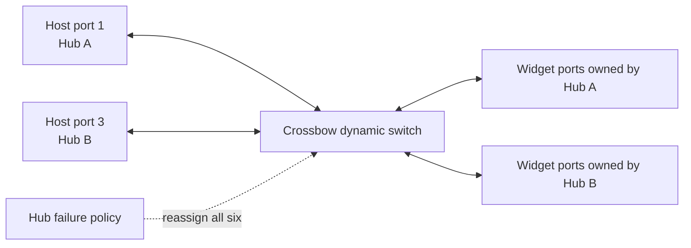

# Datasheet: Crossbow, the XIO crossbar

References rendered as citation identities name material outside this document
set. Those targets are not included or cleared for redistribution. Review and
runtime statements retain their recorded dates and scope.

**Status:** reviewed for the documented register fields, presence and width
representation, stated link states, interrupt acknowledgment and two-write
sequence, reset pulse in core cycles, and missing-response erratum. See the
independent evidence review (citation: `docs/reviews/crossbow-link-contract-review-20260905.md`).
The DMA-failure and remote-endpoint reset additions have
independent source clearance (citation: `docs/reviews/crossbow-dma-reset-independent-review-20260907.md`)
for the bounded behavior stated here.
Training completion, software-disabled link transitions, auxiliary live-state
resampling, host adapter 64-bit mapping and widget-zero connection-timeout
reporting remain unresolved. This does not clear complete timed-link behavior
or diagnostic acceptance.
**Fork file(s):** `hw/misc/sgi-xbow.c`

**Sources used:** SGI's *Crossbow ASIC Specification*, revision 12.0, dated
18 November 1996, held in the project document library as
`docs/library/cache/asic/sgi-crossbow-asic-spec-rev12.0.pdf`. That file is a
134-page scan with no text layer and yields nothing to a text search as shipped;
the text this datasheet was written from is the optical-character-recognition
output beside it, at
`docs/library/cache/asic/sgi-crossbow-asic-spec-rev12.0.ocr.txt`, with a
searchable-PDF companion alongside. Those files live in a directory the
repository ignores, so no third-party document is committed. Also used: OpenBSD
`sys/arch/sgi/xbow/widget.h`, `sys/arch/sgi/xbow/xbow.h`,
`sys/arch/sgi/xbow/xbow.c`, `sys/arch/sgi/xbow/xbowdevs.h` and
`sys/arch/sgi/sgi/ip27_machdep.c` from the `the-machine-hall/openbsd-sgi` tree
(public, ISC); OpenBSD retired its SGI port, so those files sit on no
checked-out branch and are read with
`git -C refs/openbsd-sgi show 2df91d80c1:sys/arch/sgi/xbow/widget.h`.
Also Linux `arch/mips/include/asm/xtalk/xwidget.h` and
`arch/mips/include/asm/sn/sn0/hubio.h` (public, GPL). The address arithmetic that
reaches this device is specified in
[the SN0 address map datasheet](address-map.md), and the device on the other side
of the crossbar in [the Bridge datasheet](bridge.md). We only read reference
sources and never copy their code or file structure (source-use policy,
decision D-0002).

**Which facts came from where.** The register offsets and the access convention
are dual-sourced: OpenBSD's widget and crossbar headers give exactly the offsets
the specification's address map gives, register for register. **Every bit-field
definition, every default value and the port state model are single-sourced from
the specification**, because OpenBSD names only two bits of the whole chip and
Linux models the crossbar not at all. A later pass read the specification's
register tables as page images rather than through character recognition and
cross-checked each field against the crosstalk headers in the reference trees;
its output sits beside the scan as
`sgi-crossbow-asic-spec-rev12.0.registers.md`, committed under
`docs/library/transcriptions/`. It
confirms every register offset and bit position on this page and recovered the
numbers the character recognition had lost, so the field positions here are now
dual-sourced. **The reset values are not and never will be**, because no
reference header carries a power-on value. **The Origin 200 topology facts came from
OpenBSD until 2026-08-13 and now rest on SGI's own firmware**, which states directly
that a directly connected bridge takes whatever widget number the firmware chooses;
OpenBSD remains the guest whose enumeration this machine's identity has to satisfy.
Later bounded source reads add the illegal-destination attribution and reset
recovery behavior from IRIX 6.5.7. The corresponding IRIX 6.5.5 kernel files
are byte-identical. The protected files and hashes are recorded in
provenance (citation: `docs/provenance.md`). Only independently worded interface behavior
enters this page.

## Role

Crossbow connects eight external crosstalk links through a nine-port internal
crossbar. Eight internal ports lead to the external link controllers. The ninth
terminates at logical widget zero. Each external link reaches one widget, and the switch routes packets between them by the widget
number in the packet's destination field. It performs no address translation, no
byte reordering and no buffering visible to software beyond a small input packet
queue per port. Its eight external link controllers use decoded widget identities
8 through 15. The specification and both operating systems describe 8 through 11
as the upper group and 12 through 15 as the lower. The Theory of Operations uses
a separate physical-port notation, with host ports 1 and 3 and six I/O ports. No
reviewed source maps those physical ports 1 and 3 to decoded identities 8 through
15. SGI's *Hardware Quick-reference Booklet (Origin and Onyx2 Series)*, HMQ-380-C,
maps a different numbering: the ports its `xbstat` command prints run 0 through 7
and are widgets 8 through F in order, with BaseIO at widget 8, the node boards at
widgets 9 and `0xa`, and XIO slots at `0xb` through `0xf` (section "Using the
xbstat Command", printed pages 249-250; read from the booklet's character
recognition). That places an Origin 2000 module's two host links at widgets 9
and `0xa`, which the topology below also selects, but it does not say which of
the Theory's physical ports 1 and 3 each one is.
On a Crossbow, the chip's internal register and error endpoint answers as logical
widget zero. **The modeled base Origin 200 has no Crossbow:** its widget-zero
alias answers with the fixed Bridge's identity, part `0xc002` and manufacturer
`0x36`, which the base-machine contract and OpenBSD enumeration require. An
Origin 200 GIGAchannel Crossbow owns its own logical widget-zero endpoint. The
reviewed GIGAchannel configuration maps link A to the attached module's Hub,
link 9 to its IP29 Bridge at `io1`, link 8 to the cabinet Bridge at `io7`, and
links B through F to optional positions `io2` through `io6`. These logical
identities do not assign physical XIO A/B cables individually to links A and 9
or map cabinet slots 11 through 15 one by one to links B through F.

On a large Origin 2000 this chip joins node-side and I/O-side links. **A base
Origin 200 does not have one. The Origin 200 GIGAchannel configuration has an
external Crossbow reached through paired Crosstown adapters.** This
document said until 2026-08-13 that the Origin 200's crossbar was "almost
nothing" — a point-to-point link with registers on it. **There is no chip there
and no registers of its own**: the modeled base machine's direct Crosstalk path
reaches the I/O bridge.

**SGI's own firmware is what settles it**, and it is blunter than any of the
evidence that preceded it: a directly connected bridge can be given whatever
widget number the firmware chooses. **With nothing routing by widget number,
every widget address reaches the one Bridge, and widget 8 is a convention two
firmware routines agree on rather than a place the Bridge sits.** The
determination, its five sources and James's sign-off are recorded in
what sits at widget 0 on the Origin 200 (citation: `docs/library/widget0-on-the-origin-200.md`).

The guest evidence still fits and reads better under the correct topology:
OpenBSD's probe order for this machine is a list of one widget, number 8, with a
comment saying it probes the onboard devices and there is nothing more — **which
is what a machine with one directly attached bridge looks like**, rather than a
crossbar that has been cut down to one port. On a real crossbar it probes eight.

A machine containing Crossbow needs its switch and link state for enumeration
and communication. The base Origin 200 direct-Bridge alias is a separate machine
case. Its historical identity-only behavior does not define an Origin 2000
Crossbow implementation.

### Host ownership and port width

Crossbow accepts one or two host connections and presents six remaining ports
to I/O widgets. In the manual's dual-host example, the hosts occupy physical
ports 1 and 3. The six widget ports are statically divided between them. If one
host fails, software can give the surviving host control of all six ports.[^theory-xbow]

Every XIO port can operate at 8 or 16 bits. Rate-matching buffers decouple an
8-bit widget port from a 16-bit path. Width is negotiated configuration, not a
property of a physical port: Figure 2-14 draws all eight paths at 16 bits, while
Figure 3-5 shows a mix of 8-bit and 16-bit widget paths. Neither figure maps
physical host ports 1 and 3 to decoded widget identities 8 through 15.

## Register map

### Access convention

Every Crossbow register is 32 bits or narrower and sits on an eight-byte
boundary with its data in bits 31:0, and the specification allows access only by
a crosstalk double-word packet. It is explicit about the consequences of getting
that wrong: an access to a reserved address, an access by any other packet type,
and a write to a read-only or to a read-and-clear register are all error
conditions rather than accesses that are quietly ignored.

The packet-size requirement does not by itself determine how a host MMIO
access becomes a Crosstalk packet. The established 32-bit low-half access
remains supported. Universal rejection of 64-bit host accesses needs separate
adapter evidence and is not established here.

Invalid register accesses set widget-zero status bit 5. Control bit 5 enables
its interrupt, and the status clearing alias acknowledges the error. Logging
alone does not implement the guest-visible error behavior.

Register fields default to zero after power-up unless their individual tables
state otherwise. Nonzero defaults include link credits, packet timeout,
arbitration reload, link-level control fields, interrupt destination upper,
performance-counter selectors and the NIC register. Reserved fields ignore
writes and read zero.

**A second source for these reset values exists after all, and this page said it could
not.** The sentence here read: *no reset value in this document has, or can have, a second
source* — on the reasoning that the reference headers carry bit positions and not power-on
values, so each value rested on one reading of a scanned page. **The reasoning was right
about headers and wrong about the corpus.** SGI shipped a machine-readable register table
alongside its firmware sources, and its Crossbow file gives **seventy-nine registers with a
bit range, an access type and a reset value for every field** — exactly the axis the headers
lack.

**So every reset value on this page is now checkable against a source that is not the scan**,
and the qualifier saying otherwise is withdrawn. The identification register is the first
worked example: the table resets the part number and the manufacturer fields to zero and the
low bit to one, which is what this page states from the specification and from what the
guests do. **Dual-sourced now, and previously declared impossible to dual-source.**

**Why the page was wrong about this is worth more than the correction.** It was not a
misreading — the claim was about what *could* exist, and it was made after searching a
reference corpus that genuinely does not contain the file. **The table lives outside that
corpus, in a full IRIX source tree on the same machine**, in a directory nobody's search path
included. A claim about what can never be sourced is a claim about where everyone has looked,
and this page turned the second into the first.

Cite these values as **6.5.7**. A 6.5.5 tree sits beside it, so where a reset value carries
weight the two ends can now be compared rather than asserted from one.

The public headers name every register in this chip at its offset *plus four*,
because the register's data occupies the low half of an eight-byte slot on a
big-endian machine. This page uses the eight-byte-aligned offset throughout, so
Linux and OpenBSD call the identification register `0x04` and the widget 0 status
register `0x0c` where this page calls them `0x0000` and `0x0008`. The Bridge
datasheet states the same convention for the same reason. Without it the next
person comparing the two will think one of them is wrong by four.

### Crossbar registers, as a full crossbar presents them at widget 0

| Offset | Name | Width | Reset | Access | Behavior as guest drivers use it |
|---|---|---|---|---|---|
| `0x0000` | Identification | 32 | fixed | readable | Bits 31:28 are the silicon revision; bits 27:12 part number zero; bits 11:1 manufacturer zero; bit 0 always reads one. The four-node Origin 2000 target selects revision code 2, which IRIX names 1.1. |

The identification word must be assembled from those four fields. The revision
is a machine-selected silicon property, not a resettable register value. Reset
reconstructs the same identity. Migration between identical machine definitions
reconstructs it at the destination instead of treating it as mutable state.

IRIX 6.5.30 extracts bits 31:28 and warns when the value is below 2. Its table
maps codes 1 through 5 to revisions 1.0, 1.1, 1.2, 1.3, and 2.0. The same
predicate and mapping appear in retained IRIX 6.5.5 and 6.5.7 source. Revision 1
is shipped silicon, but IRIX describes it as unsuitable. The four-node target
therefore selects code 2, the earliest accepted revision. The reference module
drawings do not identify the fitted revision, so this is a supported-variant
selection rather than a claim about a manufacturing lot.

The earlier revision-3 justification described a Bridge in an Origin 200
capture. It supplied no Crossbow revision evidence.

| Offset | Name | Width | Reset | Access | Behavior as guest drivers use it |
|---|---|---|---|---|---|
| `0x0008` | Widget 0 status | 32 | 0 | readable | Crossbar-wide error and status summary. |
| `0x0010` | Error address, upper | 32 | 0 | readable | Upper bits of the address of the packet that failed. |
| `0x0018` | Error address, lower | 32 | 0 | readable | Lower bits of the same. |
| `0x0020` | Widget 0 control | 32 | 0 | readable and writable | Crossbar-wide control. |
| `0x0028` | Packet timeout | 32 | **`0x0fffff`** | readable and writable | Bits 19:0 are the interval, 1.28 microseconds per tick, and they reset to all ones. How long a packet may be in flight before the switch gives up on it. |
| `0x0030` | Interrupt destination, upper | 32 | `0x0008_0000` | readable and writable | Where the crossbar sends its own error interrupt. Same layout as any widget's. |
| `0x0038` | Interrupt destination, lower | 32 | 0 | readable and writable | The rest of that address. |
| `0x0040` | Error command word | 32 | 0 | readable and writable | Holds the crosstalk command word of the packet that failed. Later errors are not logged until this register is written. A write clears it *and* both error address registers, and the data written is discarded. |
| `0x0048` | Link-level protocol control | 32 | **mixed** | readable and writable | Bits 25:16 the maximum micropacket retry, resetting to `0x3ff`; bits 15:10 the null-packet timeout, resetting to `0x06`; bits 9:0 the maximum burst, resetting to `0x010`. |
| `0x0050` | Widget 0 status, clearing | 32 | 0 | readable, clears on read | Returns the status register and negates its error bits. |
| `0x0058` | Arbitration reload | 32 | **`0x002`** | readable and writable | Bits 5:0 are the guaranteed-bandwidth reload interval, 1.28 microseconds per tick, resetting to 2. The value must be greater than zero for the chip to arbitrate at all, which is why it does not reset to zero. |
| `0x0060` | Performance counter A | 32 | **`0x0080_0000`** | readable and writable | Bits 23:20 select which port is counted and **reset to 8**, the first real link, so the counter comes out of reset already aimed at a port rather than at none. Bits 19:0 are the count, read-only, resetting to zero. |
| `0x0068` | Performance counter B | 32 | **`0x0080_0000`** | readable and writable | The second counter, identical in layout and reset. |
| `0x0070` | Number in a can | 32 | **`0x0000_0002`** | readable and writable | NIC/MicroLAN support fields. The revision 12.0 function errata says the controller is nonfunctional. |

**Those three reset values were `0` on this page until 2026-08-10 and two of them were wrong**
— found by comparing every field against SGI's machine-readable table rather than only the
fields this page already flagged as non-zero. That is the whole argument for checking a
source you have just acquired against the *whole* document rather than against its known
uncertainties: **the fields nobody had questioned are exactly where an unquestioned zero
survives.**

Bit 0 is the sample-data field and resets to zero. Bit 1 is data-valid and
resets set. Bits 9:2 hold the sampling offset, and bits 19:10 hold the
bus-master pulse duration. Both fields reset to zero.

The register identity and reset value do not establish a working bus. The
revision 12.0 function errata, printed and PDF page 93, says the MicroLAN
controller is nonfunctional. A machine reference may retain the register but
must not infer a Crossbow one-wire bus, responder, or transaction behavior.

| Offset | Name | Width | Reset | Access | Behavior as guest drivers use it |
|---|---|---|---|---|---|
| `0x0078`–`0x00f8` | Reserved | | | | Access is an error. |

The identification register deserves emphasis because it is counter-intuitive: a
real Crossbow reports **part number zero and manufacturer zero**. OpenBSD's device
tables agree, listing the Crossbow under vendor zero, product zero. A model that
invents a plausible-looking non-zero part number will be identified as an unknown
widget.

### Per-link registers

There are eight identical register sets, one per port. The set for widget *w*
begins at `0x0100 + (w - 8) × 0x40`, so widget 8 is at `0x0100`, widget 9 at
`0x0140`, widget 10 at `0x0180`, and widget 15 at `0x02c0`.

| Offset within the set | Name | Width | Reset | Access | Behavior as guest drivers use it |
|---|---|---|---|---|---|
| `+0x00` | Input buffer flush | 32 | — | readable | Reading it flushes that port's input buffer and returns zero when the flush has completed. If a flush was already running, it returns one and does nothing. |
| `+0x08` | Link control | 32 | see below | readable and writable | Per-port feature enables. |
| `+0x10` | Link status | 32 | 0 | readable | Per-port state and error flags. |
| `+0x18` | Arbitration, upper | 32 | 0 | readable and writable | Bandwidth allocation for this port. |
| `+0x20` | Arbitration, lower | 32 | 0 | readable and writable | The rest of it. |
| `+0x28` | Link status, clearing | 32 | 0 | readable, clears on read | Returns the status register and negates every error bit in it. Acknowledges auxiliary errors too. Live presence and width resampling remain unresolved. |
| `+0x30` | Link reset | 32 | — | writable | No bit fields. The write itself is a one-shot: the chip asserts link reset for two core clock cycles, resetting the local and remote link circuitry, driving the remote link-reset signal and forcing mode arbitration. |
| `+0x38` | Link auxiliary status | 32 | 0 | readable | Retry counters and the physical presence and width of whatever is attached. |

Link control fields:

| Bits | Name | Default | Meaning |
|---|---|---|---|
| 31 | Interrupt when the link comes alive | 0 | Lets the machine notice a widget that appears after start-up. |
| 29:28 | Performance monitor mode | 0 | Selects nothing, the source link, the destination link, or the input buffer level as what the crossbar's performance counters count. |
| 27:25 | Input packet buffer level | 0 | The queue depth the performance counter compares against. There are four buffer entries, so values above four do nothing. |
| 24 | Come up in eight-bit mode | 0 | **Deliberately not cleared by a link reset**, so software can change the mode and then reset the port into it. |
| 23 | Force a bad link micropacket | 0 | A one-shot: it holds for a single cycle and then clears itself, so it always reads back zero. |
| 22:18 | Widget credit | 2 | Maximum outstanding request packets to this widget, five bits. |
| 17 | Interrupt on illegal destination | 0 | |
| 16 | Interrupt on input buffer overallocation | 0 | |
| 8 | Interrupt on bandwidth allocation error | 0 | |
| 7 | Interrupt on receive error counter overflow | 0 | Fires when more than 255 bad micropackets have arrived. |
| 6 | Interrupt on transmit retry counter overflow | 0 | Fires after more than 255 retries. |
| 5 | Interrupt on maximum transmit retry | 0 | |
| 4 | Interrupt on receive error | 0 | |
| 3 | Interrupt on transmit retry | 0 | |
| 2 | Unused | 0 | Readable and writable with no effect, which the specification says outright. |
| 1 | Interrupt on maximum request timeout | 0 | |
| 0 | Interrupt on source timeout | 0 | |

Link status fields:

| Bits | Name | Meaning |
|---|---|---|
| 31 | Link alive | The port came out of reset and is working. |
| 18 | Multiple error | A second error of the same kind arrived while the first flag was still set. |
| 17 | Illegal destination | A packet arrived naming a destination that does not exist. |
| 16 | Input overallocation | A widget sent a packet with no room in the input buffer. |
| 15:8 | Bandwidth allocation error source | One sticky bit per port, bit 8 for widget 8 through bit 15 for widget 15, saying which source was starved. |
| 7 | Receive error counter overflow | More than 255 erroneous micropackets have arrived. |
| 6 | Transmit retry counter overflow | More than 255 retries. |
| 5 | Maximum transmitter retry | The retry limit was reached on a single micropacket. |
| 4 | Receiver error | An erroneous micropacket arrived. |
| 3 | Transmitter retry | A micropacket had to be retried. |
| 2 | Reserved | |
| 1 | Maximum request timeout | This port has been unable to issue new requests for longer than a timeout interval. |
| 0 | Packet timeout, source | A packet being streamed from a source stopped part-way and timed out. |

Link auxiliary status fields:

| Bits | Name | Default | Meaning |
|---|---|---|---|
| 31:24 | Receive retry counter | 0 | |
| 23:16 | Transmit retry counter | 0 | |
| 15:8 | Timed-out source | 0 | One sticky bit per port, same numbering as the bandwidth allocation field, recording whose packets were discarded to clear a timeout. |
| 6 | Link failure mode | 0 | Meaningful only when the link is not alive and a widget is present: one means the port never came out of reset, zero means it came up and then failed. |
| 5 | Widget present | — | **A widget is physically attached to this port.** |
| 4 | Eight-bit mode | — | Zero for a sixteen-bit link, one for an eight-bit link. |

## Behavioral contract

**The port state model is the thing to implement correctly.** The specification
sets out four states for a port and which of four bits are asserted in each,
and this is what a guest reads to decide whether anything is plugged in.

- Coming out of reset: link alive, maximum retry and link failure mode are all
  clear.
- Failed to come out of reset: maximum retry and link failure mode are set. A
  port whose widget-present bit is clear goes here and stays here.
- Up and working: link alive is set.
- Failed after having come up: maximum retry is set.

Those states apply only to a machine that contains Crossbow. The modeled base
Origin 200 has no Crossbow link-state registers. It reaches its fixed Bridge
through direct-path aliases. Origin 200 GIGAchannel instead assigns link A to
the attached Hub, link 9 to that module's IP29 Bridge, link 8 to the cabinet
Bridge, and links B through F to optional XIO positions. Those assignments are
configuration-specific; a model must not derive them from the base machine's
Bridge-at-widget-8 firmware convention.

The Origin-family identity and topology
evidence (citation: `docs/library/origin-family-identity-and-topology-evidence.md`) reconciles
the configuration-specific link identities and the unresolved physical
mappings. Its public topology originals include *Origin200 and Origin200
GIGAchannel Owner's Guide* 007-3708-002, revision 002, SHA-256
`ae6857707a113bd63b77a3a8187c81beed76cea1406592a38a735c4aa2c462dc`,
Figures 1-4 and 1-5, printed pages 6-7/PDF pages 32-33, trusted offset 26.
The host and port-width boundary is documented in the Theory of Operations
manual.[^theory-xbow] Crossbow register behavior comes from *Crossbow ASIC
Specification* revision 12.0, SHA-256
`899b7dcf35733a069b1336056e47548dab6502381b6f1ec31c02c0adea50ec94`,
printed/PDF pages 13-14, 29, 63 and 129. The original pages control. Printed and
PDF pages align.

**Reading the clearing alias is how errors are acknowledged.** Both the
crossbar-wide status and each port's status have a second address that returns
the value and negates the error bits. Clearing a port's status also acknowledges its auxiliary error information.
The live presence and width fields need separate resampling semantics. There is no write-one-to-clear anywhere in this chip; writing
to a read-and-clear register is an error.

**The error command word gates further logging.** Once it holds a command word,
no later error is recorded until software writes to it, and that write also
clears both error address registers. Data written is discarded. This is a
different idiom from the Bridge's group-clear register and from the Hub's
write-one-to-clear, and all three are on the same machine.

**On the modeled base Origin 200 there is no Crossbow, and widget 0 presents the
Bridge's identity.** This is settled by the base Origin 200 machine-contract
sign-offs. The GIGAchannel configuration is different: its external Crossbow
owns logical widget zero and uses the external link population stated above.
OpenBSD reads widget 0's
identification register on every boot — it panics outright if that register does
not read — and branches on what it finds. Seeing the Bridge's identity, vendor
`0x36` and part `0xc002`, it concludes the machine has a single directly
attached bridge rather than a crossbar, says so in a comment naming the Origin 200, and probes
widget 8 alone. Seeing a Crossbow's identity of part zero and manufacturer zero,
it takes the full-crossbar path instead, reading the machine's configuration
graph for a probe order and falling back to a base-I/O order that probes widget
15 before widget 8. Both paths would reach the Bridge on this machine, but they
print different things and consult the configuration graph differently, and only
the first matches the modeled base hardware. We present the Bridge identity and
the directly-attached-bridge path only for that base configuration.

**OpenBSD substitutes widget `0xa` as the interrupt-carrying widget on this
machine.** When the configuration graph reports the node's crossbar widget as
zero, OpenBSD replaces it with `0xa`, with a comment saying that on Origin 200
the interrupt widget is hardwired to `0xa` and is another face of the same
bridge. That number ends up in the target-widget field of the address the Bridge
writes its interrupt packets to. Our machine description and our synthesised
firmware have to agree with whatever we present here, or interrupts will be
addressed to a widget that does not answer.

## DMA

The crossbar performs no address translation of any kind. A packet's destination
widget number selects the output port and the address travels unchanged, which is
why the address map treats a crosstalk address as a widget number plus an offset
with nothing in between. Byte order is untouched: every byte-swapping decision on
this machine belongs to the Bridge's per-device control, not here.

There is one routing rule from the Bridge's side worth recording in both places:
a device issuing a 64-bit address cannot reach widget 0. This restriction is
specific to the 64-bit address form. It does not make widget zero illegal for a
32-bit mapped request.

### Requests aimed at a missing destination

Crossbow distinguishes an illegal destination number from a legal port whose
link is down. Widget 0 and widgets 8 through F are legal destinations. A packet
which arrives with any other destination number is an illegal-destination error
on the physical input port that received it. The input port's status bit 17
latches, and a repeat while that condition remains set also latches bit 18.
When the global capture registers are available, the first erroneous packet's command and 48-bit address occupy them until software
clears that record. An existing captured error is retained.

How `0x0010`/`0x0018` divide that 48-bit address between them is not itself
stated: no reviewed page was read as a page image for this specific pair. Our
model splits it the way the interrupt destination pair at `0x0030`/`0x0038` is
stated to split theirs, bits 47:32 in the upper register and bits 31:0 in the
lower, on same-device precedent rather than a citation for this pair. No
packet this crossbar can carry names an address past bit 47, so the
approximation is exact throughout the whole range it will ever see regardless
of whether the real division agrees.

The ingress controller determines which per-link status register records the
error. The source-ID field retained in the error command word is supporting
packet evidence, not the selector for that register. IRIX 6.5.5 and 6.5.7 make
this distinction observable: their Crossbow error handler accepts an illegal
destination as a device DMA error only when the retained source ID equals the
port whose interrupt request is being serviced. It then attributes the DMA
error to the widget attached to that port.

If link-control bit 17 enables this error, the corresponding link-request bit
in widget-zero status also latches: bit 24 for link 8 through bit 31 for link F.
Widget zero sends the shared Crossbow error interrupt to the target and address
in the Crossbow interrupt-destination registers. The packet originates at
widget zero and carries the configured vector with data bit 8 set. It is not a
response to the Bridge that issued the bad request. Reading that source link's
status-clearing alias acknowledges the link error and its request. The eventual
global interrupt-off packet is sent only after every enabled Crossbow request
has been acknowledged.

A legal destination from 8 through F does not become illegal merely because no
widget is attached or the link failed training. Such a port has attachment and
alive state independent of its numeric decode. A transmit retry that reaches
the programmed limit sets bit 5 on the destination link. Its auxiliary
timed-out-source bitmap records which input ports had packets discarded when
Crossbow drains traffic backed up behind that failed destination. When enabled
by link-control bit 5, this condition raises the request bit for the failed
destination link and follows the same widget-zero interrupt route.

The revision 12.0 architectural prose also describes a packet-destination
timeout on the source controller. Its register table declares bit 2 reserved,
as do the normal IRIX and public headers, while one IRIX fault-analysis decoder
assigns bit 2 to that timeout. No matching enable bit is established. The bit,
its clearing rule and any interrupt request caused specifically by a legal but
unavailable destination therefore remain open.

For Bridge DMA, a 32-bit direct-map or translated request takes its destination
from the programmed map. Widget zero is a legal Crossbow destination on this
path, so a request to widget zero is either a valid register transaction or a
widget-zero register-access error. It is not an illegal-destination error. A
64-bit Bridge address carries the destination in bits 63:60, but the Bridge
specification says that form cannot reach widget zero. It does not state which
Bridge or Crossbow error, if any, a zero value produces in that form.

Bridge never requests responses for its outgoing writes. A rejected or dropped
DMA write therefore has no Bridge write-completion error established by these
sources. An outgoing DMA read does reserve a Bridge response buffer. If no
response returns, Bridge's own request timer eventually sets interrupt-status
bit 9, captures the PCI address, response-buffer number and requesting PCI
device, and leaves that record in response-buffer reset group 4. If enabled,
Bridge sends its separate error interrupt through its own error destination.
The Crossbow link interrupt and this later Bridge read-timeout interrupt are
different reports with different destinations and acknowledgments.

**What the model does with a request it cannot deliver.** On both paths into a
port, the processor path and the packet path a Bridge's DMA takes, a destination
numbered 1 to 7 is an illegal-destination error recorded on the receiving port as
above. A destination no route reaches, a legal link that is down or empty or the
receiving port's own, drops the request and records nothing at the Crossbow. Either
way the Crossbow tells the widget on the receiving link that its request was
dropped, and a Bridge that sent a read records its read time-out
([the Bridge datasheet](bridge.md#dma-to-an-unavailable-crossbow-destination)); a
Hub has nothing further to record, since its processor already took the bus error.
The `sn/builder/dropped-read-to-illegal-widget-times-out` and
`dropped-read-to-empty-widget-times-out` qtests check both.

**Link errors the model never raises, and why.** Each needs a cause the model does
not have. Bit 5, maximum transmit retry, is raised when a link that was alive goes
down, as the specification's failure after coming up; a request to a link that is
already down raises no new one, as above. The timed-out-source bitmap stays zero,
because the model queues no packets for a failed link to drain. Bit 1, maximum
request time-out, needs a destination that stops returning request credits, and
bit 0, source time-out, a packet whose transmission stalls part-way; the model
has neither credits nor partial packets. Widget-zero status bit 2, the Crosstalk
error, needs a received packet with its error bit or invalid sideband set, and no
modelled widget sends one.

## Link and interrupt behavior for a populated Crossbow

These requirements come from the original rendered *Crossbow ASIC
Specification* revision 12.0, printed/PDF pages 19, 64–66, 79–81, 84,
87–90, 93 and 99. The retained PDF SHA-256 is
`899b7dcf35733a069b1336056e47548dab6502381b6f1ec31c02c0adea50ec94`.
The earlier identity-only model policies are insufficient for a populated
Origin 2000 switch and do not waive these requirements.

### Widget-zero status, control and interrupt destination

The status fields at aligned offset `0x0008` have combined mask `0xff800025`.
Bits 31:24 hold link interrupt requests for links F through 8. Bit 23 holds the
widget-zero request. Bits 5, 2 and 0 report register-access error, Crosstalk
error and repeated error respectively. Remaining bits are reserved, including
bit 1. All these status flags reset clear. A link request records an interrupt
attempt, not proof that the host received a new packet.

Control at `0x0020` has documented interrupt enables at bits 5, 2 and 1,
combined mask `0x00000026`, all reset clear. Bits 5 and 2 enable register-access
and Crosstalk errors. Bit 1 is the documented connection-timeout enable, but
its corresponding status location is contradictory in this specification.
Preserve that uncertainty: do not invent a widget-zero status bit or erase
the two established enable functions by treating all control as opaque storage.

A read at the clearing alias `0x0050` acknowledges widget-zero error conditions
and its request flag. It does not clear the eight link requests. Each link's
own clearing alias acknowledges that link. The specification's clearing prose
also names connection timeout, without resolving its missing status location.

The upper interrupt destination at `0x0030` contains vector bits 31:24,
target widget bits 19:16 and destination address bits 47:32 in bits 15:0.
Bits 23:20 are reserved. Bit 19 always reads one, restricting the target to
widgets 8 through F. The target resets to 8, while vector and address reset
zero, so the whole register resets to `0x00080000`. Its variable fields have
mask `0xff07ffff`, with bit 19 fixed at one. The lower register at `0x0038`
contains address bits 31:0 and resets zero.

An enabled interrupt condition sends a doubleword write request from widget
zero to the configured target and address. Its data carries the vector in
bits 7:0 and assertion in bit 8. Only one assertion is outstanding globally.
Further conditions accumulate without additional assertion packets. After all
pending conditions are acknowledged, a second write carries the vector with
bit 8 clear. Error-command logging is a separate first-error latch, rearmed by
writing its register. Clearing the host interrupt alone does not acknowledge
Crossbow's status flags.

### Reset, presence and width

Writing the selected link's reset register is a one-shot. The data is ignored.
It asserts reset for two Crossbow core cycles, clears the local and remote LLP
transmit buffers and protocol state, releases crossbar connections owned by
that local link controller, and starts width arbitration. Other Crossbow link
controllers and the rest of the switch are unaffected. Pages 19 and 99
describe a nominal 100 MHz core derived from the transmit clock, distinct from
asynchronous receive clocks. Two cycles are 20 ns at that nominal frequency.
This bounds the reset assertion, not initialization. The selected board clock
and the time to negotiate a working link are not established by these sources.

During negotiation, each endpoint alternates eight-bit and sixteen-bit reset
micropackets until both sides agree on a width. Failure to negotiate within the
maximum retry count makes the link dead and sets its retry-timeout indication.
Success allows normal traffic and sets alive. The force-eight-bit control
survives the per-link reset so that software can select a mode before restarting
negotiation.

The remote effect stops at a generic LLP unless the attached widget specifies
more. Bridge revision D drives its core-logic reset from the LLP's received
link-reset output and does not release that core until the link connection is
determined. IRIX 6.5.5 and 6.5.7 therefore save the Bridge widget and LLP
configuration before a GIO Bridge link reset, wait 100 microseconds, restore
the saved values, and reinitialize the remaining Bridge state. This establishes
that software treats Bridge core programming as lost across the pulse. It does
not independently establish the reset or retention state of every register.
Neither the Bridge specification nor the bounded IRIX read establishes that
its external PCI or GIO reset outputs pulse or that downstream devices reset.

For an attached Hub, the published Crossbow specification establishes reset
of the remote Hub LLP state and transmit buffer followed by renegotiation. The
IRIX 6.5.7 Hub register sources define failed, never-up and working link-state
values, but do not establish that an incoming link reset clears any wider Hub
I/O-interface state. The exact transient state value and all non-LLP Hub reset
effects remain open.

The page 93 erratum says a link-reset write that asks for a response performs
the reset but produces no response packet. An ordinary write selects the
no-response form and avoids the stall. IRIX 6.5.7 programs the Hub request path
for this ordinary form before issuing the reset. The two forms do not select
different reset scopes in the evidence. Their observable difference is whether
the initiator receives the requested completion.

The IRIX 6.5.7 kernel polls alive every two microseconds and abandons the reset
after slightly more than one millisecond. Its standalone Crossbow path instead
waits a fixed one millisecond. The GIO Bridge recovery path adds the
100-microsecond wait before restoring Bridge programming. These are software
bounds, not measured hardware training times.

**A warm reset received on a link resets the whole switch.** The specification's reset
section (printed pages 132-133) says a warm-reset pattern arriving from any link is, "for all
intents", a power-on reset of all core logic, which the Crossbow propagates by sending a warm
reset out of every link, and that the link layer "after detect[ing] the first reset pattern
will ignore all subsequent reset request for 1024 cycles", which is what breaks the loops the
propagation makes. The model takes a warm reset on each link's XIO port (a Hub's link-control
warm-reset bit sends one), resets the core as at power-on so the links that come up with the
machine are alive again, pulses every link's reset line, the originating link's included ("assert
a SendWarmReset to all LLPt's in the Crossbow", page 133), and ignores another warm reset for
1024 cycles of the 100 MHz core clock ("The majority of the Crossbow operates off single 100 Mhz
clock known as the core_clock", page 99), 10.24 microseconds. Two parts of that are inferred:
the page gives the quiet window to each link's LLP, where the model keeps one for the whole
chip, which answers the same for one sender and the resets that echo back; and it does not name
the clock the 1024 cycles count. A machine reset ends the window. A widget that sends the other
pattern, a link reset, resets only its own port (the same pages); no modelled widget sends one.

**Limitation: an interrupt the Crossbow had asserted stays pending at the Hub across a warm
reset.** The core forgets its interrupt state and the reset section sends no interrupt-off
packet, so the Hub keeps the pending bit the assertion set until software clears it there. That
is this model's reading of the specification's silence, not an observation, and it departs from
the whole-machine policy below, which resets the Hub's pending bank alongside the Crossbow; a
warm reset is the one Crossbow-alone reset the model now performs. A warm reset on a real
Crossbow with an interrupt outstanding, followed by a read of the Hub's pending bank, would
settle it.

The qtests `sn0/origin2000/hub-warm-reset-resets-the-crossbow`,
`hub-warm-reset-reaches-every-link`, `hub-warm-reset-leaves-the-hub-pending-bit` and
`system-reset-ends-the-warm-reset-window` check the core reset, the BaseIO Bridge's reset, a
startup link staying alive, the quiet window, one pulse on every link's reset line, the
retained pending bit, and the window ending with a machine reset.

**What the model does with the pulse at the far end.** The Crossbow's per-link
reset drives the reset input of whatever its XIO link joins: a Bridge, or a
Bridge-based XIO board's Bridge, resets its core as the Bridge contract's "Reset
received from Crossbow" says; a Hub logs the reset and changes nothing, as the
[Hub I/O interface contract](hub-io-interface.md#link-control) leaves every wider
Hub effect open; a board with no modelled response ignores it. The
`sn0/origin2000/xbow-baseio-link-reset` qtest checks the BaseIO Bridge's control
register is back at its reset value after the pulse.

**A link cannot send to itself.** The model builds no route from a port to its
own widget number, as the specification's arbitration note says (below), so a Hub
addressing the widget of its own Crossbow port reaches nothing.

Physical attachment sets auxiliary bit 5 independently of successful training.
During initialization, alive, maximum-retry and failure-mode are clear.
An unattached port proceeds to initialization failure and stays there: alive
clear, maximum-retry set and failure-mode set. A successfully initialized link
sets alive. Failure after successful initialization sets maximum-retry and
leaves alive clear. Auxiliary failure-mode distinguishes failed initialization
from later failure only while attachment is present and alive is clear.
Its value is not a general-purpose disable flag.

Auxiliary bit 4 reports negotiated width: zero for 16 bits, one for 8 bits.
Control bit 24 forces eight-bit mode and survives link reset. Neither attachment
nor widget number alone establishes negotiated width. The selected topology
attaches Hubs at links 9 and A on each Crossbow and BaseIO at link 8 on the first.
All other links are absent. Healthy attached links may reach operational state.
That topology does not supply the missing training duration or disable protocol.

No software link-disable field or complete disabled-link transition is
established by this bounded read. Interrupt masks disable notification, not
attachment or packet routing. A future disabled-link configuration must name
its hardware mechanism and state transitions rather than clearing presence as
an implementation convenience.

The status clearing alias returns the previous error state and acknowledges
errors. Page 93 warns that its physical operation is non-atomic and may lose an
error arriving within a two-cycle window. This is separate from reset timing.
Auxiliary clearing must also respect its live attachment and width indicators.
Page 81's broad clearing sentence alone does not specify their resampling time.

The architectural reset chapter calls the software action a Link Control bit
and describes a warm-reset transmission, while the programmer-visible table and
the machine register table describe the separate write-only Link Reset register
and a link reset. The latter two agree on the public interface. The internal
signal discrepancy remains open. It is not evidence for whole-switch warm reset
on a per-link register write.

### Training event boundary

The reviewed training evidence (citation: `docs/research/crossbow-training-events.md`)
distinguishes reset release, peer reset traffic, width advertisement and
retry-burst exhaustion. It supports partial event handling without defining
an autonomous negotiation-completion algorithm. Receiving a peer reset or
reaching the end of the two-core-cycle pulse is insufficient evidence for
setting alive. Cold startup, absent-peer failure and guest-triggered
retraining retain separate transitions.

The original completion description is unfinished, and its later software
reset paragraph conflicts with the dedicated register definition. The
reviewed register behavior remains authoritative. An event-driven model
still needs the missing handshake completion predicate before it can create
its own successful-training event. Neither attachment alone nor the Hub's
separate link-up exception supplies that predicate.

### Link-reset restore-alive approximation

The machine gives selected links on every Crossbow it builds from a
topology a compatibility policy for guest link resets, because the stock
IP27 PROM resets each link it finds attached and expects that link to be
alive again afterwards. At the end of the
two-core-cycle pulse, a link in the machine's restore set comes back alive
if it was alive when the reset was written, and one that was not alive
returns to initialization failure. A link outside the set stays in
initialization, as the training boundary above requires. The restore set is
every link the topology attaches, and a spare widget once a `-device` board
claims it at machine-init-done.

**Limitation.** Reaching the end of the pulse is not evidence that a link
trained (the training evidence (citation: `docs/research/crossbow-training-events.md`)
says so directly). The policy replays pre-reset health, not a training
outcome. A link that could not retrain on real hardware still comes back
alive here, and the model applies no training delay.

**Evidence and tests.** QEMU `7ab674b028` introduced the policy for the
BaseIO link. `tests/qtest/sn0-origin2000-test.c`'s
`sn0/origin2000/xbow-baseio-link-reset` pins it: the link is down through
the pulse, alive at its end, and a link that was down before the reset stays
down. QEMU PR 797 (private change-record identity), merged
as `078d97e824`, extends the set to a claimed spare widget. Without it, the PROM's reset left that
port initializing, and under multi-threaded TCG the PROM reported
`/hw/module/1/slot/io4: IO link bad`. `tests/qtest/sn-builder-test.c`'s
`sn/builder/claimed-spare-widget-survives-link-reset` pins that case.

**When the pulse ends.** The pulse's end is a virtual-clock timer, which
runs from the main loop. On the Origin 200 GIGAchannel, whose IP29 Bridge
sits behind a Crossbow, the stock PROM resets link 9 and polls its link
status 100 times ten microseconds apart; in two stock-PROM runs the polls ran
out with the pulse long over and its timer still waiting, and the PROM's
next widget read faulted ("xtalk_init resulted in an exception"). The model
therefore ends every pulse the virtual clock says is over at the start of
each access to the Crossbow's own registers. The limit: only register
accesses catch up. An access routed through the switch straight to a widget
does not, so if nothing has touched the registers since a late pulse ended,
it still finds that widget's route disabled. The PROM polls the registers
before touching the widget, which is why the catch-up is enough for it. No
qtest reaches the race, because under qtest the clock moves only by steps
that already run the timer.

**Routes through the pulse.** The catch-up does not help a guest that
touches the widget before the Crossbow's registers. IRIX 6.5.30's SI reset
on the one-node Origin 2000 is such a guest: the reset write to link 7
(widget 15) at kernel address `0xc000000000377f48` sits in the delay slot of
a fixed one-millisecond delay, and the board accesses follow at `0x377e98`
and `0x377ebc` without reading link status. The kernel's generic
widget-reset path at `0x6eefc` does poll link status bit 31 for about a
millisecond and returns failure if the link stays down, but the SI reset
path does not call it and touches the board regardless. With the route
withdrawn until a late timer ran, the kernel took a data bus error at widget
15 offset `0x20100`. On a loaded host the timer ran 1.0 to 7.7 ms late, and
three of thirteen first boots panicked.

A link in the restore set that was alive when the reset was written
therefore carries traffic for the whole pulse: its routes in both directions
and the Crossbow's own interrupt packets to it. Only its status shows the
pulse. A link outside the set, or one that was down, loses its routes as
before. This applies to every crossbar the machine builds from a topology:
the Origin 2000 topologies, the Origin 200 GIGAchannel and any XBridge-part
crossbar. The Origin 300 node's XBridge is a separate device and is
unaffected. **Limitation:** a packet that reaches such a link inside the
two-cycle pulse is delivered. What hardware does with a packet inside the
pulse is not established.

**Evidence and tests.** QEMU PR 833 (private change-record identity),
merged as `2324ead1d3`, made the change.
`tests/qtest/sn0-origin2000-test.c`'s
`sn0/origin2000/xbow-link-reset-route-stays-open` reads the BaseIO Bridge's
identification through a link whose pulse has not ended, and checks that a
link down before the reset stays unreachable through it;
`sn0/origin2000/xbow-link-reset-interrupt-delivered` raises a Crossbow
interrupt to the Hub's link inside its pulse and checks that it arrives.
Both fail without the change. Forcing the SI link's timer 20 ms late made
every IRIX boot panic without the change and boot to login with it.

### Whole-machine interrupt reset policy

The bounded Origin 2000 model resets the Crossbow interrupt-generation state
and every receiving Hub interrupt-pending bank together during whole-machine
reset. It does not synthesize an interrupt-off write during that reset. Pending
pre-reset work must be cancelled so it cannot set a Hub pending bit after reset.
Both pending banks and all processor masks must have their specified reset
values before the machine resumes.

This is a model policy for a combined reset boundary, not a claim that Crossbow
silicon never sends an interrupt packet during reset. The public Crossbow
specification, revision 12.0, pages 64–65 and 129 establishes the ordinary
interrupt-on and interrupt-off packet sequence. Its reset description on pages
132–133 describes device state and link-protocol reset traffic, without specifying
an interrupt-off transaction. The receiving Hub's reset state is established by
the [Hub interrupt contract](hub-processor-interface.md#interrupt-pending-modification-and-masks).
Ordinary acknowledgment and the reviewed link-mask behavior still produce their
specified off writes. Individual link reset does not adopt a whole-device reset
scope.

Resetting the Crossbow alone while retaining the Hub pending sink is outside
this policy. An exposed management operation or internal caller must not treat
that operation as supported whole-machine reset; refuse it until its separate
contract is established. A device callback alone does not prove its receiver
was reset.

The acceptance check first delivers an enabled Crossbow interrupt to an actual
Hub, then resets the machine and checks Crossbow state, both Hub pending banks
and all processor masks. Advance virtual time afterward and verify no pre-reset
activity restores a pending bit. A test that checks only the CPU line can pass
with stale pending bits hidden by zero masks. Separately verify the ordinary
on/off sequence still works after reset. A RAM fixture retaining the last packet
value is not a substitute for this receiver check.

### Remaining behavioral coverage

Arbitration, performance counting, buffer flushing and injected link errors
remain necessary to claim the applicable diagnostic acceptance inventory.
A model with no queued packets can finish an empty flush immediately, but this
does not establish behavior with traffic pending. Zero counters, no-op reset,
constant zero status and interrupt-destination storage alone do not implement
the documented device. The full Crosstalk link initialization specification or
controlled physical observations are needed for training latency, disabled-link
transitions and the remaining live-state clearing details.

## Behavioral notes

**Three chips on one machine, three different clear idioms.** The Hub clears
interrupt-pending bits through a modify register and its error bits by writing
ones; the Bridge clears error groups by writing group bits to a dedicated reset
register; the Crossbow clears by *reading* a second address and forbids writing to
it. Nothing about this is unusual for hardware of the period, but a model written
by pattern-matching from one device to the next will get two of the three wrong.

**The specification is a year older than the Bridge's.** This one is dated
November 1996 at revision 12.0 and the Bridge's is April 1998 at revision 4.0.
Where they describe the same crosstalk concepts, the Bridge's wording is the
later and, on the interrupt path, the more specific. Nothing read here
contradicts the Bridge document.

**The character-recognition gaps this page used to carry are closed.** Three
places where the extracted text lost information have since been read off the
page images at 400 dpi and cross-checked against the reference headers' link
masks, and the transcription sits beside the scan as
`docs/library/transcriptions/sgi-crossbow-asic-spec-rev12.0.registers.md`. Every
number this datasheet had hedged about turned out to be the number it guessed, so
the resolutions are subtractions rather than rewrites.

- The link status register's five link-level error flags are at bits 7 down to 3,
  in the printed order, with bit 2 reserved. This datasheet's link status table
  now states them, and the header's link status masks confirm the positions.
- The two lowest link control bits are at bits 1 and 0, mirroring the status
  register, confirmed by header position rather than assumed.
- The link auxiliary status table's reserved row, printed as bits 15:7 and
  overlapping the timed-out-source field at 15:8 directly above it, resolves the
  way this page read it: 15:8 is the timed-out source and bit 7 alone is
  reserved. The overlap is a defect in SGI's printed page, not in anyone's
  reading of it.

**Two more defects in SGI's printed pages, recorded so nobody rediscovers them.**
The packet timeout register's prose gives the default as `0xffffff`, six hex
digits, above a table that declares a twenty-bit field defaulting to `0x0fffff`.
Twenty bits cannot hold the prose figure; the table value is the one to use. And
this revision gives the widget 0 control register a connection-timeout interrupt
enable at bit 1 while its own widget 0 status register calls bit 1 reserved, and
the reference header treats the corresponding status bit as an XBridge addition.
The enable is on the page; where a Crossbow would report the condition is settled
by neither source. The defined register-access and Crosstalk enables remain
usable. The connection-timeout reporting behavior remains unresolved.

**Three things the page-image transcription recovered that this page does not
otherwise cover.** The widget 0 status register holds the eight per-link
interrupt request bits at 31:24, the widget 0 interrupt request at 23, a register
access error at 5, a crosstalk error at 2 and a multiple error at 0; the widget 0
control register carries the matching interrupt enables at 5 and 2. And the
per-link arbitration registers are not this port's bandwidth allocation and the
rest of it: each holds a guaranteed-bandwidth count and a remainder weight for
four *source* links, the upper register covering links 8 through B and the lower
covering C through F. A link cannot send to itself, so the self-referring field
in each register is reused for widget 0 and should be programmed to `0x1f`.
These are hardware fields. Storage-only implementation does not establish
arbitration or interrupt behavior.

**One naming difference between the specification and OpenBSD.** OpenBSD's header
gives the name "alive" to bit 31 of both the link control and the link status
register. The specification agrees for status, where bit 31 is link alive, but
for control bit 31 is the *interrupt enable* for the link-alive event, not a
liveness bit. The specification is the authority; OpenBSD's constant is a
convenience that happens to share a bit position.

**One register that OpenBSD names for its generic purpose and the specification
names for its actual one.** Offset `0x0050` is the target flush register in the
common widget layout, and OpenBSD's widget header calls it that. On the Crossbow
it is the read-and-clear alias of the widget 0 status register. A model that
implements it as a generic flush that returns zero would be wrong in a way no
guest we boot would notice, and wrong all the same.

## Open questions

- Which physical XIO cable on an Origin 200 GIGAchannel system carries
  logical Crossbow link A and which carries link 9. The manuals require
  A-to-A and B-to-B cabling but do not bind those labels to logical links.
  A GIGAchannel composition records the settled logical
  Hub-to-Crossbow-to-IP29-Bridge route and both required physical cables
  without assigning either logical link to one cable. Settled by a
  GIGAchannel backplane schematic or continuity measurement from each
  labeled XIO connector to its Crossbow link.
- Which GIGAchannel expansion cabinet slot from 11 through 15 maps to each
  Crossbow link B-F and software position io2-io6. No reviewed source
  establishes the individual rows; the public evidence establishes only
  the two corresponding sets. A GIGAchannel composition records links B-F
  at software positions io2-io6 and physical slots 11-15 as sets without
  selecting individual rows. Settled by a GIGAchannel backplane schematic
  or firmware inventory tied to physical cabinet slots.

## qtest checklist

These assertions test a populated Crossbow. The separate Origin 200 direct
Bridge alias requires its own machine test.

- With the machine's Crossbow revision property set to 2, the identification
  register at offset `0x0000` reads `0x2000_0001`: revision 2, part number zero,
  manufacturer zero, and bit 0 set. A second case selects revision 5 and reads
  `0x5000_0001`, proving that the property composes the word instead of fixing it
  to the IRIX acceptance value.
- Reset leaves the configured identification word unchanged. Save and restore
  with an identical machine definition preserves the value without migrating it
  as writable device state.
- A 32-bit access at the register offset plus four is served. Test the packet
  doubleword requirement at the packet boundary. Host 64-bit MMIO acceptance or
  rejection requires a separately established adapter mapping.
- An access to the reserved range `0x0078` through `0x00f8` is logged as an
  error.
- A write to the identification register, which is read-only, is logged as an
  error and changes nothing.
- Each attached link reports presence independently of training. After successful
  initialization it reports alive. Test both selected Crossbow populations.
- Absent links report presence and alive clear, and reach initialization failure
  with maximum-retry and failure-mode set. Do not invent its transition delay.
- The per-port register sets decode where they should: widget 8's link control
  is at `0x0108`, widget 9's at `0x0148`, and widget 15's at `0x02c8`.
- Link-control readback follows the documented writable, read-only and reserved
  fields. The force-bad-micropacket bit always reads back zero.
- The widget credit field of every link control register resets to two.
- The packet timeout register resets to `0x0fffff`, the arbitration reload
  register to `0x002`, and the link-level protocol control register to a maximum
  retry of `0x3ff`, a null timeout of `0x06` and a maximum burst of `0x010`.
  Interrupt destination upper resets to `0x00080000`. Identity, topology and
  the documented NIC and performance-counter defaults are separate fields.
- Reading input-buffer flush returns zero for an empty or completed flush.
  A flush already in progress returns one, as specified on page 77.
- Reading the clearing alias of a port's link status at `+0x28` returns the same
  value the plain status register returned and leaves the error bits clear
  afterwards. Auxiliary acknowledged error fields clear. Live presence and
  width resampling remain unresolved and must not be assumed to disappear.
- Widget-zero status and control expose the documented masks. Clearing global
  status preserves link requests until their individual aliases are read.
- Interrupt destination upper preserves its fixed target high bit and resets
  to target 8. Test nonzero vector and both address halves.
- Two enabled error conditions produce one assertion write. Clearing one leaves
  it outstanding. Clearing the last produces the deassertion write.
- Link reset preserves force-eight-bit control and affects local and remote
  link initialization. The pulse uses Crossbow core cycles. Completion timing
  assertions require the still-missing training evidence.
- A response-requesting link-reset write follows the documented missing-response
  erratum. It must not receive a fabricated successful response.
- A packet addressed to a widget number between the register block and the first
  link is an illegal-destination error on the port that received it, latching
  that port's status bit 17, and a repeat while the condition stands latches
  bit 18. Address the first and the last doubleword of that range, not only an
  offset inside it: a range short by one doubleword at either end leaves part of
  the hole open and no test that writes only into the middle of a widget can see
  it.
- Two ports each holding an illegal-destination error acknowledge independently,
  in either order, and acknowledging one leaves the other's request standing.
- A legal destination from 8 through F does not become an illegal destination
  because nothing is attached or the link failed training.
- A standing illegal-destination error clears on reset and survives migration.
- Writing the error command word clears it and both error address registers.
- A write to a clearing alias is logged as an error.
- On the Origin 200 machine, widget 0's identification register reads the
  Bridge's part `0xc002` and manufacturer `0x36`, not a Crossbow's zeros, and a
  boot test asserts on OpenBSD taking its single-bridge path and probing
  widget 8 alone. This is the assertion that catches a change of machine
  identity, which no per-register test can see. The Crossbow identification test
  above applies to a machine configured with a real crossbar, not to this one.

[^theory-xbow]: *Origin and Onyx2 Theory of Operations Manual*, SGI
    `007-3439-002`, revision 002, Figures 2-14, 3-4, and 3-5 and their
    accompanying text on printed pages 53-54 and 84-85, PDF pages 67-68 and
    98-99. SHA-256
    `f6f30191b662aeef6c9888f109c4997d58ac9c4a77acd24263937c6392113309`.

## Interrupt control changes during service

The reviewed interrupt-transition evidence (citation: `docs/research/crossbow-interrupt-transitions.md`)
adds a link-specific masking rule from specification page 129. Disabling a
link source's notification suppresses its request without acknowledging the
sticky error. If this removes the last active request, a deassertion packet
follows. Page 64 advises software to use status acknowledgment rather than
disabling interrupts during normal service.

This masking rule is not independently established for widget-zero control:
the architectural lifetime description names link status and control.
Enabling notification after an error has already latched, and changing the
programmed destination or vector while an interrupt is outstanding, also lack
explicit behavior in the inspected specification. Neither replay on late
enable nor a choice between old and new deassertion destinations is cleared.

## Origin 2000 address transport

The reviewed address-transport design (citation: `docs/designs/origin2000-crossbow-packet-interface.md`)
defines two independently implementable scopes: Crossbow/Bridge address transport
and a bounded incoming Hub packet adapter. Its
independent clearance (citation: `docs/reviews/origin2000-crossbow-packet-interface-independent-review-v2-20260908.md`)
excludes the remote Hub CPU-facing decoder, complete machine assembly and packet
command synthesis. These are internal transport interfaces and explicit model
bounds, not additional silicon address bits or a general Crosstalk decoder.
